# DocIndexer — Benutzerhandbuch

DocIndexer führt einen Index über den Text der Dokumente in den Ordnern, die Sie auswählen: Office-Dokumente, PDFs, Fotos und Scans (per OCR gelesen), E-Mails, Webseiten, Datenbanken, komprimierte Archive und mehr. Das Programm arbeitet im Hintergrund neben der Windows-Uhr und findet ein Dokument im Nu, wenn Sie nach einem Wort, einer Phrase oder einem regulären Ausdruck suchen. Die Dateien **bleiben, wo sie sind**: In die Datenbank kommen nur der Pfad und der Text.

## Inhalt

1. [Bevor Sie beginnen](#1-bevor-sie-beginnen)
2. [Erster Start: Einrichtungsassistent](#2-erster-start-einrichtungsassistent)
3. [Das Hauptfenster](#3-das-hauptfenster)
4. [Monitor](#4-monitor)
5. [Ressourcen für die Indexierung und Temperaturen](#5-ressourcen-für-die-indexierung-und-temperaturen)
6. [Suche](#6-suche)
7. [Editor für reguläre Ausdrücke](#7-editor-für-reguläre-ausdrücke)
8. [Gespeicherte Suchen und Export](#8-gespeicherte-suchen-und-export)
9. [Wichtigkeit und Notizen](#9-wichtigkeit-und-notizen)
10. [Dokumente und Große Dateien](#10-dokumente-und-große-dateien)
11. [Duplikate](#11-duplikate)
12. [Schnellsuche](#12-schnellsuche)
13. [Einstellungen](#13-einstellungen)
14. [Symbol neben der Uhr und Start mit Windows](#14-symbol-neben-der-uhr-und-start-mit-windows)
15. [Häufige Probleme](#15-häufige-probleme)

---

## 1. Bevor Sie beginnen

- DocIndexer läuft unter Windows und muss nicht installiert werden: Es ist ein einziges Programm, `DocIndexer.exe`.
- Neben dem Programm entstehen die Ordner `data` (die Datenbank), `cache` (temporäre Vorschauen, kann gelöscht werden) und `tools` (externe Werkzeuge und OCR-Modelle) sowie die Einstellungsdatei `config.json`. Um DocIndexer auf einen anderen PC zu bringen, kopieren Sie einfach den ganzen Ordner.
- Das Haupt-OCR-Modell (lateinisches Alphabet plus Chinesisch und Japanisch) ist bereits enthalten. Weitere Alphabete und die optionalen Werkzeuge (ExifTool für Metadaten, 7-Zip für Archive) laden Sie unter **Einstellungen › Externe Werkzeuge** herunter (siehe [Kapitel 13](#13-einstellungen)).
- Die Dokumente werden nie verschoben, kopiert oder verändert.

### Portable Nutzung auf einem externen Laufwerk

DocIndexer kann zusammen mit den Ordnern, die es indexiert, auf einem externen Laufwerk oder USB-Stick liegen: Programm, Einstellungen (`config.json`) und Datenbank stehen im selben Ordner und reisen gemeinsam. Es gibt nichts einzuschalten: Der portable Modus ist automatisch.

- Bekommt das Laufwerk auf einem anderen PC einen anderen Buchstaben (zum Beispiel war es **E:** und ist jetzt **F:**), bemerkt DocIndexer das beim Start und passt alle Pfade dieses Laufwerks selbst an: überwachte Ordner, ausgeschlossene Unterordner, gespeicherte Suchen und Index. Es beginnt nicht von vorn: Bereits gelesener Text, Wichtigkeitsfarben und Notizen bleiben erhalten. Im **Protokoll** des Monitors zeigt eine Zeile den alten und den neuen Buchstaben und wie viele Pfade angepasst wurden.
- Ordner auf anderen Laufwerken (zum Beispiel **C:**) bleiben unverändert. Ist ein überwachtes Laufwerk nicht angeschlossen, bleiben seine Dateien im Index und werden erneut geprüft, sobald es wieder da ist.
- **Mit Windows starten** und der Rechtsklick-Eintrag **Zu DocIndexer hinzufügen** werden in Windows gespeichert, nicht im Programmordner: Schalten Sie sie auf jedem PC unter **Einstellungen › Konfiguration › Start** wieder ein (siehe [Kapitel 14](#14-symbol-neben-der-uhr-und-start-mit-windows)).

## 2. Erster Start: Einrichtungsassistent

### Sprache und Nutzungsbedingungen

Beim allerersten Start fragt DocIndexer nach der Sprache und zeigt dann die Nutzungsbedingungen in dieser Sprache.

| # | Element | Funktion |
|:--:|---|---|
| **①** | **Sprache** | Ein Klick wählt die Sprache von Programm und Handbuch. |

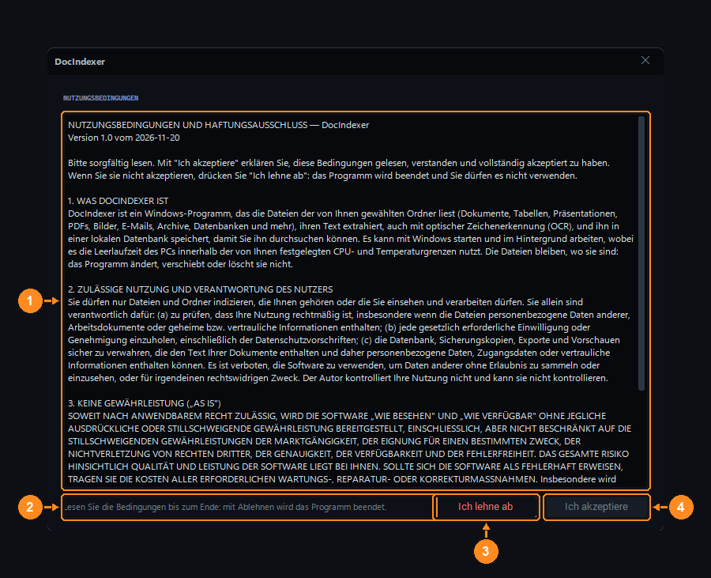

| # | Element | Funktion |
|:--:|---|---|
| **①** | **Text der Bedingungen** | Muss bis zum Ende gescrollt werden. |
| **②** | **Hinweis** | Wird grün, wenn alles gelesen ist. |
| **③** | **Ich lehne ab** | Beendet das Programm. |
| **④** | **Ich akzeptiere** | Wird am Textende aktiv und führt zur Einrichtung. |

**Ich akzeptiere** wird erst aktiv, wenn Sie den Text bis zum Ende gescrollt haben; **Ich lehne ab** (oder das Schließen des Fensters) beendet das Programm. Die Antwort wird gespeichert: Die Bedingungen werden nur erneut abgefragt, wenn sie sich ändern. Mit der Schaltfläche **Nutzungsbedingungen** neben **📖 Handbuch** können Sie sie jederzeit erneut lesen.

### Geführte Einrichtung

Beim ersten Öffnen fragt DocIndexer, wo es suchen soll.

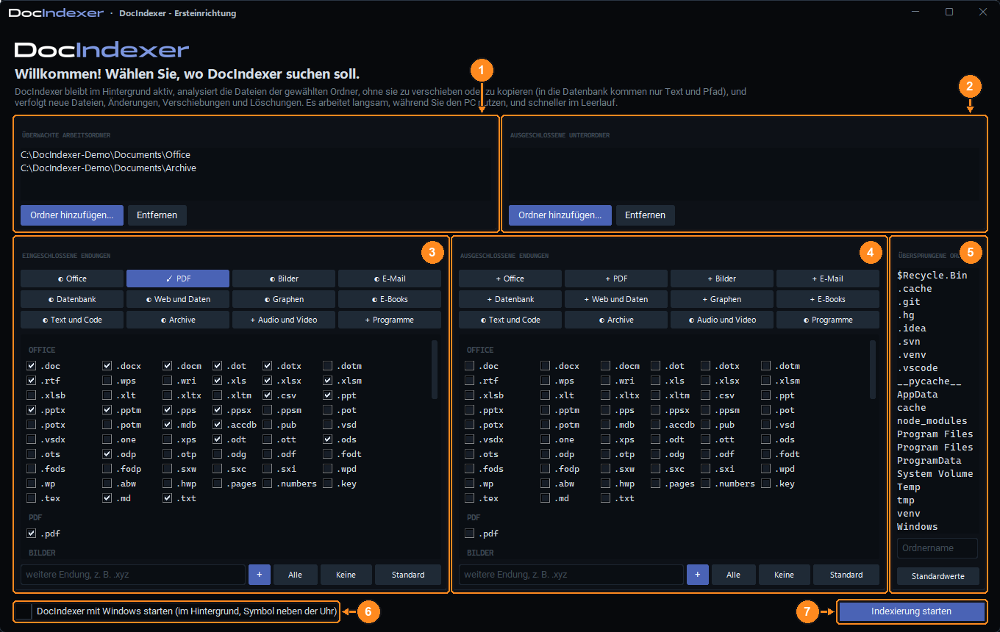

| # | Element | Funktion |
|:--:|---|---|
| **①** | **Überwachte Arbeitsordner** | Die zu indexierenden Ordner: **Ordner hinzufügen...** und **Entfernen**. |
| **②** | **Ausgeschlossene Unterordner** | Teile der gewählten Ordner, die übersprungen werden. |
| **③** | **Eingeschlossene Endungen** | Die zu lesenden Dateitypen; die Kategorie-Schaltflächen wählen sie gruppenweise. |
| **④** | **Ausgeschlossene Endungen** | Dateitypen, die immer ignoriert werden. |
| **⑤** | **Übersprungene Ordner (nach Name)** | Ordner, die überall übersprungen werden (z. B. .git, Temp). |
| **⑥** | **Mit Windows starten** | DocIndexer startet bei der Anmeldung von selbst im Hintergrund. |
| **⑦** | **Indexierung starten** | Speichert die Auswahl und startet die Arbeit. |

1. **Überwachte Arbeitsordner**: Drücken Sie **Ordner hinzufügen...** für jeden Ordner, der indiziert werden soll (zum Beispiel Dokumente oder ein Netzwerkordner); **Entfernen** nimmt ihn aus der Liste.
2. **Ausgeschlossene Unterordner**: bestimmte Ordner innerhalb der überwachten, die nicht analysiert werden sollen.
3. **Eingeschlossene Endungen** und **ausgeschlossene Endungen**: die Dateitypen, die gelesen werden. Die Gruppenschaltflächen (Office, PDF, Bilder, E-Mail, Datenbank, Web und Daten, Graphen, E-Books, Text und Code, Archive, Audio und Video, Programme) haken mit einem Klick die ganze Gruppe an und mit einem weiteren Klick wieder ab; **Alle**, **Keine** und **Standard** tun, was sie sagen. Im Feld unten können Sie eine Endung von Hand hinzufügen.
4. **Übersprungene Ordner (nach Name)**: Ordner, die überall ignoriert werden, etwa `$Recycle.Bin`, `.git` oder `node_modules`.
5. **DocIndexer mit Windows starten**: Ist das Häkchen gesetzt, startet DocIndexer bei der Anmeldung von selbst, nur mit dem Symbol neben der Uhr.

Drücken Sie **Indexierung starten**. Alles, was Sie hier wählen, lässt sich später unter **Einstellungen** ändern.

## 3. Das Hauptfenster

Oben befindet sich die Kopfzeile, die immer sichtbar ist:

- das Logo, die Version und die Angaben des Autors (E-Mail und Website sind anklickbar);
- die **Aktivitätsanzeige**, die sich wie der Equalizer einer Stereoanlage bewegt: Die Höhe der Säulen folgt der CPU, die die Indexierung nutzt, und jede gerade gelesene Datei gibt ihrem Bereich einen Schlag (von links: PDF, Office, Bilder, Text und Sonstiges); rote Spitzen melden einen Fehler. Ohne Arbeit bleibt eine dunkle Linie, in der Pause ist sie bernsteinfarben;
- die Anzahl der Dateien im Index und wie viele davon schon indiziert sind;
- das Menü **Sprache**, das sofort die Sprache des ganzen Programms ändert;
- die Schaltflächen Minimieren, Maximieren und Schließen. **Das Schließen des Fensters beendet DocIndexer nicht**: Das Fenster wird ausgeblendet und die Arbeit geht weiter (siehe [Kapitel 14](#14-symbol-neben-der-uhr-und-start-mit-windows)).

Darunter liegen die Registerkarten **Monitor**, **Suche**, **Wichtig**, **Dokumente**, **Duplikate** und **Einstellungen**. Rechts neben den Registerkarten öffnet **📖 Handbuch** dieses Handbuch in der Sprache des Programms. Daneben zeigt **Nutzungsbedingungen** die beim ersten Start akzeptierten Bedingungen erneut an.

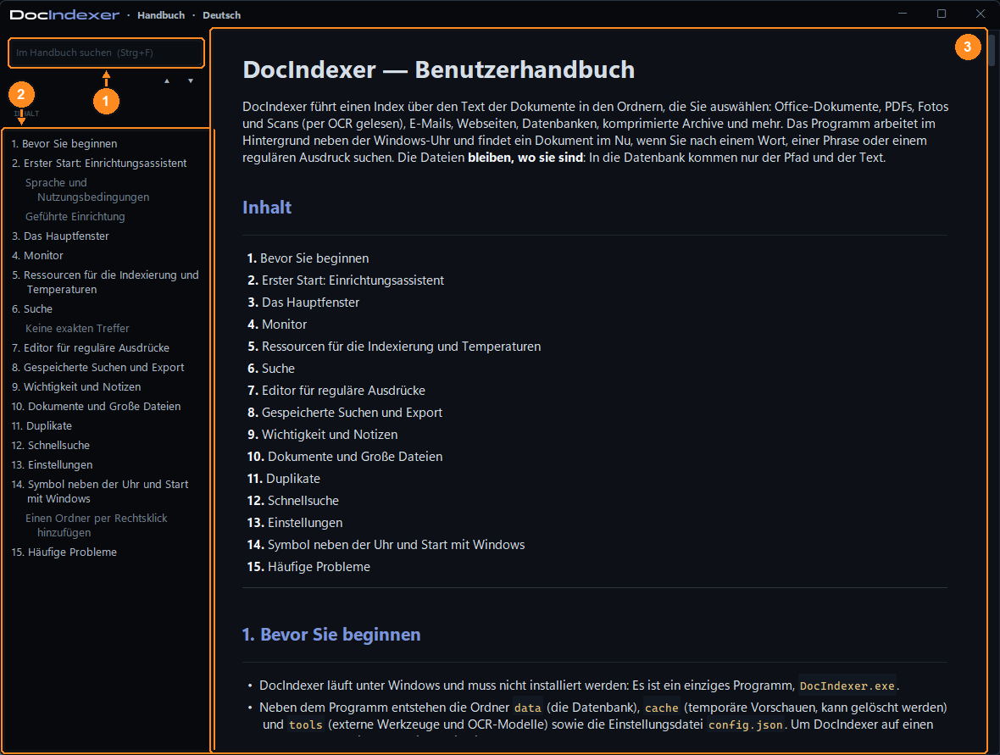

| # | Element | Funktion |
|:--:|---|---|
| **①** | **Im Handbuch suchen (Strg+F)** | Markiert alle Treffer; Eingabe springt zum nächsten. |
| **②** | **Inhalt** | Ein Klick springt zum Kapitel. |
| **③** | **Text** | Das Handbuch; ein Klick auf ein Bild öffnet es in voller Größe. |

Im Handbuchfenster führt das Inhaltsverzeichnis links mit einem Klick zum Kapitel, das Feld **Im Handbuch suchen** (Strg+F) hebt alle Treffer hervor (Eingabe = nächster, Umschalt+Eingabe = vorheriger) und ein Klick auf ein Bild öffnet es in voller Größe. Esc schließt das Fenster.

## 4. Monitor

Der Monitor zeigt, wie weit die Indexierung ist.

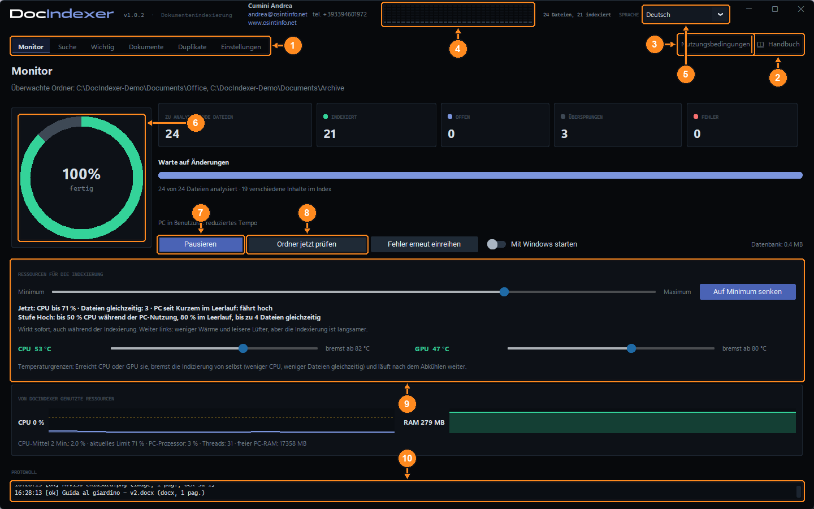

| # | Element | Funktion |
|:--:|---|---|
| **①** | **Registerkarten** | Die Seiten des Programms. |
| **②** | **📖 Handbuch** | Öffnet dieses Handbuch in der Sprache des Programms. |
| **③** | **Nutzungsbedingungen** | Zeigt die beim ersten Start akzeptierten Bedingungen erneut an. |
| **④** | **Equalizer** | Bewegt sich, während DocIndexer arbeitet. |
| **⑤** | **Sprache** | Ändert die Sprache der Oberfläche. |
| **⑥** | **Fortschritt** | Wie viel der Dateien schon analysiert ist. |
| **⑦** | **Pausieren** | Pausiert die Indexierung und setzt sie fort. |
| **⑧** | **Ordner jetzt prüfen** | Sucht sofort nach neuen oder geänderten Dateien. |
| **⑨** | **Ressourcen für die Indexierung** | Wie viel CPU genutzt wird und Temperaturgrenzen (Kapitel 5). |
| **⑩** | **Protokoll** | Die Arbeitsmeldungen, Datei für Datei. |

- **Überwachte Ordner**: die Liste unter dem Titel.
- **Kreisdiagramm** und Felder: **Zu analysierende Dateien** (alle gefundenen Dateien), **Indexiert**, **Offen**, **Übersprungen** (ohne lesbaren Text oder ausgeschlossen) und **Fehler**.
- Aktuelle **Phase**: Dateien zählen, Prüfsummen berechnen, Text extrahieren oder *Warte auf Änderungen*, wenn alles erledigt ist. Darunter stehen der Fortschrittsbalken, die Datei, an der gerade gearbeitet wird, und das aktuelle Tempo: *PC in Benutzung: reduziertes Tempo*, *PC im Leerlauf: volles Tempo*, *PC ausgelastet: wartet* (andere Programme nutzen schon viel CPU) oder *Akkubetrieb: minimales Tempo*.
- **Pausieren / Fortsetzen** hält die Indexierung an und startet sie wieder.
- **Ordner jetzt prüfen** sucht sofort nach neuen, geänderten, verschobenen oder gelöschten Dateien (DocIndexer tut das auch von selbst beim Start und alle paar Stunden und verfolgt Änderungen in Echtzeit, solange es läuft).
- **Fehler erneut einreihen** versucht die Dateien erneut, die nicht gelesen werden konnten.
- **Mit Windows starten** schaltet den automatischen Start sofort ein oder aus.
- **Datenbank**: die aktuelle Größe der Datenbank.
- **Protokoll**: unten auf der Seite die letzten Vorgänge.

So funktioniert es: Zuerst werden die Dateien gezählt, dann wird für jede ein Fingerabdruck des Inhalts (SHA-256) berechnet und der Text extrahiert. Eine Datei, die mit einer schon gelesenen identisch ist, wird nicht erneut analysiert; bei einer verschobenen oder umbenannten Datei ändert sich nur der Pfad im Index; eine gelöschte Datei wird entfernt.

Wenn Sie alle überwachten Ordner entfernen, nimmt DocIndexer ihre Dateien aus dem Index und der Monitor wird zurückgesetzt: Diagramm, Zähler und Fortschritt beginnen wieder bei null, bis Sie einen neuen Ordner hinzufügen.

## 5. Ressourcen für die Indexierung und Temperaturen

Im Monitor legt der Bereich **Ressourcen für die Indexierung** fest, wie viel vom PC DocIndexer nutzen darf.

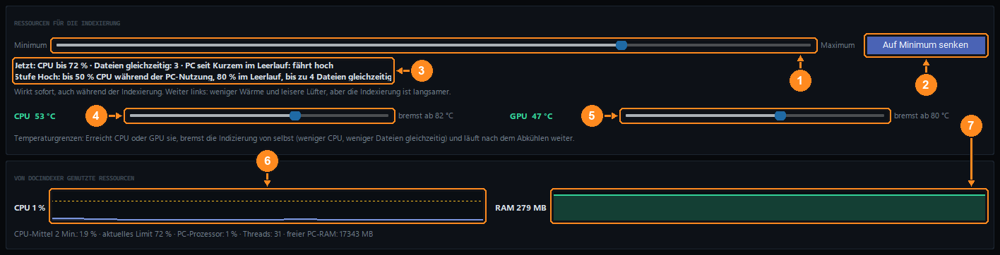

| # | Element | Funktion |
|:--:|---|---|
| **①** | **Ressourcenstufe** | Von Minimum bis Maximum; gilt sofort. |
| **②** | **Auf Minimum senken** | Stellt die Stufe ganz nach links. |
| **③** | **Jetzt** | Was die gewählte Stufe gerade bewirkt. |
| **④** | **CPU-Grenze** | Über dieser Temperatur wird die Indexierung langsamer. |
| **⑤** | **GPU-Grenze** | Dasselbe für die Grafikkarte. |
| **⑥** | **CPU-Diagramm** | Von DocIndexer genutzte CPU; die gestrichelte Linie ist die Grenze. |
| **⑦** | **RAM-Diagramm** | Von DocIndexer genutzter Speicher. |

Der **Schieberegler** reicht von **Minimum** bis **Maximum** und wirkt sofort, auch während der Indexierung. Weiter links bedeutet weniger Wärme und leisere Lüfter, aber eine langsamere Indexierung. **Auf Minimum senken** stellt den Regler mit einem Klick ganz nach links.

| Stufe | CPU während der PC-Nutzung | CPU im Leerlauf | Hinweise |
|---|---|---|---|
| Minimum | 5 % | 5 % | eine Datei nach der anderen, Windows-Energiesparen |
| Niedrig | 10 % | 25 % | eine Datei nach der anderen, Windows-Energiesparen |
| Mittel | 25 % | 60 % | zwei Dateien gleichzeitig |
| Hoch | 50 % | 80 % | mehrere Dateien gleichzeitig (etwa die Hälfte der Kerne) |
| Maximum | 90 % | 100 % | fast alle Kerne |

Unter dem Regler sagen zwei Zeilen, was gerade passiert (zum Beispiel *Jetzt: CPU bis 60 % · Dateien gleichzeitig: 2 · PC im Leerlauf: volle Leistung*) und was die gewählte Stufe vorsieht.

**PC im Leerlauf**: Wenn Sie einige Minuten weder Tastatur noch Maus benutzen (standardmäßig 3, änderbar in den Einstellungen), steigt die Grenze allmählich bis zum Leerlaufwert; sobald Sie zurück sind, sinkt sie wieder. Auch während Sie im DocIndexer-Fenster tippen oder klicken, tritt die Indexierung einige Sekunden zurück, damit Suche und Vorschau schnell bleiben.

**Temperaturen**: Die Zeilen **CPU** und **GPU** zeigen die aktuelle Temperatur (grün, bernsteinfarben in der Nähe der Grenze, rot bei Erreichen) und einen Regler mit der Grenze von 50 bis 100 °C (standardmäßig 82 °C für die CPU und 80 °C für die GPU). Ist die Grenze erreicht, bremst die Indexierung von selbst (weniger CPU, weniger Dateien gleichzeitig) und läuft weiter, wenn das Bauteil abgekühlt ist. Kann ein Sensor nicht gelesen werden, erscheint *nicht verfügbar*.

Der Bereich **Von DocIndexer genutzte Ressourcen** zeigt CPU und RAM, die das Programm in den letzten zwei Minuten genutzt hat; die gestrichelte Linie ist die geltende CPU-Grenze. Darunter stehen der Durchschnitt, die aktuelle Grenze, die gesamte Prozessorlast und der freie Arbeitsspeicher des PCs.

## 6. Suche

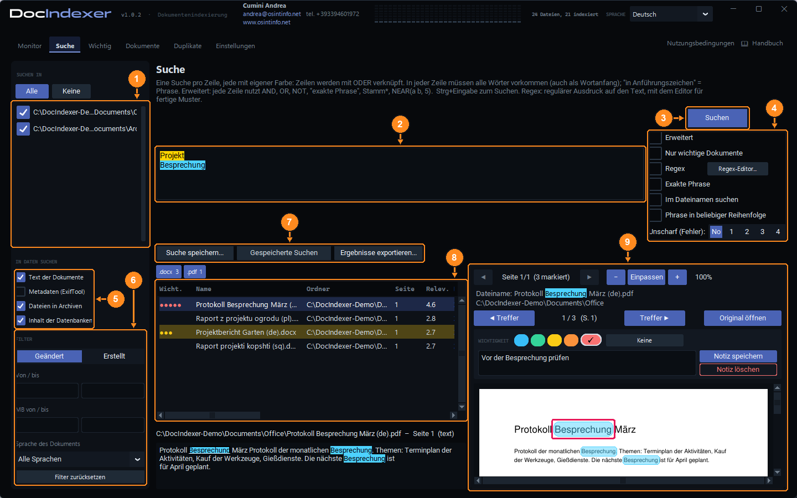

| # | Element | Funktion |
|:--:|---|---|
| **①** | **Suchen in** | Die Ordner, in denen gesucht wird (**Alle** / **Keine**). |
| **②** | **Suchfeld** | Eine Suche pro Zeile, jede in eigener Farbe. |
| **③** | **Suchen** | Startet die Suche (auch Strg+Eingabe). |
| **④** | **Optionen** | Erweitert, Regex mit Editor, exakte Phrase, Dateiname, unscharf. |
| **⑤** | **In den Daten suchen** | Text, Metadaten, Archive und Datenbanken, die einbezogen werden. |
| **⑥** | **Filter** | Datum, Größe und Sprache; **Filter zurücksetzen** entfernt sie. |
| **⑦** | **Speichern und exportieren** | Speichert die Suche, öffnet die gespeicherten Suchen, exportiert die Ergebnisse. |
| **⑧** | **Ergebnisse** | Ein Klick zeigt das Dokument in der Vorschau. |
| **⑨** | **Vorschau** | Seiten, markierte Treffer, Wichtigkeit und Notiz, **Original öffnen**. |

**Was Sie eingeben.** Schreiben Sie in das große Feld eine Suche pro Zeile; jede Zeile hat ihre eigene Farbe, die Sie in den Ergebnissen und in der Vorschau wiederfinden, und die Zeilen gelten als Alternativen (eine genügt). In einer Zeile müssen alle Wörter vorkommen, auch als Wortanfang; Groß- und Kleinschreibung und Akzente spielen keine Rolle; eine Phrase „in Anführungszeichen“ wird genau so gesucht. Drücken Sie **Suchen** oder Strg+Eingabe.

**Optionen** rechts neben dem Feld:

- **Erweitert**: Jede Zeile nutzt die volle Syntax: `AND`, `OR`, `NOT`, `"exakte Phrase"`, `Stamm*`, `NEAR(a b, 5)`.
- **Nur wichtige Dokumente**: nur die Dateien, denen Sie eine Farbe gegeben haben (siehe [Kapitel 9](#9-wichtigkeit-und-notizen)).
- **Regex**: Die Zeile ist ein regulärer Ausdruck, der im Text gesucht wird; **Regex-Editor...** öffnet den Editor (siehe [Kapitel 7](#7-editor-für-reguläre-ausdrücke)). Eine lange Regex-Suche lässt sich mit **Suche stoppen** anhalten.
- **Exakte Phrase**, **Im Dateinamen suchen**, **Phrase in beliebiger Reihenfolge**.
- **Unscharf (Fehler)**: akzeptiert 1 bis 4 Fehler pro Wort, auch typische OCR-Verwechslungen (0/o, 1/l, rn/m). Findet eine normale Suche nichts, versucht DocIndexer es von selbst mit einem tolerierten Fehler und weist darauf hin.

**Links** wählen Sie, **wo** gesucht wird:

- **Suchen in**: die überwachten Ordner, die durchsucht werden (**Alle** / **Keine**).
- **In Daten suchen**: Text der Dokumente, Metadaten (ExifTool), Dateien in Archiven, Inhalt der Datenbanken.
- **Filter**: Zeitraum (**Geändert** oder **Erstellt**, Datum im Format jjjj-mm-tt, auch nur jjjj oder jjjj-mm), Größe in MB, **Sprache des Dokuments** (für jede Datei automatisch erkannt). **Filter zurücksetzen** entfernt alle.

**Die Ergebnisse.** Über der Tabelle gibt es für jeden gefundenen Dateityp (.pdf, .docx...) eine Schaltfläche mit der Zahl der Ergebnisse: Ein Klick blendet diesen Typ aus oder ein, **Alle** und **Keine** ändern alle. Die Spalten sind Wichtigkeit, Name, Ordner, Seite, Relevanz, Erstellungsdatum und ein Auszug mit den farbigen Wörtern; ein Klick auf den Spaltenkopf sortiert. Unter der Tabelle steht der extrahierte Text der gefundenen Seite mit den hervorgehobenen Wörtern.

**Die Vorschau** rechts zeigt die echte Seite des Dokuments mit umrahmten Treffern: Die Pfeile wechseln die Seite, **−**, **Einpassen** und **+** ändern den Zoom (auch mit dem Mausrad), **◀ Treffer** und **Treffer ▶** springen von Fundstelle zu Fundstelle, **Original öffnen** (oder ein Doppelklick auf das Ergebnis) öffnet die Datei mit ihrem Programm. Bei Office-Dokumenten wird die Vorschau mit Office erstellt und kann einige Sekunden dauern.

**Den Ordner eines Treffers öffnen.** Ein Klick auf die Zelle **Ordner** eines Treffers öffnet den Ordner im Datei-Explorer, mit der Datei bereits markiert. Das gilt auch in den Registerkarten **Dokumente** und **Wichtig**.

### Keine exakten Treffer

Findet eine Suche nichts, versucht DocIndexer es von selbst erneut und toleriert dabei einen Tipp- oder OCR-Fehler pro Wort. Dann erscheint über den Ergebnissen ein roter Hinweis, der einige Male blinkt: **Keine exakten Treffer: Ergebnisse mit 1 Tipp- oder OCR-Fehler**. Prüfen Sie die Ergebnisse: Sie können Wörter enthalten, die dem gesuchten ähneln.

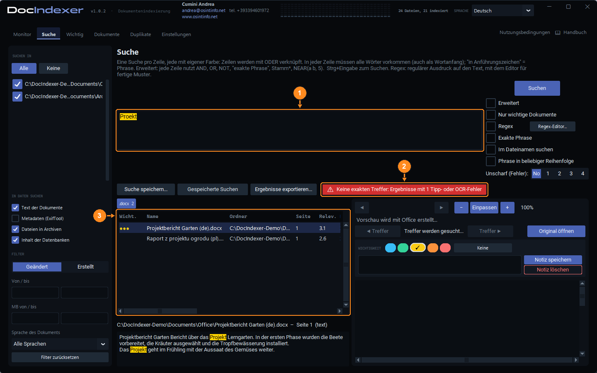

| # | Element | Funktion |
|:--:|---|---|
| **①** | **Suche mit Tippfehler** | Hier fehlt ein Buchstabe. |
| **②** | **Roter Hinweis** | Blinkt: keine exakten Treffer, angezeigt werden die mit 1 Fehler. |
| **③** | **Ergebnisse** | Die Dokumente mit dem richtigen Wort. |

## 7. Editor für reguläre Ausdrücke

Ein regulärer Ausdruck (Regex) sucht nach einem *Muster* statt nach einem Wort: zum Beispiel nach einem beliebigen Datum, einer beliebigen Webadresse oder einem Code in einem bestimmten Format.

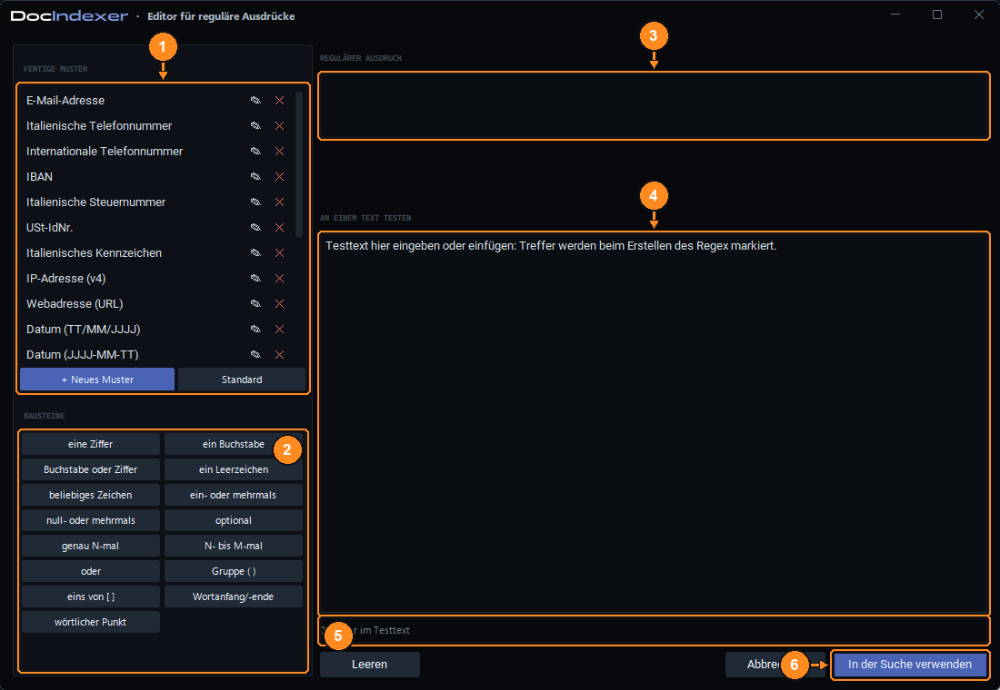

| # | Element | Funktion |
|:--:|---|---|
| **①** | **Fertige Muster** | Fertige Muster: ein Klick verwendet es; **+ Neues Muster** fügt eins hinzu. |
| **②** | **Bausteine** | Bausteine zum Einfügen ohne Syntaxkenntnisse. |
| **③** | **Regulärer Ausdruck** | Die Regex, die Sie zusammenstellen. |
| **④** | **An einem Text testen** | Testtext: Treffer werden sofort markiert. |
| **⑤** | **Anzahl** | Wie viele Treffer der Testtext hat. |
| **⑥** | **In der Suche verwenden** | Übernimmt die Regex in die Suchseite. |

- **Fertige Muster**: bereits geschriebene Muster, darunter E-Mail-Adresse, Telefonnummern, IBAN, italienische Steuernummer und USt-IdNr., Kfz-Kennzeichen, IP-Adresse, URL, Datum, Uhrzeit, Beträge, GPS-Koordinaten, Hashtags und Benutzernamen. Ein Klick setzt es ins Feld; eigene fügen Sie mit **Neues Muster** hinzu, und mit **Standard** kehren Sie zur ursprünglichen Liste zurück.
- **Bausteine**: Teile zum Zusammensetzen, ohne die Syntax zu kennen (eine Ziffer, ein Buchstabe, ein- oder mehrmals, optional, „oder“, Gruppen, Wortanfang/-ende...).
- **Regulärer Ausdruck**: das Feld mit dem Muster; darunter eine Erklärung in Worten, wonach es sucht.
- **An einem Text testen**: Schreiben oder fügen Sie einen Probetext ein; die Treffer werden beim Tippen hervorgehoben. **Leeren** löscht den Text.

**In der Suche verwenden** übernimmt das Muster in die Seite Suche, mit eingeschalteter Option Regex, und startet die Suche.

## 8. Gespeicherte Suchen und Export

**Suche speichern...** (unter dem Suchfeld) speichert die aktuelle Suche unter einem Namen, zusammen mit Optionen und Filtern. Wenn Sie **Benachrichtigen, wenn neue Dateien zu dieser Suche passen** anhaken, wiederholt DocIndexer sie von selbst, sobald es neue Dateien indiziert, und zeigt eine Windows-Benachrichtigung neben der Uhr.

| # | Element | Funktion |
|:--:|---|---|
| **①** | **Benachrichtigen** | Wiederholt die Suche bei neuen Dateien und meldet sich neben der Uhr. |
| **②** | **Öffnen** | Setzt die Suche in die Suchseite und führt sie aus. |
| **③** | **✕** | Löscht die gespeicherte Suche. |
| **④** | **Jetzt prüfen** | Wiederholt sofort die Suchen mit Benachrichtigung. |

**Gespeicherte Suchen** öffnet die Liste: Für jede sehen Sie die Benachrichtigung (an oder aus), wie viele neue Dateien sie gefunden hat und wann sie geprüft wurde. **Öffnen** holt sie in die Seite Suche und führt sie aus, **Nur neue** zeigt nur die seit dem letzten Mal hinzugekommenen Dateien, **Jetzt prüfen** wiederholt sie sofort; man kann sie auch löschen. Gibt es neue Dateien, zeigt die Schaltfläche Gespeicherte Suchen, wie viele.

**Ergebnisse exportieren...** speichert die Ergebnisse als **Excel** (.xlsx, Zeilen nach Wichtigkeit eingefärbt), **CSV** (Trennzeichen `;`, öffnet sich in Excel) oder **PDF**, mit Wichtigkeit und Notizen. Dieselbe Schaltfläche **Exportieren...** gibt es in Dokumente, Wichtig und Duplikate.

## 9. Wichtigkeit und Notizen

In der Vorschau, unter dem Dateinamen, kann jedes Dokument eine **Wichtigkeitsfarbe** (hellblau, grün, gelb, orange, rot, vom am wenigsten bis zum wichtigsten; **Keine** entfernt sie) und eine von Ihnen geschriebene **Notiz** erhalten (**Notiz speichern**, **Notiz löschen**).

Farbe und Notiz gehören zum **Inhalt** der Datei (ihrem SHA-256-Fingerabdruck), nicht zu ihrem Pfad. Wenn Sie die Datei verschieben oder umbenennen, auch bei geschlossenem DocIndexer oder auf ein anderes Laufwerk, sind sie wieder da, sobald die Datei erneut geprüft wird. Identische Kopien derselben Datei haben dieselbe Farbe und dieselbe Notiz: Ändern Sie sie bei einer Kopie, ändern sie sich bei allen. Wenn Sie die Datei bearbeiten, bleiben Farbe und Notiz erhalten.

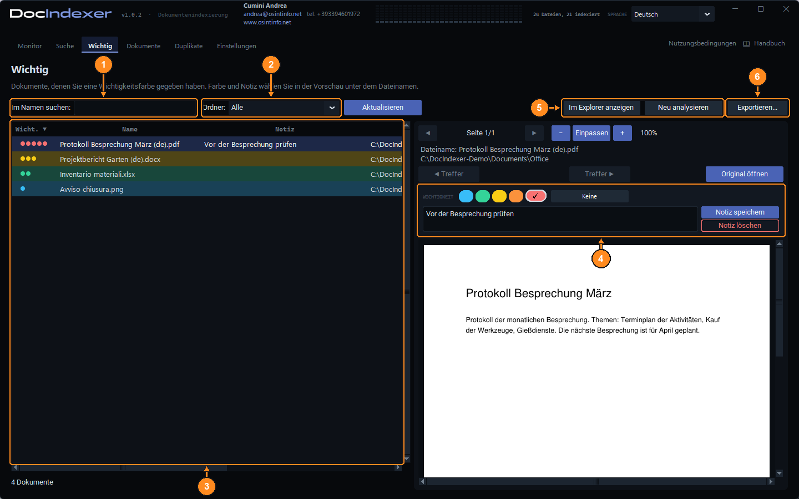

| # | Element | Funktion |
|:--:|---|---|
| **①** | **Im Namen suchen** | Filtert die Liste beim Tippen. |
| **②** | **Ordner** | Zeigt nur einen überwachten Ordner. |
| **③** | **Liste** | Die farbig markierten Dokumente, die wichtigsten oben, mit Notiz. |
| **④** | **Wichtigkeit** | Fünf Farben und eine Notiz; **Notiz speichern** sichert sie. |
| **⑤** | **Anzeigen und neu analysieren** | Öffnet den Ordner der Datei oder stellt sie neu in die Warteschlange. |
| **⑥** | **Exportieren** | Speichert die Liste als CSV, Excel oder HTML. |

Die Registerkarte **Wichtig** listet nur die eingefärbten Dokumente auf, die wichtigsten oben, mit der Notiz. In allen Listen erscheint die Farbe als Punkte am Zeilenanfang und die Zeile ist leicht getönt. In der Suche beschränkt die Option **Nur wichtige Dokumente** die Suche auf diese Dateien.

## 10. Dokumente und Große Dateien

Die Registerkarte **Dokumente** listet alle indizierten Dateien auf.

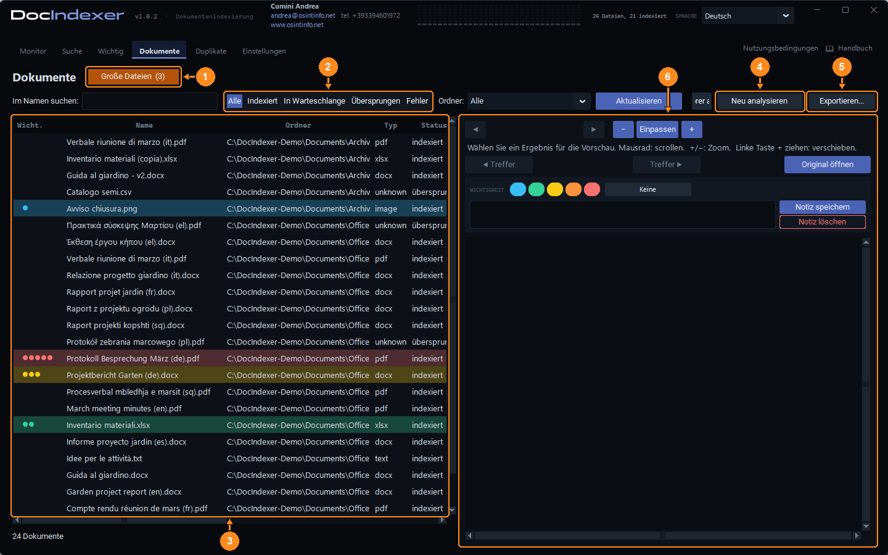

| # | Element | Funktion |
|:--:|---|---|
| **①** | **Große Dateien** | Dateien über der Größengrenze, die auf eine Entscheidung warten. |
| **②** | **Status** | Alle, indexiert, wartend, übersprungen oder fehlerhaft. |
| **③** | **Liste** | Alle gefundenen Dateien mit Ordner, Typ und Status. |
| **④** | **Neu analysieren** | Stellt die gewählte Datei neu in die Warteschlange. |
| **⑤** | **Exportieren** | Speichert die Liste als CSV, Excel oder HTML. |
| **⑥** | **Vorschau** | Das gewählte Dokument mit Wichtigkeit und Notiz. |

- **Im Namen suchen**: filtert die Liste beim Tippen.
- **Alle / Indexiert / In Warteschlange / Übersprungen / Fehler**: filtert nach Status. **Ordner** filtert nach überwachtem Ordner. **Aktualisieren** lädt die Liste neu.
- Die Spalten zeigen Wichtigkeit, Name, Ordner, Typ, Status, Sprache, Seiten, per OCR gelesene Seiten, Zeichen, Erstellungs- und Änderungsdatum und den SHA-256-Fingerabdruck. Ein Klick auf den Spaltenkopf sortiert; fährt man über eine abgeschnittene Zelle, erscheint der ganze Text.
- Sie können mehrere Zeilen auswählen (Strg oder Umschalt + Klick, Strg+A). **Im Explorer anzeigen** öffnet den Ordner der Datei, **Neu analysieren** liest die ausgewählten Dateien erneut, **Exportieren...** speichert die Liste. Ein Doppelklick öffnet die Datei.
- Ein Klick auf die Zelle **Ordner** öffnet den Ordner im Datei-Explorer mit der markierten Datei (auch in der Registerkarte **Wichtig**).

**Große Dateien.** Dateien über der eingestellten Grenze (standardmäßig 200 MB) werden nicht automatisch analysiert: Die Schaltfläche **Große Dateien** wird orange und zeigt, wie viele warten.

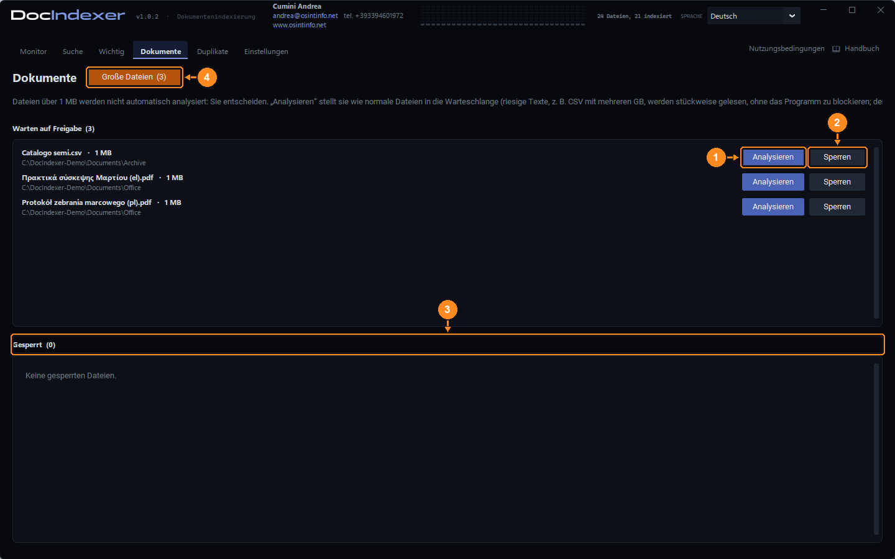

| # | Element | Funktion |
|:--:|---|---|
| **①** | **Analysieren** | Stellt die Datei wie die anderen in die Warteschlange. |
| **②** | **Sperren** | Legt sie beiseite, ohne sie zu analysieren. |
| **③** | **Gesperrt** | Die gesperrten Dateien; **Entsperren** stellt sie wieder zurück. |
| **④** | **Große Dateien** | Zurück zur Dokumentliste. |

Wählen Sie für jede wartende Datei **Analysieren** (sie kommt wie eine normale Datei in die Warteschlange; riesige Texte werden stückweise gelesen, ohne das Programm zu blockieren, aber der Index kann stark wachsen) oder **Sperren** (beiseitegelegt). In der Liste **Gesperrt** setzt **Entsperren** sie wieder auf Warten. **← Dokumente** kehrt zur Liste zurück.

## 11. Duplikate

Die Registerkarte **Duplikate** findet zwei Arten von Kopien. Drücken Sie **Duplikate suchen**.

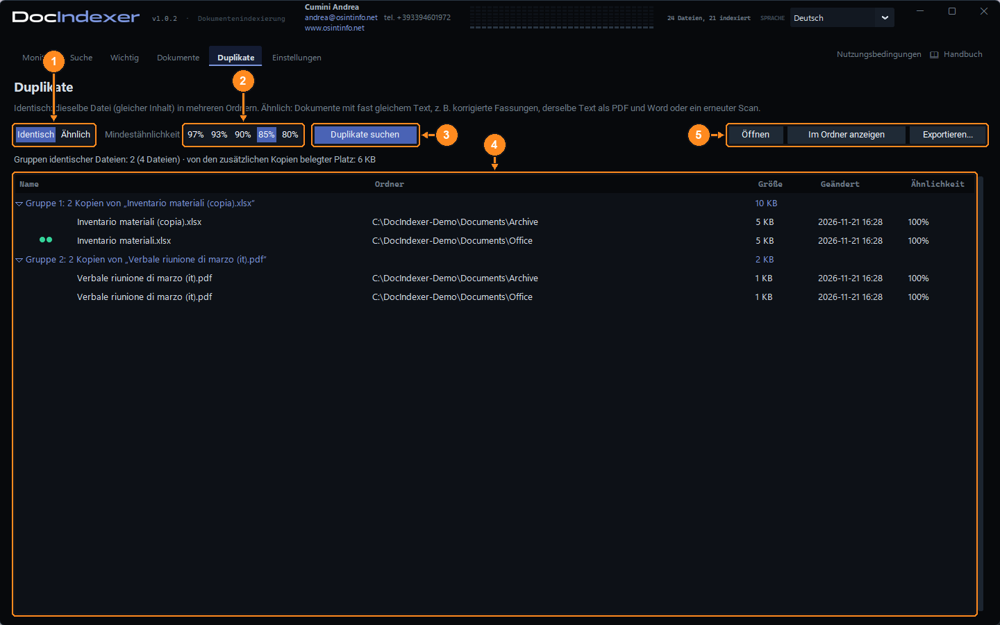

| # | Element | Funktion |
|:--:|---|---|
| **①** | **Identisch / Ähnlich** | Gleiche Datei oder fast gleicher Text. |
| **②** | **Mindestähnlichkeit** | Wie ähnlich die Dokumente sein müssen. |
| **③** | **Duplikate suchen** | Startet die Suche. |
| **④** | **Gruppen** | Eine Gruppe pro Kopiensatz, mit belegtem Speicher. |
| **⑤** | **Öffnen, anzeigen, exportieren** | Für die gewählte Datei oder die ganze Liste. |

- **Identisch**: dieselbe Datei (gleicher Inhalt) in mehreren Ordnern. Jede Gruppe zeigt die Zahl der Kopien und den belegten Platz; oben steht der gesamte Platz, den die überzähligen Kopien belegen.

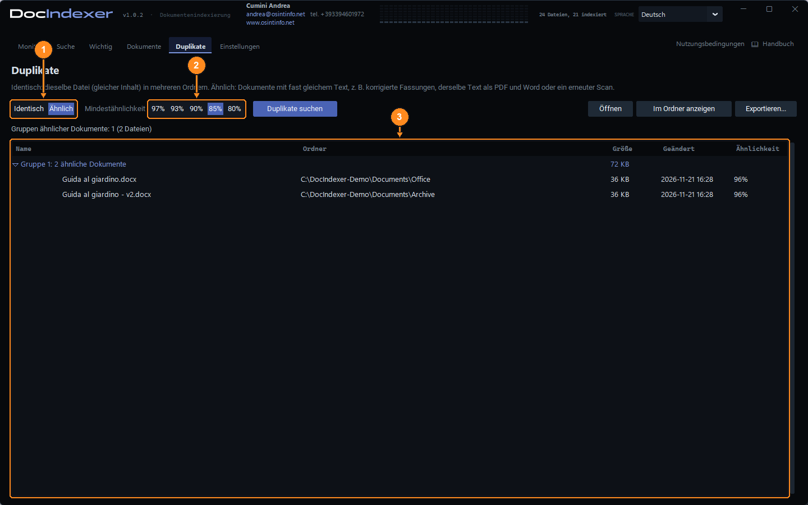

| # | Element | Funktion |
|:--:|---|---|
| **①** | **Ähnlich** | Dokumente mit fast gleichem Text. |
| **②** | **Mindestähnlichkeit** | Von 97 % bis 80 %: niedriger findet mehr Paare. |
| **③** | **Gruppen** | Die Spalte Ähnlichkeit zeigt den Wert jeder Datei. |

- **Ähnlich**: Dokumente mit fast gleichem Text, zum Beispiel korrigierte Fassungen desselben Dokuments, derselbe Text als PDF und in Word oder ein neu erstellter Scan. **Mindestähnlichkeit** legt fest, wie ähnlich sie sein müssen (von 97 % bis 80 %); die Spalte Ähnlichkeit zeigt den Wert jeder Datei.

**Öffnen**, **Im Ordner anzeigen** und **Exportieren...** wirken auf die ausgewählte Datei oder auf die Liste.

## 12. Schnellsuche

Die Schnellsuche ist eine Suchleiste, die sich über jedem Programm öffnet, mit dem Tastenkürzel **Strg+Alt+D** (in den Einstellungen änderbar) oder über das Menü des Symbols neben der Uhr.

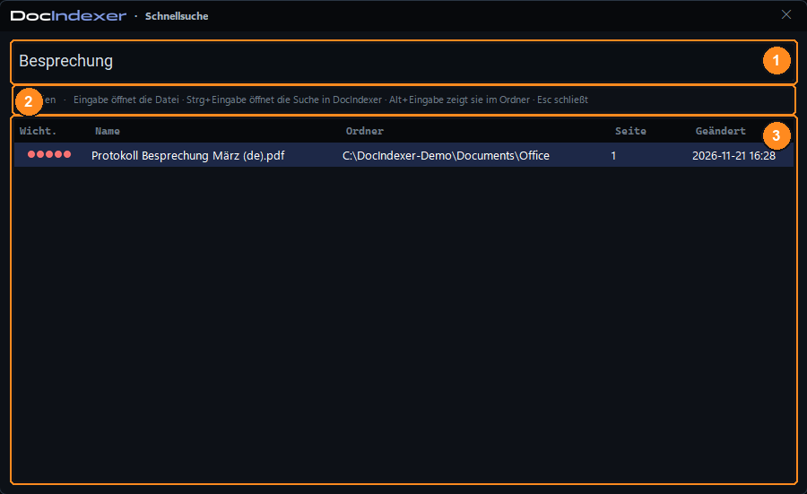

| # | Element | Funktion |
|:--:|---|---|
| **①** | **Suchfeld** | Sucht beim Tippen. |
| **②** | **Tasten** | Eingabe, Strg+Eingabe, Alt+Eingabe, Esc. |
| **③** | **Ergebnisse** | Mit den Pfeiltasten die Datei wählen. |

Sie sucht schon beim Tippen. Wählen Sie mit den Pfeiltasten ein Ergebnis; **Eingabe** öffnet die Datei, **Strg+Eingabe** öffnet die vollständige Suche in DocIndexer, **Alt+Eingabe** zeigt die Datei in ihrem Ordner, **Esc** schließt die Leiste.

## 13. Einstellungen

Änderungen gelten erst nach **Speichern**. **Änderungen verwerfen** kehrt zu den gespeicherten Einstellungen zurück; **Standardeinstellungen wiederherstellen** stellt die Werkswerte her. Wechseln Sie mit ungespeicherten Änderungen die Registerkarte, fragt DocIndexer, ob sie gespeichert werden sollen.

**Ordner und Endungen** enthält dieselben Tabellen wie der Einrichtungsassistent: überwachte Ordner, ausgeschlossene Unterordner, eingeschlossene und ausgeschlossene Endungen, nach Name übersprungene Ordner.

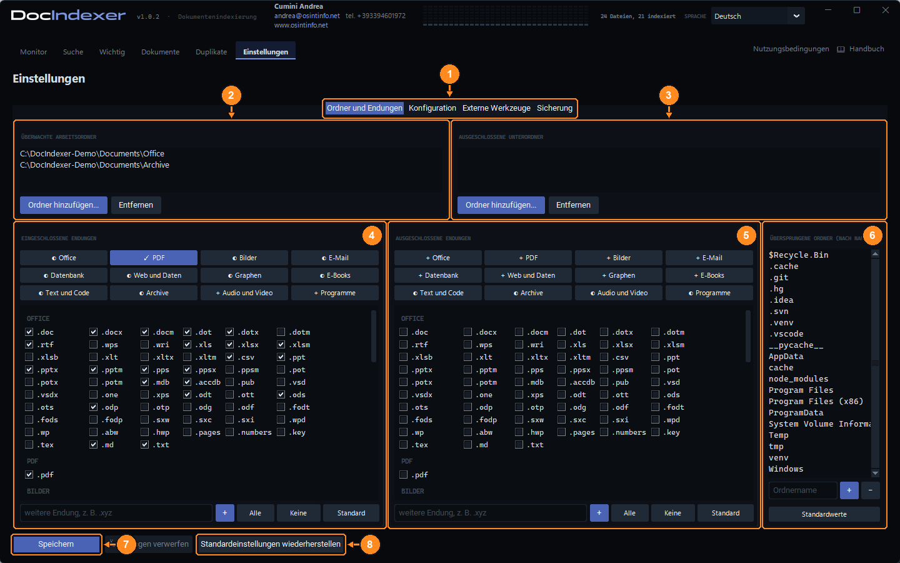

| # | Element | Funktion |
|:--:|---|---|
| **①** | **Registerkarten der Einstellungen** | Ordner, Konfiguration, externe Werkzeuge, Sicherung. |
| **②** | **Überwachte Arbeitsordner** | Die zu indexierenden Ordner. |
| **③** | **Ausgeschlossene Unterordner** | Teile der Ordner, die übersprungen werden. |
| **④** | **Eingeschlossene Endungen** | Die zu lesenden Dateitypen. |
| **⑤** | **Ausgeschlossene Endungen** | Die zu ignorierenden Dateitypen. |
| **⑥** | **Übersprungene Ordner (nach Name)** | Ordner, die überall übersprungen werden. |
| **⑦** | **Speichern** | Übernimmt die Änderungen. |
| **⑧** | **Standardeinstellungen wiederherstellen** | Zurück zu den Anfangswerten. |

**Konfiguration**:

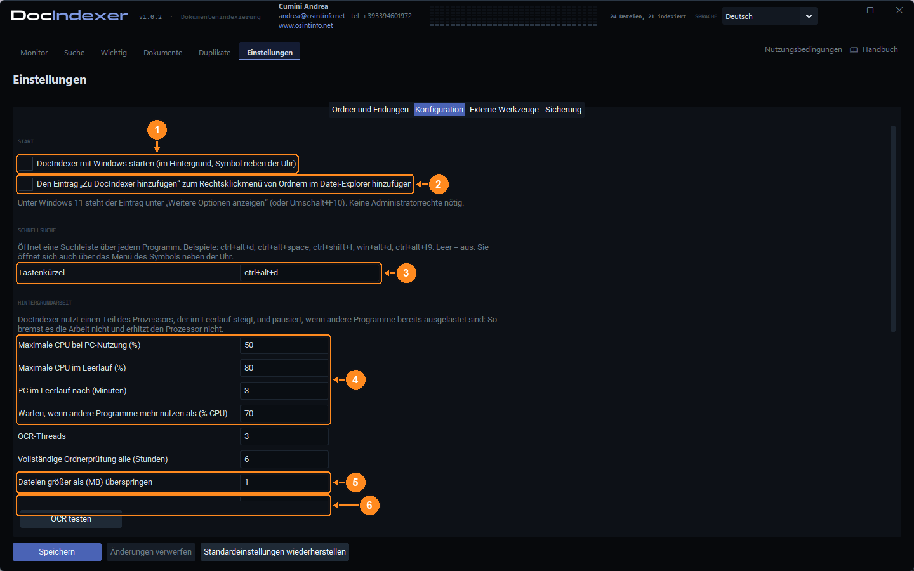

| # | Element | Funktion |
|:--:|---|---|
| **①** | **Mit Windows starten** | Gilt sofort, ohne Speichern. |
| **②** | **Zu DocIndexer hinzufügen** | Rechtsklick-Eintrag für Ordner im Datei-Explorer; gilt sofort. |
| **③** | **Tastenkürzel** | Die Tasten der Schnellsuche (leer = aus). |
| **④** | **Hintergrundarbeit** | CPU bei genutztem und ruhendem PC, Wartezeit, ausgelastete Programme. |
| **⑤** | **Dateien größer als (MB) überspringen** | Über dieser Grenze landen Dateien unter **Große Dateien**. |
| **⑥** | **Größe der Oberfläche (%) — 100 = wie der Windows-Zoom** | 100 = wie andere Windows-Apps; mehr vergrößert, weniger verkleinert. |

- **Start**: Start mit Windows (gilt sofort).
- **Zu DocIndexer hinzufügen**: fügt den Eintrag zum Rechtsklickmenü von Ordnern im Datei-Explorer hinzu; gilt sofort, ohne Speichern (siehe Kapitel 14).
- **Schnellsuche**: das Tastenkürzel, zum Beispiel `ctrl+alt+d`, `ctrl+shift+f` oder `win+alt+d`; leer = aus. Wird das Kürzel schon von einem anderen Programm verwendet, erscheint ein Hinweis.
- **Hintergrundarbeit**: maximale CPU während der PC-Nutzung und im Leerlauf, nach wie vielen Minuten der PC als untätig gilt, ab welcher Last anderer Programme DocIndexer wartet, OCR-Threads, alle wie viele Stunden alle Ordner erneut geprüft werden, maximale Dateigröße (größere landen in **Große Dateien**), Größe der Oberfläche (in %, 100 = wie der Windows-Zoom, also so groß wie andere Apps; gilt ab dem nächsten Start). Die ersten Werte ändern sich auch mit dem Regler im Monitor.
- **Zusatzmodule**: Metadaten mit ExifTool, Text von Dateien in Archiven (7-Zip), SQLite-, dBASE/FoxPro- und Access-Datenbanken. Jedes Modul speichert seine Daten getrennt; in der Suche wählen Sie, worin gesucht wird.
- **OCR (RapidOCR)**: das Modell. **Automatisch** liest die erste gescannte Seite mit dem lateinischen Modell und probiert bei einem unsicheren Ergebnis die anderen heruntergeladenen Modelle aus; es behält das, das am besten liest. Eine höhere **OCR-Auflösung (DPI)** liest kleine Schrift besser, ist aber langsamer. **OCR testen** macht eine Probe.
- **SQLite-Datenbanken**: die Datenbankdatei.

**Externe Werkzeuge** zeigt den Zustand der OCR-Modelle und der optionalen Werkzeuge (ExifTool, 7-Zip, Access-Treiber). **Installieren** oder **Neu installieren** lädt ein Werkzeug in den Ordner `tools`, **Alles Fehlende installieren** lädt alle, **Erneut prüfen** aktualisiert den Zustand. Sie funktionieren ohne Installation im System.

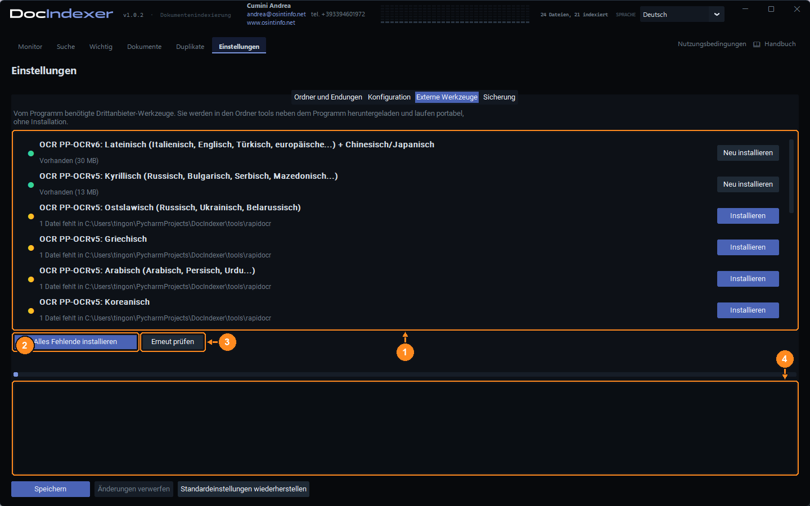

| # | Element | Funktion |
|:--:|---|---|
| **①** | **Werkzeuge** | Jedes Werkzeug mit Status und Schaltfläche zum Installieren. |
| **②** | **Alles Fehlende installieren** | Lädt alle fehlenden Werkzeuge auf einmal herunter. |
| **③** | **Erneut prüfen** | Liest den Status der Werkzeuge neu. |
| **④** | **Protokoll** | Fortschritt und Meldungen der Downloads. |

**Sicherung**: **Sicherung erstellen...** speichert die Datenbank (Index, Notizen, Wichtigkeitsfarben), die Einstellungen, die Regex-Muster und die gespeicherten Suchen in einer .zip-Datei, auch während die Indexierung läuft. **Aus Sicherung wiederherstellen...** ersetzt sie und startet DocIndexer neu; die vorherige Datenbank bleibt mit der Endung `.before-restore` daneben liegen.

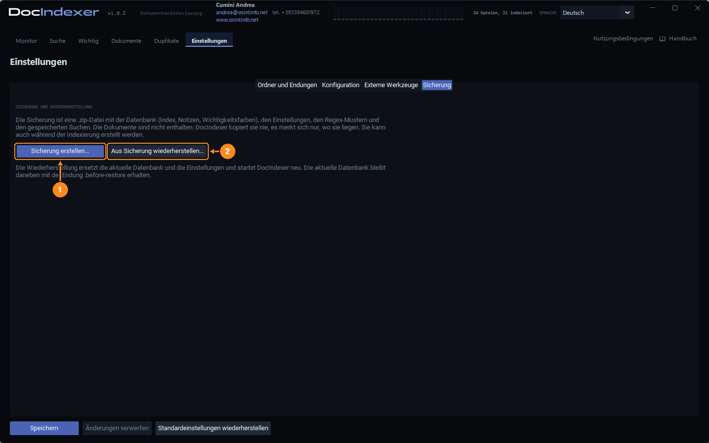

| # | Element | Funktion |
|:--:|---|---|
| **①** | **Sicherung erstellen** | Speichert Datenbank, Einstellungen, Muster und Suchen in einer .zip. |
| **②** | **Aus Sicherung wiederherstellen** | Ersetzt die aktuellen Daten durch die Sicherung und startet neu. |

## 14. Symbol neben der Uhr und Start mit Windows

Ist das Fenster geschlossen, arbeitet DocIndexer weiter und bleibt als Symbol neben der Uhr. Fährt man darüber, sieht man den Zustand; ein Rechtsklick öffnet das Menü:

- **DocIndexer öffnen** (auch mit einem Klick auf das Symbol);
- **Indexierung pausieren** / **Indexierung fortsetzen**;
- **Ordner jetzt prüfen**;
- **Schnellsuche**;
- **Handbuch**;
- **Mit Windows starten** (mit Häkchen, wenn aktiv);
- **Beenden**, das das Programm wirklich schließt.

Starten Sie DocIndexer ein zweites Mal, startet keine neue Kopie: Es erscheint das Fenster der bereits laufenden. Der Start mit Windows gilt nur für Ihr Benutzerkonto und braucht keine Administratorrechte.

### Einen Ordner per Rechtsklick hinzufügen

Ist die Option **Zu DocIndexer hinzufügen** aktiv (Einstellungen › Konfiguration › Start), zeigt ein Rechtsklick auf einen Ordner im Datei-Explorer **Zu DocIndexer hinzufügen**: Der Ordner kommt zu den überwachten Ordnern und die Indexierung beginnt sofort, auch wenn DocIndexer schon geöffnet war. Unter Windows 11 steht der Eintrag unter „Weitere Optionen anzeigen“ (oder Umschalt+F10). Ist der Ordner schon überwacht oder liegt er in einem überwachten Ordner, meldet DocIndexer das und ändert nichts; enthält er bereits überwachte Ordner, tritt er an ihre Stelle. Administratorrechte sind nicht nötig.

**Auf mehreren PCs.** Der Rechtsklick-Eintrag und der Start mit Windows werden im Windows des verwendeten PCs gespeichert, für Ihren Benutzer. Wenn Sie DocIndexer von einem externen Laufwerk nutzen, schalten Sie sie auf jedem PC unter **Einstellungen › Konfiguration › Start** wieder ein. Wechselt das Programm auf demselben PC den Ordner oder Laufwerksbuchstaben, passt sich der Rechtsklick-Eintrag beim nächsten Start selbst an.

## 15. Häufige Probleme

- **Ein Dokument wird nicht gefunden.** Prüfen Sie im Monitor, ob die Indexierung fertig ist; suchen Sie die Datei in Dokumente nach Namen und sehen Sie sich den Status an (*In Warteschlange*, *Übersprungen*, *Fehler*). Prüfen Sie, ob der Ordner überwacht wird und die Endung zu den eingeschlossenen gehört.
- **Viele Dateien mit Fehlern.** Eine Datei kann kennwortgeschützt, beschädigt oder in einem anderen Programm geöffnet sein. **Fehler erneut einreihen** im Monitor versucht sie erneut.
- **Ein Scan wird nicht gelesen.** Prüfen Sie unter Einstellungen › Externe Werkzeuge, ob das OCR-Modell für das richtige Alphabet installiert ist; mit dem Modell **Automatisch** wird es selbst unter den heruntergeladenen gewählt.
- **Der PC ist laut oder heiß.** Schieben Sie den Ressourcenregler nach links oder drücken Sie **Auf Minimum senken**; senken Sie die Temperaturgrenzen.
- **Die Indexierung ist langsam.** Schieben Sie den Regler nach rechts; im Leerlauf beschleunigt DocIndexer von selbst.
- **Eine sehr große Datei erscheint nicht.** Sie liegt in **Dokumente › Große Dateien** und wartet auf Ihre Freigabe.
- **Das Kürzel der Schnellsuche funktioniert nicht.** Ein anderes Programm verwendet es: Wählen Sie unter Einstellungen › Konfiguration ein anderes.
- **DocIndexer auf einen anderen PC bringen.** Kopieren Sie den ganzen Programmordner oder erstellen Sie eine Sicherung und stellen Sie sie auf dem neuen PC wieder her. Schalten Sie danach bei Bedarf **Mit Windows starten** und **Zu DocIndexer hinzufügen** wieder ein.
- **Das externe Laufwerk hat einen anderen Buchstaben.** Nichts zu tun: Beim Start passt DocIndexer die Pfade selbst an (siehe [Kapitel 1](#1-bevor-sie-beginnen)).
- **Die Schrift ist zu klein oder zu groß.** Ändern Sie **Größe der Oberfläche (%)** unter Einstellungen › Konfiguration: 100 ist die Größe anderer Windows-Apps. Gilt ab dem nächsten Start.
