# DocIndexer — Εγχειρίδιο χρήσης

Το DocIndexer διατηρεί ένα ευρετήριο με το κείμενο των εγγράφων που βρίσκονται στους φακέλους που επιλέγετε: έγγραφα Office, PDF, φωτογραφίες και σαρώσεις (διαβάζονται με OCR), e-mail, ιστοσελίδες, βάσεις δεδομένων, συμπιεσμένα αρχεία και άλλα. Δουλεύει στο παρασκήνιο, δίπλα στο ρολόι των Windows, και βρίσκει ένα έγγραφο αμέσως όταν αναζητάτε μια λέξη, μια φράση ή μια κανονική έκφραση. Τα αρχεία **μένουν εκεί που είναι**: στη βάση δεδομένων αποθηκεύονται μόνο η διαδρομή και το κείμενο.

## Περιεχόμενα

1. [Πριν ξεκινήσετε](#1-πριν-ξεκινήσετε)
2. [Πρώτη εκκίνηση: οδηγός ρύθμισης](#2-πρώτη-εκκίνηση-οδηγός-ρύθμισης)
3. [Το κύριο παράθυρο](#3-το-κύριο-παράθυρο)
4. [Παρακολούθηση](#4-παρακολούθηση)
5. [Πόροι για την ευρετηρίαση και θερμοκρασίες](#5-πόροι-για-την-ευρετηρίαση-και-θερμοκρασίες)
6. [Αναζήτηση](#6-αναζήτηση)
7. [Επεξεργαστής κανονικών εκφράσεων](#7-επεξεργαστής-κανονικών-εκφράσεων)
8. [Αποθηκευμένες αναζητήσεις και εξαγωγή](#8-αποθηκευμένες-αναζητήσεις-και-εξαγωγή)
9. [Σημαντικότητα και σημειώσεις](#9-σημαντικότητα-και-σημειώσεις)
10. [Έγγραφα και Μεγάλα αρχεία](#10-έγγραφα-και-μεγάλα-αρχεία)
11. [Διπλότυπα](#11-διπλότυπα)
12. [Γρήγορη αναζήτηση](#12-γρήγορη-αναζήτηση)
13. [Ρυθμίσεις](#13-ρυθμίσεις)
14. [Εικονίδιο δίπλα στο ρολόι και εκκίνηση με τα Windows](#14-εικονίδιο-δίπλα-στο-ρολόι-και-εκκίνηση-με-τα-windows)
15. [Συχνά προβλήματα](#15-συχνά-προβλήματα)

---

## 1. Πριν ξεκινήσετε

- Το DocIndexer λειτουργεί στα Windows και δεν χρειάζεται εγκατάσταση: είναι ένα μόνο πρόγραμμα, το `DocIndexer.exe`.
- Δίπλα στο πρόγραμμα δημιουργούνται οι φάκελοι `data` (η βάση δεδομένων), `cache` (προσωρινές προεπισκοπήσεις, μπορεί να διαγραφεί) και `tools` (εξωτερικά εργαλεία και μοντέλα OCR), καθώς και το αρχείο ρυθμίσεων `config.json`. Για να μεταφέρετε το DocIndexer σε άλλον υπολογιστή, αρκεί να αντιγράψετε ολόκληρο τον φάκελο.
- Το κύριο μοντέλο OCR (λατινικό αλφάβητο μαζί με κινεζικά και ιαπωνικά) περιλαμβάνεται ήδη. Τα άλλα αλφάβητα, και τα ελληνικά, καθώς και τα προαιρετικά εργαλεία (ExifTool για τα μεταδεδομένα, 7-Zip για τα συμπιεσμένα αρχεία) λαμβάνονται από τις **Ρυθμίσεις › Εξωτερικά εργαλεία** (βλ. [κεφάλαιο 13](#13-ρυθμίσεις)).
- Τα έγγραφα δεν μετακινούνται, δεν αντιγράφονται και δεν τροποποιούνται ποτέ.

### Φορητή χρήση σε εξωτερικό δίσκο

Το DocIndexer μπορεί να βρίσκεται σε εξωτερικό δίσκο ή σε στικάκι USB μαζί με τους φακέλους που ευρετηριάζει: πρόγραμμα, ρυθμίσεις (`config.json`) και βάση δεδομένων βρίσκονται στον ίδιο φάκελο και μεταφέρονται μαζί. Δεν χρειάζεται να ενεργοποιήσετε τίποτα: η φορητή λειτουργία είναι αυτόματη.

- Αν σε άλλον υπολογιστή ο δίσκος πάρει άλλο γράμμα (για παράδειγμα ήταν **E:** και τώρα είναι **F:**), το DocIndexer το καταλαβαίνει κατά την εκκίνηση και ενημερώνει μόνο του όλες τις διαδρομές αυτού του δίσκου: φακέλους υπό παρακολούθηση, εξαιρούμενους υποφακέλους, αποθηκευμένες αναζητήσεις και ευρετήριο. Δεν ξεκινά από την αρχή: το κείμενο που έχει ήδη διαβαστεί, τα χρώματα σημαντικότητας και οι σημειώσεις παραμένουν. Στο **Αρχείο καταγραφής** της Παρακολούθησης μια γραμμή δείχνει το παλιό και το νέο γράμμα και πόσες διαδρομές ενημερώθηκαν.
- Οι φάκελοι σε άλλους δίσκους (για παράδειγμα **C:**) δεν αλλάζουν. Αν ένας δίσκος υπό παρακολούθηση δεν είναι συνδεδεμένος, τα αρχεία του μένουν στο ευρετήριο και ελέγχονται ξανά όταν συνδεθεί.
- Η **Εκκίνηση με τα Windows** και η καταχώριση **Προσθήκη στο DocIndexer** του δεξιού κλικ αποθηκεύονται στα Windows, όχι στον φάκελο του προγράμματος: σε κάθε υπολογιστή ενεργοποιήστε τις ξανά από **Ρυθμίσεις › Διαμόρφωση › Εκκίνηση** (δείτε το [κεφάλαιο 14](#14-εικονίδιο-δίπλα-στο-ρολόι-και-εκκίνηση-με-τα-windows)).

## 2. Πρώτη εκκίνηση: οδηγός ρύθμισης

### Γλώσσα και όροι χρήσης

Την πρώτη φορά που ανοίγει, το DocIndexer ζητά τη γλώσσα και μετά δείχνει τους όρους χρήσης σε αυτή τη γλώσσα.

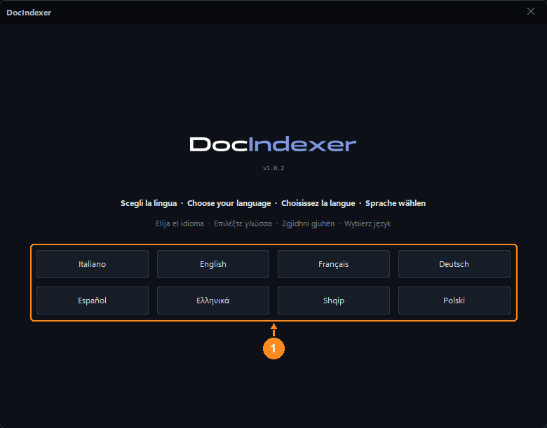

| # | Στοιχείο | Λειτουργία |
|:--:|---|---|
| **①** | **Γλώσσα** | Ένα κλικ επιλέγει τη γλώσσα του προγράμματος και του εγχειριδίου. |

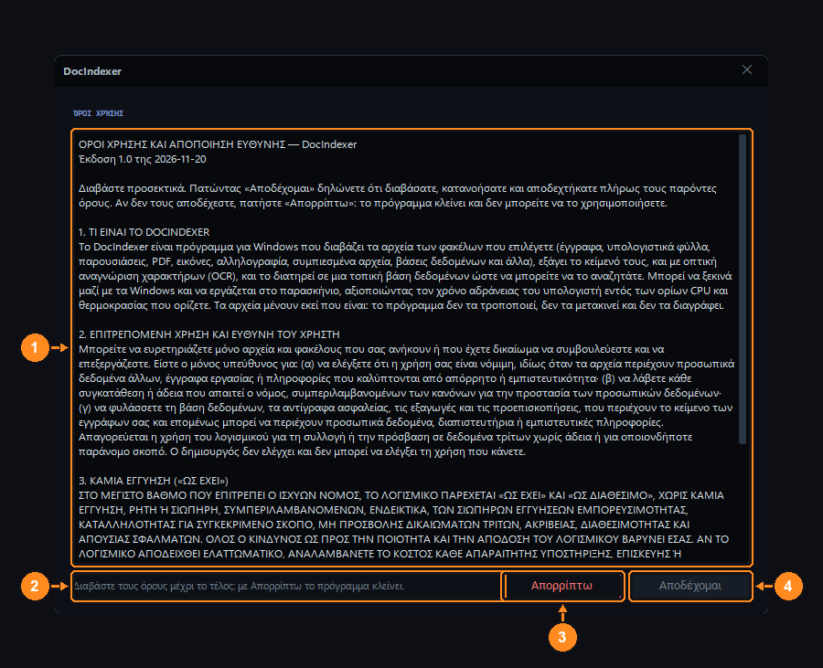

| # | Στοιχείο | Λειτουργία |
|:--:|---|---|
| **①** | **Κείμενο των όρων** | Πρέπει να κυλήσει μέχρι το τέλος. |
| **②** | **Σημείωση** | Γίνεται πράσινη όταν τα έχετε διαβάσει όλα. |
| **③** | **Απορρίπτω** | Κλείνει το πρόγραμμα. |
| **④** | **Αποδέχομαι** | Ενεργοποιείται στο τέλος του κειμένου και συνεχίζει στη ρύθμιση. |

Το **Αποδέχομαι** ενεργοποιείται μόνο αφού κυλήσετε το κείμενο μέχρι το τέλος· το **Απορρίπτω** (ή το κλείσιμο του παραθύρου) κλείνει το πρόγραμμα. Η απάντηση αποθηκεύεται: οι όροι ζητούνται ξανά μόνο αν αλλάξουν. Μπορείτε να τους ξαναδιαβάσετε όποτε θέλετε με το κουμπί **Όροι χρήσης** δίπλα στο **📖 Εγχειρίδιο**.

### Καθοδηγούμενη ρύθμιση

Την πρώτη φορά που ανοίγει, το DocIndexer ρωτά πού πρέπει να ψάξει.

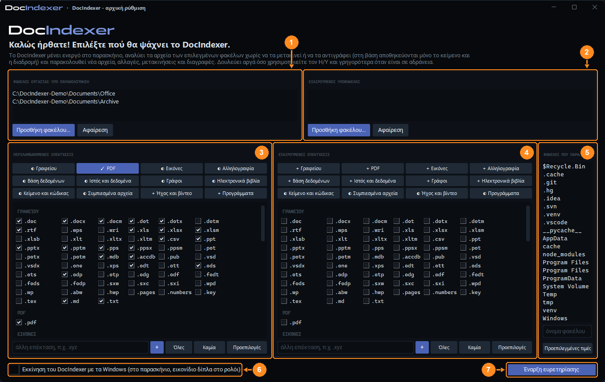

| # | Στοιχείο | Λειτουργία |
|:--:|---|---|
| **①** | **Φάκελοι εργασίας υπό παρακολούθηση** | Οι φάκελοι προς ευρετηρίαση: **Προσθήκη φακέλου...** και **Αφαίρεση**. |
| **②** | **Εξαιρούμενοι υποφάκελοι** | Τμήματα των επιλεγμένων φακέλων που παραλείπονται. |
| **③** | **Περιλαμβανόμενες επεκτάσεις** | Οι τύποι αρχείων προς ανάγνωση· τα κουμπιά κατηγορίας τους επιλέγουν ανά ομάδες. |
| **④** | **Εξαιρούμενες επεκτάσεις** | Τύποι αρχείων που αγνοούνται πάντα. |
| **⑤** | **Φάκελοι που παραλείπονται (κατά όνομα)** | Φάκελοι που παραλείπονται όπου κι αν βρίσκονται (π.χ. .git, Temp). |
| **⑥** | **Εκκίνηση με τα Windows** | Το DocIndexer ξεκινά μόνο του στην εκκίνηση, στο παρασκήνιο. |
| **⑦** | **Έναρξη ευρετηρίασης** | Αποθηκεύει τις επιλογές και ξεκινά την εργασία. |

1. **Φάκελοι εργασίας υπό παρακολούθηση**: πατήστε **Προσθήκη φακέλου...** για κάθε φάκελο που θέλετε να ευρετηριαστεί (για παράδειγμα τα Έγγραφα ή έναν φάκελο δικτύου)· η **Αφαίρεση** τον βγάζει από τη λίστα.
2. **Εξαιρούμενοι υποφάκελοι**: συγκεκριμένοι φάκελοι, μέσα σε αυτούς που παρακολουθούνται, που δεν πρέπει να αναλυθούν.
3. **Περιλαμβανόμενες επεκτάσεις** και **εξαιρούμενες επεκτάσεις**: οι τύποι αρχείων που διαβάζονται. Τα κουμπιά των ομάδων (Γραφείου, PDF, Εικόνες, Αλληλογραφία, Βάση δεδομένων, Ιστός και δεδομένα, Γράφοι, Ηλεκτρονικά βιβλία, Κείμενο και κώδικας, Συμπιεσμένα αρχεία, Ήχος και βίντεο, Προγράμματα) επιλέγουν όλη την ομάδα με ένα κλικ και την αποεπιλέγουν με άλλο· τα **Όλες**, **Καμία** και **Προεπιλογές** κάνουν ό,τι λένε. Στο πεδίο κάτω μπορείτε να προσθέσετε μια επέκταση με το χέρι.
4. **Φάκελοι που παραλείπονται (κατά όνομα)**: φάκελοι που αγνοούνται όπου κι αν βρίσκονται, όπως `$Recycle.Bin`, `.git` ή `node_modules`.
5. **Εκκίνηση του DocIndexer με τα Windows**: αν είναι επιλεγμένο, το DocIndexer ξεκινά μόνο του κατά τη σύνδεση, μόνο με το εικονίδιο δίπλα στο ρολόι.

Πατήστε **Έναρξη ευρετηρίασης**. Ό,τι επιλέξετε εδώ μπορεί να αλλάξει αργότερα στις **Ρυθμίσεις**.

## 3. Το κύριο παράθυρο

Στο πάνω μέρος βρίσκεται η κεφαλίδα, πάντα ορατή:

- το λογότυπο, η έκδοση και τα στοιχεία του δημιουργού (το e-mail και ο ιστότοπος είναι πατήσιμα)·
- η **ένδειξη δραστηριότητας**, που κινείται σαν τον ισοσταθμιστή ενός στερεοφωνικού: το ύψος των στηλών ακολουθεί τη CPU που χρησιμοποιεί η ευρετηρίαση και κάθε αρχείο που μόλις διαβάστηκε δίνει ένα χτύπημα στη ζώνη του (από αριστερά: PDF, Office, εικόνες, κείμενο και άλλα)· οι κόκκινες κορυφές δείχνουν σφάλμα. Όταν δεν υπάρχει δουλειά μένει μια σβηστή γραμμή· σε παύση είναι πορτοκαλοκίτρινη·
- ο αριθμός των αρχείων στο ευρετήριο και πόσα έχουν ήδη ευρετηριαστεί·
- το μενού **Γλώσσα**, που αλλάζει αμέσως τη γλώσσα όλου του προγράμματος·
- τα κουμπιά ελαχιστοποίησης, μεγιστοποίησης και κλεισίματος. **Το κλείσιμο του παραθύρου δεν σταματά το DocIndexer**: το κρύβει και η δουλειά συνεχίζεται (βλ. [κεφάλαιο 14](#14-εικονίδιο-δίπλα-στο-ρολόι-και-εκκίνηση-με-τα-windows)).

Από κάτω βρίσκονται οι καρτέλες **Παρακολούθηση**, **Αναζήτηση**, **Σημαντικά**, **Έγγραφα**, **Διπλότυπα** και **Ρυθμίσεις**. Δεξιά από τις καρτέλες, το **📖 Εγχειρίδιο** ανοίγει αυτό το εγχειρίδιο στη γλώσσα του προγράμματος. Δίπλα, το **Όροι χρήσης** εμφανίζει ξανά τους όρους που αποδεχτήκατε στην πρώτη εκκίνηση.

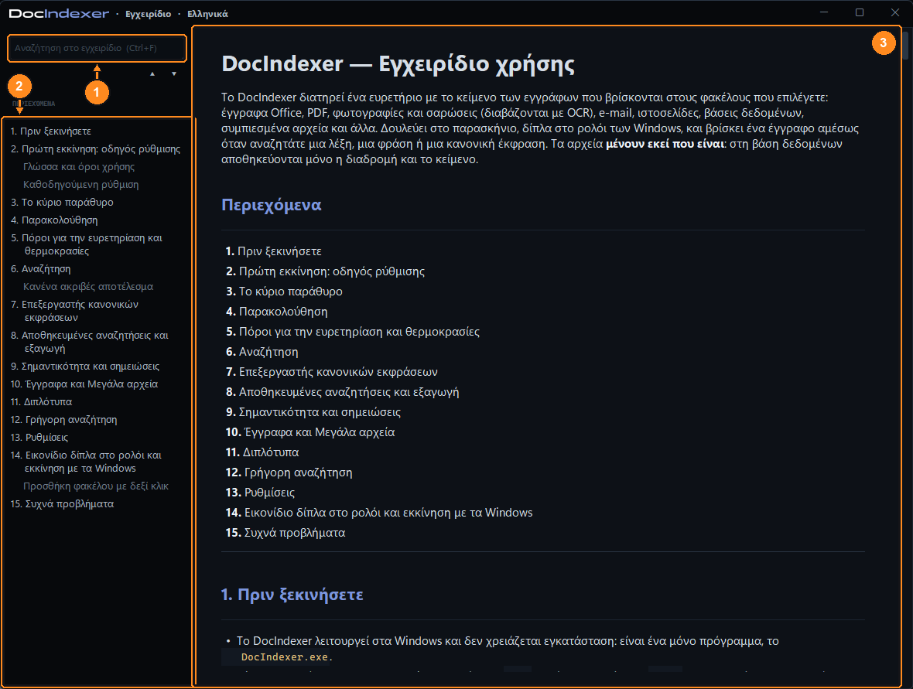

| # | Στοιχείο | Λειτουργία |
|:--:|---|---|
| **①** | **Αναζήτηση στο εγχειρίδιο (Ctrl+F)** | Επισημαίνει όλα τα ευρήματα· το Enter πάει στο επόμενο. |
| **②** | **Περιεχόμενα** | Ένα κλικ πηγαίνει στο κεφάλαιο. |
| **③** | **Κείμενο** | Το εγχειρίδιο· ένα κλικ σε εικόνα την ανοίγει σε πλήρες μέγεθος. |

Στο παράθυρο του εγχειριδίου, τα περιεχόμενα αριστερά οδηγούν στο κεφάλαιο με ένα κλικ, το πεδίο **Αναζήτηση στο εγχειρίδιο** (Ctrl+F) επισημαίνει όλα τα ευρήματα (Enter = επόμενο, Shift+Enter = προηγούμενο) και ένα κλικ σε μια εικόνα την ανοίγει σε πλήρες μέγεθος. Το Esc κλείνει το παράθυρο.

## 4. Παρακολούθηση

Η Παρακολούθηση δείχνει πόσο έχει προχωρήσει η ευρετηρίαση.

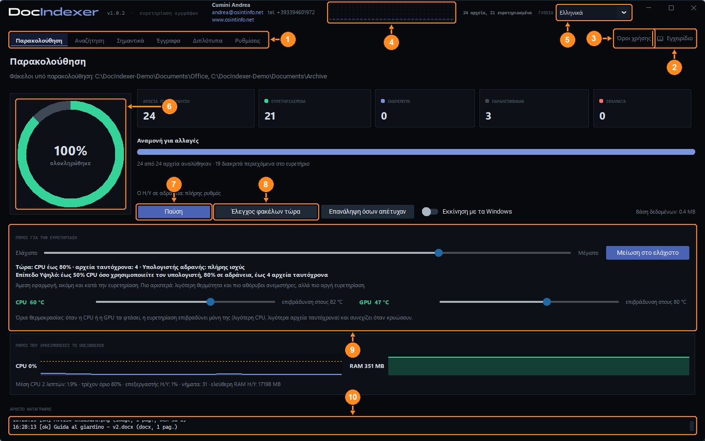

| # | Στοιχείο | Λειτουργία |
|:--:|---|---|
| **①** | **Καρτέλες** | Οι σελίδες του προγράμματος. |
| **②** | **📖 Εγχειρίδιο** | Ανοίγει αυτό το εγχειρίδιο στη γλώσσα του προγράμματος. |
| **③** | **Όροι χρήσης** | Εμφανίζει ξανά τους όρους που αποδεχτήκατε στην πρώτη εκκίνηση. |
| **④** | **Ισοσταθμιστής** | Κινείται όταν το DocIndexer εργάζεται. |
| **⑤** | **Γλώσσα** | Αλλάζει τη γλώσσα του περιβάλλοντος. |
| **⑥** | **Πρόοδος** | Πόσα από τα αρχεία έχουν ήδη αναλυθεί. |
| **⑦** | **Παύση** | Παύει και συνεχίζει την ευρετηρίαση. |
| **⑧** | **Έλεγχος φακέλων τώρα** | Αναζητά αμέσως νέα ή αλλαγμένα αρχεία. |
| **⑨** | **Πόροι για την ευρετηρίαση** | Πόση CPU θα χρησιμοποιείται και όρια θερμοκρασίας (κεφάλαιο 5). |
| **⑩** | **Αρχείο καταγραφής** | Τα μηνύματα της εργασίας, αρχείο προς αρχείο. |

- **Φάκελοι υπό παρακολούθηση**: η λίστα κάτω από τον τίτλο.
- **Κυκλικό διάγραμμα** και πλαίσια: **Αρχεία προς ανάλυση** (όλα τα αρχεία που βρέθηκαν), **Ευρετηριασμένα**, **Εκκρεμούν**, **Παραλείφθηκαν** (χωρίς αναγνώσιμο κείμενο ή εξαιρούμενα) και **Σφάλματα**.
- Τρέχουσα **φάση**: καταμέτρηση αρχείων, υπολογισμός αποτυπωμάτων, εξαγωγή κειμένου, ή *Αναμονή για αλλαγές* όταν έχει τελειώσει. Από κάτω βρίσκονται η γραμμή προόδου, το αρχείο που επεξεργάζεται και ο τρέχων ρυθμός: *Ο Η/Υ χρησιμοποιείται: μειωμένος ρυθμός*, *Ο Η/Υ σε αδράνεια: πλήρης ρυθμός*, *Ο Η/Υ είναι απασχολημένος: αναμονή* (τα άλλα προγράμματα χρησιμοποιούν ήδη πολλή CPU) ή *Με μπαταρία: ελάχιστος ρυθμός*.
- Η **Παύση / Συνέχεια** σταματά και ξαναξεκινά την ευρετηρίαση.
- Ο **Έλεγχος φακέλων τώρα** αναζητά αμέσως νέα, τροποποιημένα, μετακινημένα ή διαγραμμένα αρχεία (το DocIndexer το κάνει και μόνο του κατά την εκκίνηση και κάθε λίγες ώρες, και παρακολουθεί τις αλλαγές σε πραγματικό χρόνο όσο λειτουργεί).
- Η **Επανάληψη όσων απέτυχαν** ξαναδοκιμάζει τα αρχεία που δεν μπόρεσε να διαβάσει.
- Η **Εκκίνηση με τα Windows** ενεργοποιεί ή απενεργοποιεί αμέσως την αυτόματη εκκίνηση.
- **Βάση δεδομένων**: το τρέχον μέγεθος της βάσης δεδομένων.
- **Αρχείο καταγραφής**: στο κάτω μέρος της σελίδας, οι τελευταίες εργασίες.

Πώς δουλεύει: πρώτα μετρά τα αρχεία, μετά υπολογίζει για το καθένα ένα αποτύπωμα του περιεχομένου (SHA-256) και εξάγει το κείμενο. Ένα αρχείο ίδιο με κάποιο που έχει ήδη διαβαστεί δεν αναλύεται ξανά· ένα αρχείο που μετακινήθηκε ή μετονομάστηκε αλλάζει μόνο διαδρομή στο ευρετήριο· ένα διαγραμμένο αρχείο αφαιρείται.

Αν αφαιρέσετε όλους τους φακέλους υπό παρακολούθηση, το DocIndexer αφαιρεί τα αρχεία τους από το ευρετήριο και η Παρακολούθηση μηδενίζεται: γράφημα, μετρητές και πρόοδος ξεκινούν από το μηδέν μέχρι να προσθέσετε νέο φάκελο.

## 5. Πόροι για την ευρετηρίαση και θερμοκρασίες

Στην Παρακολούθηση, το πλαίσιο **Πόροι για την ευρετηρίαση** ορίζει πόσο από τον υπολογιστή μπορεί να χρησιμοποιεί το DocIndexer.

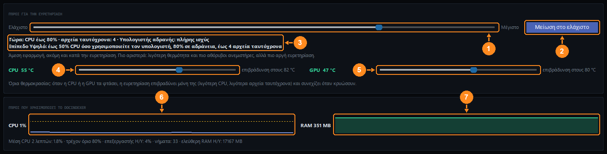

| # | Στοιχείο | Λειτουργία |
|:--:|---|---|
| **①** | **Επίπεδο πόρων** | Από Ελάχιστο έως Μέγιστο· ισχύει αμέσως. |
| **②** | **Μείωση στο ελάχιστο** | Μεταφέρει το επίπεδο τέρμα αριστερά. |
| **③** | **Τώρα** | Τι κάνει τώρα το επιλεγμένο επίπεδο. |
| **④** | **Όριο CPU** | Πάνω από αυτή τη θερμοκρασία η ευρετηρίαση επιβραδύνεται. |
| **⑤** | **Όριο GPU** | Το ίδιο για την κάρτα γραφικών. |
| **⑥** | **Γράφημα CPU** | CPU που χρησιμοποιεί το DocIndexer· η διακεκομμένη γραμμή είναι το όριο. |
| **⑦** | **Γράφημα RAM** | Μνήμη που χρησιμοποιεί το DocIndexer. |

Ο **ρυθμιστής** πηγαίνει από **Ελάχιστο** έως **Μέγιστο** και ισχύει αμέσως, ακόμη και κατά την ευρετηρίαση. Πιο αριστερά σημαίνει λιγότερη ζέστη και πιο αθόρυβους ανεμιστήρες, αλλά πιο αργή ευρετηρίαση. Η **Μείωση στο ελάχιστο** φέρνει τον ρυθμιστή τέρμα αριστερά με ένα κλικ.

| Επίπεδο | CPU όσο χρησιμοποιείτε τον υπολογιστή | CPU σε αδράνεια | Σημειώσεις |
|---|---|---|---|
| Ελάχιστο | 5% | 5% | ένα αρχείο τη φορά, εξοικονόμηση ενέργειας των Windows |
| Χαμηλό | 10% | 25% | ένα αρχείο τη φορά, εξοικονόμηση ενέργειας των Windows |
| Μεσαίο | 25% | 60% | δύο αρχεία ταυτόχρονα |
| Υψηλό | 50% | 80% | πολλά αρχεία ταυτόχρονα (περίπου οι μισοί πυρήνες) |
| Μέγιστο | 90% | 100% | σχεδόν όλοι οι πυρήνες |

Κάτω από τον ρυθμιστή, δύο γραμμές λένε τι συμβαίνει τώρα (για παράδειγμα *Τώρα: CPU έως 60% · αρχεία ταυτόχρονα: 2 · Υπολογιστής αδρανής: πλήρης ισχύς*) και τι προβλέπει το επιλεγμένο επίπεδο.

**Υπολογιστής σε αδράνεια**: όταν δεν χρησιμοποιείτε πληκτρολόγιο και ποντίκι για λίγα λεπτά (3 από προεπιλογή, αλλάζει στις Ρυθμίσεις), το όριο ανεβαίνει σταδιακά έως την τιμή «σε αδράνεια»· μόλις επιστρέψετε, κατεβαίνει ξανά. Όσο πληκτρολογείτε ή κάνετε κλικ στο παράθυρο του DocIndexer, η ευρετηρίαση επίσης κάνει στην άκρη για λίγα δευτερόλεπτα, ώστε η αναζήτηση και οι προεπισκοπήσεις να μένουν γρήγορες.

**Θερμοκρασίες**: οι γραμμές **CPU** και **GPU** δείχνουν την τρέχουσα θερμοκρασία (πράσινη, πορτοκαλοκίτρινη όταν πλησιάζει το όριο, κόκκινη όταν το φτάσει) και έναν ρυθμιστή με το όριο, από 50 έως 100 °C (82 °C για τη CPU και 80 °C για τη GPU από προεπιλογή). Όταν φτάσει το όριο, η ευρετηρίαση επιβραδύνει μόνη της (λιγότερη CPU, λιγότερα αρχεία ταυτόχρονα) και συνεχίζει όταν το εξάρτημα κρυώσει. Αν ένας αισθητήρας δεν διαβάζεται, εμφανίζεται *μη διαθέσιμη*.

Το πλαίσιο **Πόροι που χρησιμοποιεί το DocIndexer** δείχνει τη CPU και τη RAM που χρησιμοποίησε το πρόγραμμα τα τελευταία δύο λεπτά· η διακεκομμένη γραμμή είναι το ισχύον όριο CPU. Από κάτω φαίνονται ο μέσος όρος, το τρέχον όριο, το συνολικό φορτίο του επεξεργαστή και η ελεύθερη RAM του υπολογιστή.

## 6. Αναζήτηση

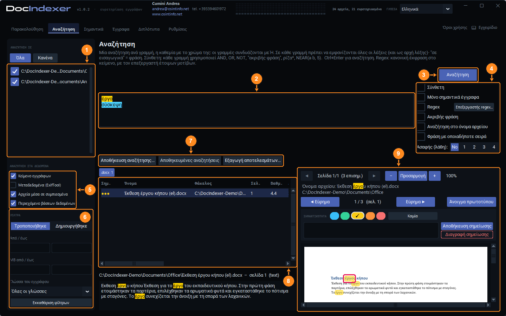

| # | Στοιχείο | Λειτουργία |
|:--:|---|---|
| **①** | **Αναζήτηση σε** | Οι φάκελοι αναζήτησης (**Όλα** / **Κανένα**). |
| **②** | **Πλαίσιο αναζήτησης** | Μία αναζήτηση ανά γραμμή, η καθεμία με το χρώμα της. |
| **③** | **Αναζήτηση** | Ξεκινά την αναζήτηση (και Ctrl+Enter). |
| **④** | **Επιλογές** | Σύνθετη, regex με τον επεξεργαστή του, ακριβής φράση, όνομα αρχείου, ασαφής. |
| **⑤** | **Αναζήτηση στα δεδομένα** | Κείμενο, μεταδεδομένα, αρχεία συμπίεσης και βάσεις δεδομένων που περιλαμβάνονται. |
| **⑥** | **Φίλτρα** | Ημερομηνίες, μέγεθος και γλώσσα· η **Εκκαθάριση φίλτρων** τα αφαιρεί. |
| **⑦** | **Αποθήκευση και εξαγωγή** | Αποθηκεύει την αναζήτηση, ανοίγει τις αποθηκευμένες, εξάγει τα αποτελέσματα. |
| **⑧** | **Αποτελέσματα** | Ένα κλικ δείχνει το έγγραφο στην προεπισκόπηση. |
| **⑨** | **Προεπισκόπηση** | Σελίδες, επισημασμένα ευρήματα, σημαντικότητα και σημείωση, **Άνοιγμα πρωτοτύπου**. |

**Τι να γράψετε.** Στο μεγάλο πλαίσιο γράψτε μία αναζήτηση ανά γραμμή· κάθε γραμμή έχει το χρώμα της, που το ξαναβρίσκετε στα αποτελέσματα και στην προεπισκόπηση, και οι γραμμές λειτουργούν εναλλακτικά (αρκεί να εμφανίζεται μία). Σε μια γραμμή πρέπει να εμφανίζονται όλες οι λέξεις, και ως αρχή λέξης· τα κεφαλαία και οι τόνοι δεν μετράνε· μια φράση «σε εισαγωγικά» αναζητείται όπως είναι. Πατήστε **Αναζήτηση** ή Ctrl+Enter.

**Επιλογές** δεξιά από το πλαίσιο:

- **Σύνθετη**: κάθε γραμμή χρησιμοποιεί την πλήρη σύνταξη: `AND`, `OR`, `NOT`, `"ακριβής φράση"`, `ρίζα*`, `NEAR(a b, 5)`.
- **Μόνο σημαντικά έγγραφα**: μόνο τα αρχεία στα οποία δώσατε χρώμα (βλ. [κεφάλαιο 9](#9-σημαντικότητα-και-σημειώσεις)).
- **Regex**: η γραμμή είναι μια κανονική έκφραση που αναζητείται στο κείμενο· ο **Επεξεργαστής regex...** ανοίγει τον επεξεργαστή (βλ. [κεφάλαιο 7](#7-επεξεργαστής-κανονικών-εκφράσεων)). Μια μεγάλη αναζήτηση regex σταματά με τη **Διακοπή αναζήτησης**.
- **Ακριβής φράση**, **Αναζήτηση στο όνομα αρχείου**, **Φράση με οποιαδήποτε σειρά**.
- **Ασαφής (λάθη)**: δέχεται από 1 έως 4 λάθη ανά λέξη, μαζί με τις τυπικές συγχύσεις του OCR (0/o, 1/l, rn/m). Αν μια κανονική αναζήτηση δεν βρει τίποτα, το DocIndexer ξαναδοκιμάζει μόνο του επιτρέποντας ένα λάθος και το αναφέρει.

**Αριστερά** επιλέγετε **πού** θα γίνει η αναζήτηση:

- **Αναζήτηση σε**: οι φάκελοι υπό παρακολούθηση στους οποίους θα γίνει αναζήτηση (**Όλα** / **Κανένα**).
- **Αναζήτηση στα δεδομένα**: κείμενο εγγράφων, μεταδεδομένα (ExifTool), αρχεία μέσα σε συμπιεσμένα, περιεχόμενο βάσεων δεδομένων.
- **Φίλτρα**: περίοδος (**Τροποποιήθηκε** ή **Δημιουργήθηκε**, ημερομηνίες σε μορφή εεεε-μμ-ηη, ή μόνο εεεε ή εεεε-μμ), μέγεθος σε MB, **γλώσσα του εγγράφου** (αναγνωρίζεται αυτόματα για κάθε αρχείο). Η **Εκκαθάριση φίλτρων** τα αφαιρεί όλα.

**Τα αποτελέσματα.** Πάνω από τον πίνακα υπάρχει ένα κουμπί για κάθε τύπο αρχείου που βρέθηκε (.pdf, .docx...) με τον αριθμό αποτελεσμάτων: ένα κλικ κρύβει ή δείχνει αυτόν τον τύπο, τα **Όλες** και **Καμία** τα αλλάζουν όλα. Οι στήλες είναι σημαντικότητα, όνομα, φάκελος, σελίδα, βαθμολογία συνάφειας, ημερομηνία δημιουργίας και ένα απόσπασμα με τις λέξεις χρωματισμένες· ένα κλικ στην κεφαλίδα ταξινομεί τη στήλη. Κάτω από τον πίνακα βρίσκεται το εξαγόμενο κείμενο της σελίδας που βρέθηκε, με τις λέξεις επισημασμένες.

**Η προεπισκόπηση** δεξιά δείχνει την πραγματική σελίδα του εγγράφου με τα ευρήματα σε πλαίσιο: τα βέλη αλλάζουν σελίδα, τα **−**, **Προσαρμογή** και **+** αλλάζουν τη μεγέθυνση (και η ροδέλα του ποντικιού), τα **◀ Εύρημα** και **Εύρημα ▶** πηγαίνουν από το ένα εύρημα στο άλλο, το **Άνοιγμα πρωτοτύπου** (ή διπλό κλικ στο αποτέλεσμα) ανοίγει το αρχείο με το πρόγραμμά του. Για τα έγγραφα Office η προεπισκόπηση ετοιμάζεται με το Office και μπορεί να χρειαστεί λίγα δευτερόλεπτα.

**Άνοιγμα του φακέλου ενός αποτελέσματος.** Ένα κλικ στο κελί **Φάκελος** ενός αποτελέσματος ανοίγει τον φάκελο στην Εξερεύνηση αρχείων με το αρχείο ήδη επιλεγμένο. Το ίδιο ισχύει στις καρτέλες **Έγγραφα** και **Σημαντικά**.

### Κανένα ακριβές αποτέλεσμα

Αν μια αναζήτηση δεν βρει τίποτα, το DocIndexer ξαναδοκιμάζει μόνο του, επιτρέποντας ένα λάθος πληκτρολόγησης ή OCR ανά λέξη. Τότε πάνω από τα αποτελέσματα εμφανίζεται μια κόκκινη ειδοποίηση που αναβοσβήνει μερικές φορές: **Κανένα ακριβές αποτέλεσμα: εμφανίζονται όσα έχουν 1 λάθος πληκτρολόγησης ή OCR**. Ελέγξτε τα αποτελέσματα: μπορεί να περιέχουν λέξεις παρόμοιες με αυτή που αναζητήσατε.

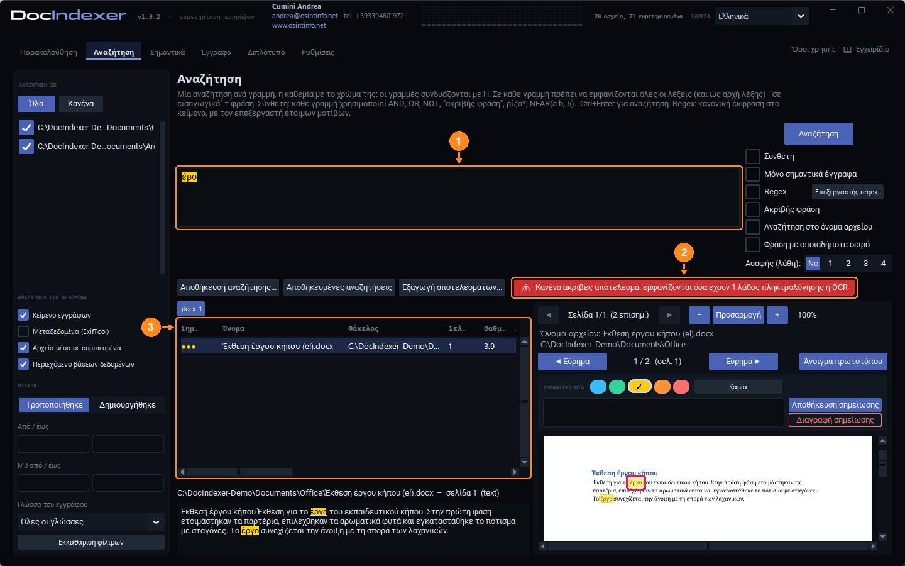

| # | Στοιχείο | Λειτουργία |
|:--:|---|---|
| **①** | **Αναζήτηση με λάθος** | Εδώ λείπει ένα γράμμα. |
| **②** | **Κόκκινη ειδοποίηση** | Αναβοσβήνει: κανένα ακριβές αποτέλεσμα, εμφανίζονται όσα έχουν 1 λάθος. |
| **③** | **Αποτελέσματα** | Τα έγγραφα με τη σωστή λέξη. |

## 7. Επεξεργαστής κανονικών εκφράσεων

Μια κανονική έκφραση (regex) αναζητά ένα *μοτίβο* αντί για μια λέξη: για παράδειγμα οποιαδήποτε ημερομηνία, οποιαδήποτε διεύθυνση ιστού ή οποιονδήποτε κωδικό συγκεκριμένης μορφής.

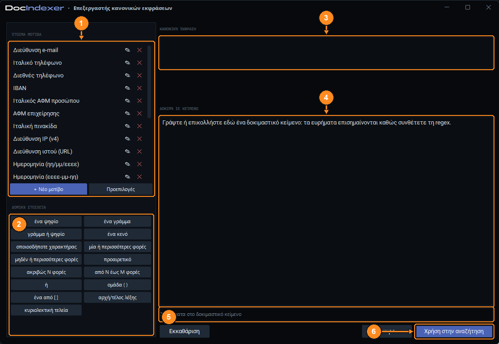

| # | Στοιχείο | Λειτουργία |
|:--:|---|---|
| **①** | **Έτοιμα μοτίβα** | Έτοιμα μοτίβα: ένα κλικ το χρησιμοποιεί· το **+ Νέο μοτίβο** προσθέτει ένα. |
| **②** | **Δομικά στοιχεία** | Κομμάτια για εισαγωγή χωρίς γνώση της σύνταξης. |
| **③** | **Κανονική έκφραση** | Η regex που συνθέτετε. |
| **④** | **Δοκιμή σε κείμενο** | Δοκιμαστικό κείμενο: τα ευρήματα επισημαίνονται αμέσως. |
| **⑤** | **Πλήθος** | Πόσα ευρήματα υπάρχουν στο δοκιμαστικό κείμενο. |
| **⑥** | **Χρήση στην αναζήτηση** | Μεταφέρει τη regex στη σελίδα Αναζήτηση. |

- **Έτοιμα μοτίβα**: μοτίβα ήδη γραμμένα, ανάμεσά τους διεύθυνση e-mail, αριθμοί τηλεφώνου, IBAN, ιταλικός φορολογικός κωδικός και ΑΦΜ, πινακίδα οχήματος, διεύθυνση IP, URL, ημερομηνίες, ώρες, ποσά, συντεταγμένες GPS, hashtags και ονόματα χρηστών. Ένα κλικ το βάζει στο πεδίο· μπορείτε να προσθέσετε δικά σας με το **Νέο μοτίβο** και να επιστρέψετε στην αρχική λίστα με τις **Προεπιλογές**.
- **Δομικά στοιχεία**: κομμάτια για να συνθέσετε χωρίς να θυμάστε τη σύνταξη (ένα ψηφίο, ένα γράμμα, μία ή περισσότερες φορές, προαιρετικό, «ή», ομάδες, αρχή/τέλος λέξης...).
- **Κανονική έκφραση**: το πεδίο με το μοτίβο· από κάτω, η εξήγηση με λόγια για το τι αναζητά.
- **Δοκιμή σε κείμενο**: γράψτε ή επικολλήστε ένα δοκιμαστικό κείμενο και τα ευρήματα επισημαίνονται καθώς γράφετε. Η **Εκκαθάριση** σβήνει το κείμενο.

Η **Χρήση στην αναζήτηση** μεταφέρει το μοτίβο στη σελίδα Αναζήτηση, με ενεργή την επιλογή Regex, και ξεκινά την αναζήτηση.

## 8. Αποθηκευμένες αναζητήσεις και εξαγωγή

Η **Αποθήκευση αναζήτησης...** (κάτω από το πλαίσιο της Αναζήτησης) αποθηκεύει την τρέχουσα αναζήτηση με ένα όνομα, μαζί με τις επιλογές και τα φίλτρα. Αν επιλέξετε **Ειδοποίηση όταν νέα αρχεία ταιριάζουν με αυτήν την αναζήτηση**, το DocIndexer την επαναλαμβάνει μόνο του όταν ευρετηριάζει νέα αρχεία και εμφανίζει μια ειδοποίηση των Windows δίπλα στο ρολόι.

| # | Στοιχείο | Λειτουργία |
|:--:|---|---|
| **①** | **Ειδοποίηση** | Επαναλαμβάνει την αναζήτηση στα νέα αρχεία και ειδοποιεί δίπλα στο ρολόι. |
| **②** | **Άνοιγμα** | Επαναφέρει την αναζήτηση στη σελίδα Αναζήτηση και την εκτελεί. |
| **③** | **✕** | Διαγράφει την αποθηκευμένη αναζήτηση. |
| **④** | **Έλεγχος τώρα** | Επαναλαμβάνει αμέσως τις αναζητήσεις με ειδοποίηση. |

Οι **Αποθηκευμένες αναζητήσεις** ανοίγουν τη λίστα: για καθεμία βλέπετε την ειδοποίηση (ενεργή ή όχι), πόσα νέα αρχεία βρήκε και πότε ελέγχθηκε. Το **Άνοιγμα** την επαναφέρει στη σελίδα Αναζήτηση και την εκτελεί, το **Μόνο τα νέα** δείχνει μόνο τα αρχεία που ήρθαν από την τελευταία φορά, ο **Έλεγχος τώρα** την επαναλαμβάνει αμέσως· μπορεί επίσης να διαγραφεί. Όταν υπάρχουν νέα αρχεία, το κουμπί Αποθηκευμένες αναζητήσεις δείχνει πόσα.

Η **Εξαγωγή αποτελεσμάτων...** αποθηκεύει τα αποτελέσματα σε **Excel** (.xlsx, γραμμές χρωματισμένες ανάλογα με τη σημαντικότητα), **CSV** (διαχωριστικό `;`, ανοίγει στο Excel) ή **PDF**, με σημαντικότητα και σημειώσεις. Το ίδιο κουμπί **Εξαγωγή...** υπάρχει στα Έγγραφα, στα Σημαντικά και στα Διπλότυπα.

## 9. Σημαντικότητα και σημειώσεις

Στην προεπισκόπηση, κάτω από το όνομα του αρχείου, κάθε έγγραφο μπορεί να έχει ένα **χρώμα σημαντικότητας** (γαλάζιο, πράσινο, κίτρινο, πορτοκαλί, κόκκινο, από το λιγότερο στο πιο σημαντικό· το **Καμία** το αφαιρεί) και μια **σημείωση** γραμμένη από εσάς (**Αποθήκευση σημείωσης**, **Διαγραφή σημείωσης**).

Το χρώμα και η σημείωση ανήκουν στο **περιεχόμενο** του αρχείου (το αποτύπωμά του SHA-256), όχι στη διαδρομή του. Αν μετακινήσετε ή μετονομάσετε το αρχείο, ακόμη και με το DocIndexer κλειστό ή σε άλλον δίσκο, τα βρίσκετε ξανά μόλις το αρχείο ελεγχθεί ξανά. Τα πανομοιότυπα αντίγραφα του ίδιου αρχείου έχουν το ίδιο χρώμα και την ίδια σημείωση: αν τα αλλάξετε σε ένα αντίγραφο, αλλάζουν σε όλα. Αν τροποποιήσετε το αρχείο, το χρώμα και η σημείωση παραμένουν.

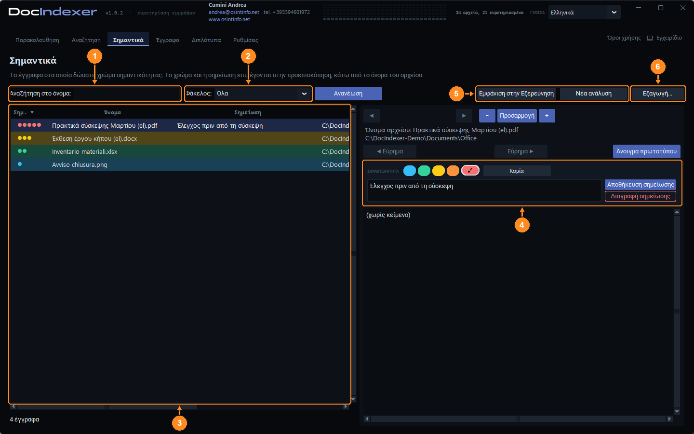

| # | Στοιχείο | Λειτουργία |
|:--:|---|---|
| **①** | **Αναζήτηση στο όνομα** | Φιλτράρει τη λίστα καθώς πληκτρολογείτε. |
| **②** | **Φάκελος** | Δείχνει μόνο έναν παρακολουθούμενο φάκελο. |
| **③** | **Λίστα** | Τα χρωματισμένα έγγραφα, τα σημαντικότερα πρώτα, με τη σημείωση. |
| **④** | **Σημαντικότητα** | Πέντε χρώματα και μια σημείωση· η **Αποθήκευση σημείωσης** την κρατά. |
| **⑤** | **Εμφάνιση και νέα ανάλυση** | Ανοίγει τον φάκελο του αρχείου ή το ξαναβάζει στην ουρά. |
| **⑥** | **Εξαγωγή** | Αποθηκεύει τη λίστα σε CSV, Excel ή HTML. |

Η καρτέλα **Σημαντικά** δείχνει μόνο τα χρωματισμένα έγγραφα, τα πιο σημαντικά πάνω, με τη σημείωση. Σε όλες τις λίστες το χρώμα εμφανίζεται ως κουκκίδες στην αρχή της γραμμής και η γραμμή είναι ελαφρά χρωματισμένη. Στην Αναζήτηση η επιλογή **Μόνο σημαντικά έγγραφα** περιορίζει την αναζήτηση σε αυτά τα αρχεία.

## 10. Έγγραφα και Μεγάλα αρχεία

Η καρτέλα **Έγγραφα** δείχνει όλα τα ευρετηριασμένα αρχεία.

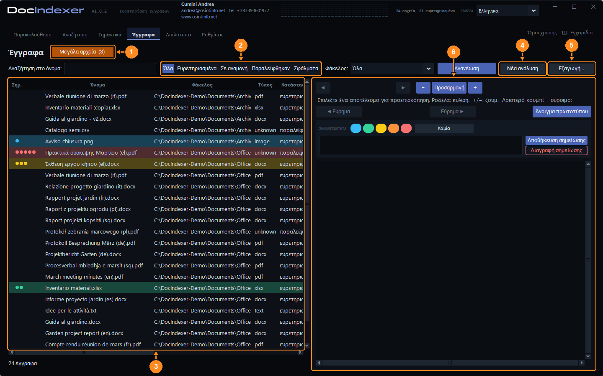

| # | Στοιχείο | Λειτουργία |
|:--:|---|---|
| **①** | **Μεγάλα αρχεία** | Αρχεία πάνω από το όριο μεγέθους, σε αναμονή επιλογής. |
| **②** | **Κατάσταση** | Όλα, ευρετηριασμένα, σε ουρά, παραλειμμένα ή με σφάλματα. |
| **③** | **Λίστα** | Όλα τα αρχεία που βρέθηκαν, με φάκελο, τύπο και κατάσταση. |
| **④** | **Νέα ανάλυση** | Ξαναβάζει στην ουρά το επιλεγμένο αρχείο. |
| **⑤** | **Εξαγωγή** | Αποθηκεύει τη λίστα σε CSV, Excel ή HTML. |
| **⑥** | **Προεπισκόπηση** | Το επιλεγμένο έγγραφο, με σημαντικότητα και σημείωση. |

- **Αναζήτηση στο όνομα**: φιλτράρει τη λίστα καθώς γράφετε.
- **Όλα / Ευρετηριασμένα / Σε αναμονή / Παραλείφθηκαν / Σφάλματα**: φιλτράρει κατά κατάσταση. Ο **Φάκελος** φιλτράρει κατά φάκελο υπό παρακολούθηση. Η **Ανανέωση** ξαναφορτώνει τη λίστα.
- Οι στήλες δείχνουν σημαντικότητα, όνομα, φάκελο, τύπο, κατάσταση, γλώσσα, σελίδες, σελίδες που διαβάστηκαν με OCR, χαρακτήρες, ημερομηνίες δημιουργίας και τροποποίησης και το αποτύπωμα SHA-256. Ένα κλικ στην κεφαλίδα ταξινομεί· περνώντας πάνω από ένα κομμένο κελί εμφανίζεται ολόκληρο το κείμενο.
- Μπορείτε να επιλέξετε πολλές γραμμές (Ctrl ή Shift + κλικ, Ctrl+A). Η **Εμφάνιση στην Εξερεύνηση** ανοίγει τον φάκελο του αρχείου, η **Νέα ανάλυση** ξαναδιαβάζει τα επιλεγμένα αρχεία, η **Εξαγωγή...** αποθηκεύει τη λίστα. Ένα διπλό κλικ ανοίγει το αρχείο.
- Ένα κλικ στο κελί **Φάκελος** ανοίγει τον φάκελο στην Εξερεύνηση αρχείων με το αρχείο επιλεγμένο (και στην καρτέλα **Σημαντικά**).

**Μεγάλα αρχεία.** Τα αρχεία μεγαλύτερα από το όριο που έχει οριστεί (200 MB από προεπιλογή) δεν αναλύονται αυτόματα: το κουμπί **Μεγάλα αρχεία** γίνεται πορτοκαλί και δείχνει πόσα περιμένουν.

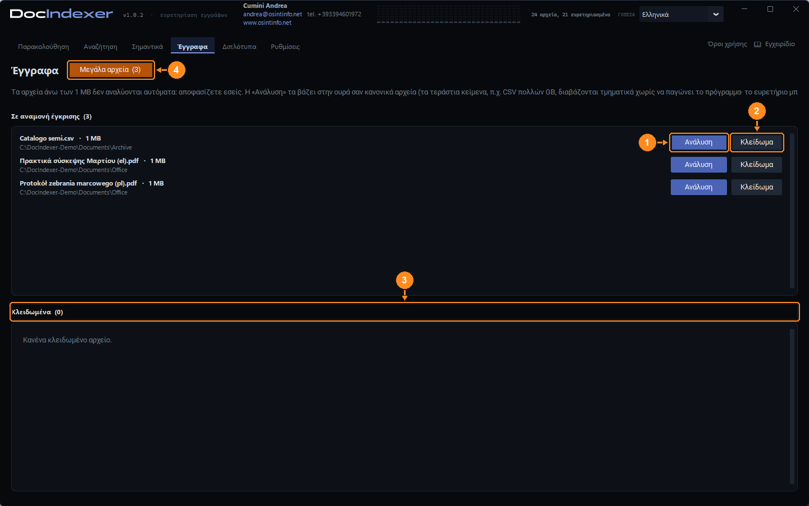

| # | Στοιχείο | Λειτουργία |
|:--:|---|---|
| **①** | **Ανάλυση** | Βάζει το αρχείο στην ουρά όπως τα άλλα. |
| **②** | **Κλείδωμα** | Το βάζει στην άκρη χωρίς ανάλυση. |
| **③** | **Κλειδωμένα** | Τα κλειδωμένα αρχεία· το **Ξεκλείδωμα** τα επαναφέρει σε αναμονή. |
| **④** | **Μεγάλα αρχεία** | Επιστρέφει στη λίστα εγγράφων. |

Για κάθε αρχείο σε αναμονή επιλέξτε **Ανάλυση** (μπαίνει στην ουρά σαν κανονικό αρχείο· τα τεράστια κείμενα διαβάζονται τμηματικά χωρίς να παγώνει το πρόγραμμα, αλλά το ευρετήριο μπορεί να μεγαλώσει πολύ) ή **Κλείδωμα** (μπαίνει στην άκρη). Στη λίστα **Κλειδωμένα**, το **Ξεκλείδωμα** το ξαναβάζει σε αναμονή. Το **← Έγγραφα** επιστρέφει στη λίστα.

## 11. Διπλότυπα

Η καρτέλα **Διπλότυπα** βρίσκει δύο είδη αντιγράφων. Πατήστε **Εύρεση διπλότυπων**.

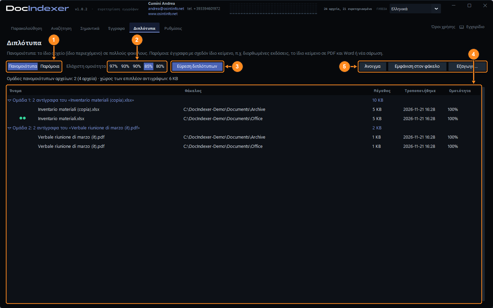

| # | Στοιχείο | Λειτουργία |
|:--:|---|---|
| **①** | **Ίδια / Παρόμοια** | Ίδιο αρχείο ή σχεδόν ίδιο κείμενο. |
| **②** | **Ελάχιστη ομοιότητα** | Πόσο πρέπει να μοιάζουν τα παρόμοια έγγραφα. |
| **③** | **Εύρεση διπλότυπων** | Ξεκινά την αναζήτηση. |
| **④** | **Ομάδες** | Μία ομάδα για κάθε σύνολο αντιγράφων, με τον χώρο που καταλαμβάνει. |
| **⑤** | **Άνοιγμα, εμφάνιση, εξαγωγή** | Για το επιλεγμένο αρχείο ή όλη τη λίστα. |

- **Πανομοιότυπα**: το ίδιο αρχείο (ίδιο περιεχόμενο) σε πολλούς φακέλους. Κάθε ομάδα δείχνει πόσα αντίγραφα υπάρχουν και τον χώρο που πιάνουν· πάνω φαίνεται ο συνολικός χώρος που πιάνουν τα περιττά αντίγραφα.

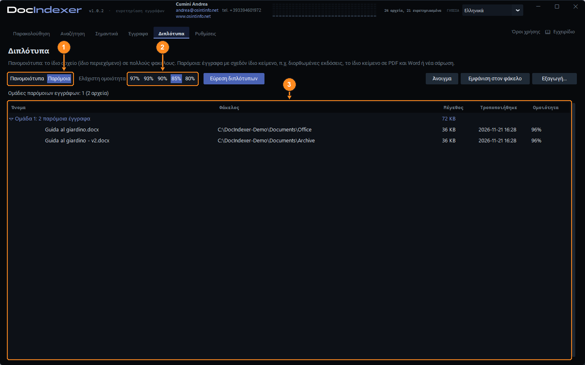

| # | Στοιχείο | Λειτουργία |
|:--:|---|---|
| **①** | **Παρόμοια** | Έγγραφα με σχεδόν ίδιο κείμενο. |
| **②** | **Ελάχιστη ομοιότητα** | Από 97% έως 80%: χαμηλότερο βρίσκει περισσότερα ζεύγη. |
| **③** | **Ομάδες** | Η στήλη Ομοιότητα δείχνει την τιμή κάθε αρχείου. |

- **Παρόμοια**: έγγραφα με σχεδόν ίδιο κείμενο, για παράδειγμα διορθωμένες εκδόσεις του ίδιου εγγράφου, το ίδιο κείμενο σε PDF και σε Word ή μια σάρωση που έγινε ξανά. Η **Ελάχιστη ομοιότητα** ορίζει πόσο πρέπει να μοιάζουν (από 97% έως 80%)· η στήλη Ομοιότητα δείχνει την τιμή κάθε αρχείου.

Τα **Άνοιγμα**, **Εμφάνιση στον φάκελο** και **Εξαγωγή...** δρουν στο επιλεγμένο αρχείο ή στη λίστα.

## 12. Γρήγορη αναζήτηση

Η γρήγορη αναζήτηση είναι μια γραμμή αναζήτησης που ανοίγει πάνω από οποιοδήποτε πρόγραμμα, με τη συντόμευση **Ctrl+Alt+D** (αλλάζει στις Ρυθμίσεις) ή από το μενού του εικονιδίου δίπλα στο ρολόι.

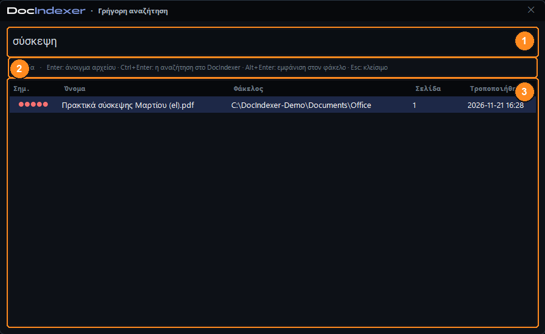

| # | Στοιχείο | Λειτουργία |
|:--:|---|---|
| **①** | **Πεδίο αναζήτησης** | Αναζητά καθώς πληκτρολογείτε. |
| **②** | **Πλήκτρα** | Enter, Ctrl+Enter, Alt+Enter, Esc. |
| **③** | **Αποτελέσματα** | Με τα βέλη επιλέγετε το αρχείο. |

Αναζητά καθώς γράφετε. Επιλέξτε ένα αποτέλεσμα με τα βέλη· το **Enter** ανοίγει το αρχείο, το **Ctrl+Enter** ανοίγει την πλήρη αναζήτηση στο DocIndexer, το **Alt+Enter** δείχνει το αρχείο στον φάκελό του, το **Esc** κλείνει τη γραμμή.

## 13. Ρυθμίσεις

Οι αλλαγές ισχύουν μόνο μετά την **Αποθήκευση**. Η **Απόρριψη αλλαγών** επιστρέφει στις αποθηκευμένες ρυθμίσεις· η **Επαναφορά προεπιλεγμένων ρυθμίσεων** επαναφέρει τις εργοστασιακές τιμές. Αν αλλάξετε καρτέλα με μη αποθηκευμένες αλλαγές, το DocIndexer ρωτά αν θέλετε να αποθηκευτούν.

Οι **Φάκελοι και επεκτάσεις** έχουν τους ίδιους πίνακες με τον οδηγό ρύθμισης: φάκελοι υπό παρακολούθηση, εξαιρούμενοι υποφάκελοι, περιλαμβανόμενες και εξαιρούμενες επεκτάσεις, φάκελοι που παραλείπονται κατά όνομα.

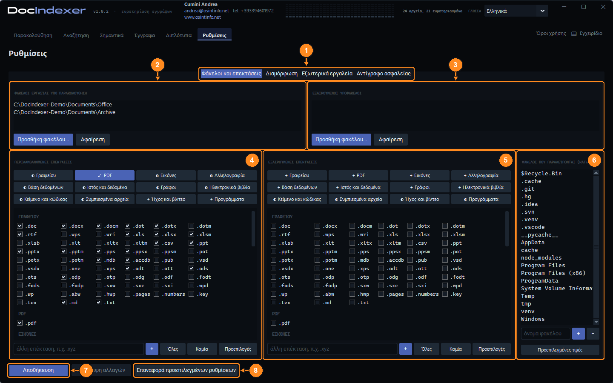

| # | Στοιχείο | Λειτουργία |
|:--:|---|---|
| **①** | **Καρτέλες ρυθμίσεων** | Φάκελοι, διαμόρφωση, εξωτερικά εργαλεία, αντίγραφο ασφαλείας. |
| **②** | **Φάκελοι εργασίας υπό παρακολούθηση** | Οι φάκελοι προς ευρετηρίαση. |
| **③** | **Εξαιρούμενοι υποφάκελοι** | Τμήματα των φακέλων που παραλείπονται. |
| **④** | **Περιλαμβανόμενες επεκτάσεις** | Οι τύποι αρχείων προς ανάγνωση. |
| **⑤** | **Εξαιρούμενες επεκτάσεις** | Οι τύποι αρχείων που αγνοούνται. |
| **⑥** | **Φάκελοι που παραλείπονται (κατά όνομα)** | Φάκελοι που παραλείπονται όπου κι αν βρίσκονται. |
| **⑦** | **Αποθήκευση** | Εφαρμόζει τις αλλαγές. |
| **⑧** | **Επαναφορά προεπιλεγμένων ρυθμίσεων** | Επιστρέφει στις αρχικές τιμές. |

**Διαμόρφωση**:

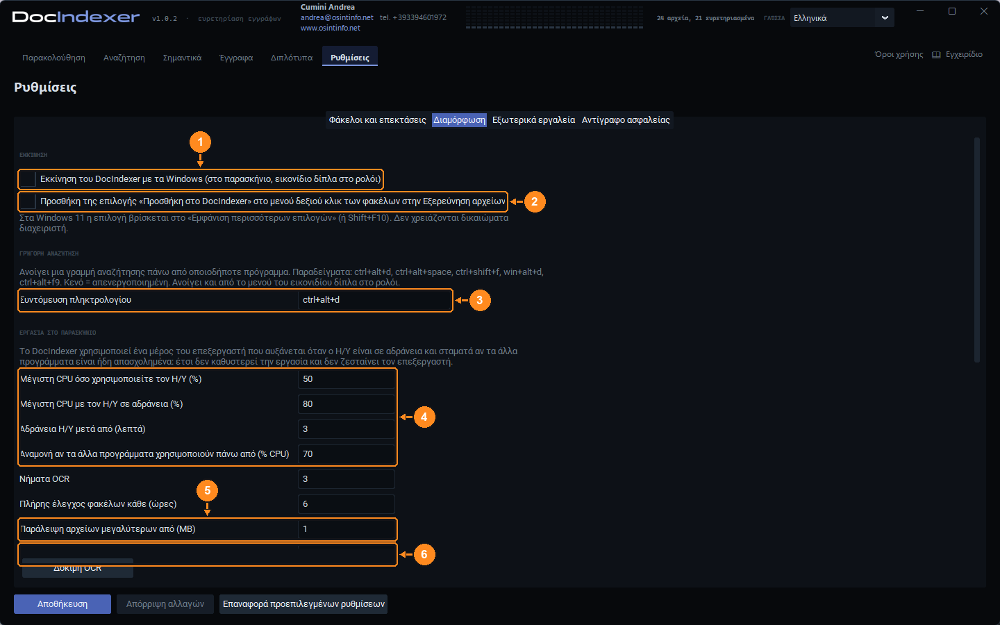

| # | Στοιχείο | Λειτουργία |
|:--:|---|---|
| **①** | **Εκκίνηση με τα Windows** | Ισχύει αμέσως, χωρίς Αποθήκευση. |
| **②** | **Προσθήκη στο DocIndexer** | Επιλογή δεξιού κλικ των φακέλων στην Εξερεύνηση αρχείων· ισχύει αμέσως. |
| **③** | **Συντόμευση πληκτρολογίου** | Τα πλήκτρα της γρήγορης αναζήτησης (κενό = ανενεργή). |
| **④** | **Εργασία στο παρασκήνιο** | CPU με τον υπολογιστή σε χρήση και αδρανή, αναμονή, απασχολημένα προγράμματα. |
| **⑤** | **Παράλειψη αρχείων μεγαλύτερων από (MB)** | Πάνω από αυτό το όριο τα αρχεία πάνε στα **Μεγάλα αρχεία**. |
| **⑥** | **Μέγεθος διεπαφής (%) — 100 = όπως το ζουμ των Windows** | 100 = όπως οι άλλες εφαρμογές των Windows· μεγαλύτερη τιμή μεγεθύνει, μικρότερη σμικρύνει. |

- **Εκκίνηση**: εκκίνηση με τα Windows (ισχύει αμέσως).
- **Προσθήκη στο DocIndexer**: προσθέτει την επιλογή στο μενού δεξιού κλικ των φακέλων στην Εξερεύνηση αρχείων· ισχύει αμέσως, χωρίς Αποθήκευση (δείτε το κεφάλαιο 14).
- **Γρήγορη αναζήτηση**: η συντόμευση πληκτρολογίου, για παράδειγμα `ctrl+alt+d`, `ctrl+shift+f` ή `win+alt+d`· κενό = απενεργοποιημένη. Αν τη συντόμευση τη χρησιμοποιεί ήδη άλλο πρόγραμμα, εμφανίζεται προειδοποίηση.
- **Εργασία στο παρασκήνιο**: μέγιστη CPU όσο χρησιμοποιείτε τον υπολογιστή και σε αδράνεια, μετά από πόσα λεπτά ο υπολογιστής θεωρείται αδρανής, πάνω από ποιο φορτίο των άλλων προγραμμάτων το DocIndexer περιμένει, νήματα OCR, ανά πόσες ώρες ξαναελέγχονται όλοι οι φάκελοι, μέγιστο μέγεθος αρχείων (τα μεγαλύτερα πηγαίνουν στα **Μεγάλα αρχεία**), μέγεθος διεπαφής (σε %, 100 = όπως το ζουμ των Windows, δηλαδή ίδιο μέγεθος με τις άλλες εφαρμογές· ισχύει από την επόμενη εκκίνηση). Οι πρώτες τιμές αλλάζουν και με τον ρυθμιστή της Παρακολούθησης.
- **Πρόσθετες λειτουργικές μονάδες**: μεταδεδομένα με το ExifTool, κείμενο αρχείων μέσα σε συμπιεσμένα (7-Zip), βάσεις δεδομένων SQLite, dBASE/FoxPro και Access. Κάθε μονάδα κρατά τα δεδομένα της χωριστά· στην Αναζήτηση επιλέγετε σε ποια θα γίνει αναζήτηση.
- **OCR (RapidOCR)**: το μοντέλο. Το **Αυτόματο** διαβάζει την πρώτη σαρωμένη σελίδα με το λατινικό μοντέλο και, αν το αποτέλεσμα είναι αβέβαιο, δοκιμάζει τα άλλα μοντέλα που έχουν ληφθεί και κρατά αυτό που διαβάζει καλύτερα. Μια υψηλότερη **ανάλυση OCR (DPI)** διαβάζει καλύτερα τους μικρούς χαρακτήρες αλλά είναι πιο αργή. Η **Δοκιμή OCR** κάνει μια δοκιμή.
- **Βάσεις δεδομένων SQLite**: το αρχείο της βάσης δεδομένων.

Τα **Εξωτερικά εργαλεία** δείχνουν την κατάσταση των μοντέλων OCR και των προαιρετικών εργαλείων (ExifTool, 7-Zip, πρόγραμμα οδήγησης Access). Η **Εγκατάσταση** ή **Επανεγκατάσταση** κατεβάζει ένα εργαλείο στον φάκελο `tools`, η **Εγκατάσταση όλων όσων λείπουν** τα κατεβάζει όλα, ο **Επανέλεγχος** ανανεώνει την κατάσταση. Λειτουργούν χωρίς εγκατάσταση στο σύστημα.

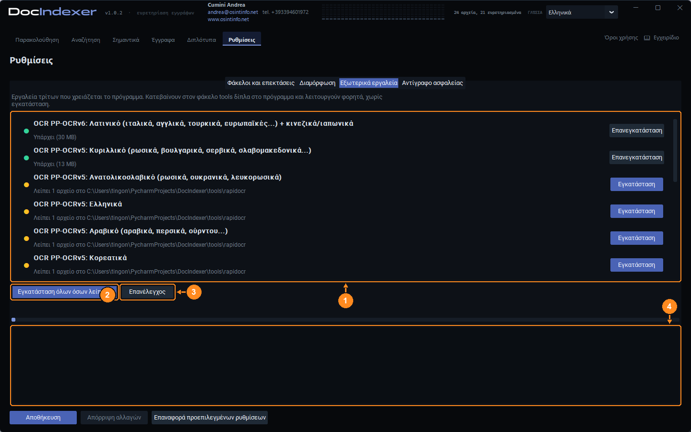

| # | Στοιχείο | Λειτουργία |
|:--:|---|---|
| **①** | **Εργαλεία** | Κάθε εργαλείο με την κατάστασή του και το κουμπί εγκατάστασης. |
| **②** | **Εγκατάσταση όλων όσων λείπουν** | Κατεβάζει μονομιάς τα εργαλεία που λείπουν. |
| **③** | **Επανέλεγχος** | Ξαναδιαβάζει την κατάσταση των εργαλείων. |
| **④** | **Αρχείο καταγραφής** | Πρόοδος και μηνύματα των λήψεων. |

**Αντίγραφο ασφαλείας**: η **Δημιουργία αντιγράφου...** αποθηκεύει σε ένα αρχείο .zip τη βάση δεδομένων (ευρετήριο, σημειώσεις, χρώματα σημαντικότητας), τις ρυθμίσεις, τα μοτίβα regex και τις αποθηκευμένες αναζητήσεις, ακόμη και όσο τρέχει η ευρετηρίαση. Η **Επαναφορά από αντίγραφο...** τα αντικαθιστά και επανεκκινεί το DocIndexer· η προηγούμενη βάση μένει δίπλα με την επέκταση `.before-restore`.

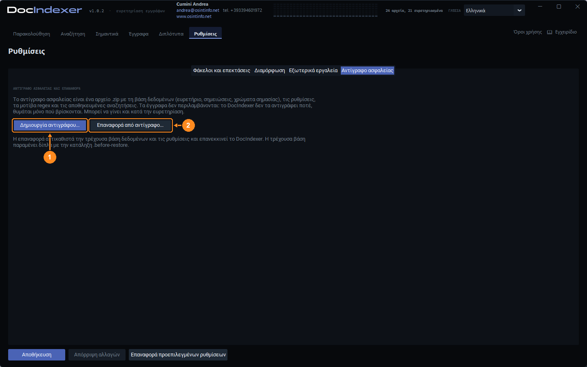

| # | Στοιχείο | Λειτουργία |
|:--:|---|---|
| **①** | **Δημιουργία αντιγράφου** | Αποθηκεύει βάση, ρυθμίσεις, μοτίβα και αναζητήσεις σε ένα .zip. |
| **②** | **Επαναφορά από αντίγραφο** | Αντικαθιστά τα τρέχοντα δεδομένα με του αντιγράφου και επανεκκινεί. |

## 14. Εικονίδιο δίπλα στο ρολόι και εκκίνηση με τα Windows

Όταν το παράθυρο είναι κλειστό, το DocIndexer συνεχίζει να δουλεύει και μένει ως εικονίδιο δίπλα στο ρολόι. Περνώντας από πάνω βλέπετε την κατάσταση· το δεξί κλικ ανοίγει το μενού:

- **Άνοιγμα DocIndexer** (και με ένα κλικ στο εικονίδιο)·
- **Παύση ευρετηρίασης** / **Συνέχιση ευρετηρίασης**·
- **Έλεγχος φακέλων τώρα**·
- **Γρήγορη αναζήτηση**·
- **Εγχειρίδιο**·
- **Εκκίνηση με τα Windows** (με σημάδι επιλογής όταν είναι ενεργή)·
- **Έξοδος**, που κλείνει πραγματικά το πρόγραμμα.

Αν ανοίξετε το DocIndexer δεύτερη φορά δεν ξεκινά νέο αντίγραφο: εμφανίζεται το παράθυρο αυτού που ήδη τρέχει. Η εκκίνηση με τα Windows ισχύει μόνο για τον δικό σας χρήστη και δεν χρειάζεται δικαιώματα διαχειριστή.

### Προσθήκη φακέλου με δεξί κλικ

Με την επιλογή **Προσθήκη στο DocIndexer** ενεργή (Ρυθμίσεις › Διαμόρφωση › Εκκίνηση), το δεξί κλικ σε έναν φάκελο στην Εξερεύνηση αρχείων δείχνει **Προσθήκη στο DocIndexer**: ο φάκελος μπαίνει στους παρακολουθούμενους φακέλους και η ευρετηρίαση ξεκινά αμέσως, ακόμη κι αν το DocIndexer ήταν ήδη ανοιχτό. Στα Windows 11 η επιλογή βρίσκεται στο «Εμφάνιση περισσότερων επιλογών» (ή Shift+F10). Αν ο φάκελος παρακολουθείται ήδη ή βρίσκεται μέσα σε παρακολουθούμενο φάκελο, το DocIndexer το αναφέρει και δεν αλλάζει τίποτα· αν περιέχει φακέλους που παρακολουθούνται ήδη, παίρνει τη θέση τους. Δεν χρειάζονται δικαιώματα διαχειριστή.

**Σε περισσότερους υπολογιστές.** Η καταχώριση του δεξιού κλικ και η εκκίνηση με τα Windows αποθηκεύονται στα Windows του υπολογιστή που χρησιμοποιείτε, για τον χρήστη σας. Αν χρησιμοποιείτε το DocIndexer από εξωτερικό δίσκο, ενεργοποιήστε τις ξανά σε κάθε υπολογιστή από **Ρυθμίσεις › Διαμόρφωση › Εκκίνηση**. Αν στον ίδιο υπολογιστή το πρόγραμμα αλλάξει φάκελο ή γράμμα δίσκου, η καταχώριση του δεξιού κλικ ενημερώνεται μόνη της στην επόμενη εκκίνηση.

## 15. Συχνά προβλήματα

- **Ένα έγγραφο δεν βρίσκεται.** Ελέγξτε στην Παρακολούθηση ότι η ευρετηρίαση έχει τελειώσει· στα Έγγραφα αναζητήστε το αρχείο με το όνομά του και δείτε την κατάστασή του (*Σε αναμονή*, *Παραλείφθηκαν*, *Σφάλματα*). Ελέγξτε ότι ο φάκελος παρακολουθείται και ότι η επέκταση είναι στις περιλαμβανόμενες.
- **Πολλά αρχεία στα σφάλματα.** Ένα αρχείο μπορεί να προστατεύεται με κωδικό, να είναι κατεστραμμένο ή ανοιχτό σε άλλο πρόγραμμα. Η **Επανάληψη όσων απέτυχαν** στην Παρακολούθηση τα ξαναδοκιμάζει.
- **Μια σάρωση δεν διαβάζεται.** Ελέγξτε στις Ρυθμίσεις › Εξωτερικά εργαλεία ότι είναι εγκατεστημένο το μοντέλο OCR του σωστού αλφαβήτου (για ελληνικά, το ελληνικό)· με το **Αυτόματο** μοντέλο επιλέγεται μόνο του ανάμεσα σε όσα έχουν ληφθεί.
- **Ο υπολογιστής κάνει θόρυβο ή ζεσταίνεται.** Μετακινήστε τον ρυθμιστή πόρων προς τα αριστερά ή πατήστε **Μείωση στο ελάχιστο**· χαμηλώστε τα όρια θερμοκρασίας.
- **Η ευρετηρίαση είναι αργή.** Μετακινήστε τον ρυθμιστή προς τα δεξιά· σε αδράνεια το DocIndexer επιταχύνει μόνο του.
- **Ένα πολύ μεγάλο αρχείο δεν εμφανίζεται.** Βρίσκεται στα **Έγγραφα › Μεγάλα αρχεία** και περιμένει την έγκρισή σας.
- **Η συντόμευση της γρήγορης αναζήτησης δεν λειτουργεί.** Τη χρησιμοποιεί άλλο πρόγραμμα: επιλέξτε άλλη στις Ρυθμίσεις › Διαμόρφωση.
- **Μεταφορά του DocIndexer σε άλλον υπολογιστή.** Αντιγράψτε ολόκληρο τον φάκελο του προγράμματος, ή δημιουργήστε αντίγραφο ασφαλείας και επαναφέρετέ το στον νέο υπολογιστή. Μετά, αν τις χρειάζεστε, ενεργοποιήστε ξανά την **Εκκίνηση με τα Windows** και την **Προσθήκη στο DocIndexer**.
- **Ο εξωτερικός δίσκος έχει άλλο γράμμα.** Δεν χρειάζεται να κάνετε τίποτα: κατά την εκκίνηση το DocIndexer ενημερώνει μόνο του τις διαδρομές (δείτε το [κεφάλαιο 1](#1-πριν-ξεκινήσετε)).
- **Το κείμενο είναι πολύ μικρό ή πολύ μεγάλο.** Αλλάξτε το **Μέγεθος διεπαφής (%)** στις Ρυθμίσεις › Διαμόρφωση: 100 είναι το μέγεθος των άλλων εφαρμογών των Windows. Ισχύει από την επόμενη εκκίνηση.
