# DocIndexer — User manual

DocIndexer keeps an index of the text of the documents in the folders you choose: Office documents, PDFs, photos and scans (read with OCR), e-mails, web pages, databases, compressed archives and more. It works in the background, next to the Windows clock, and finds a document in an instant when you search for a word, a phrase or a regular expression. Files **stay where they are**: only the path and the text go into the database.

## Contents

1. [Before you start](#1-before-you-start)
2. [First start: setup wizard](#2-first-start-setup-wizard)
3. [The main window](#3-the-main-window)
4. [Monitor](#4-monitor)
5. [Indexing resources and temperatures](#5-indexing-resources-and-temperatures)
6. [Search](#6-search)
7. [Regular expression editor](#7-regular-expression-editor)
8. [Saved searches and export](#8-saved-searches-and-export)
9. [Importance and notes](#9-importance-and-notes)
10. [Documents and Large files](#10-documents-and-large-files)
11. [Duplicates](#11-duplicates)
12. [Quick search](#12-quick-search)
13. [Settings](#13-settings)
14. [Icon next to the clock and starting with Windows](#14-icon-next-to-the-clock-and-starting-with-windows)
15. [Common problems](#15-common-problems)

---

## 1. Before you start

- DocIndexer runs on Windows and needs no installation: it is a single program, `DocIndexer.exe`.
- Next to the program it creates the folders `data` (the database), `cache` (temporary previews, can be deleted) and `tools` (external tools and OCR models), plus the settings file `config.json`. To move DocIndexer to another PC, just copy the whole folder.
- The main OCR model (Latin alphabet plus Chinese and Japanese) is already included. Other alphabets and the optional tools (ExifTool for metadata, 7-Zip for archives) are downloaded from **Settings › External tools** (see [chapter 13](#13-settings)).
- Documents are never moved, copied or changed.

## 2. First start: setup wizard

### Language and terms of use

The very first time it opens, DocIndexer asks for the language and then shows the terms of use in that language.

| # | Element | What it does |
|:--:|---|---|
| **①** | **Language** | A click picks the language of the program and the manual. |

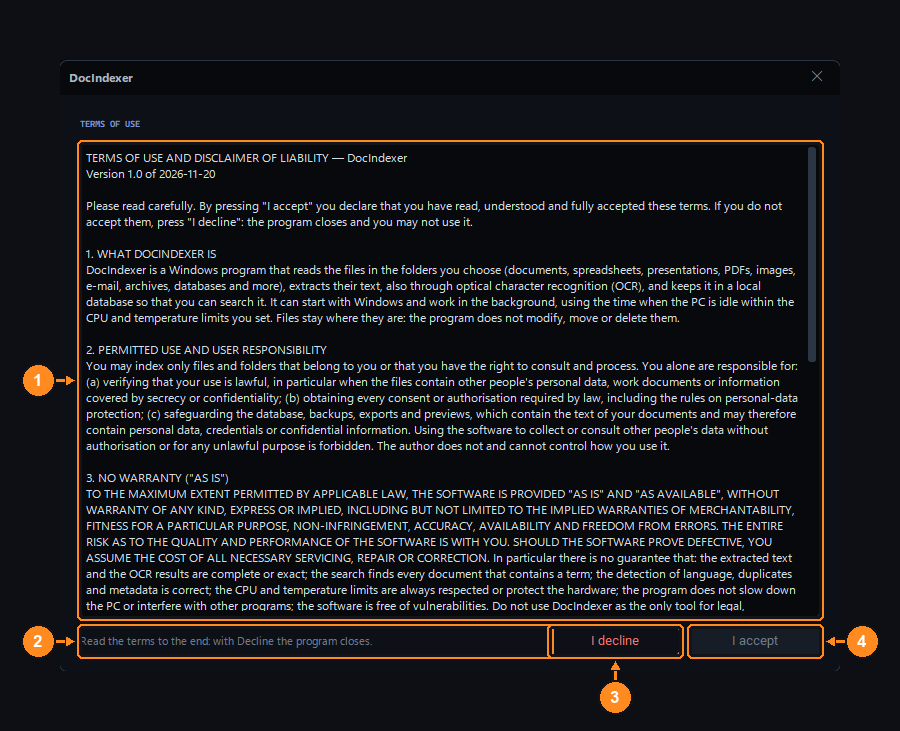

| # | Element | What it does |
|:--:|---|---|
| **①** | **Terms text** | Must be scrolled to the end. |
| **②** | **Note** | Turns green when you have read everything. |
| **③** | **I decline** | Closes the program. |
| **④** | **I accept** | Becomes active at the end of the text and continues to the setup. |

**I accept** becomes active only after you have scrolled the text to the end; **I decline** (or closing the window) closes the program. The answer is remembered: the terms are asked again only if they change. You can read them again at any time with the **Terms of use** button next to **📖 Manual**.

### Guided setup

The first time it opens, DocIndexer asks where it should look.

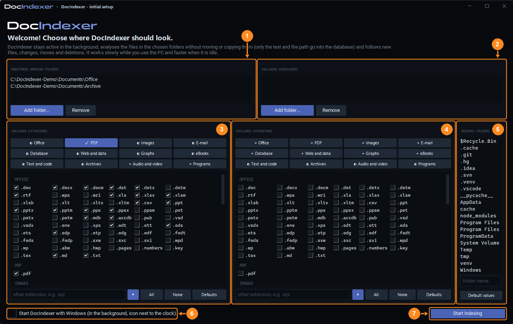

| # | Element | What it does |
|:--:|---|---|
| **①** | **Monitored working folders** | The folders to index: **Add folder...** and **Remove**. |
| **②** | **Excluded subfolders** | Parts of the chosen folders to skip. |
| **③** | **Included extensions** | The file types to read; the category buttons pick them in groups. |
| **④** | **Excluded extensions** | File types that are always ignored. |
| **⑤** | **Skipped folders (by name)** | Folders skipped wherever they are (for example .git, Temp). |
| **⑥** | **Start with Windows** | DocIndexer starts by itself at login, in the background. |
| **⑦** | **Start indexing** | Saves the choices and starts the work. |

1. **Monitored working folders**: press **Add folder...** for each folder to index (for example Documents or a network folder); **Remove** takes it off the list.
2. **Excluded subfolders**: specific folders, inside the monitored ones, that must not be analysed.
3. **Included extensions** and **excluded extensions**: the file types to read. The group buttons (Office, PDF, Images, E-mail, Database, Web and data, Graphs, eBooks, Text and code, Archives, Audio and video, Programs) tick the whole group with one click and untick it with another; **All**, **None** and **Defaults** do what they say. In the field at the bottom you can add an extension by hand.
4. **Skipped folders (by name)**: folders ignored wherever they are, such as `$Recycle.Bin`, `.git` or `node_modules`.
5. **Start DocIndexer with Windows**: when ticked, DocIndexer starts by itself when you sign in, with only the icon next to the clock.

Press **Start indexing**. Everything you choose here can be changed later in **Settings**.

## 3. The main window

At the top is the header, always visible:

- the logo, the version and the author's details (e-mail and website can be clicked);
- the **activity indicator**, which moves like a stereo equalizer: the height of the columns follows the CPU used by indexing and every file just read gives a kick to its zone (from the left: PDF, Office, images, text and other); red peaks signal an error. When there is no work it shows a single dim line; when paused it is amber;
- the number of files in the index and how many are already indexed;
- the **Language** menu, which changes the language of the whole program at once;
- the minimise, maximise and close buttons. **Closing the window does not stop DocIndexer**: it hides it and the work continues (see [chapter 14](#14-icon-next-to-the-clock-and-starting-with-windows)).

Below are the tabs **Monitor**, **Search**, **Important**, **Documents**, **Duplicates** and **Settings**. To the right of the tabs, **📖 Manual** opens this manual in the program's language. Next to it, **Terms of use** shows again the terms of use accepted at first start.

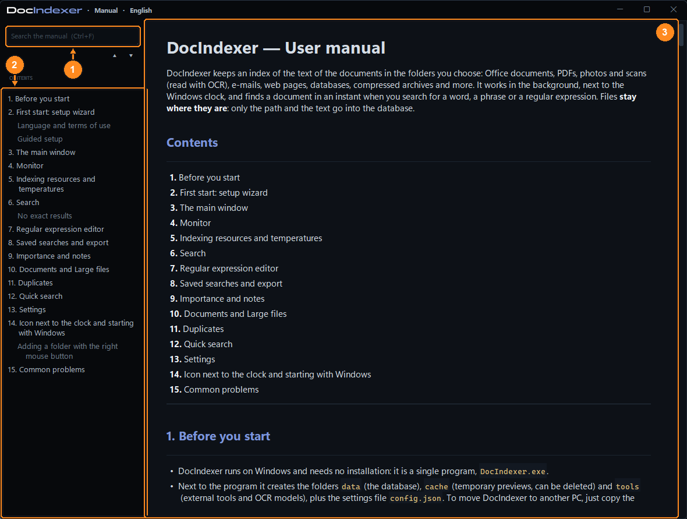

| # | Element | What it does |
|:--:|---|---|
| **①** | **Search the manual (Ctrl+F)** | Highlights all matches; Enter goes to the next one. |
| **②** | **Contents** | A click goes to the chapter. |
| **③** | **Text** | The manual; a click on an image opens it full size. |

In the manual window the contents on the left jump to a chapter with one click, the **Search the manual** field (Ctrl+F) highlights every match (Enter = next, Shift+Enter = previous) and clicking an image opens it at full size. Esc closes the window.

## 4. Monitor

The Monitor shows how far indexing has got.

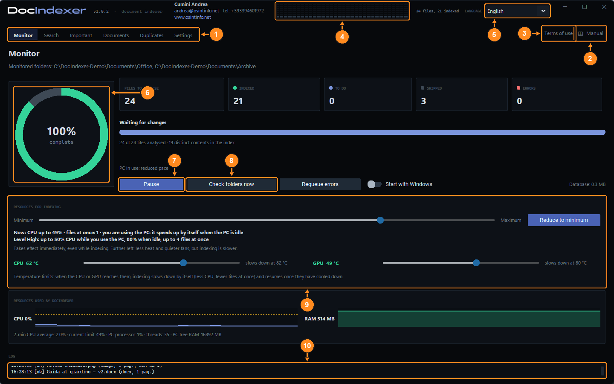

| # | Element | What it does |
|:--:|---|---|
| **①** | **Tabs** | The pages of the program. |
| **②** | **📖 Manual** | Opens this manual in the program's language. |
| **③** | **Terms of use** | Shows again the terms of use accepted at first start. |
| **④** | **Equalizer** | Moves while DocIndexer is working. |
| **⑤** | **Language** | Changes the interface language. |
| **⑥** | **Progress** | How much of the files is already analysed. |
| **⑦** | **Pause** | Pauses and resumes indexing. |
| **⑧** | **Check folders now** | Looks for new or changed files right away. |
| **⑨** | **Resources for indexing** | How much CPU to use and temperature limits (chapter 5). |
| **⑩** | **Log** | The work messages, file by file. |

- **Monitored folders**: the list of folders under the title.
- **Pie chart** and boxes: **Files to analyse** (all files found), **Indexed**, **To do**, **Skipped** (no readable text, or excluded) and **Errors**.
- Current **phase**: counting files, computing hashes, extracting text, or *Waiting for changes* when it has finished. Below are the progress bar, the file being worked on and the current pace: *PC in use: reduced pace*, *PC idle: full pace*, *PC busy: waiting* (other programs are already using a lot of CPU) or *On battery: minimum pace*.
- **Pause / Resume** stops and restarts indexing.
- **Check folders now** looks right away for new, changed, moved or deleted files (DocIndexer also does this by itself at startup and every few hours, and follows changes in real time while it runs).
- **Requeue errors** retries the files it could not read.
- **Start with Windows** turns automatic startup on or off immediately.
- **Database**: the current size of the database.
- **Log**: at the bottom of the page, the latest operations.

How it works: first it counts the files, then it computes a fingerprint of each file's content (SHA-256) and extracts the text. A file identical to one already read is not analysed again; a moved or renamed file only changes its path in the index; a deleted file is removed.

## 5. Indexing resources and temperatures

In the Monitor, the **Resources for indexing** panel decides how much of the PC DocIndexer may use.

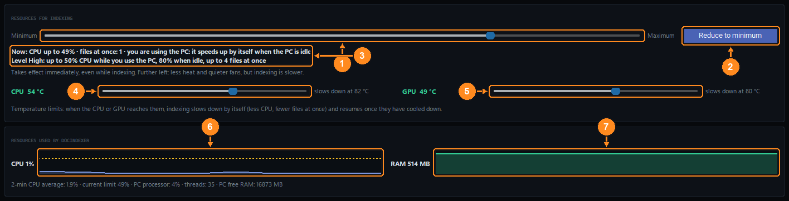

| # | Element | What it does |
|:--:|---|---|
| **①** | **Resource level** | From Minimum to Maximum; applies immediately. |
| **②** | **Reduce to minimum** | Moves the level all the way to the left. |
| **③** | **Now** | What the chosen level does right now. |
| **④** | **CPU limit** | Above this temperature indexing slows down. |
| **⑤** | **GPU limit** | The same for the graphics card. |
| **⑥** | **CPU chart** | CPU used by DocIndexer; the dashed line is the limit. |
| **⑦** | **RAM chart** | Memory used by DocIndexer. |

The **slider** goes from **Minimum** to **Maximum** and takes effect immediately, even while indexing. Further left means less heat and quieter fans, but slower indexing. **Reduce to minimum** moves the slider all the way to the left with one click.

| Level | CPU while you use the PC | CPU when the PC is idle | Notes |
|---|---|---|---|
| Minimum | 5% | 5% | one file at a time, Windows power saving |
| Low | 10% | 25% | one file at a time, Windows power saving |
| Medium | 25% | 60% | two files at once |
| High | 50% | 80% | several files at once (about half the cores) |
| Maximum | 90% | 100% | almost all cores |

Under the slider two lines say what is happening now (for example *Now: CPU up to 60% · files at once: 2 · PC idle: full power*) and what the chosen level provides.

**PC idle**: when you do not use keyboard and mouse for a few minutes (3 by default, can be changed in Settings) the limit rises gradually to the "idle" value; as soon as you are back it drops again. While you type or click in the DocIndexer window, indexing also steps aside for a few seconds, so search and previews stay fast.

**Temperatures**: the **CPU** and **GPU** rows show the current temperature (green, amber when it gets close to the limit, red when it reaches it) and a slider with the limit, from 50 to 100 °C (82 °C for the CPU and 80 °C for the GPU by default). When the limit is reached, indexing slows down by itself (less CPU, fewer files at once) and resumes once the component has cooled down. If a sensor cannot be read, *not available* is shown.

The **Resources used by DocIndexer** panel shows the CPU and RAM used by the program in the last two minutes; the dashed line is the CPU limit in force. Below are the average, the current limit, the total processor load and the PC's free RAM.

## 6. Search

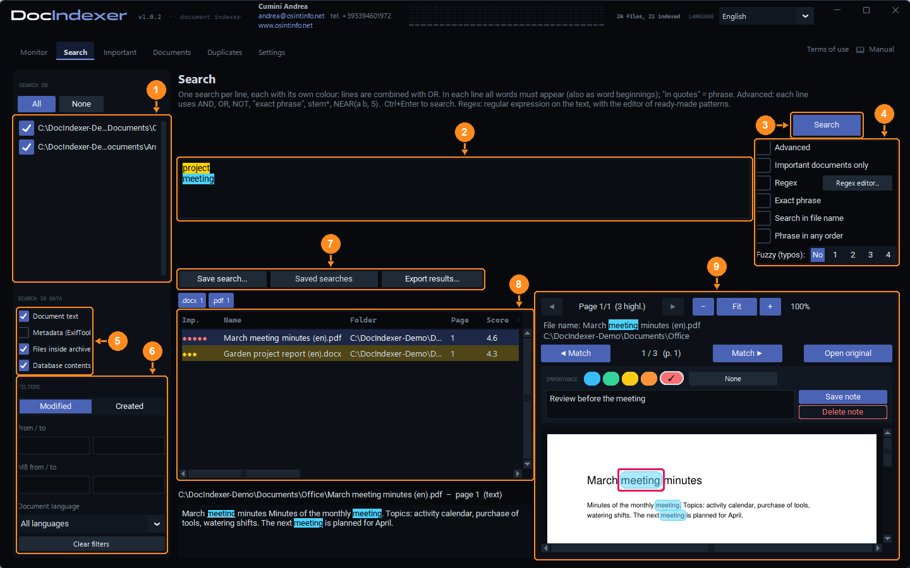

| # | Element | What it does |
|:--:|---|---|
| **①** | **Search in** | The folders to search in (**All** / **None**). |
| **②** | **Search box** | One search per line, each with its own colour. |
| **③** | **Search** | Starts the search (also Ctrl+Enter). |
| **④** | **Options** | Advanced, regex with its editor, exact phrase, file name, fuzzy. |
| **⑤** | **Search in data** | Text, metadata, archives and databases to include. |
| **⑥** | **Filters** | Dates, size and language; **Clear filters** removes them. |
| **⑦** | **Save and export** | Saves the search, opens the saved searches, exports the results. |
| **⑧** | **Results** | A click shows the document in the preview. |
| **⑨** | **Preview** | Pages, highlighted matches, importance and note, **Open original**. |

**What to type.** In the large box, type one search per line; each line has its own colour, which you find again in the results and in the preview, and the lines are alternatives (one of them is enough). In a line all the words must appear, also as the start of a word; capitals and accents do not matter; a phrase "in quotes" is searched as it is. Press **Search** or Ctrl+Enter.

**Options** to the right of the box:

- **Advanced**: each line uses the full syntax: `AND`, `OR`, `NOT`, `"exact phrase"`, `stem*`, `NEAR(a b, 5)`.
- **Important documents only**: only the files you gave a colour to (see [chapter 9](#9-importance-and-notes)).
- **Regex**: the line is a regular expression searched in the text; **Regex editor...** opens the editor (see [chapter 7](#7-regular-expression-editor)). A long regex search can be stopped with **Stop search**.
- **Exact phrase**, **Search in file name**, **Phrase in any order**.
- **Fuzzy (typos)**: accepts 1 to 4 errors per word, including typical OCR swaps (0/o, 1/l, rn/m). If a normal search finds nothing, DocIndexer tries again by itself allowing one error and tells you so.

**On the left** you choose **where** to search:

- **Search in**: the monitored folders to search (**All** / **None**).
- **Search in data**: document text, metadata (ExifTool), files inside archives, database contents.
- **Filters**: period (**Modified** or **Created**, dates as yyyy-mm-dd, also just yyyy or yyyy-mm), size in MB, **document language** (recognised automatically for each file). **Clear filters** removes them all.

**The results.** Above the table there is a button for each file type found (.pdf, .docx...) with the number of results: a click hides or shows that type, **All** and **None** change them all. The columns are importance, name, folder, page, relevance, creation date and an excerpt with the coloured words; clicking a header sorts the column. Below the table is the extracted text of the page found, with the words highlighted.

**The preview** on the right shows the real page of the document with the matches framed: the arrows change page, **−**, **Fit** and **+** change the zoom (the mouse wheel too), **◀ Match** and **Match ▶** jump from one hit to the next, **Open original** (or a double click on the result) opens the file with its program. For Office documents the preview is prepared with Office and may take a few seconds.

### No exact results

If a search finds nothing, DocIndexer tries again by itself, allowing one typing or OCR error per word. In that case a red notice appears above the results and blinks a few times: **No exact results: showing those with 1 typing or OCR error**. Check the results: they may contain words similar to the one you searched for.

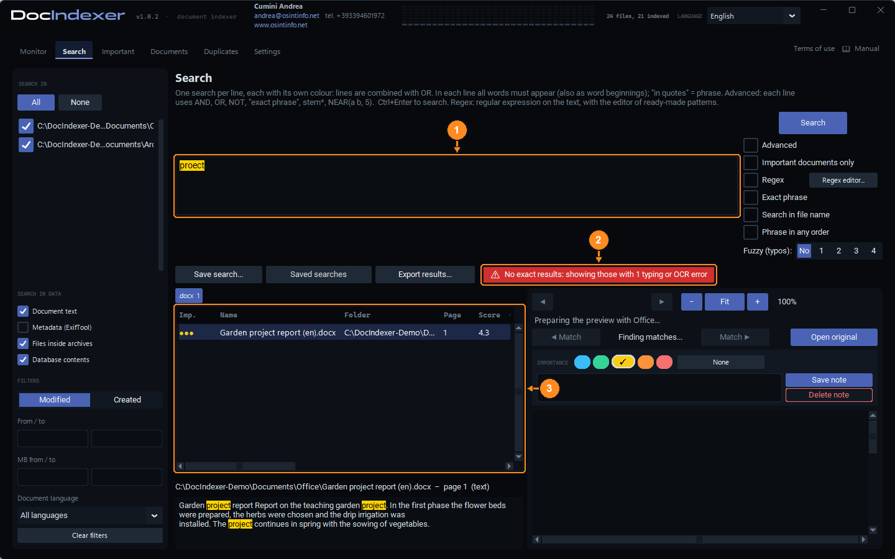

| # | Element | What it does |
|:--:|---|---|
| **①** | **Search with a typo** | One letter is missing here. |
| **②** | **Red notice** | Blinks: no exact results, those with 1 error are shown. |
| **③** | **Results** | The documents with the correct word. |

## 7. Regular expression editor

A regular expression (regex) searches for a *pattern* instead of a word: for example any date, any web address or any code with a certain format.

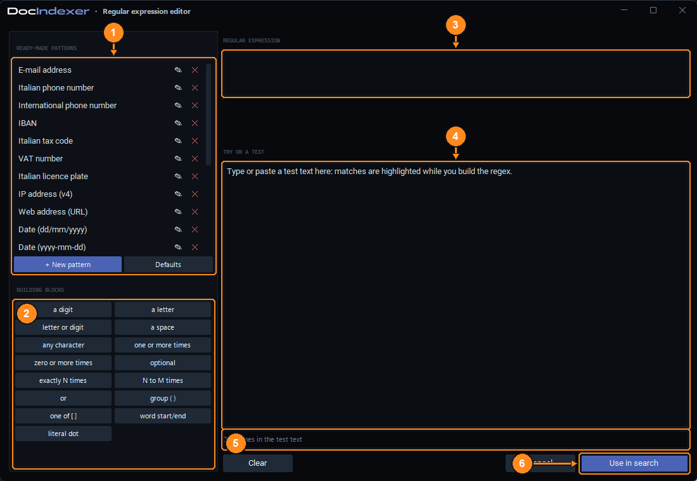

| # | Element | What it does |
|:--:|---|---|
| **①** | **Ready-made patterns** | Ready-made patterns: a click uses one; **+ New pattern** adds one. |
| **②** | **Building blocks** | Pieces to insert without knowing the syntax. |
| **③** | **Regular expression** | The regex you are building. |
| **④** | **Try on a text** | Test text: matches are highlighted right away. |
| **⑤** | **Count** | How many matches are in the test text. |
| **⑥** | **Use in search** | Takes the regex to the Search page. |

- **Ready-made patterns**: patterns already written, including e-mail address, phone numbers, IBAN, Italian tax code and VAT number, number plate, IP address, URL, dates, times, amounts, GPS coordinates, hashtags and user names. One click puts it in the field; you can add your own with **New pattern** and go back to the original list with **Defaults**.
- **Building blocks**: pieces to combine without remembering the syntax (a digit, a letter, one or more times, optional, "or", groups, word start/end...).
- **Regular expression**: the field with the pattern; below it, a plain-language explanation of what it searches for.
- **Try on a text**: type or paste a sample text and the matches are highlighted as you type. **Clear** deletes the text.

**Use in search** takes the pattern to the Search page, with the Regex option on, and starts the search.

## 8. Saved searches and export

**Save search...** (under the Search box) saves the current search with a name, together with options and filters. If you tick **Notify me when new files match this search**, DocIndexer repeats it by itself when it indexes new files and shows a Windows notification next to the clock.

| # | Element | What it does |
|:--:|---|---|
| **①** | **Notify** | Repeats the search on new files and notifies near the clock. |
| **②** | **Open** | Puts the search back on the Search page and runs it. |
| **③** | **✕** | Deletes the saved search. |
| **④** | **Check now** | Repeats the searches with notification right away. |

**Saved searches** opens the list: for each one you see the notification (on or off), how many new files it found and when it was checked. **Open** puts it back in the Search page and runs it, **New only** shows only the files that arrived since last time, **Check now** repeats it immediately; it can also be deleted. When there are new files, the Saved searches button shows how many.

**Export results...** saves the results to **Excel** (.xlsx, rows coloured by importance), **CSV** (`;` separator, opens in Excel) or **PDF**, with importance and notes. The same **Export...** button is in Documents, Important and Duplicates.

## 9. Importance and notes

In the preview, under the file name, every document can have an **importance colour** (light blue, green, yellow, orange, red, from least to most important; **None** removes it) and a **note** written by you (**Save note**, **Delete note**). Colour and note stay attached to the file even if it is moved, renamed or changed.

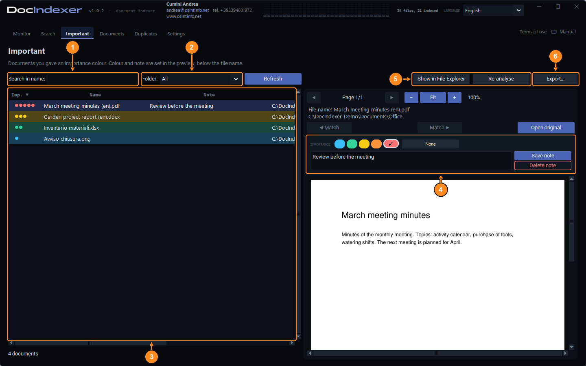

| # | Element | What it does |
|:--:|---|---|
| **①** | **Search in name** | Filters the list as you type. |
| **②** | **Folder** | Shows only one monitored folder. |
| **③** | **List** | The coloured documents, most important first, with the note. |
| **④** | **Importance** | Five colours and a note; **Save note** stores it. |
| **⑤** | **Show and re-analyse** | Opens the file's folder or puts it back in the queue. |
| **⑥** | **Export** | Saves the list as CSV, Excel or HTML. |

The **Important** tab lists only the coloured documents, the most important at the top, with the note. In every list the colour appears as dots at the start of the row and the row is lightly tinted. In Search the **Important documents only** option limits the search to these files.

## 10. Documents and Large files

The **Documents** tab lists all indexed files.

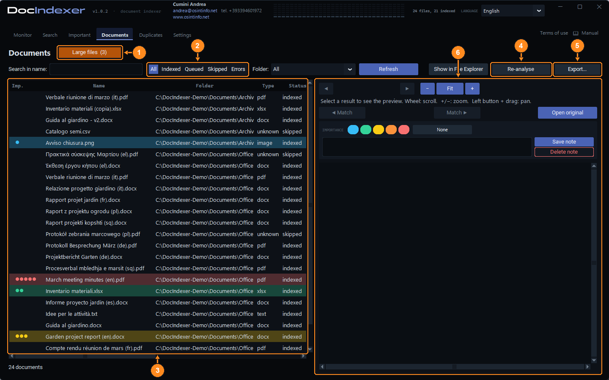

| # | Element | What it does |
|:--:|---|---|
| **①** | **Large files** | Files over the size limit, waiting for a choice. |
| **②** | **Status** | All, indexed, queued, skipped or with errors. |
| **③** | **List** | All the files found, with folder, type and status. |
| **④** | **Re-analyse** | Puts the selected file back in the queue. |
| **⑤** | **Export** | Saves the list as CSV, Excel or HTML. |
| **⑥** | **Preview** | The selected document, with importance and note. |

- **Search in name**: filters the list as you type.
- **All / Indexed / Queued / Skipped / Errors**: filters by status. **Folder** filters by monitored folder. **Refresh** reloads the list.
- The columns show importance, name, folder, type, status, language, pages, pages read with OCR, characters, creation and modification date and SHA-256 fingerprint. Clicking a header sorts; hovering over a truncated cell shows the full text.
- You can select several rows (Ctrl or Shift + click, Ctrl+A). **Show in Explorer** opens the file's folder, **Re-analyse** reads the selected files again, **Export...** saves the list. A double click opens the file.

**Large files.** Files larger than the set limit (200 MB by default) are not analysed automatically: the **Large files** button turns orange and shows how many are waiting.

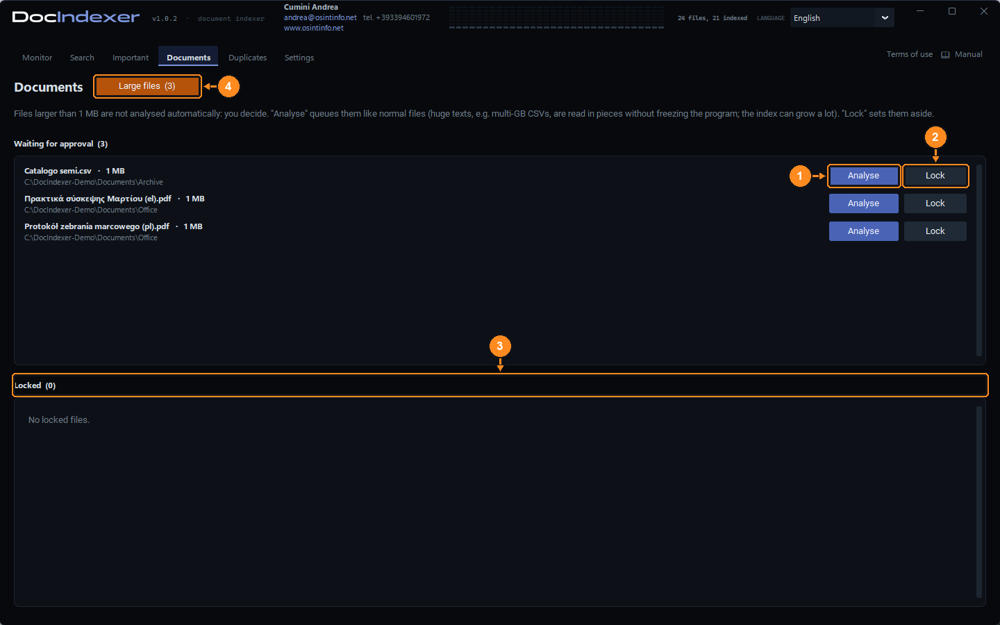

| # | Element | What it does |
|:--:|---|---|
| **①** | **Analyse** | Puts the file in the queue like the others. |
| **②** | **Lock** | Sets it aside without analysing it. |
| **③** | **Locked** | The locked files; **Unlock** puts them back on hold. |
| **④** | **Large files** | Goes back to the document list. |

For each waiting file choose **Analyse** (it is queued like a normal file; huge texts are read in pieces without freezing the program, but the index can grow a lot) or **Lock** (set aside). In the **Locked** list, **Unlock** puts it back on hold. **← Documents** returns to the list.

## 11. Duplicates

The **Duplicates** tab finds two kinds of copies. Press **Find duplicates**.

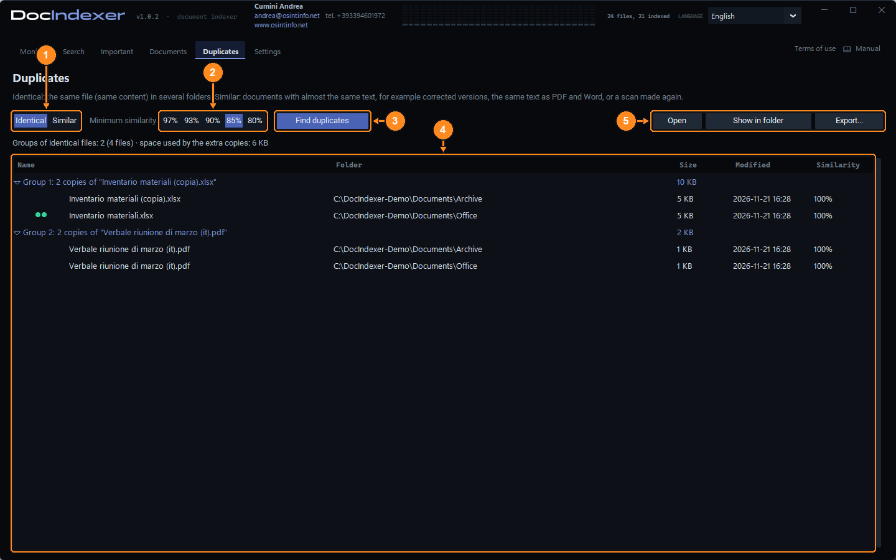

| # | Element | What it does |
|:--:|---|---|
| **①** | **Identical / Similar** | Same file or almost the same text. |
| **②** | **Minimum similarity** | How alike the similar documents must be. |
| **③** | **Find duplicates** | Starts the search. |
| **④** | **Groups** | One group per set of copies, with the space used. |
| **⑤** | **Open, show, export** | For the selected file or the whole list. |

- **Identical**: the same file (same content) in several folders. Each group shows how many copies there are and the space they take; at the top is the total space taken by the extra copies.

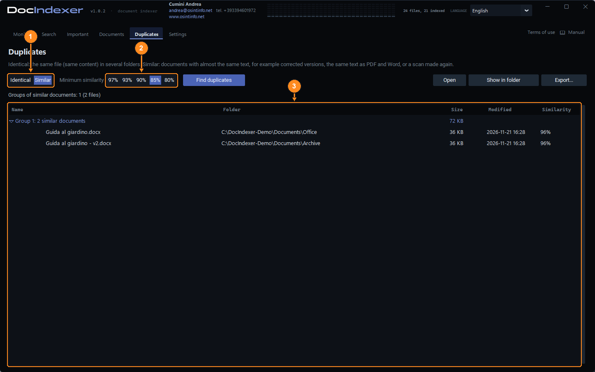

| # | Element | What it does |
|:--:|---|---|
| **①** | **Similar** | Documents with almost the same text. |
| **②** | **Minimum similarity** | From 97% to 80%: lower finds more pairs. |
| **③** | **Groups** | The Similarity column shows each file's value. |

- **Similar**: documents with almost the same text, for example corrected versions of the same document, the same text in PDF and in Word, or a scan made again. **Minimum similarity** chooses how alike they must be (from 97% to 80%); the Similarity column shows each file's value.

**Open**, **Show in folder** and **Export...** work on the selected file or on the list.

## 12. Quick search

Quick search is a search bar that opens on top of any program, with the shortcut **Ctrl+Alt+D** (can be changed in Settings) or from the menu of the icon next to the clock.

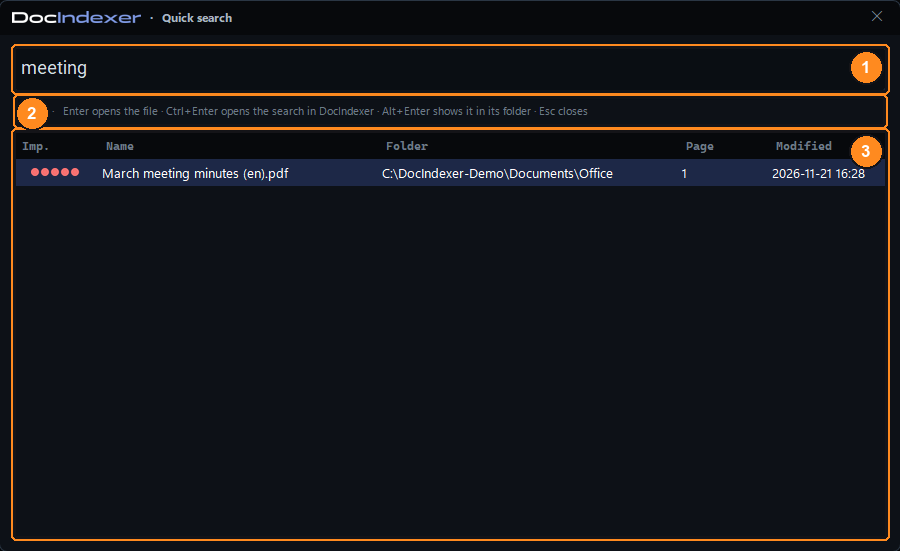

| # | Element | What it does |
|:--:|---|---|
| **①** | **Search field** | Searches as you type. |
| **②** | **Keys** | Enter, Ctrl+Enter, Alt+Enter, Esc. |
| **③** | **Results** | Pick the file with the arrow keys. |

It searches as you type. Choose a result with the arrow keys; **Enter** opens the file, **Ctrl+Enter** opens the full search in DocIndexer, **Alt+Enter** shows the file in its folder, **Esc** closes the bar.

## 13. Settings

Changes apply only after **Save**. **Discard changes** goes back to the saved settings; **Restore default settings** brings back the factory values. If you switch tab with unsaved changes, DocIndexer asks whether to save them.

**Folders and extensions** has the same tables as the setup wizard: monitored folders, excluded subfolders, included and excluded extensions, folders skipped by name.

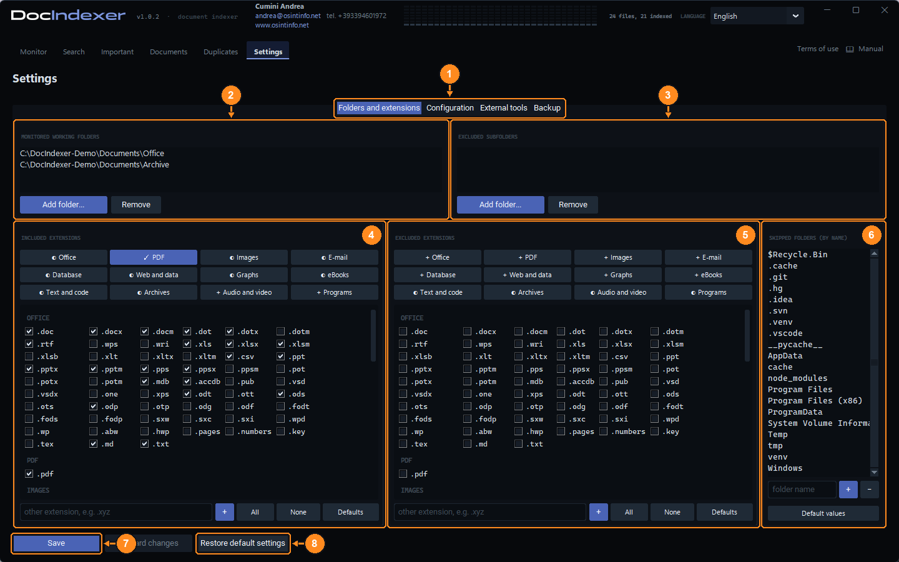

| # | Element | What it does |
|:--:|---|---|
| **①** | **Settings tabs** | Folders, configuration, external tools, backup. |
| **②** | **Monitored working folders** | The folders to index. |
| **③** | **Excluded subfolders** | Parts of the folders to skip. |
| **④** | **Included extensions** | The file types to read. |
| **⑤** | **Excluded extensions** | The file types to ignore. |
| **⑥** | **Skipped folders (by name)** | Folders skipped wherever they are. |
| **⑦** | **Save** | Applies the changes. |
| **⑧** | **Restore default settings** | Goes back to the initial values. |

**Configuration**:

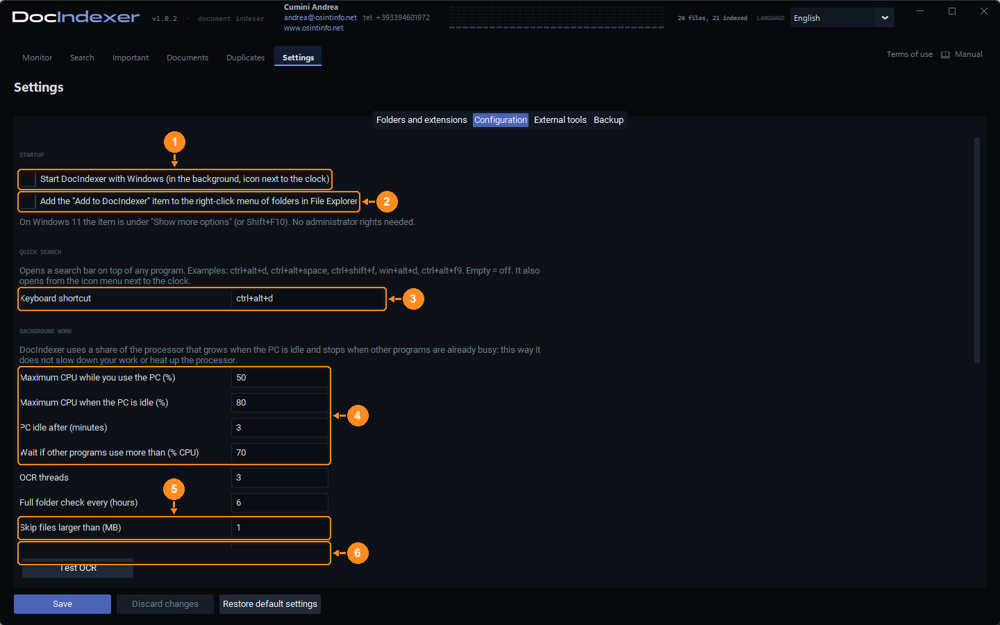

| # | Element | What it does |
|:--:|---|---|
| **①** | **Start with Windows** | Applies immediately, without pressing Save. |
| **②** | **Add to DocIndexer** | Right-click item for folders in File Explorer; applies immediately. |
| **③** | **Keyboard shortcut** | The quick search keys (empty = off). |
| **④** | **Background work** | CPU with the PC in use and idle, waiting time, busy programs. |
| **⑤** | **Skip files larger than (MB)** | Above this limit files go to **Large files**. |
| **⑥** | **Interface size (%) — does not follow Windows zoom** | Enlarges or shrinks the whole window. |

- **Startup**: start with Windows (applies immediately).
- **Add to DocIndexer**: adds the item to the right-click menu of folders in File Explorer; applies immediately, without Save (see chapter 14).
- **Quick search**: the keyboard shortcut, for example `ctrl+alt+d`, `ctrl+shift+f` or `win+alt+d`; empty = off. If the shortcut is already used by another program, a warning appears.
- **Background work**: maximum CPU while you use the PC and when it is idle, after how many minutes the PC counts as idle, above which load of other programs DocIndexer waits, OCR threads, how often (hours) to recheck all folders, maximum file size (larger files go to **Large files**), interface size (in %, independent of the Windows zoom; applies from the next start). The first values also change with the Monitor slider.
- **Add-on modules**: metadata with ExifTool, text of files inside archives (7-Zip), SQLite, dBASE/FoxPro and Access databases. Each module keeps its data separately; in Search you choose which to search.
- **OCR (RapidOCR)**: the model. **Automatic** reads the first scanned page with the Latin model and, if the result is uncertain, tries the other downloaded models and keeps the one that reads best. A higher **OCR resolution (DPI)** reads small characters better but is slower. **Test OCR** runs a check.
- **SQLite databases**: the database file.

**External tools** shows the status of the OCR models and of the optional tools (ExifTool, 7-Zip, Access driver). **Install** or **Reinstall** downloads a tool into the `tools` folder, **Install everything missing** downloads them all, **Check again** refreshes the status. They work without being installed in the system.

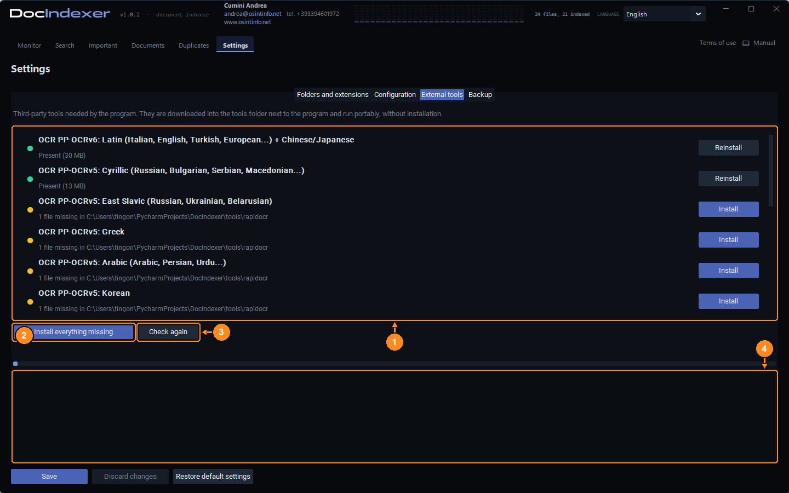

| # | Element | What it does |
|:--:|---|---|
| **①** | **Tools** | Each tool with its status and the button to install it. |
| **②** | **Install everything missing** | Downloads all the missing tools at once. |
| **③** | **Check again** | Reads the tools' status again. |
| **④** | **Log** | Download progress and messages. |

**Backup**: **Create backup...** saves to a .zip file the database (index, notes, importance colours), the settings, the regex patterns and the saved searches, even while indexing is running. **Restore from backup...** replaces them and restarts DocIndexer; the previous database stays alongside with the `.before-restore` extension.

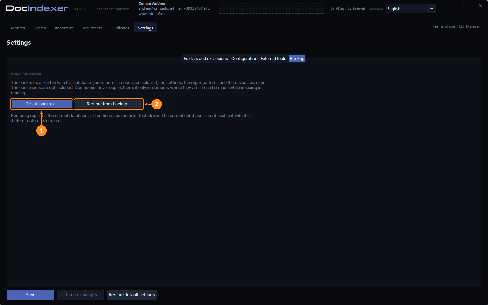

| # | Element | What it does |
|:--:|---|---|
| **①** | **Create backup** | Saves database, settings, patterns and searches in a .zip. |
| **②** | **Restore from backup** | Replaces the current data with the backup and restarts. |

## 14. Icon next to the clock and starting with Windows

When the window is closed DocIndexer keeps working and stays as an icon next to the clock. Hovering over it shows the status; a right click opens the menu:

- **Open DocIndexer** (also with a click on the icon);
- **Pause indexing** / **Resume indexing**;
- **Check folders now**;
- **Quick search**;
- **Manual**;
- **Start with Windows** (ticked when it is on);
- **Exit**, which really closes the program.

If you start DocIndexer a second time no new copy starts: the window of the one already running is shown. Starting with Windows applies only to your user and needs no administrator rights.

### Adding a folder with the right mouse button

With the **Add to DocIndexer** option on (Settings › Configuration › Startup), right-clicking a folder in File Explorer shows **Add to DocIndexer**: the folder joins the monitored folders and indexing starts at once, even if DocIndexer was already open. On Windows 11 the item is under "Show more options" (or Shift+F10). If the folder is already monitored, or lies inside a monitored folder, DocIndexer says so and changes nothing; if it contains folders that are already monitored, it takes their place. No administrator rights are needed.

## 15. Common problems

- **A document cannot be found.** Check in the Monitor that indexing has finished; in Documents look for the file by name and check its status (*Queued*, *Skipped*, *Errors*). Make sure the folder is monitored and the extension is among the included ones.
- **Many files among the errors.** A file may be password-protected, damaged or open in another program. **Requeue errors** in the Monitor retries them.
- **A scan is not read.** Check in Settings › External tools that the OCR model for the right alphabet is installed; with the **Automatic** model it is chosen by itself among those downloaded.
- **The PC is noisy or hot.** Move the resources slider to the left or press **Reduce to minimum**; lower the temperature limits.
- **Indexing is slow.** Move the slider to the right; remember that when the PC is idle DocIndexer speeds up by itself.
- **A very large file does not appear.** It is in **Documents › Large files**, waiting for your approval.
- **The quick search shortcut does not work.** Another program is using it: choose another one in Settings › Configuration.
- **Moving DocIndexer to another PC.** Copy the whole program folder, or create a backup and restore it on the new PC.
