# DocIndexer — Manual de usuario

DocIndexer mantiene un índice del texto de los documentos que hay en las carpetas que usted elige: documentos de Office, PDF, fotos y escaneos (leídos con OCR), correos electrónicos, páginas web, bases de datos, archivos comprimidos y más. Trabaja en segundo plano, junto al reloj de Windows, y encuentra un documento al instante cuando busca una palabra, una frase o una expresión regular. Los archivos **se quedan donde están**: en la base de datos solo se guardan la ruta y el texto.

## Índice

1. [Antes de empezar](#1-antes-de-empezar)
2. [Primer inicio: configuración guiada](#2-primer-inicio-configuración-guiada)
3. [La ventana principal](#3-la-ventana-principal)
4. [Monitor](#4-monitor)
5. [Recursos para la indexación y temperaturas](#5-recursos-para-la-indexación-y-temperaturas)
6. [Búsqueda](#6-búsqueda)
7. [Editor de expresiones regulares](#7-editor-de-expresiones-regulares)
8. [Búsquedas guardadas y exportación](#8-búsquedas-guardadas-y-exportación)
9. [Importancia y notas](#9-importancia-y-notas)
10. [Documentos y Archivos grandes](#10-documentos-y-archivos-grandes)
11. [Duplicados](#11-duplicados)
12. [Búsqueda rápida](#12-búsqueda-rápida)
13. [Ajustes](#13-ajustes)
14. [Icono junto al reloj e inicio con Windows](#14-icono-junto-al-reloj-e-inicio-con-windows)
15. [Problemas frecuentes](#15-problemas-frecuentes)

---

## 1. Antes de empezar

- DocIndexer funciona en Windows y no necesita instalación: es un único programa, `DocIndexer.exe`.
- Junto al programa se crean las carpetas `data` (la base de datos), `cache` (vistas previas temporales, se puede borrar) y `tools` (herramientas externas y modelos OCR), además del archivo de ajustes `config.json`. Para llevar DocIndexer a otro PC basta con copiar la carpeta entera.
- El modelo OCR principal (alfabeto latino más chino y japonés) ya está incluido. Los demás alfabetos y las herramientas opcionales (ExifTool para los metadatos, 7-Zip para los archivos comprimidos) se descargan desde **Ajustes › Herramientas externas** (véase el [capítulo 13](#13-ajustes)).
- Los documentos nunca se mueven, copian ni modifican.

## 2. Primer inicio: configuración guiada

### Idioma y términos de uso

La primerísima vez que se abre, DocIndexer pide el idioma y luego muestra los términos de uso en ese idioma.

| # | Elemento | Para qué sirve |
|:--:|---|---|
| **①** | **Idioma** | Un clic elige el idioma del programa y del manual. |

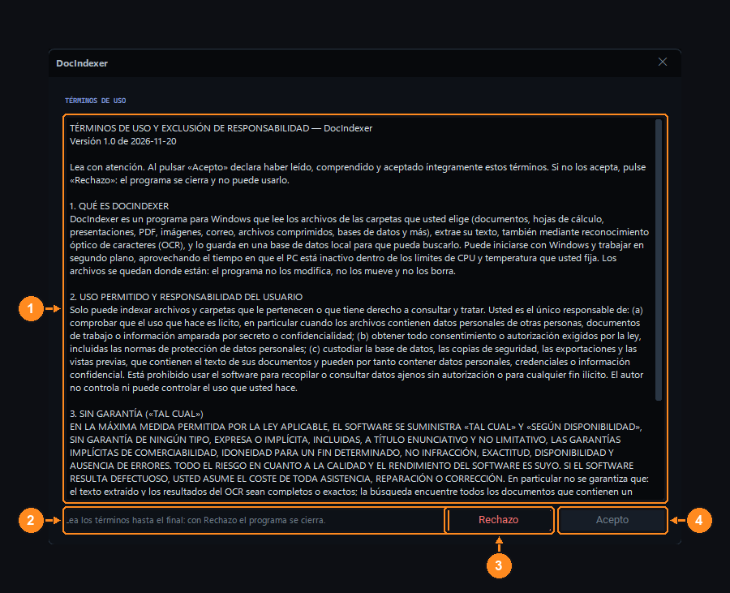

| # | Elemento | Para qué sirve |
|:--:|---|---|
| **①** | **Texto de los términos** | Hay que desplazarlo hasta el final. |
| **②** | **Nota** | Se vuelve verde cuando has leído todo. |
| **③** | **Rechazo** | Cierra el programa. |
| **④** | **Acepto** | Se activa al final del texto y continúa con la configuración. |

**Acepto** solo se activa después de desplazar el texto hasta el final; **Rechazo** (o cerrar la ventana) cierra el programa. La respuesta se recuerda: los términos solo se vuelven a pedir si cambian. Puedes releerlos cuando quieras con el botón **Términos de uso** junto a **📖 Manual**.

### Configuración guiada

La primera vez que se abre, DocIndexer pregunta dónde debe buscar.

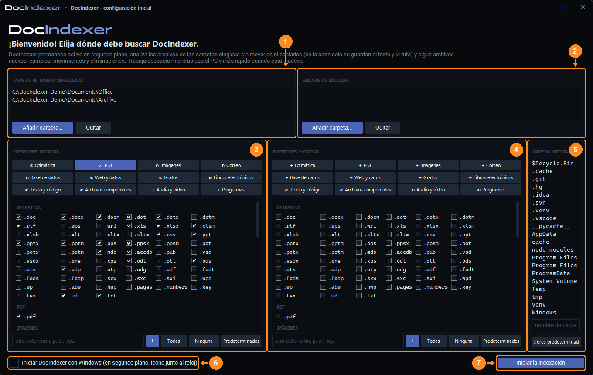

| # | Elemento | Para qué sirve |
|:--:|---|---|
| **①** | **Carpetas de trabajo supervisadas** | Las carpetas que se indexan: **Añadir carpeta...** y **Quitar**. |
| **②** | **Subcarpetas excluidas** | Partes de las carpetas elegidas que se omiten. |
| **③** | **Extensiones incluidas** | Los tipos de archivo que se leen; los botones de categoría los eligen por grupos. |
| **④** | **Extensiones excluidas** | Tipos de archivo que siempre se ignoran. |
| **⑤** | **Carpetas omitidas (por nombre)** | Carpetas que se omiten estén donde estén (por ejemplo .git, Temp). |
| **⑥** | **Iniciar con Windows** | DocIndexer se inicia solo al encender, en segundo plano. |
| **⑦** | **Iniciar la indexación** | Guarda las opciones y empieza el trabajo. |

1. **Carpetas de trabajo supervisadas**: pulse **Añadir carpeta...** para cada carpeta que quiera indexar (por ejemplo Documentos o una carpeta de red); **Quitar** la elimina de la lista.
2. **Subcarpetas excluidas**: carpetas concretas, dentro de las supervisadas, que no se deben analizar.
3. **Extensiones incluidas** y **extensiones excluidas**: los tipos de archivo que se leen. Los botones de grupo (Ofimática, PDF, Imágenes, Correo, Base de datos, Web y datos, Grafos, Libros electrónicos, Texto y código, Archivos comprimidos, Audio y vídeo, Programas) marcan todo el grupo con un clic y lo desmarcan con otro; **Todas**, **Ninguna** y **Predeterminados** hacen lo que dicen. En el campo de abajo puede añadir una extensión a mano.
4. **Carpetas omitidas (por nombre)**: carpetas que se ignoran estén donde estén, como `$Recycle.Bin`, `.git` o `node_modules`.
5. **Iniciar DocIndexer con Windows**: si está marcado, DocIndexer arranca solo al iniciar sesión, con solo el icono junto al reloj.

Pulse **Iniciar la indexación**. Todo lo que elija aquí se puede cambiar más tarde en **Ajustes**.

## 3. La ventana principal

Arriba está la cabecera, siempre visible:

- el logotipo, la versión y los datos del autor (el correo y la web se pueden pulsar);
- el **indicador de actividad**, que se mueve como el ecualizador de un equipo de música: la altura de las columnas sigue la CPU que usa la indexación y cada archivo recién leído da un golpe en su zona (desde la izquierda: PDF, Office, imágenes, texto y otros); los picos rojos indican un error. Sin trabajo queda una línea apagada; en pausa es ámbar;
- el número de archivos del índice y cuántos están ya indexados;
- el menú **Idioma**, que cambia al momento el idioma de todo el programa;
- los botones minimizar, maximizar y cerrar. **Cerrar la ventana no detiene DocIndexer**: la oculta y el trabajo continúa (véase el [capítulo 14](#14-icono-junto-al-reloj-e-inicio-con-windows)).

Debajo están las pestañas **Monitor**, **Búsqueda**, **Importantes**, **Documentos**, **Duplicados** y **Ajustes**. A la derecha de las pestañas, **📖 Manual** abre este manual en el idioma del programa. Al lado, **Términos de uso** vuelve a mostrar los términos aceptados en el primer inicio.

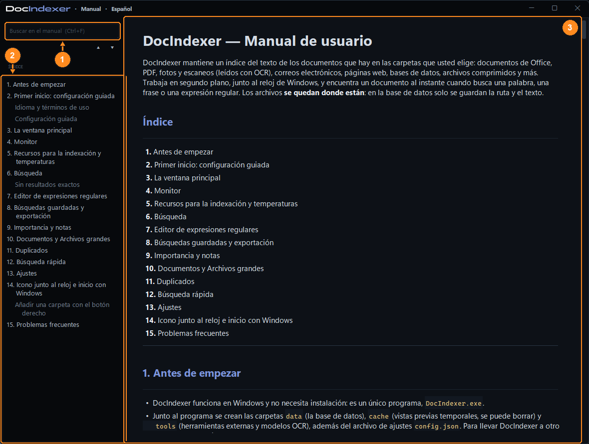

| # | Elemento | Para qué sirve |
|:--:|---|---|
| **①** | **Buscar en el manual (Ctrl+F)** | Resalta todas las coincidencias; Intro pasa a la siguiente. |
| **②** | **Índice** | Un clic lleva al capítulo. |
| **③** | **Texto** | El manual; un clic en una imagen la abre a tamaño completo. |

En la ventana del manual, el índice de la izquierda lleva al capítulo con un clic, el campo **Buscar en el manual** (Ctrl+F) resalta todas las coincidencias (Intro = siguiente, Mayús+Intro = anterior) y un clic en una imagen la abre a tamaño completo. Esc cierra la ventana.

## 4. Monitor

El Monitor muestra cómo va la indexación.

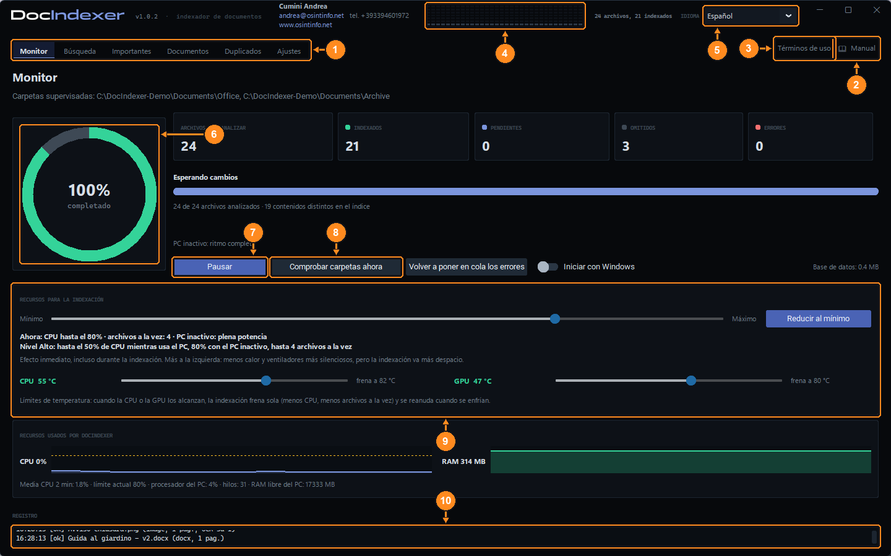

| # | Elemento | Para qué sirve |
|:--:|---|---|
| **①** | **Pestañas** | Las páginas del programa. |
| **②** | **📖 Manual** | Abre este manual en el idioma del programa. |
| **③** | **Términos de uso** | Vuelve a mostrar los términos aceptados en el primer inicio. |
| **④** | **Ecualizador** | Se mueve cuando DocIndexer está trabajando. |
| **⑤** | **Idioma** | Cambia el idioma de la interfaz. |
| **⑥** | **Progreso** | Qué parte de los archivos ya está analizada. |
| **⑦** | **Pausar** | Pausa y reanuda la indexación. |
| **⑧** | **Comprobar carpetas ahora** | Busca enseguida archivos nuevos o cambiados. |
| **⑨** | **Recursos para la indexación** | Cuánta CPU usar y umbrales de temperatura (capítulo 5). |
| **⑩** | **Registro** | Los mensajes del trabajo, archivo por archivo. |

- **Carpetas supervisadas**: la lista bajo el título.
- **Gráfico circular** y recuadros: **Archivos por analizar** (todos los archivos encontrados), **Indexados**, **Pendientes**, **Omitidos** (sin texto legible o excluidos) y **Errores**.
- **Fase** actual: recuento de archivos, cálculo de huellas, extracción del texto, o *Esperando cambios* cuando ha terminado. Debajo están la barra de progreso, el archivo en el que trabaja y el ritmo actual: *PC en uso: ritmo reducido*, *PC inactivo: ritmo completo*, *PC ocupado: en espera* (los demás programas ya usan mucha CPU) o *Con batería: ritmo mínimo*.
- **Pausar / Reanudar** detiene y reanuda la indexación.
- **Comprobar carpetas ahora** busca enseguida archivos nuevos, modificados, movidos o borrados (DocIndexer también lo hace solo al arrancar y cada pocas horas, y sigue los cambios en tiempo real mientras está en marcha).
- **Volver a poner en cola los errores** reintenta los archivos que no pudo leer.
- **Iniciar con Windows** activa o desactiva al momento el inicio automático.
- **Base de datos**: el tamaño actual de la base de datos.
- **Registro**: al final de la página, las últimas operaciones.

Cómo trabaja: primero cuenta los archivos, luego calcula para cada uno una huella del contenido (SHA-256) y extrae el texto. Un archivo idéntico a otro ya leído no se vuelve a analizar; un archivo movido o renombrado solo cambia de ruta en el índice; un archivo borrado se elimina.

## 5. Recursos para la indexación y temperaturas

En el Monitor, el recuadro **Recursos para la indexación** decide qué parte del PC puede usar DocIndexer.

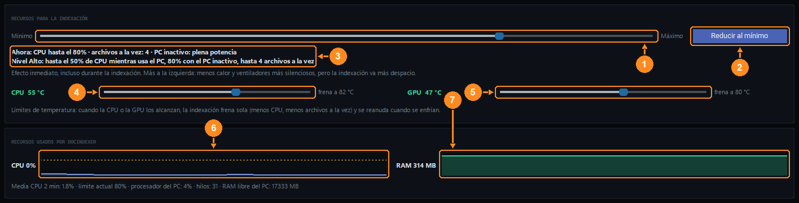

| # | Elemento | Para qué sirve |
|:--:|---|---|
| **①** | **Nivel de recursos** | De Mínimo a Máximo; se aplica enseguida. |
| **②** | **Reducir al mínimo** | Lleva el nivel del todo a la izquierda. |
| **③** | **Ahora** | Qué hace el nivel elegido en este momento. |
| **④** | **Umbral de CPU** | Por encima de esta temperatura la indexación se ralentiza. |
| **⑤** | **Umbral de GPU** | Lo mismo para la tarjeta gráfica. |
| **⑥** | **Gráfico de CPU** | CPU usada por DocIndexer; la línea discontinua es el límite. |
| **⑦** | **Gráfico de RAM** | Memoria usada por DocIndexer. |

El **control deslizante** va de **Mínimo** a **Máximo** y tiene efecto inmediato, incluso durante la indexación. Más a la izquierda significa menos calor y ventiladores más silenciosos, pero una indexación más lenta. **Reducir al mínimo** lleva el control del todo a la izquierda con un clic.

| Nivel | CPU mientras usa el PC | CPU con el PC inactivo | Notas |
|---|---|---|---|
| Mínimo | 5% | 5% | un archivo cada vez, ahorro de energía de Windows |
| Bajo | 10% | 25% | un archivo cada vez, ahorro de energía de Windows |
| Medio | 25% | 60% | dos archivos a la vez |
| Alto | 50% | 80% | varios archivos a la vez (aproximadamente la mitad de los núcleos) |
| Máximo | 90% | 100% | casi todos los núcleos |

Bajo el control, dos líneas dicen qué ocurre ahora (por ejemplo *Ahora: CPU hasta el 60% · archivos a la vez: 2 · PC inactivo: plena potencia*) y qué prevé el nivel elegido.

**PC inactivo**: cuando no usa el teclado ni el ratón durante unos minutos (3 de forma predeterminada, se cambia en Ajustes), el límite sube poco a poco hasta el valor «PC inactivo»; en cuanto vuelve, baja de nuevo. Mientras escribe o hace clic en la ventana de DocIndexer, la indexación también se aparta unos segundos, para que la búsqueda y las vistas previas sigan siendo rápidas.

**Temperaturas**: las filas **CPU** y **GPU** muestran la temperatura actual (verde, ámbar cuando se acerca al límite, roja cuando lo alcanza) y un control con el límite, de 50 a 100 °C (82 °C para la CPU y 80 °C para la GPU de forma predeterminada). Al alcanzar el límite la indexación frena sola (menos CPU, menos archivos a la vez) y se reanuda cuando el componente se ha enfriado. Si un sensor no se puede leer aparece *no disponible*.

El recuadro **Recursos usados por DocIndexer** muestra la CPU y la RAM que usa el programa en los dos últimos minutos; la línea discontinua es el límite de CPU vigente. Debajo aparecen la media, el límite actual, la carga total del procesador y la RAM libre del PC.

## 6. Búsqueda

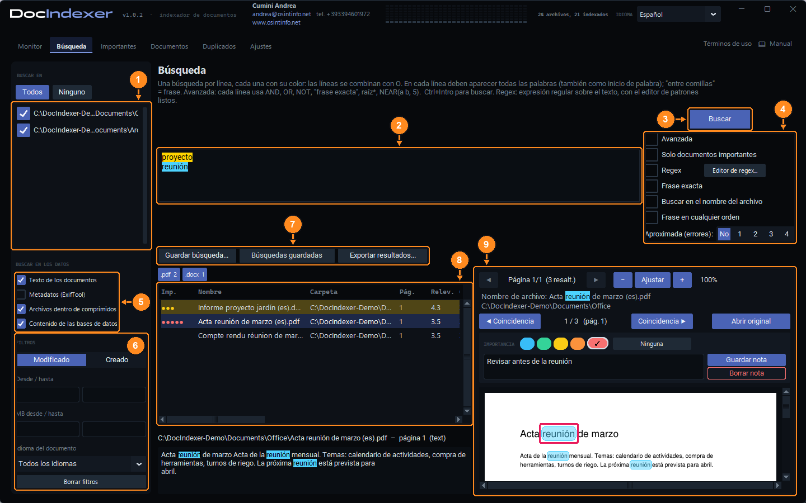

| # | Elemento | Para qué sirve |
|:--:|---|---|
| **①** | **Buscar en** | Las carpetas donde buscar (**Todos** / **Ninguno**). |
| **②** | **Cuadro de búsqueda** | Una búsqueda por línea, cada una con su color. |
| **③** | **Buscar** | Inicia la búsqueda (también Ctrl+Intro). |
| **④** | **Opciones** | Avanzada, regex con su editor, frase exacta, nombre del archivo, aproximada. |
| **⑤** | **Buscar en los datos** | Texto, metadatos, archivos comprimidos y bases de datos que se incluyen. |
| **⑥** | **Filtros** | Fechas, tamaño e idioma; **Borrar filtros** los quita. |
| **⑦** | **Guardar y exportar** | Guarda la búsqueda, abre las búsquedas guardadas, exporta los resultados. |
| **⑧** | **Resultados** | Un clic muestra el documento en la vista previa. |
| **⑨** | **Vista previa** | Páginas, coincidencias resaltadas, importancia y nota, **Abrir original**. |

**Qué escribir.** En el recuadro grande escriba una búsqueda por línea; cada línea tiene su color, que vuelve a ver en los resultados y en la vista previa, y las líneas son alternativas (basta con que aparezca una). En una línea deben aparecer todas las palabras, también como comienzo de palabra; las mayúsculas y los acentos no importan; una frase «entre comillas» se busca tal cual. Pulse **Buscar** o Ctrl+Intro.

**Opciones** a la derecha del recuadro:

- **Avanzada**: cada línea usa la sintaxis completa: `AND`, `OR`, `NOT`, `"frase exacta"`, `raíz*`, `NEAR(a b, 5)`.
- **Solo documentos importantes**: solo los archivos a los que ha dado un color (véase el [capítulo 9](#9-importancia-y-notas)).
- **Regex**: la línea es una expresión regular que se busca en el texto; **Editor de regex...** abre el editor (véase el [capítulo 7](#7-editor-de-expresiones-regulares)). Una búsqueda regex larga se puede parar con **Detener búsqueda**.
- **Frase exacta**, **Buscar en el nombre del archivo**, **Frase en cualquier orden**.
- **Aproximada (errores)**: acepta de 1 a 4 errores por palabra, incluidos los cambios típicos del OCR (0/o, 1/l, rn/m). Si una búsqueda normal no encuentra nada, DocIndexer vuelve a intentarlo solo tolerando un error y lo indica.

**A la izquierda** elige **dónde** buscar:

- **Buscar en**: las carpetas supervisadas en las que buscar (**Todos** / **Ninguno**).
- **Buscar en los datos**: texto de los documentos, metadatos (ExifTool), archivos dentro de comprimidos, contenido de las bases de datos.
- **Filtros**: periodo (**Modificado** o **Creado**, fechas con el formato aaaa-mm-dd, o solo aaaa o aaaa-mm), tamaño en MB, **idioma del documento** (reconocido solo para cada archivo). **Borrar filtros** los quita todos.

**Los resultados.** Encima de la tabla hay un botón por cada tipo de archivo encontrado (.pdf, .docx...) con el número de resultados: un clic oculta o muestra ese tipo, **Todas** y **Ninguna** los cambian todos. Las columnas son importancia, nombre, carpeta, página, relevancia, fecha de creación y un extracto con las palabras coloreadas; un clic en la cabecera ordena la columna. Bajo la tabla está el texto extraído de la página encontrada, con las palabras resaltadas.

**La vista previa** de la derecha muestra la página real del documento con las coincidencias enmarcadas: las flechas cambian de página, **−**, **Ajustar** y **+** cambian el zoom (también la rueda del ratón), **◀ Coincidencia** y **Coincidencia ▶** saltan de un resultado a otro, **Abrir original** (o un doble clic en el resultado) abre el archivo con su programa. En los documentos de Office la vista previa se prepara con Office y puede tardar unos segundos.

### Sin resultados exactos

Si una búsqueda no encuentra nada, DocIndexer vuelve a intentarlo solo, tolerando un error de escritura u OCR por palabra. En ese caso aparece sobre los resultados un aviso rojo que parpadea unas veces: **Sin resultados exactos: se muestran los que tienen 1 error de escritura u OCR**. Revisa los resultados: pueden contener palabras parecidas a la buscada.

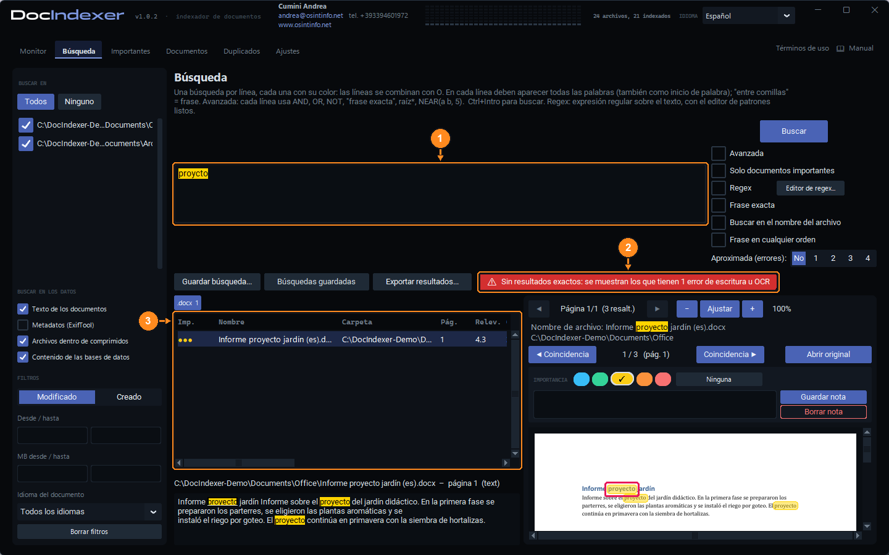

| # | Elemento | Para qué sirve |
|:--:|---|---|
| **①** | **Búsqueda con un error** | Aquí falta una letra. |
| **②** | **Aviso rojo** | Parpadea: sin resultados exactos, se muestran los que tienen 1 error. |
| **③** | **Resultados** | Los documentos con la palabra correcta. |

## 7. Editor de expresiones regulares

Una expresión regular (regex) busca un *patrón* en lugar de una palabra: por ejemplo cualquier fecha, cualquier dirección web o cualquier código con un formato determinado.

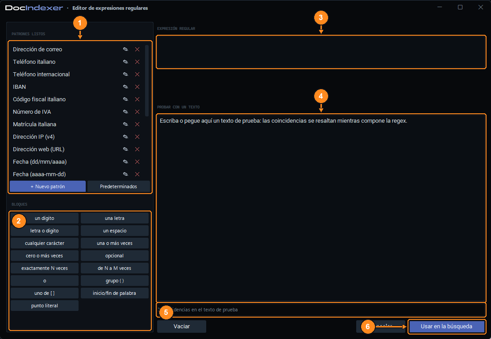

| # | Elemento | Para qué sirve |
|:--:|---|---|
| **①** | **Patrones listos** | Patrones listos: un clic lo usa; **+ Nuevo patrón** añade uno. |
| **②** | **Bloques** | Piezas para insertar sin conocer la sintaxis. |
| **③** | **Expresión regular** | La regex que estás componiendo. |
| **④** | **Probar con un texto** | Texto de prueba: las coincidencias se resaltan al instante. |
| **⑤** | **Recuento** | Cuántas coincidencias hay en el texto de prueba. |
| **⑥** | **Usar en la búsqueda** | Lleva la regex a la página Búsqueda. |

- **Patrones listos**: patrones ya escritos, entre ellos dirección de correo, números de teléfono, IBAN, código fiscal y número de IVA italianos, matrícula, dirección IP, URL, fechas, horas, importes, coordenadas GPS, hashtags y nombres de usuario. Un clic lo coloca en el campo; puede añadir los suyos con **Nuevo patrón** y volver a la lista original con **Predeterminados**.
- **Bloques**: piezas para combinar sin recordar la sintaxis (una cifra, una letra, una o más veces, opcional, «o», grupos, inicio/fin de palabra...).
- **Expresión regular**: el campo con el patrón; debajo, la explicación con palabras de lo que busca.
- **Probar con un texto**: escriba o pegue un texto de prueba y las coincidencias se resaltan mientras escribe. **Vaciar** borra el texto.

**Usar en la búsqueda** lleva el patrón a la página Búsqueda, con la opción Regex activada, y lanza la búsqueda.

## 8. Búsquedas guardadas y exportación

**Guardar búsqueda...** (bajo el recuadro de la Búsqueda) guarda la búsqueda actual con un nombre, junto con opciones y filtros. Si marca **Avisarme cuando nuevos archivos coincidan con esta búsqueda**, DocIndexer la repite solo cuando indexa archivos nuevos y muestra una notificación de Windows junto al reloj.

| # | Elemento | Para qué sirve |
|:--:|---|---|
| **①** | **Aviso** | Repite la búsqueda en los archivos nuevos y avisa junto al reloj. |
| **②** | **Abrir** | Vuelve a poner la búsqueda en la página Búsqueda y la ejecuta. |
| **③** | **✕** | Elimina la búsqueda guardada. |
| **④** | **Comprobar ahora** | Repite enseguida las búsquedas con aviso. |

**Búsquedas guardadas** abre la lista: para cada una ve el aviso (activo o no), cuántos archivos nuevos ha encontrado y cuándo se comprobó. **Abrir** la devuelve a la página Búsqueda y la ejecuta, **Solo los nuevos** muestra solo los archivos llegados desde la última vez, **Comprobar ahora** la repite enseguida; también se puede eliminar. Cuando hay archivos nuevos, el botón Búsquedas guardadas indica cuántos.

**Exportar resultados...** guarda los resultados en **Excel** (.xlsx, filas coloreadas según la importancia), **CSV** (separador `;`, se abre en Excel) o **PDF**, con importancia y notas. El mismo botón **Exportar...** está en Documentos, Importantes y Duplicados.

## 9. Importancia y notas

En la vista previa, bajo el nombre del archivo, cada documento puede tener un **color de importancia** (celeste, verde, amarillo, naranja, rojo, del menos al más importante; **Ninguna** lo quita) y una **nota** escrita por usted (**Guardar nota**, **Borrar nota**). El color y la nota siguen unidos al archivo aunque se mueva, se renombre o se modifique.

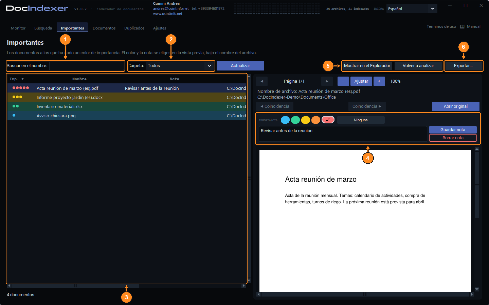

| # | Elemento | Para qué sirve |
|:--:|---|---|
| **①** | **Buscar en el nombre** | Filtra la lista mientras escribes. |
| **②** | **Carpeta** | Muestra solo una carpeta vigilada. |
| **③** | **Lista** | Los documentos coloreados, los más importantes arriba, con la nota. |
| **④** | **Importancia** | Cinco colores y una nota; **Guardar nota** la registra. |
| **⑤** | **Mostrar y volver a analizar** | Abre la carpeta del archivo o lo vuelve a poner en cola. |
| **⑥** | **Exportar** | Guarda la lista en CSV, Excel o HTML. |

La pestaña **Importantes** muestra solo los documentos con color, los más importantes arriba, con la nota. En todas las listas el color aparece como puntos al principio de la fila y la fila está ligeramente teñida. En Búsqueda, la opción **Solo documentos importantes** limita la búsqueda a estos archivos.

## 10. Documentos y Archivos grandes

La pestaña **Documentos** muestra todos los archivos indexados.

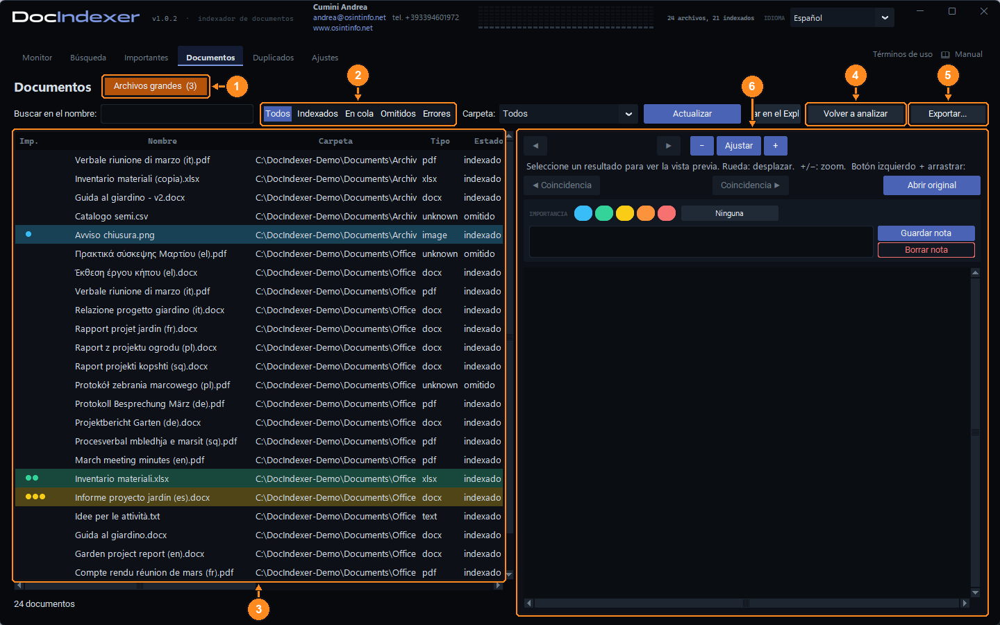

| # | Elemento | Para qué sirve |
|:--:|---|---|
| **①** | **Archivos grandes** | Los archivos que superan el límite de tamaño, a la espera de una elección. |
| **②** | **Estado** | Todos, indexados, en cola, omitidos o con errores. |
| **③** | **Lista** | Todos los archivos encontrados, con carpeta, tipo y estado. |
| **④** | **Volver a analizar** | Vuelve a poner en cola el archivo seleccionado. |
| **⑤** | **Exportar** | Guarda la lista en CSV, Excel o HTML. |
| **⑥** | **Vista previa** | El documento seleccionado, con importancia y nota. |

- **Buscar en el nombre**: filtra la lista mientras escribe.
- **Todos / Indexados / En cola / Omitidos / Errores**: filtra por estado. **Carpeta** filtra por carpeta supervisada. **Actualizar** vuelve a cargar la lista.
- Las columnas muestran importancia, nombre, carpeta, tipo, estado, idioma, páginas, páginas leídas con OCR, caracteres, fechas de creación y modificación y huella SHA-256. Un clic en la cabecera ordena; al pasar por encima de una celda recortada aparece el texto completo.
- Puede seleccionar varias filas (Ctrl o Mayús + clic, Ctrl+A). **Mostrar en el Explorador** abre la carpeta del archivo, **Volver a analizar** vuelve a leer los archivos seleccionados, **Exportar...** guarda la lista. Un doble clic abre el archivo.

**Archivos grandes.** Los archivos más grandes que el límite fijado (200 MB de forma predeterminada) no se analizan solos: el botón **Archivos grandes** se vuelve naranja e indica cuántos esperan.

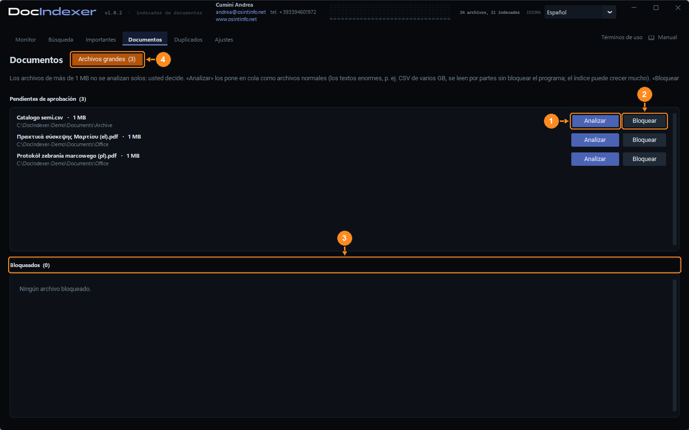

| # | Elemento | Para qué sirve |
|:--:|---|---|
| **①** | **Analizar** | Pone el archivo en cola como los demás. |
| **②** | **Bloquear** | Lo deja aparte sin analizarlo. |
| **③** | **Bloqueados** | Los archivos bloqueados; **Desbloquear** los vuelve a dejar en espera. |
| **④** | **Archivos grandes** | Vuelve a la lista de documentos. |

Para cada archivo en espera elija **Analizar** (pasa a la cola como un archivo normal; los textos enormes se leen por partes sin bloquear el programa, pero el índice puede crecer mucho) o **Bloquear** (se deja aparte). En la lista **Bloqueados**, **Desbloquear** lo vuelve a poner en espera. **← Documentos** vuelve a la lista.

## 11. Duplicados

La pestaña **Duplicados** encuentra dos tipos de copias. Pulse **Buscar duplicados**.

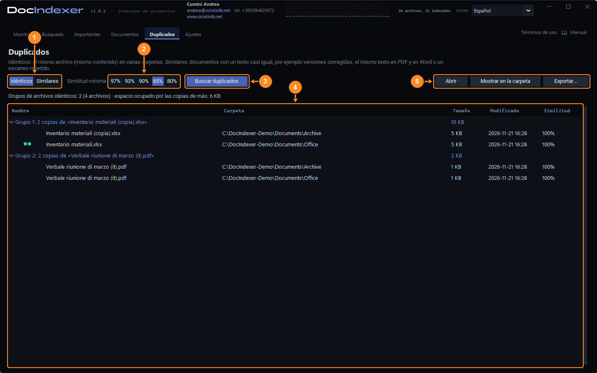

| # | Elemento | Para qué sirve |
|:--:|---|---|
| **①** | **Idénticos / Similares** | Mismo archivo o texto casi igual. |
| **②** | **Similitud mínima** | Cuánto deben parecerse los documentos similares. |
| **③** | **Buscar duplicados** | Inicia la búsqueda. |
| **④** | **Grupos** | Un grupo por cada conjunto de copias, con el espacio ocupado. |
| **⑤** | **Abrir, mostrar, exportar** | Para el archivo seleccionado o toda la lista. |

- **Idénticos**: el mismo archivo (mismo contenido) en varias carpetas. Cada grupo muestra cuántas copias hay y el espacio que ocupan; arriba aparece el espacio total que ocupan las copias sobrantes.

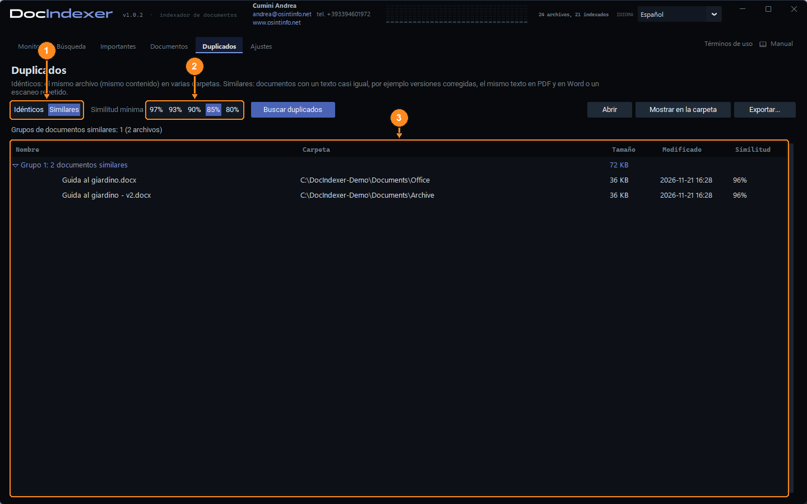

| # | Elemento | Para qué sirve |
|:--:|---|---|
| **①** | **Similares** | Documentos con texto casi igual. |
| **②** | **Similitud mínima** | Del 97% al 80%: más bajo encuentra más parejas. |
| **③** | **Grupos** | La columna Similitud muestra el valor de cada archivo. |

- **Similares**: documentos con un texto casi igual, por ejemplo versiones corregidas del mismo documento, el mismo texto en PDF y en Word o un escaneo repetido. **Similitud mínima** elige cuánto deben parecerse (del 97% al 80%); la columna Similitud muestra el valor de cada archivo.

**Abrir**, **Mostrar en la carpeta** y **Exportar...** actúan sobre el archivo seleccionado o sobre la lista.

## 12. Búsqueda rápida

La búsqueda rápida es una barra de búsqueda que se abre encima de cualquier programa, con el atajo **Ctrl+Alt+D** (se cambia en Ajustes) o desde el menú del icono junto al reloj.

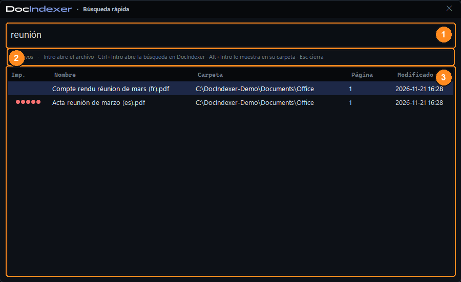

| # | Elemento | Para qué sirve |
|:--:|---|---|
| **①** | **Campo de búsqueda** | Busca mientras escribes. |
| **②** | **Teclas** | Intro, Ctrl+Intro, Alt+Intro, Esc. |
| **③** | **Resultados** | Con las flechas eliges el archivo. |

Busca mientras escribe. Elija un resultado con las flechas; **Intro** abre el archivo, **Ctrl+Intro** abre la búsqueda completa en DocIndexer, **Alt+Intro** muestra el archivo en su carpeta, **Esc** cierra la barra.

## 13. Ajustes

Los cambios valen solo después de **Guardar**. **Descartar cambios** vuelve a los ajustes guardados; **Restablecer ajustes predeterminados** recupera los valores de fábrica. Si cambia de pestaña con cambios sin guardar, DocIndexer pregunta si quiere guardarlos.

**Carpetas y extensiones** tiene las mismas tablas que la configuración guiada: carpetas supervisadas, subcarpetas excluidas, extensiones incluidas y excluidas, carpetas omitidas por nombre.

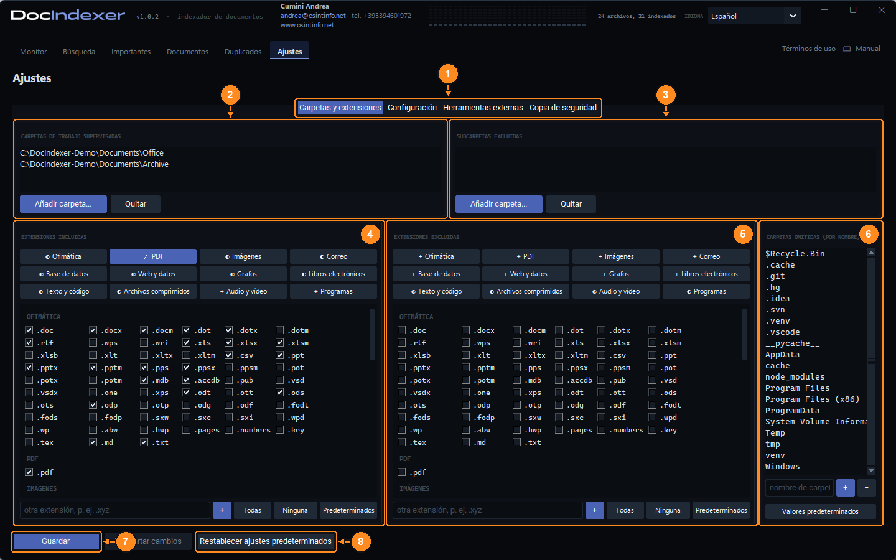

| # | Elemento | Para qué sirve |
|:--:|---|---|
| **①** | **Pestañas de ajustes** | Carpetas, configuración, herramientas externas, copia de seguridad. |
| **②** | **Carpetas de trabajo supervisadas** | Las carpetas que se indexan. |
| **③** | **Subcarpetas excluidas** | Partes de las carpetas que se omiten. |
| **④** | **Extensiones incluidas** | Los tipos de archivo que se leen. |
| **⑤** | **Extensiones excluidas** | Los tipos de archivo que se ignoran. |
| **⑥** | **Carpetas omitidas (por nombre)** | Carpetas que se omiten estén donde estén. |
| **⑦** | **Guardar** | Aplica los cambios. |
| **⑧** | **Restablecer ajustes predeterminados** | Vuelve a los valores iniciales. |

**Configuración**:

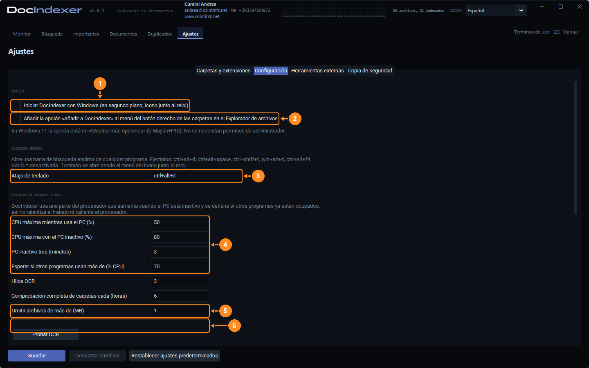

| # | Elemento | Para qué sirve |
|:--:|---|---|
| **①** | **Iniciar con Windows** | Se aplica enseguida, sin pulsar Guardar. |
| **②** | **Añadir a DocIndexer** | Opción del botón derecho de las carpetas en el Explorador; se aplica enseguida. |
| **③** | **Atajo de teclado** | Las teclas de la búsqueda rápida (vacío = desactivada). |
| **④** | **Trabajo en segundo plano** | CPU con el PC en uso e inactivo, espera, programas ocupados. |
| **⑤** | **Omitir archivos de más de (MB)** | Por encima de este límite los archivos van a **Archivos grandes**. |
| **⑥** | **Tamaño de la interfaz (%) — no sigue el zoom de Windows** | Agranda o reduce toda la ventana. |

- **Inicio**: inicio con Windows (vale al momento).
- **Añadir a DocIndexer**: añade la opción al menú del botón derecho de las carpetas en el Explorador de archivos; se aplica enseguida, sin Guardar (ver el capítulo 14).
- **Búsqueda rápida**: el atajo de teclado, por ejemplo `ctrl+alt+d`, `ctrl+shift+f` o `win+alt+d`; vacío = desactivada. Si otro programa ya usa el atajo aparece un aviso.
- **Trabajo en segundo plano**: CPU máxima mientras usa el PC y con el PC inactivo, tras cuántos minutos el PC se considera inactivo, a partir de qué carga de los demás programas DocIndexer espera, hilos OCR, cada cuántas horas se vuelven a comprobar todas las carpetas, tamaño máximo de los archivos (los mayores van a **Archivos grandes**), tamaño de la interfaz (en %, independiente del zoom de Windows; vale desde el próximo inicio). Los primeros valores cambian también con el control del Monitor.
- **Módulos adicionales**: metadatos con ExifTool, texto de los archivos dentro de comprimidos (7-Zip), bases de datos SQLite, dBASE/FoxPro y Access. Cada módulo guarda sus datos aparte; en Búsqueda elige en cuáles buscar.
- **OCR (RapidOCR)**: el modelo. **Automático** lee la primera página escaneada con el modelo latino y, si el resultado es dudoso, prueba los demás modelos descargados y se queda con el que lee mejor. Una **resolución OCR (DPI)** más alta lee mejor los caracteres pequeños pero es más lenta. **Probar OCR** hace una prueba.
- **Bases de datos SQLite**: el archivo de la base de datos.

**Herramientas externas** muestra el estado de los modelos OCR y de las herramientas opcionales (ExifTool, 7-Zip, controlador de Access). **Instalar** o **Reinstalar** descarga una herramienta en la carpeta `tools`, **Instalar todo lo que falta** las descarga todas, **Volver a comprobar** actualiza el estado. Funcionan sin instalarse en el sistema.

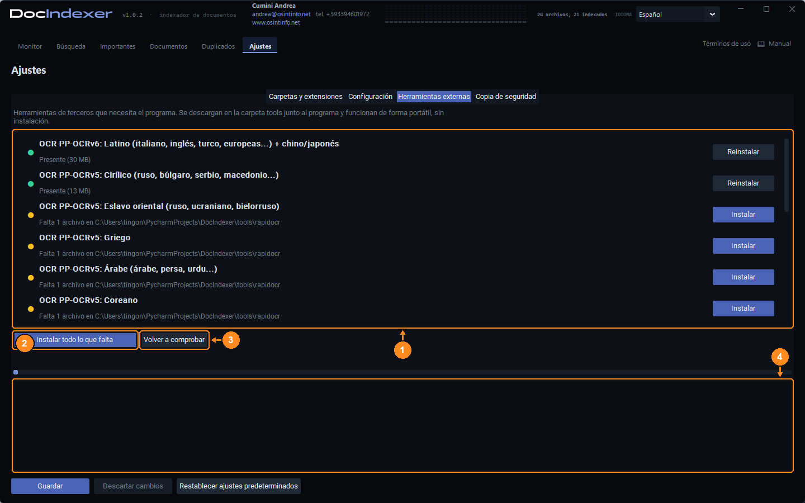

| # | Elemento | Para qué sirve |
|:--:|---|---|
| **①** | **Herramientas** | Cada herramienta con su estado y el botón para instalarla. |
| **②** | **Instalar todo lo que falta** | Descarga de una vez las herramientas que faltan. |
| **③** | **Volver a comprobar** | Vuelve a leer el estado de las herramientas. |
| **④** | **Registro** | Progreso y mensajes de las descargas. |

**Copia de seguridad**: **Crear copia de seguridad...** guarda en un archivo .zip la base de datos (índice, notas, colores de importancia), los ajustes, los patrones regex y las búsquedas guardadas, incluso mientras la indexación trabaja. **Restaurar desde copia...** los sustituye y reinicia DocIndexer; la base de datos anterior queda al lado con la extensión `.before-restore`.

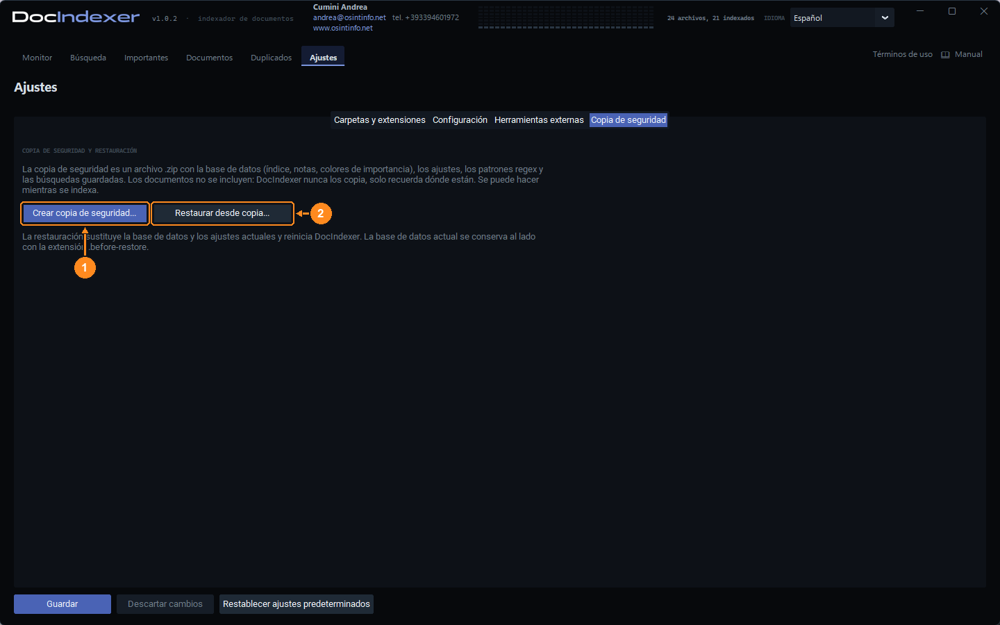

| # | Elemento | Para qué sirve |
|:--:|---|---|
| **①** | **Crear copia de seguridad** | Guarda base de datos, ajustes, patrones y búsquedas en un .zip. |
| **②** | **Restaurar desde copia** | Sustituye los datos actuales por los de la copia y reinicia. |

## 14. Icono junto al reloj e inicio con Windows

Con la ventana cerrada DocIndexer sigue trabajando y queda como icono junto al reloj. Al pasar por encima se ve el estado; el clic derecho abre el menú:

- **Abrir DocIndexer** (también con un clic en el icono);
- **Pausar la indexación** / **Reanudar la indexación**;
- **Comprobar carpetas ahora**;
- **Búsqueda rápida**;
- **Manual**;
- **Iniciar con Windows** (marcado cuando está activo);
- **Salir**, que cierra de verdad el programa.

Si abre DocIndexer una segunda vez no arranca otra copia: se muestra la ventana del que ya está en marcha. El inicio con Windows vale solo para su usuario y no requiere permisos de administrador.

### Añadir una carpeta con el botón derecho

Con la opción **Añadir a DocIndexer** activada (Ajustes › Configuración › Inicio), el clic derecho sobre una carpeta en el Explorador de archivos muestra **Añadir a DocIndexer**: la carpeta se suma a las carpetas vigiladas y la indexación empieza enseguida, aunque DocIndexer ya estuviera abierto. En Windows 11 la opción está en «Mostrar más opciones» (o Mayús+F10). Si la carpeta ya está vigilada, o está dentro de una carpeta vigilada, DocIndexer lo indica y no cambia nada; si contiene carpetas ya vigiladas, ocupa su lugar. No se necesitan permisos de administrador.

## 15. Problemas frecuentes

- **No se encuentra un documento.** Compruebe en el Monitor que la indexación ha terminado; en Documentos busque el archivo por nombre y mire su estado (*En cola*, *Omitidos*, *Errores*). Compruebe que la carpeta está supervisada y que la extensión está entre las incluidas.
- **Muchos archivos con errores.** Un archivo puede estar protegido con contraseña, dañado o abierto en otro programa. **Volver a poner en cola los errores** en el Monitor los reintenta.
- **Un escaneo no se lee.** Compruebe en Ajustes › Herramientas externas que está instalado el modelo OCR del alfabeto correcto; con el modelo **Automático** se elige solo entre los descargados.
- **El PC hace ruido o se calienta.** Mueva el control de recursos hacia la izquierda o pulse **Reducir al mínimo**; baje los límites de temperatura.
- **La indexación es lenta.** Mueva el control hacia la derecha; con el PC inactivo DocIndexer acelera solo.
- **Un archivo muy grande no aparece.** Está en **Documentos › Archivos grandes**, esperando su aprobación.
- **El atajo de la búsqueda rápida no funciona.** Lo usa otro programa: elija otro en Ajustes › Configuración.
- **Llevar DocIndexer a otro PC.** Copie la carpeta entera del programa, o cree una copia de seguridad y restáurela en el nuevo PC.
