# DocIndexer — Manuel d'utilisation

DocIndexer tient un index du texte des documents qui se trouvent dans les dossiers que vous choisissez : documents Office, PDF, photos et numérisations (lues par OCR), e-mails, pages web, bases de données, archives compressées et plus encore. Il travaille en arrière-plan, près de l'horloge de Windows, et retrouve un document en un instant quand vous cherchez un mot, une phrase ou une expression régulière. Les fichiers **restent où ils sont** : seuls le chemin et le texte vont dans la base de données.

## Sommaire

1. [Avant de commencer](#1-avant-de-commencer)
2. [Premier démarrage : configuration guidée](#2-premier-démarrage--configuration-guidée)
3. [La fenêtre principale](#3-la-fenêtre-principale)
4. [Moniteur](#4-moniteur)
5. [Ressources pour l'indexation et températures](#5-ressources-pour-lindexation-et-températures)
6. [Recherche](#6-recherche)
7. [Éditeur d'expressions régulières](#7-éditeur-dexpressions-régulières)
8. [Recherches enregistrées et exportation](#8-recherches-enregistrées-et-exportation)
9. [Importance et notes](#9-importance-et-notes)
10. [Documents et Gros fichiers](#10-documents-et-gros-fichiers)
11. [Doublons](#11-doublons)
12. [Recherche rapide](#12-recherche-rapide)
13. [Paramètres](#13-paramètres)
14. [Icône près de l'horloge et démarrage avec Windows](#14-icône-près-de-lhorloge-et-démarrage-avec-windows)
15. [Problèmes fréquents](#15-problèmes-fréquents)

---

## 1. Avant de commencer

- DocIndexer fonctionne sous Windows et ne demande aucune installation : c'est un seul programme, `DocIndexer.exe`.
- À côté du programme il crée les dossiers `data` (la base de données), `cache` (aperçus temporaires, peut être supprimé) et `tools` (outils externes et modèles OCR), ainsi que le fichier de paramètres `config.json`. Pour déplacer DocIndexer sur un autre PC, il suffit de copier tout le dossier.
- Le modèle OCR principal (alphabet latin plus chinois et japonais) est déjà inclus. Les autres alphabets et les outils facultatifs (ExifTool pour les métadonnées, 7-Zip pour les archives) se téléchargent depuis **Paramètres › Outils externes** (voir le [chapitre 13](#13-paramètres)).
- Les documents ne sont jamais déplacés, copiés ni modifiés.

### Utilisation portable sur un disque externe

DocIndexer peut se trouver sur un disque externe ou une clé USB avec les dossiers qu'il indexe : programme, paramètres (`config.json`) et base de données sont dans le même dossier et voyagent ensemble. Rien à activer : le mode portable est automatique.

- Si, sur un autre PC, le disque reçoit une autre lettre (par exemple il était **E:** et il est maintenant **F:**), DocIndexer s'en aperçoit au démarrage et met à jour tout seul tous les chemins de ce disque : dossiers surveillés, sous-dossiers exclus, recherches enregistrées et index. Il ne repart pas de zéro : le texte déjà lu, les couleurs d'importance et les notes sont conservés. Dans le **Journal** du Moniteur, une ligne indique l'ancienne et la nouvelle lettre et combien de chemins ont été mis à jour.
- Les dossiers situés sur d'autres disques (par exemple **C:**) ne sont pas touchés. Si un disque surveillé n'est pas branché, ses fichiers restent dans l'index et sont revérifiés quand il revient.
- **Démarrer avec Windows** et l'entrée **Ajouter à DocIndexer** du clic droit sont enregistrés dans Windows, pas dans le dossier du programme : sur chaque PC, réactivez-les dans **Paramètres › Configuration › Démarrage** (voir le [chapitre 14](#14-icône-près-de-lhorloge-et-démarrage-avec-windows)).

## 2. Premier démarrage : configuration guidée

### Langue et conditions d'utilisation

À la toute première ouverture, DocIndexer demande la langue puis affiche les conditions d'utilisation dans cette langue.

| # | Élément | Rôle |
|:--:|---|---|
| **①** | **Langue** | Un clic choisit la langue du programme et du manuel. |

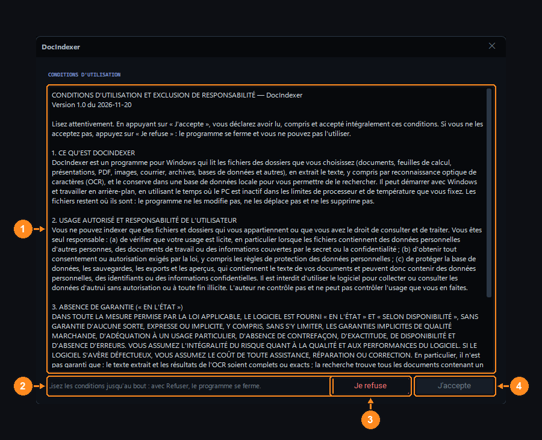

| # | Élément | Rôle |
|:--:|---|---|
| **①** | **Texte des conditions** | À faire défiler jusqu'au bout. |
| **②** | **Note** | Devient verte quand tout est lu. |
| **③** | **Je refuse** | Ferme le programme. |
| **④** | **J'accepte** | S'active en fin de texte et passe à la configuration. |

**J'accepte** ne s'active qu'après avoir fait défiler le texte jusqu'au bout ; **Je refuse** (ou la fermeture de la fenêtre) ferme le programme. La réponse est mémorisée : les conditions ne sont redemandées que si elles changent. Vous pouvez les relire à tout moment avec le bouton **Conditions d'utilisation** à côté de **📖 Manuel**.

### Configuration guidée

À la première ouverture, DocIndexer demande où il doit chercher.

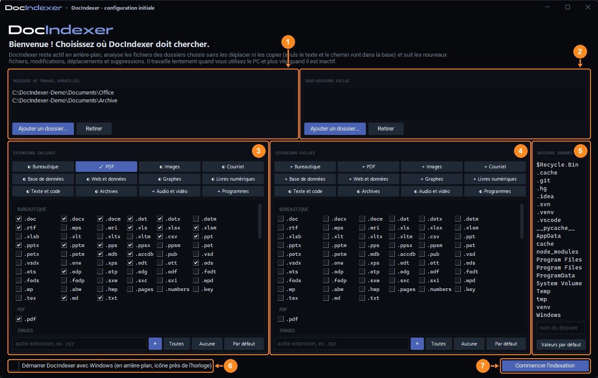

| # | Élément | Rôle |
|:--:|---|---|
| **①** | **Dossiers de travail surveillés** | Les dossiers à indexer : **Ajouter un dossier...** et **Retirer**. |
| **②** | **Sous-dossiers exclus** | Parties des dossiers choisis à ignorer. |
| **③** | **Extensions incluses** | Les types de fichiers à lire ; les boutons de catégorie les choisissent par groupes. |
| **④** | **Extensions exclues** | Types de fichiers toujours ignorés. |
| **⑤** | **Dossiers ignorés (par nom)** | Dossiers ignorés où qu'ils soient (par exemple .git, Temp). |
| **⑥** | **Démarrer avec Windows** | DocIndexer démarre seul à l'ouverture de session, en arrière-plan. |
| **⑦** | **Commencer l'indexation** | Enregistre les choix et lance le travail. |

1. **Dossiers de travail surveillés** : appuyez sur **Ajouter un dossier...** pour chaque dossier à indexer (par exemple Documents ou un dossier réseau) ; **Retirer** l'enlève de la liste.
2. **Sous-dossiers exclus** : des dossiers précis, à l'intérieur des dossiers surveillés, à ne pas analyser.
3. **Extensions incluses** et **extensions exclues** : les types de fichiers à lire. Les boutons des groupes (Bureautique, PDF, Images, Courriel, Base de données, Web et données, Graphes, Livres numériques, Texte et code, Archives, Audio et vidéo, Programmes) cochent tout le groupe d'un clic et le décochent d'un autre ; **Toutes**, **Aucune** et **Par défaut** font ce qu'ils disent. Dans le champ du bas, vous pouvez ajouter une extension à la main.
4. **Dossiers ignorés (par nom)** : dossiers ignorés où qu'ils se trouvent, comme `$Recycle.Bin`, `.git` ou `node_modules`.
5. **Démarrer DocIndexer avec Windows** : si la case est cochée, DocIndexer démarre tout seul à l'ouverture de session, avec seulement l'icône près de l'horloge.

Appuyez sur **Commencer l'indexation**. Tout ce que vous choisissez ici peut être modifié plus tard dans **Paramètres**.

## 3. La fenêtre principale

En haut se trouve l'en-tête, toujours visible :

- le logo, la version et les coordonnées de l'auteur (l'e-mail et le site sont cliquables) ;
- l'**indicateur d'activité**, qui bouge comme l'égaliseur d'une chaîne stéréo : la hauteur des colonnes suit le CPU utilisé par l'indexation et chaque fichier lu donne un coup à sa zone (de gauche à droite : PDF, Office, images, texte et autres) ; des pics rouges signalent une erreur. Sans travail, il reste une ligne éteinte ; en pause, il est ambre ;
- le nombre de fichiers dans l'index et combien sont déjà indexés ;
- le menu **Langue**, qui change immédiatement la langue de tout le programme ;
- les boutons réduire, agrandir et fermer. **Fermer la fenêtre n'arrête pas DocIndexer** : elle est masquée et le travail continue (voir le [chapitre 14](#14-icône-près-de-lhorloge-et-démarrage-avec-windows)).

En dessous se trouvent les onglets **Moniteur**, **Recherche**, **Importants**, **Documents**, **Doublons** et **Paramètres**. À droite des onglets, **📖 Manuel** ouvre ce manuel dans la langue du programme. À côté, **Conditions d'utilisation** réaffiche les conditions acceptées au premier démarrage.

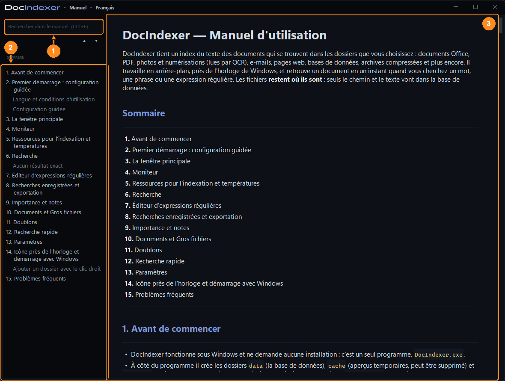

| # | Élément | Rôle |
|:--:|---|---|
| **①** | **Rechercher dans le manuel (Ctrl+F)** | Surligne toutes les occurrences ; Entrée passe à la suivante. |
| **②** | **Sommaire** | Un clic mène au chapitre. |
| **③** | **Texte** | Le manuel ; un clic sur une image l'ouvre en grand. |

Dans la fenêtre du manuel, le sommaire à gauche mène au chapitre d'un clic, le champ **Rechercher dans le manuel** (Ctrl+F) surligne toutes les occurrences (Entrée = suivante, Maj+Entrée = précédente) et un clic sur une image l'ouvre en taille réelle. Échap ferme la fenêtre.

## 4. Moniteur

Le Moniteur montre où en est l'indexation.

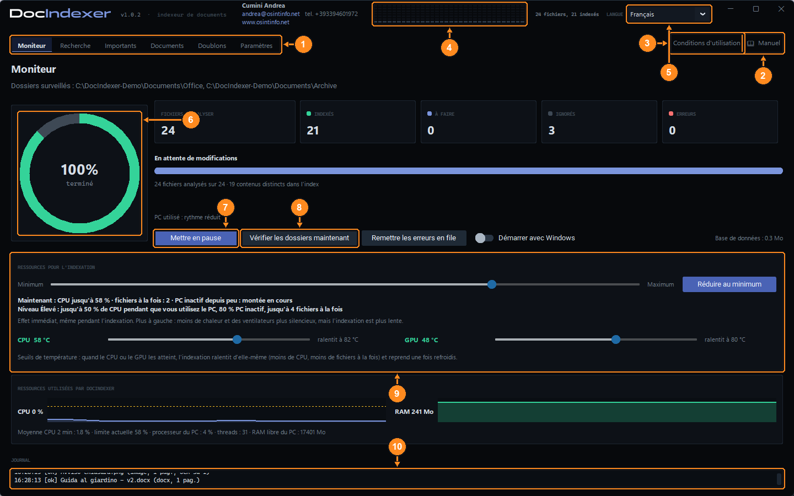

| # | Élément | Rôle |
|:--:|---|---|
| **①** | **Onglets** | Les pages du programme. |
| **②** | **📖 Manuel** | Ouvre ce manuel dans la langue du programme. |
| **③** | **Conditions d'utilisation** | Réaffiche les conditions acceptées au premier démarrage. |
| **④** | **Égaliseur** | Bouge quand DocIndexer travaille. |
| **⑤** | **Langue** | Change la langue de l'interface. |
| **⑥** | **Progression** | Part des fichiers déjà analysés. |
| **⑦** | **Mettre en pause** | Met en pause et reprend l'indexation. |
| **⑧** | **Vérifier les dossiers maintenant** | Cherche tout de suite les fichiers nouveaux ou modifiés. |
| **⑨** | **Ressources pour l'indexation** | CPU à utiliser et seuils de température (chapitre 5). |
| **⑩** | **Journal** | Les messages du travail, fichier par fichier. |

- **Dossiers surveillés** : la liste sous le titre.
- **Graphique circulaire** et cases : **Fichiers à analyser** (tous les fichiers trouvés), **Indexés**, **À faire**, **Ignorés** (sans texte lisible ou exclus) et **Erreurs**.
- **Phase** en cours : comptage des fichiers, calcul des empreintes, extraction du texte, ou *En attente de modifications* quand il a fini. En dessous se trouvent la barre de progression, le fichier en cours et le rythme actuel : *PC utilisé : rythme réduit*, *PC inactif : plein rythme*, *PC occupé : en attente* (les autres programmes utilisent déjà beaucoup de CPU) ou *Sur batterie : rythme minimal*.
- **Mettre en pause / Reprendre** arrête et relance l'indexation.
- **Vérifier les dossiers maintenant** cherche tout de suite les fichiers nouveaux, modifiés, déplacés ou supprimés (DocIndexer le fait aussi tout seul au démarrage et toutes les quelques heures, et suit les modifications en temps réel pendant qu'il fonctionne).
- **Remettre les erreurs en file** réessaie les fichiers qu'il n'a pas pu lire.
- **Démarrer avec Windows** active ou désactive immédiatement le démarrage automatique.
- **Base de données** : la taille actuelle de la base de données.
- **Journal** : en bas de la page, les dernières opérations.

Fonctionnement : il compte d'abord les fichiers, puis calcule pour chacun une empreinte du contenu (SHA-256) et extrait le texte. Un fichier identique à un fichier déjà lu n'est pas réanalysé ; un fichier déplacé ou renommé change seulement de chemin dans l'index ; un fichier supprimé en est retiré.

Si vous retirez tous les dossiers surveillés, DocIndexer retire leurs fichiers de l'index et le Moniteur se remet à zéro : graphique, compteurs et progression repartent de zéro jusqu'à ce que vous ajoutiez un nouveau dossier.

## 5. Ressources pour l'indexation et températures

Dans le Moniteur, le cadre **Ressources pour l'indexation** décide quelle part du PC DocIndexer peut utiliser.

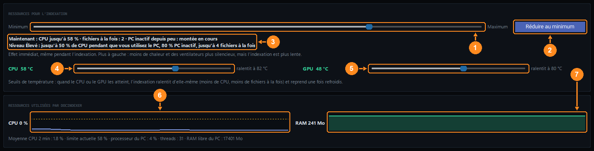

| # | Élément | Rôle |
|:--:|---|---|
| **①** | **Niveau des ressources** | De Minimum à Maximum ; s'applique tout de suite. |
| **②** | **Réduire au minimum** | Met le niveau tout à gauche. |
| **③** | **Maintenant** | Ce que fait le niveau choisi en ce moment. |
| **④** | **Seuil CPU** | Au-delà de cette température l'indexation ralentit. |
| **⑤** | **Seuil GPU** | La même chose pour la carte graphique. |
| **⑥** | **Graphique CPU** | CPU utilisé par DocIndexer ; la ligne pointillée est la limite. |
| **⑦** | **Graphique RAM** | Mémoire utilisée par DocIndexer. |

Le **curseur** va de **Minimum** à **Maximum** et agit immédiatement, même pendant l'indexation. Plus à gauche signifie moins de chaleur et des ventilateurs plus silencieux, mais une indexation plus lente. **Réduire au minimum** place le curseur tout à gauche d'un clic.

| Niveau | CPU pendant que vous utilisez le PC | CPU PC inactif | Remarques |
|---|---|---|---|
| Minimum | 5 % | 5 % | un fichier à la fois, économie d'énergie de Windows |
| Bas | 10 % | 25 % | un fichier à la fois, économie d'énergie de Windows |
| Moyen | 25 % | 60 % | deux fichiers à la fois |
| Élevé | 50 % | 80 % | plusieurs fichiers à la fois (environ la moitié des cœurs) |
| Maximum | 90 % | 100 % | presque tous les cœurs |

Sous le curseur, deux lignes indiquent ce qui se passe maintenant (par exemple *Maintenant : CPU jusqu'à 60 % · fichiers à la fois : 2 · PC inactif : pleine puissance*) et ce que prévoit le niveau choisi.

**PC inactif** : quand vous n'utilisez ni clavier ni souris pendant quelques minutes (3 par défaut, modifiable dans Paramètres), la limite monte progressivement jusqu'à la valeur « PC inactif » ; dès que vous revenez, elle redescend. Pendant que vous tapez ou cliquez dans la fenêtre de DocIndexer, l'indexation s'efface aussi quelques secondes, pour que la recherche et les aperçus restent rapides.

**Températures** : les lignes **CPU** et **GPU** montrent la température actuelle (vert, ambre quand elle approche du seuil, rouge quand elle l'atteint) et un curseur avec le seuil, de 50 à 100 °C (82 °C pour le CPU et 80 °C pour le GPU par défaut). Le seuil atteint, l'indexation ralentit d'elle-même (moins de CPU, moins de fichiers à la fois) et reprend quand le composant a refroidi. Si un capteur n'est pas lisible, *non disponible* s'affiche.

Le cadre **Ressources utilisées par DocIndexer** montre le CPU et la RAM utilisés par le programme pendant les deux dernières minutes ; la ligne pointillée est la limite de CPU en vigueur. En dessous figurent la moyenne, la limite actuelle, la charge totale du processeur et la RAM libre du PC.

## 6. Recherche

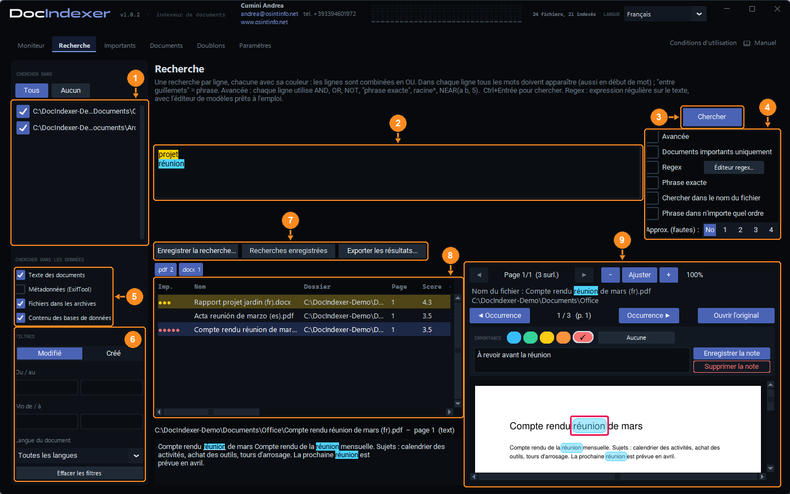

| # | Élément | Rôle |
|:--:|---|---|
| **①** | **Chercher dans** | Les dossiers où chercher (**Tous** / **Aucun**). |
| **②** | **Zone de recherche** | Une recherche par ligne, chacune avec sa couleur. |
| **③** | **Chercher** | Lance la recherche (aussi Ctrl+Entrée). |
| **④** | **Options** | Avancée, regex avec son éditeur, phrase exacte, nom du fichier, approximative. |
| **⑤** | **Chercher dans les données** | Texte, métadonnées, archives et bases de données à inclure. |
| **⑥** | **Filtres** | Dates, taille et langue ; **Effacer les filtres** les retire. |
| **⑦** | **Enregistrer et exporter** | Enregistre la recherche, ouvre les recherches enregistrées, exporte les résultats. |
| **⑧** | **Résultats** | Un clic affiche le document dans l'aperçu. |
| **⑨** | **Aperçu** | Pages, occurrences surlignées, importance et note, **Ouvrir l'original**. |

**Quoi écrire.** Dans le grand cadre, écrivez une recherche par ligne ; chaque ligne a sa couleur, que vous retrouvez dans les résultats et dans l'aperçu, et les lignes sont des alternatives (il suffit que l'une apparaisse). Dans une ligne, tous les mots doivent apparaître, aussi comme début de mot ; les majuscules et les accents ne comptent pas ; une phrase « entre guillemets » est cherchée telle quelle. Appuyez sur **Chercher** ou Ctrl+Entrée.

**Options** à droite du cadre :

- **Avancée** : chaque ligne utilise la syntaxe complète : `AND`, `OR`, `NOT`, `"phrase exacte"`, `racine*`, `NEAR(a b, 5)`.
- **Documents importants uniquement** : seulement les fichiers auxquels vous avez donné une couleur (voir le [chapitre 9](#9-importance-et-notes)).
- **Regex** : la ligne est une expression régulière cherchée dans le texte ; **Éditeur regex...** ouvre l'éditeur (voir le [chapitre 7](#7-éditeur-dexpressions-régulières)). Une longue recherche regex peut être arrêtée avec **Arrêter la recherche**.
- **Phrase exacte**, **Chercher dans le nom du fichier**, **Phrase dans n'importe quel ordre**.
- **Approx. (fautes)** : accepte de 1 à 4 fautes par mot, y compris les confusions typiques de l'OCR (0/o, 1/l, rn/m). Si une recherche normale ne trouve rien, DocIndexer réessaie tout seul en tolérant une faute et vous le signale.

**À gauche**, vous choisissez **où** chercher :

- **Chercher dans** : les dossiers surveillés dans lesquels chercher (**Tous** / **Aucun**).
- **Chercher dans les données** : texte des documents, métadonnées (ExifTool), fichiers dans les archives, contenu des bases de données.
- **Filtres** : période (**Modifié** ou **Créé**, dates au format aaaa-mm-jj, ou seulement aaaa ou aaaa-mm), taille en Mo, **langue du document** (reconnue automatiquement pour chaque fichier). **Effacer les filtres** les retire tous.

**Les résultats.** Au-dessus du tableau, il y a un bouton pour chaque type de fichier trouvé (.pdf, .docx...) avec le nombre de résultats : un clic masque ou affiche ce type, **Toutes** et **Aucune** les changent tous. Les colonnes sont l'importance, le nom, le dossier, la page, la pertinence, la date de création et un extrait avec les mots colorés ; un clic sur l'en-tête trie la colonne. Sous le tableau se trouve le texte extrait de la page trouvée, avec les mots surlignés.

**L'aperçu** à droite montre la vraie page du document avec les occurrences encadrées : les flèches changent de page, **−**, **Ajuster** et **+** changent le zoom (la molette aussi), **◀ Occurrence** et **Occurrence ▶** passent d'un résultat à l'autre, **Ouvrir l'original** (ou un double clic sur le résultat) ouvre le fichier avec son programme. Pour les documents Office, l'aperçu est préparé avec Office et peut demander quelques secondes.

**Ouvrir le dossier d'un résultat.** Un clic sur la cellule **Dossier** d'un résultat ouvre le dossier dans l'Explorateur de fichiers avec le fichier déjà sélectionné. Cela fonctionne aussi dans les onglets **Documents** et **Importants**.

### Aucun résultat exact

Si une recherche ne trouve rien, DocIndexer réessaie seul en tolérant une faute de frappe ou d'OCR par mot. Un avis rouge apparaît alors au-dessus des résultats et clignote quelques fois : **Aucun résultat exact : résultats avec 1 faute de frappe ou d'OCR**. Vérifiez les résultats : ils peuvent contenir des mots proches de celui cherché.

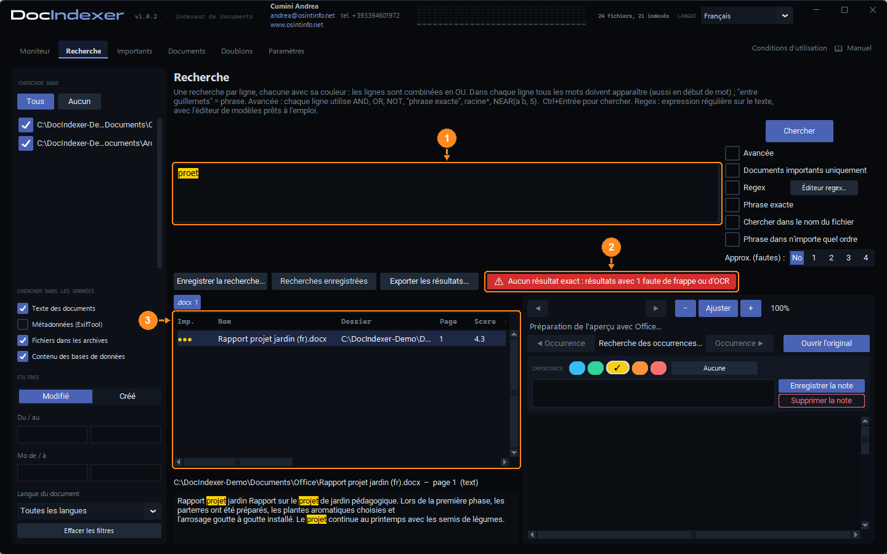

| # | Élément | Rôle |
|:--:|---|---|
| **①** | **Recherche avec une faute** | Ici il manque une lettre. |
| **②** | **Avis rouge** | Clignote : aucun résultat exact, ceux avec 1 faute sont affichés. |
| **③** | **Résultats** | Les documents avec le bon mot. |

## 7. Éditeur d'expressions régulières

Une expression régulière (regex) cherche un *motif* au lieu d'un mot : par exemple n'importe quelle date, n'importe quelle adresse web ou n'importe quel code d'un certain format.

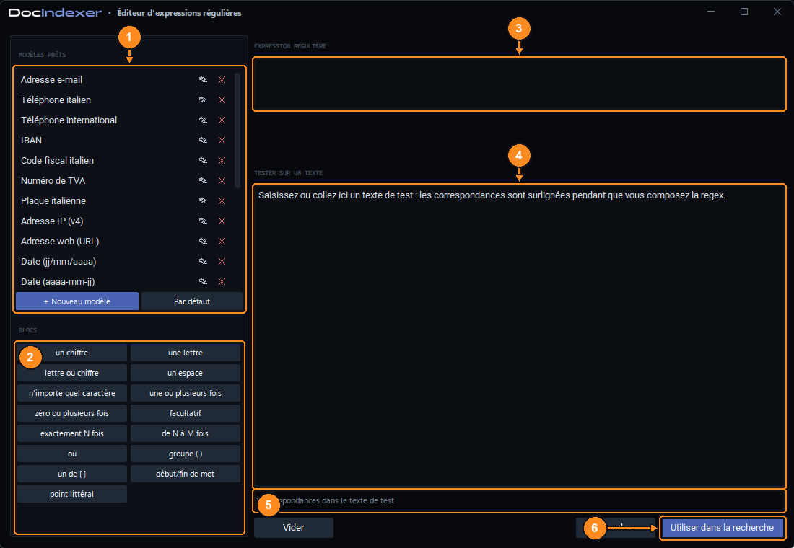

| # | Élément | Rôle |
|:--:|---|---|
| **①** | **Modèles prêts** | Modèles prêts : un clic l'utilise ; **+ Nouveau modèle** en ajoute un. |
| **②** | **Blocs** | Morceaux à insérer sans connaître la syntaxe. |
| **③** | **Expression régulière** | La regex que vous composez. |
| **④** | **Tester sur un texte** | Texte d'essai : les correspondances sont surlignées aussitôt. |
| **⑤** | **Nombre** | Combien de correspondances dans le texte d'essai. |
| **⑥** | **Utiliser dans la recherche** | Envoie la regex vers la page Recherche. |

- **Modèles prêts** : des motifs déjà écrits, dont adresse e-mail, numéros de téléphone, IBAN, code fiscal et numéro de TVA italiens, plaque d'immatriculation, adresse IP, URL, dates, heures, montants, coordonnées GPS, hashtags et noms d'utilisateur. Un clic le place dans le champ ; vous pouvez ajouter les vôtres avec **Nouveau modèle** et revenir à la liste d'origine avec **Par défaut**.
- **Blocs** : des morceaux à combiner sans retenir la syntaxe (un chiffre, une lettre, une ou plusieurs fois, facultatif, « ou », groupes, début/fin de mot...).
- **Expression régulière** : le champ avec le motif ; en dessous, l'explication en mots de ce qu'il cherche.
- **Tester sur un texte** : écrivez ou collez un texte d'essai et les résultats sont surlignés pendant la saisie. **Vider** efface le texte.

**Utiliser dans la recherche** place le motif dans la page Recherche, avec l'option Regex active, et lance la recherche.

## 8. Recherches enregistrées et exportation

**Enregistrer la recherche...** (sous le cadre de la Recherche) enregistre la recherche actuelle sous un nom, avec ses options et ses filtres. Si vous cochez **M'avertir quand de nouveaux fichiers correspondent à cette recherche**, DocIndexer la répète tout seul quand il indexe de nouveaux fichiers et affiche une notification Windows près de l'horloge.

| # | Élément | Rôle |
|:--:|---|---|
| **①** | **Avertir** | Répète la recherche sur les nouveaux fichiers et avertit près de l'horloge. |
| **②** | **Ouvrir** | Remet la recherche dans la page Recherche et l'exécute. |
| **③** | **✕** | Supprime la recherche enregistrée. |
| **④** | **Vérifier maintenant** | Répète tout de suite les recherches avec avertissement. |

**Recherches enregistrées** ouvre la liste : pour chacune, vous voyez l'avertissement (actif ou non), combien de nouveaux fichiers elle a trouvés et quand elle a été vérifiée. **Ouvrir** la remet dans la page Recherche et l'exécute, **Nouveaux seulement** n'affiche que les fichiers arrivés depuis la dernière fois, **Vérifier maintenant** la répète tout de suite ; on peut aussi la supprimer. Quand il y a de nouveaux fichiers, le bouton Recherches enregistrées indique combien.

**Exporter les résultats...** enregistre les résultats en **Excel** (.xlsx, lignes colorées selon l'importance), **CSV** (séparateur `;`, s'ouvre dans Excel) ou **PDF**, avec importance et notes. Le même bouton **Exporter...** existe dans Documents, Importants et Doublons.

## 9. Importance et notes

Dans l'aperçu, sous le nom du fichier, chaque document peut avoir une **couleur d'importance** (bleu clair, vert, jaune, orange, rouge, du moins au plus important ; **Aucune** la retire) et une **note** écrite par vous (**Enregistrer la note**, **Supprimer la note**).

La couleur et la note appartiennent au **contenu** du fichier (son empreinte SHA-256), pas à son chemin. Si vous déplacez ou renommez le fichier, même DocIndexer fermé ou vers un autre disque, vous les retrouvez dès que le fichier est revérifié. Les copies identiques d'un même fichier ont la même couleur et la même note : si vous les changez sur une copie, elles changent sur toutes. Si vous modifiez le fichier, la couleur et la note restent.

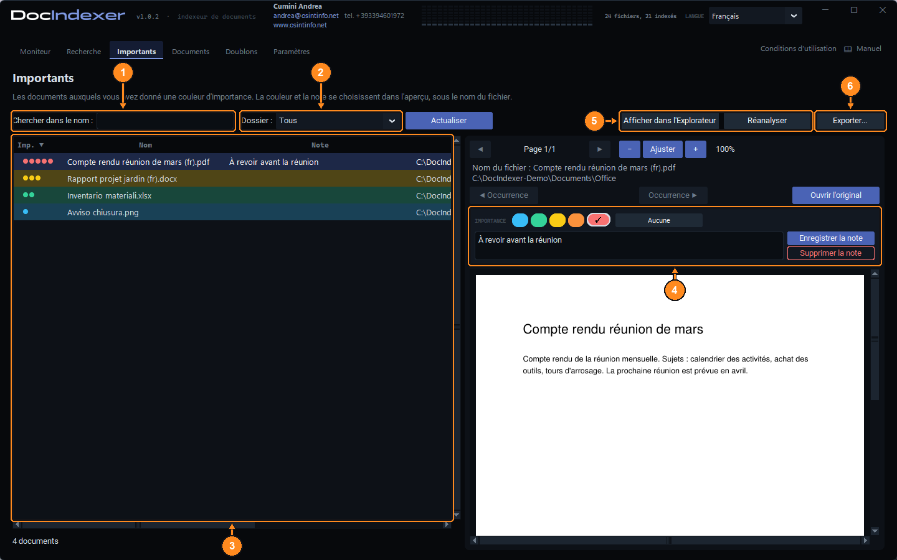

| # | Élément | Rôle |
|:--:|---|---|
| **①** | **Chercher dans le nom** | Filtre la liste pendant la saisie. |
| **②** | **Dossier** | N'affiche qu'un dossier surveillé. |
| **③** | **Liste** | Les documents colorés, les plus importants en haut, avec la note. |
| **④** | **Importance** | Cinq couleurs et une note ; **Enregistrer la note** la garde. |
| **⑤** | **Afficher et réanalyser** | Ouvre le dossier du fichier ou le remet en file. |
| **⑥** | **Exporter** | Enregistre la liste en CSV, Excel ou HTML. |

L'onglet **Importants** ne liste que les documents colorés, les plus importants en haut, avec la note. Dans toutes les listes, la couleur apparaît sous forme de points au début de la ligne et la ligne est légèrement teintée. Dans Recherche, l'option **Documents importants uniquement** limite la recherche à ces fichiers.

## 10. Documents et Gros fichiers

L'onglet **Documents** liste tous les fichiers indexés.

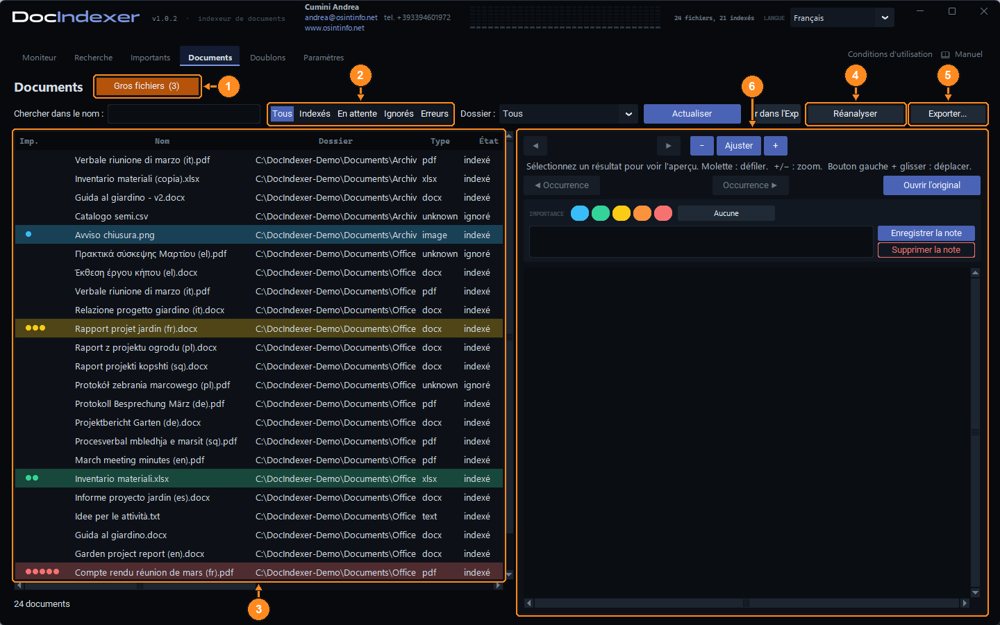

| # | Élément | Rôle |
|:--:|---|---|
| **①** | **Gros fichiers** | Les fichiers au-delà de la limite de taille, en attente d'un choix. |
| **②** | **État** | Tous, indexés, en file, ignorés ou en erreur. |
| **③** | **Liste** | Tous les fichiers trouvés, avec dossier, type et état. |
| **④** | **Réanalyser** | Remet en file le fichier sélectionné. |
| **⑤** | **Exporter** | Enregistre la liste en CSV, Excel ou HTML. |
| **⑥** | **Aperçu** | Le document sélectionné, avec importance et note. |

- **Chercher dans le nom** : filtre la liste pendant la saisie.
- **Tous / Indexés / En attente / Ignorés / Erreurs** : filtre par état. **Dossier** filtre par dossier surveillé. **Actualiser** recharge la liste.
- Les colonnes montrent l'importance, le nom, le dossier, le type, l'état, la langue, les pages, les pages lues par OCR, les caractères, les dates de création et de modification et l'empreinte SHA-256. Un clic sur l'en-tête trie ; en survolant une cellule tronquée, le texte complet apparaît.
- Vous pouvez sélectionner plusieurs lignes (Ctrl ou Maj + clic, Ctrl+A). **Afficher dans l'Explorateur** ouvre le dossier du fichier, **Réanalyser** relit les fichiers sélectionnés, **Exporter...** enregistre la liste. Un double clic ouvre le fichier.
- Un clic sur la cellule **Dossier** ouvre le dossier dans l'Explorateur de fichiers avec le fichier sélectionné (aussi dans l'onglet **Importants**).

**Gros fichiers.** Les fichiers plus grands que la limite fixée (200 Mo par défaut) ne sont pas analysés automatiquement : le bouton **Gros fichiers** devient orange et indique combien sont en attente.

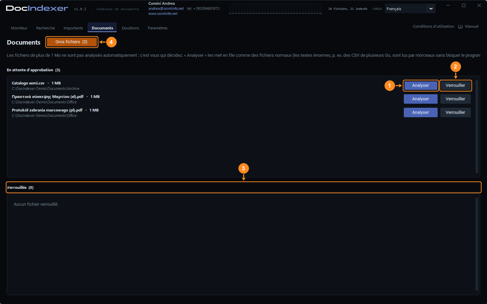

| # | Élément | Rôle |
|:--:|---|---|
| **①** | **Analyser** | Met le fichier en file comme les autres. |
| **②** | **Verrouiller** | Le met de côté sans l'analyser. |
| **③** | **Verrouillés** | Les fichiers verrouillés ; **Déverrouiller** les remet en attente. |
| **④** | **Gros fichiers** | Revient à la liste des documents. |

Pour chaque fichier en attente, choisissez **Analyser** (il passe en file comme un fichier normal ; les textes énormes sont lus par morceaux sans bloquer le programme, mais l'index peut beaucoup grossir) ou **Verrouiller** (mis de côté). Dans la liste **Verrouillés**, **Déverrouiller** le remet en attente. **← Documents** revient à la liste.

## 11. Doublons

L'onglet **Doublons** trouve deux sortes de copies. Appuyez sur **Rechercher les doublons**.

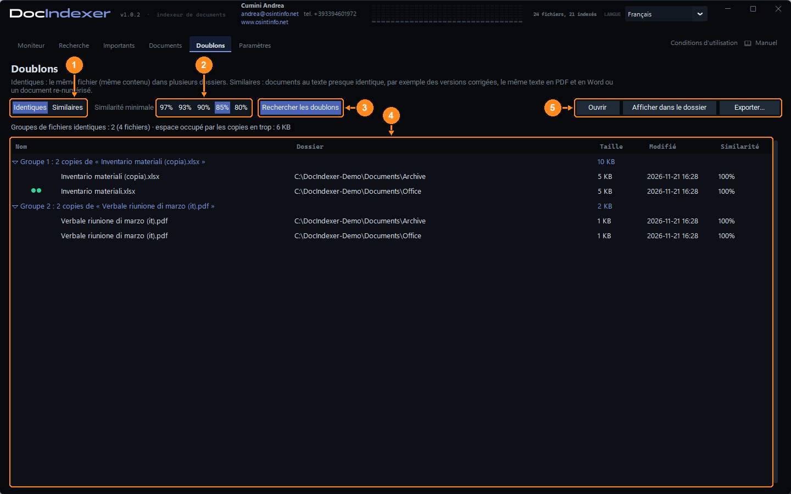

| # | Élément | Rôle |
|:--:|---|---|
| **①** | **Identiques / Similaires** | Même fichier ou texte presque identique. |
| **②** | **Similarité minimale** | Degré de ressemblance des documents similaires. |
| **③** | **Rechercher les doublons** | Lance la recherche. |
| **④** | **Groupes** | Un groupe par ensemble de copies, avec l'espace occupé. |
| **⑤** | **Ouvrir, afficher, exporter** | Pour le fichier sélectionné ou toute la liste. |

- **Identiques** : le même fichier (même contenu) dans plusieurs dossiers. Chaque groupe montre le nombre de copies et l'espace occupé ; en haut figure l'espace total occupé par les copies en trop.

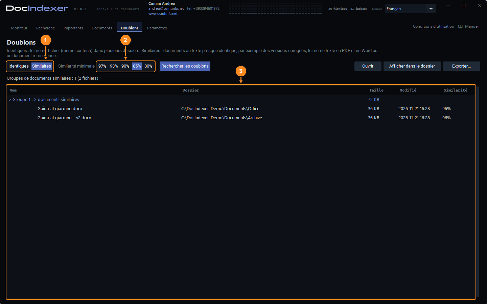

| # | Élément | Rôle |
|:--:|---|---|
| **①** | **Similaires** | Documents au texte presque identique. |
| **②** | **Similarité minimale** | De 97 % à 80 % : plus bas trouve plus de paires. |
| **③** | **Groupes** | La colonne Similarité indique la valeur de chaque fichier. |

- **Similaires** : des documents au texte presque identique, par exemple des versions corrigées du même document, le même texte en PDF et en Word, ou une numérisation refaite. **Similarité minimale** choisit à quel point ils doivent se ressembler (de 97 % à 80 %) ; la colonne Similarité montre la valeur de chaque fichier.

**Ouvrir**, **Afficher dans le dossier** et **Exporter...** agissent sur le fichier sélectionné ou sur la liste.

## 12. Recherche rapide

La recherche rapide est une barre de recherche qui s'ouvre au-dessus de n'importe quel programme, avec le raccourci **Ctrl+Alt+D** (modifiable dans Paramètres) ou depuis le menu de l'icône près de l'horloge.

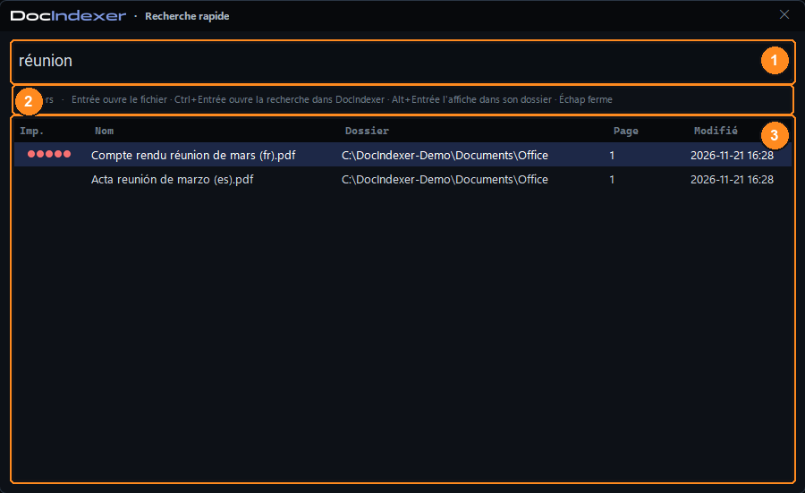

| # | Élément | Rôle |
|:--:|---|---|
| **①** | **Champ de recherche** | Cherche pendant la saisie. |
| **②** | **Touches** | Entrée, Ctrl+Entrée, Alt+Entrée, Échap. |
| **③** | **Résultats** | Choisissez le fichier avec les flèches. |

Elle cherche pendant la saisie. Choisissez un résultat avec les flèches ; **Entrée** ouvre le fichier, **Ctrl+Entrée** ouvre la recherche complète dans DocIndexer, **Alt+Entrée** affiche le fichier dans son dossier, **Échap** ferme la barre.

## 13. Paramètres

Les modifications ne s'appliquent qu'après **Enregistrer**. **Annuler les modifications** revient aux paramètres enregistrés ; **Rétablir les paramètres par défaut** remet les valeurs d'origine. Si vous changez d'onglet avec des modifications non enregistrées, DocIndexer demande s'il faut les enregistrer.

**Dossiers et extensions** contient les mêmes tableaux que la configuration guidée : dossiers surveillés, sous-dossiers exclus, extensions incluses et exclues, dossiers ignorés par nom.

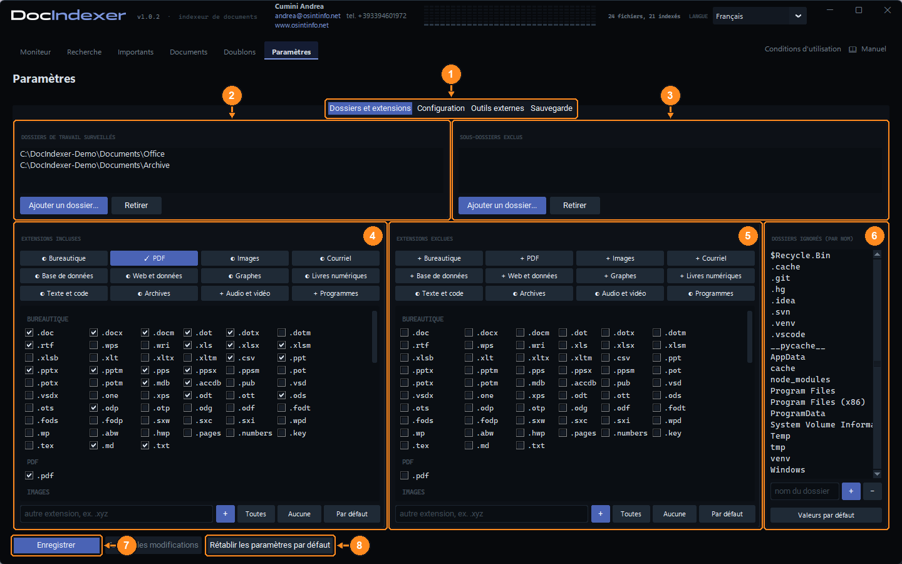

| # | Élément | Rôle |
|:--:|---|---|
| **①** | **Onglets des paramètres** | Dossiers, configuration, outils externes, sauvegarde. |
| **②** | **Dossiers de travail surveillés** | Les dossiers à indexer. |
| **③** | **Sous-dossiers exclus** | Parties des dossiers à ignorer. |
| **④** | **Extensions incluses** | Les types de fichiers à lire. |
| **⑤** | **Extensions exclues** | Les types de fichiers à ignorer. |
| **⑥** | **Dossiers ignorés (par nom)** | Dossiers ignorés où qu'ils soient. |
| **⑦** | **Enregistrer** | Applique les modifications. |
| **⑧** | **Rétablir les paramètres par défaut** | Revient aux valeurs initiales. |

**Configuration** :

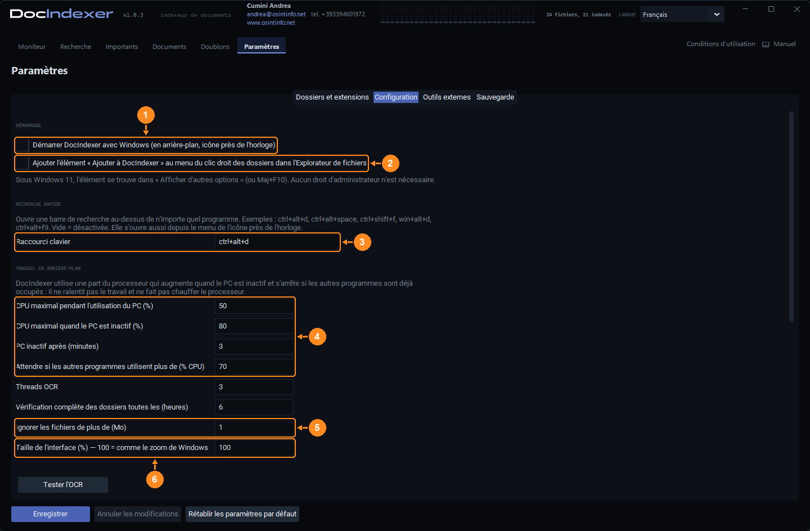

| # | Élément | Rôle |
|:--:|---|---|
| **①** | **Démarrer avec Windows** | S'applique tout de suite, sans Enregistrer. |
| **②** | **Ajouter à DocIndexer** | Élément du clic droit des dossiers dans l'Explorateur ; s'applique tout de suite. |
| **③** | **Raccourci clavier** | Les touches de la recherche rapide (vide = désactivée). |
| **④** | **Travail en arrière-plan** | CPU avec le PC utilisé et inactif, attente, programmes occupés. |
| **⑤** | **Ignorer les fichiers de plus de (Mo)** | Au-delà de cette limite les fichiers vont dans **Gros fichiers**. |
| **⑥** | **Taille de l'interface (%) — 100 = comme le zoom de Windows** | 100 = comme les autres applications Windows ; plus grand agrandit, plus petit réduit. |

- **Démarrage** : démarrage avec Windows (s'applique immédiatement).
- **Ajouter à DocIndexer** : ajoute l'élément au menu du clic droit des dossiers dans l'Explorateur de fichiers ; s'applique tout de suite, sans Enregistrer (voir le chapitre 14).
- **Recherche rapide** : le raccourci clavier, par exemple `ctrl+alt+d`, `ctrl+shift+f` ou `win+alt+d` ; vide = désactivée. Si le raccourci est déjà utilisé par un autre programme, un avertissement s'affiche.
- **Travail en arrière-plan** : CPU maximal pendant que vous utilisez le PC et quand il est inactif, après combien de minutes le PC est considéré comme inactif, au-delà de quelle charge des autres programmes DocIndexer attend, threads OCR, toutes les combien d'heures revérifier tous les dossiers, taille maximale des fichiers (au-delà ils vont dans **Gros fichiers**), taille de l'interface (en %, 100 = comme le zoom de Windows, c'est-à-dire la même taille que les autres applications ; s'applique au prochain démarrage). Les premières valeurs changent aussi avec le curseur du Moniteur.
- **Modules complémentaires** : métadonnées avec ExifTool, texte des fichiers dans les archives (7-Zip), bases de données SQLite, dBASE/FoxPro et Access. Chaque module garde ses données à part ; dans Recherche, vous choisissez où chercher.
- **OCR (RapidOCR)** : le modèle. **Automatique** lit la première page numérisée avec le modèle latin et, si le résultat est incertain, essaie les autres modèles téléchargés et garde celui qui lit le mieux. Une **résolution OCR (DPI)** plus élevée lit mieux les petits caractères mais est plus lente. **Tester l'OCR** fait un essai.
- **Bases de données SQLite** : le fichier de la base de données.

**Outils externes** montre l'état des modèles OCR et des outils facultatifs (ExifTool, 7-Zip, pilote Access). **Installer** ou **Réinstaller** télécharge un outil dans le dossier `tools`, **Installer tout ce qui manque** les télécharge tous, **Revérifier** met l'état à jour. Ils fonctionnent sans installation dans le système.

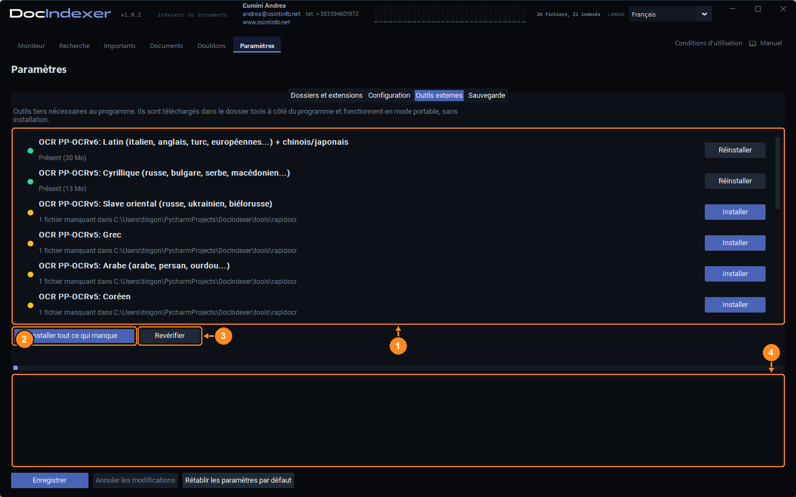

| # | Élément | Rôle |
|:--:|---|---|
| **①** | **Outils** | Chaque outil avec son état et le bouton pour l'installer. |
| **②** | **Installer tout ce qui manque** | Télécharge d'un coup les outils manquants. |
| **③** | **Revérifier** | Relit l'état des outils. |
| **④** | **Journal** | Progression et messages des téléchargements. |

**Sauvegarde** : **Créer une sauvegarde...** enregistre dans un fichier .zip la base de données (index, notes, couleurs d'importance), les paramètres, les modèles regex et les recherches enregistrées, même pendant l'indexation. **Restaurer depuis une sauvegarde...** les remplace et redémarre DocIndexer ; la base précédente reste à côté avec l'extension `.before-restore`.

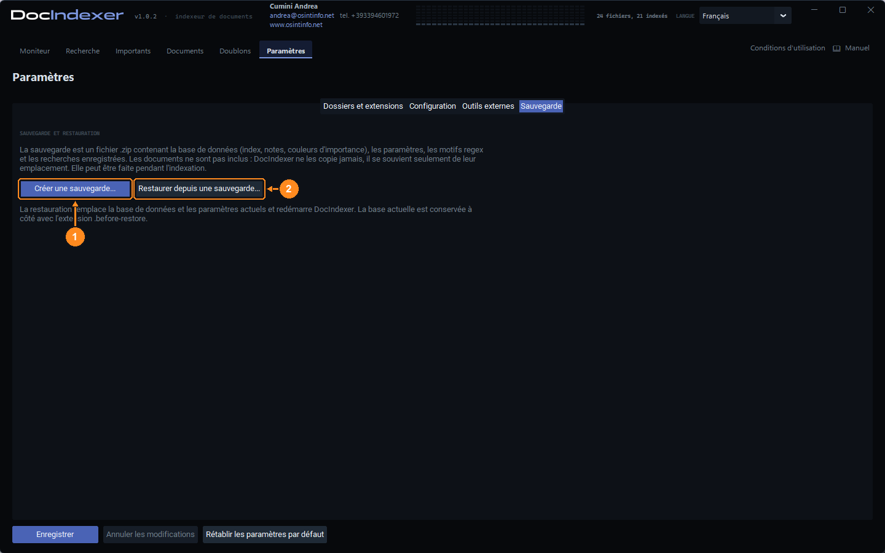

| # | Élément | Rôle |
|:--:|---|---|
| **①** | **Créer une sauvegarde** | Enregistre base, paramètres, modèles et recherches dans un .zip. |
| **②** | **Restaurer depuis une sauvegarde** | Remplace les données actuelles par la sauvegarde et redémarre. |

## 14. Icône près de l'horloge et démarrage avec Windows

Quand la fenêtre est fermée, DocIndexer continue à travailler et reste sous forme d'icône près de l'horloge. En la survolant, on voit l'état ; un clic droit ouvre le menu :

- **Ouvrir DocIndexer** (aussi d'un clic sur l'icône) ;
- **Mettre l'indexation en pause** / **Reprendre l'indexation** ;
- **Vérifier les dossiers maintenant** ;
- **Recherche rapide** ;
- **Manuel** ;
- **Démarrer avec Windows** (coché quand il est actif) ;
- **Quitter**, qui ferme vraiment le programme.

Si vous lancez DocIndexer une deuxième fois, aucune nouvelle copie ne démarre : la fenêtre de celui qui tourne déjà s'affiche. Le démarrage avec Windows ne concerne que votre utilisateur et ne demande pas de droits d'administrateur.

### Ajouter un dossier avec le clic droit

Avec l'option **Ajouter à DocIndexer** activée (Paramètres › Configuration › Démarrage), un clic droit sur un dossier dans l'Explorateur de fichiers affiche **Ajouter à DocIndexer** : le dossier rejoint les dossiers surveillés et l'indexation démarre aussitôt, même si DocIndexer était déjà ouvert. Sous Windows 11, l'élément se trouve dans « Afficher d'autres options » (ou Maj+F10). Si le dossier est déjà surveillé, ou se trouve dans un dossier surveillé, DocIndexer le signale et ne change rien ; s'il contient des dossiers déjà surveillés, il prend leur place. Aucun droit d'administrateur n'est nécessaire.

**Sur plusieurs PC.** L'entrée du clic droit et le démarrage avec Windows sont enregistrés dans le Windows du PC utilisé, pour votre utilisateur. Si vous utilisez DocIndexer depuis un disque externe, réactivez-les sur chaque PC dans **Paramètres › Configuration › Démarrage**. Si, sur le même PC, le programme change de dossier ou de lettre de disque, l'entrée du clic droit se met à jour toute seule au démarrage suivant.

## 15. Problèmes fréquents

- **Un document est introuvable.** Vérifiez dans le Moniteur que l'indexation est terminée ; dans Documents, cherchez le fichier par son nom et regardez son état (*En attente*, *Ignorés*, *Erreurs*). Vérifiez que le dossier est surveillé et que l'extension fait partie des incluses.
- **Beaucoup de fichiers en erreur.** Un fichier peut être protégé par mot de passe, endommagé ou ouvert par un autre programme. **Remettre les erreurs en file** dans le Moniteur les réessaie.
- **Une numérisation n'est pas lue.** Vérifiez dans Paramètres › Outils externes que le modèle OCR du bon alphabet est installé ; avec le modèle **Automatique**, il est choisi tout seul parmi ceux téléchargés.
- **Le PC est bruyant ou chaud.** Déplacez le curseur des ressources vers la gauche ou appuyez sur **Réduire au minimum** ; abaissez les seuils de température.
- **L'indexation est lente.** Déplacez le curseur vers la droite ; quand le PC est inactif, DocIndexer accélère tout seul.
- **Un très gros fichier n'apparaît pas.** Il est dans **Documents › Gros fichiers**, en attente de votre accord.
- **Le raccourci de la recherche rapide ne marche pas.** Un autre programme l'utilise : choisissez-en un autre dans Paramètres › Configuration.
- **Déplacer DocIndexer sur un autre PC.** Copiez tout le dossier du programme, ou créez une sauvegarde et restaurez-la sur le nouveau PC. Ensuite, si vous en avez besoin, réactivez **Démarrer avec Windows** et **Ajouter à DocIndexer**.
- **Le disque externe a une autre lettre.** Rien à faire : au démarrage, DocIndexer met à jour les chemins tout seul (voir le [chapitre 1](#1-avant-de-commencer)).
- **Le texte est trop petit ou trop grand.** Changez **Taille de l'interface (%)** dans Paramètres › Configuration : 100 est la taille des autres applications Windows. Cela s'applique au prochain démarrage.
