# DocIndexer — Manuale utente

DocIndexer tiene un indice del testo dei documenti che si trovano nelle cartelle scelte da te: documenti di Office, PDF, foto e scansioni (lette con l'OCR), e-mail, pagine web, database, archivi compressi e altro. Lavora in background, vicino all'orologio di Windows, e ti fa trovare un documento in un attimo cercando una parola, una frase o un'espressione regolare. I file **restano dove sono**: nel database vanno solo il percorso e il testo.

## Indice

1. [Prima di iniziare](#1-prima-di-iniziare)
2. [Primo avvio: configurazione guidata](#2-primo-avvio-configurazione-guidata)
3. [La finestra principale](#3-la-finestra-principale)
4. [Monitor](#4-monitor)
5. [Risorse per l'indicizzazione e temperature](#5-risorse-per-lindicizzazione-e-temperature)
6. [Ricerca](#6-ricerca)
7. [Editor delle espressioni regolari](#7-editor-delle-espressioni-regolari)
8. [Ricerche salvate ed esportazione](#8-ricerche-salvate-ed-esportazione)
9. [Importanza e note](#9-importanza-e-note)
10. [Documenti e File grandi](#10-documenti-e-file-grandi)
11. [Duplicati](#11-duplicati)
12. [Ricerca rapida](#12-ricerca-rapida)
13. [Impostazioni](#13-impostazioni)
14. [Icona vicino all'orologio e avvio con Windows](#14-icona-vicino-allorologio-e-avvio-con-windows)
15. [Problemi frequenti](#15-problemi-frequenti)

---

## 1. Prima di iniziare

- DocIndexer funziona su Windows e non richiede installazione: è un unico programma, `DocIndexer.exe`.
- Accanto al programma vengono create le cartelle `data` (il database), `cache` (anteprime temporanee, si può cancellare) e `tools` (strumenti esterni e modelli OCR), più il file delle impostazioni `config.json`. Per spostare DocIndexer su un altro PC basta copiare la cartella intera.
- Il modello OCR principale (alfabeto latino più cinese e giapponese) è già incluso. Gli altri alfabeti e gli strumenti facoltativi (ExifTool per i metadati, 7-Zip per gli archivi) si scaricano da **Impostazioni › Strumenti esterni** (vedi [capitolo 13](#13-impostazioni)).
- I documenti non vengono mai spostati, copiati o modificati.

### Uso portatile su un disco esterno

DocIndexer può stare su un disco esterno o su una chiavetta insieme alle cartelle che indicizza: programma, impostazioni (`config.json`) e database stanno nella stessa cartella e viaggiano insieme. Non c'è nulla da attivare: la modalità portatile è automatica.

- Se su un altro PC il disco prende un'altra lettera (per esempio era **E:** e ora è **F:**), all'avvio DocIndexer se ne accorge e aggiorna da solo tutti i percorsi di quel disco: cartelle monitorate, sottocartelle escluse, ricerche salvate e indice. Non riparte da zero: il testo già letto, i colori di importanza e le note restano. Nel **Registro** del Monitor una riga indica la vecchia e la nuova lettera e quanti percorsi sono stati aggiornati.
- Le cartelle che stanno su altri dischi (per esempio **C:**) non vengono toccate. Se un disco monitorato non è collegato, i suoi file restano nell'indice e vengono ricontrollati quando torna disponibile.
- **Avvia con Windows** e la voce **Aggiungi a DocIndexer** del tasto destro sono registrate in Windows, non nella cartella del programma: su ogni PC vanno riattivate in **Impostazioni › Configurazione › Avvio** (vedi il [capitolo 14](#14-icona-vicino-allorologio-e-avvio-con-windows)).

## 2. Primo avvio: configurazione guidata

### Lingua e termini d'uso

Alla primissima apertura DocIndexer chiede la lingua e poi mostra i termini d'uso in quella lingua.

| # | Elemento | A cosa serve |
|:--:|---|---|
| **①** | **Lingua** | Un clic sceglie la lingua del programma e del manuale. |

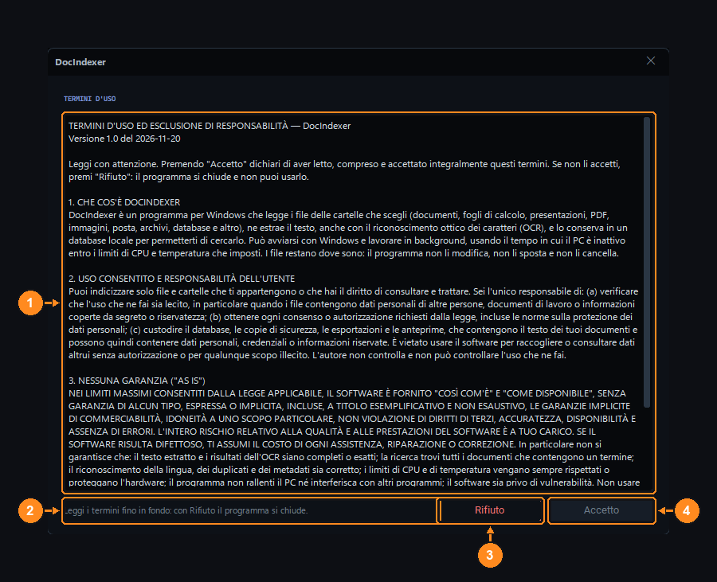

| # | Elemento | A cosa serve |
|:--:|---|---|
| **①** | **Testo dei termini** | Va fatto scorrere fino in fondo. |
| **②** | **Nota** | Diventa verde quando hai letto tutto. |
| **③** | **Rifiuto** | Chiude il programma. |
| **④** | **Accetto** | Si attiva in fondo al testo e prosegue con la configurazione. |

**Accetto** si attiva solo dopo aver fatto scorrere il testo fino in fondo; **Rifiuto** (o la chiusura della finestra) chiude il programma. La risposta viene ricordata: i termini vengono chiesti di nuovo solo se cambiano. Si possono rileggere quando vuoi con il pulsante **Termini d'uso** accanto a **📖 Manuale**.

### Configurazione guidata

Alla prima apertura DocIndexer chiede dove deve cercare.

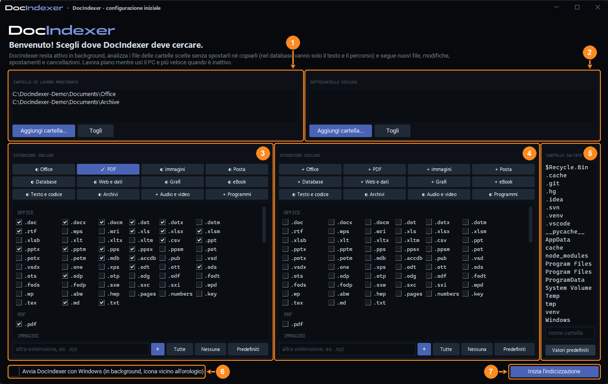

| # | Elemento | A cosa serve |
|:--:|---|---|
| **①** | **Cartelle di lavoro monitorate** | Le cartelle da indicizzare: **Aggiungi cartella...** e **Togli**. |
| **②** | **Sottocartelle escluse** | Parti delle cartelle scelte da saltare. |
| **③** | **Estensioni incluse** | I tipi di file da leggere; i pulsanti di categoria li scelgono a gruppi. |
| **④** | **Estensioni escluse** | Tipi di file da ignorare sempre. |
| **⑤** | **Cartelle saltate (per nome)** | Cartelle saltate ovunque si trovino (per esempio .git, Temp). |
| **⑥** | **Avvia con Windows** | DocIndexer parte da solo all'accensione, in background. |
| **⑦** | **Inizia l'indicizzazione** | Salva le scelte e avvia il lavoro. |

1. **Cartelle di lavoro monitorate**: premi **Aggiungi cartella...** per ogni cartella da indicizzare (per esempio Documenti o una cartella di rete); **Togli** la toglie dall'elenco.
2. **Sottocartelle escluse**: cartelle precise, dentro quelle monitorate, da non analizzare.
3. **Estensioni incluse** ed **estensioni escluse**: i tipi di file da leggere. I pulsanti dei gruppi (Office, PDF, Immagini, Posta, Database, Web e dati, Grafi, eBook, Testo e codice, Archivi, Audio e video, Programmi) spuntano tutto il gruppo con un clic e lo tolgono con un altro clic; **Tutte**, **Nessuna** e **Predefiniti** fanno quello che dicono. Nel campo in basso puoi aggiungere un'estensione a mano.
4. **Cartelle saltate (per nome)**: cartelle ignorate ovunque si trovino, come `$Recycle.Bin`, `.git` o `node_modules`.
5. **Avvia DocIndexer con Windows**: se spuntato, DocIndexer parte da solo all'accesso, con la sola icona vicino all'orologio.

Premi **Inizia l'indicizzazione**. Tutto quello che scegli qui si può cambiare più tardi in **Impostazioni**.

## 3. La finestra principale

In alto c'è l'intestazione, sempre visibile:

- il logo, la versione e i riferimenti dell'autore (e-mail e sito sono cliccabili);
- l'**indicatore di attività**, che si muove come l'equalizzatore di uno stereo: l'altezza delle colonne segue la CPU usata dall'indicizzazione e ogni file appena letto dà un colpo alla sua zona (da sinistra: PDF, Office, immagini, testo e altro); i picchi rossi segnalano un errore. Quando non c'è lavoro resta una riga spenta; in pausa è ambra;
- il numero di file nell'indice e quanti sono già indicizzati;
- il menu **Lingua**, che cambia subito la lingua di tutto il programma;
- i pulsanti riduci, ingrandisci e chiudi. **Chiudere la finestra non ferma DocIndexer**: la nasconde e il lavoro continua (vedi [capitolo 14](#14-icona-vicino-allorologio-e-avvio-con-windows)).

Sotto ci sono le schede **Monitor**, **Ricerca**, **Importanti**, **Documenti**, **Duplicati** e **Impostazioni**. A destra delle schede, **📖 Manuale** apre questo manuale nella lingua del programma. Accanto, **Termini d'uso** mostra di nuovo i termini d'uso accettati alla prima apertura.

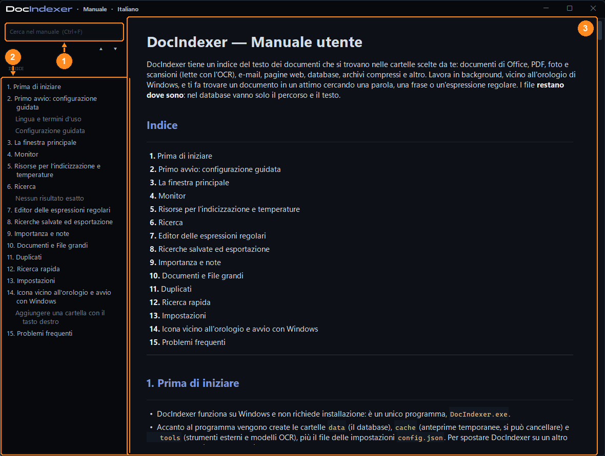

| # | Elemento | A cosa serve |
|:--:|---|---|
| **①** | **Cerca nel manuale (Ctrl+F)** | Evidenzia tutte le occorrenze; Invio passa alla successiva. |
| **②** | **Indice** | Un clic porta al capitolo. |
| **③** | **Testo** | Il manuale; un clic su un'immagine la apre a grandezza intera. |

Nella finestra del manuale l'indice a sinistra porta al capitolo con un clic, il campo **Cerca nel manuale** (Ctrl+F) evidenzia tutte le occorrenze (Invio = successiva, Maiusc+Invio = precedente) e un clic su un'immagine la apre a grandezza intera. Esc chiude la finestra.

## 4. Monitor

Il Monitor mostra a che punto è l'indicizzazione.

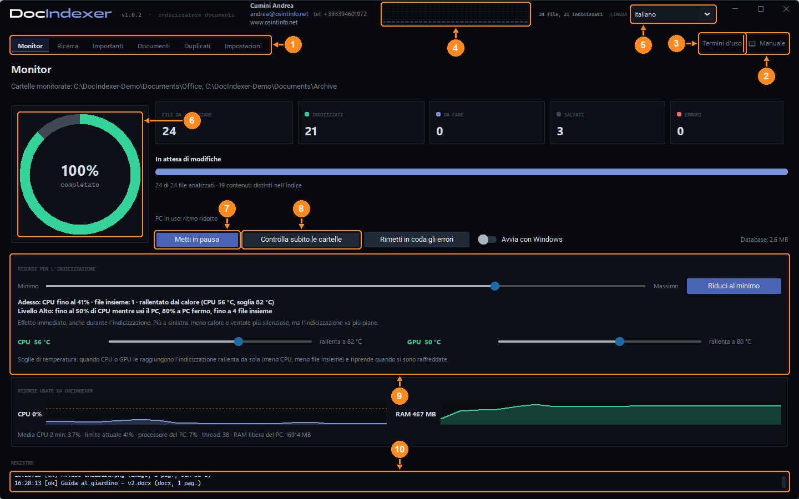

| # | Elemento | A cosa serve |
|:--:|---|---|
| **①** | **Schede** | Le pagine del programma. |
| **②** | **📖 Manuale** | Apre questo manuale nella lingua del programma. |
| **③** | **Termini d'uso** | Rilegge i termini d'uso accettati alla prima apertura. |
| **④** | **Equalizzatore** | Si muove quando DocIndexer sta lavorando. |
| **⑤** | **Lingua** | Cambia la lingua dell'interfaccia. |
| **⑥** | **Avanzamento** | Quanta parte dei file è già analizzata. |
| **⑦** | **Metti in pausa** | Ferma e riprende l'indicizzazione. |
| **⑧** | **Controlla subito le cartelle** | Cerca subito file nuovi o cambiati. |
| **⑨** | **Risorse per l'indicizzazione** | Quanta CPU usare e soglie di temperatura (capitolo 5). |
| **⑩** | **Registro** | I messaggi del lavoro, file per file. |

- **Cartelle monitorate**: l'elenco delle cartelle sotto il titolo.
- **Grafico a torta** e riquadri: **File da analizzare** (tutti i file trovati), **Indicizzati**, **Da fare**, **Saltati** (senza testo leggibile o esclusi) ed **Errori**.
- **Fase** in corso: conteggio dei file, calcolo degli hash, estrazione del testo, oppure *In attesa di modifiche* quando ha finito. Sotto ci sono la barra di avanzamento, il file su cui sta lavorando e il ritmo attuale: *PC in uso: ritmo ridotto*, *PC inattivo: ritmo pieno*, *PC impegnato: in attesa* (gli altri programmi usano già molta CPU) o *A batteria: ritmo minimo*.
- **Metti in pausa / Riprendi** ferma e fa ripartire l'indicizzazione.
- **Controlla subito le cartelle** cerca subito file nuovi, modificati, spostati o cancellati (DocIndexer lo fa comunque da solo all'avvio e ogni qualche ora, e segue in tempo reale le modifiche mentre è acceso).
- **Rimetti in coda gli errori** riprova i file che non è riuscito a leggere.
- **Avvia con Windows** attiva o disattiva subito l'avvio automatico.
- **Database**: la dimensione attuale del database.
- **Registro**: in fondo alla pagina, le ultime operazioni.

Come lavora: prima conta i file, poi calcola per ognuno un'impronta del contenuto (SHA-256) ed estrae il testo. Un file identico a uno già letto non viene rianalizzato; un file spostato o rinominato cambia solo percorso nell'indice; un file cancellato viene tolto.

Se togli tutte le cartelle monitorate, DocIndexer toglie dall'indice i loro file e il Monitor si azzera: grafico, contatori e avanzamento ripartono da zero finché non aggiungi una nuova cartella.

## 5. Risorse per l'indicizzazione e temperature

Nel Monitor, il riquadro **Risorse per l'indicizzazione** decide quanta parte del PC può usare DocIndexer.

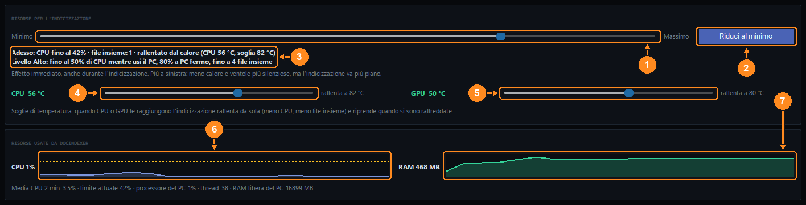

| # | Elemento | A cosa serve |
|:--:|---|---|
| **①** | **Livello delle risorse** | Da Minimo a Massimo; vale subito. |
| **②** | **Riduci al minimo** | Porta il livello tutto a sinistra. |
| **③** | **Adesso** | Cosa fa il livello scelto in questo momento. |
| **④** | **Soglia CPU** | Oltre questa temperatura l'indicizzazione rallenta. |
| **⑤** | **Soglia GPU** | Lo stesso per la scheda video. |
| **⑥** | **Grafico CPU** | CPU usata da DocIndexer; la riga tratteggiata è il limite. |
| **⑦** | **Grafico RAM** | Memoria usata da DocIndexer. |

Lo **slider** va da **Minimo** a **Massimo** e ha effetto subito, anche durante l'indicizzazione. Più a sinistra significa meno calore e ventole più silenziose, ma un'indicizzazione più lenta. **Riduci al minimo** porta lo slider tutto a sinistra con un clic.

| Livello | CPU mentre usi il PC | CPU a PC fermo | Note |
|---|---|---|---|
| Minimo | 5% | 5% | un file alla volta, risparmio energetico di Windows |
| Basso | 10% | 25% | un file alla volta, risparmio energetico di Windows |
| Medio | 25% | 60% | due file insieme |
| Alto | 50% | 80% | più file insieme (circa metà dei core) |
| Massimo | 90% | 100% | quasi tutti i core |

Sotto lo slider due righe dicono cosa succede adesso (per esempio *Adesso: CPU fino al 60% · file insieme: 2 · PC fermo: piena potenza*) e cosa prevede il livello scelto.

**PC fermo**: quando non usi tastiera e mouse per qualche minuto (3 di base, si cambia in Impostazioni) il limite sale gradualmente fino al valore "a PC fermo"; appena torni al PC scende di nuovo. Anche mentre scrivi o fai clic nella finestra di DocIndexer l'indicizzazione lascia il passo per qualche secondo, così ricerca e anteprime restano rapide.

**Temperature**: le due righe **CPU** e **GPU** mostrano la temperatura attuale (verde, ambra quando si avvicina alla soglia, rossa quando la raggiunge) e uno slider con la soglia, da 50 a 100 °C (82 °C per la CPU e 80 °C per la GPU di base). Raggiunta la soglia l'indicizzazione rallenta da sola (meno CPU, meno file insieme) e riprende quando il componente si è raffreddato. Se un sensore non è leggibile compare *non rilevabile*.

Il riquadro **Risorse usate da DocIndexer** mostra CPU e RAM usate dal programma negli ultimi due minuti; la linea tratteggiata è il limite di CPU in vigore. Sotto ci sono la media, il limite attuale, il carico complessivo del processore e la RAM libera del PC.

## 6. Ricerca

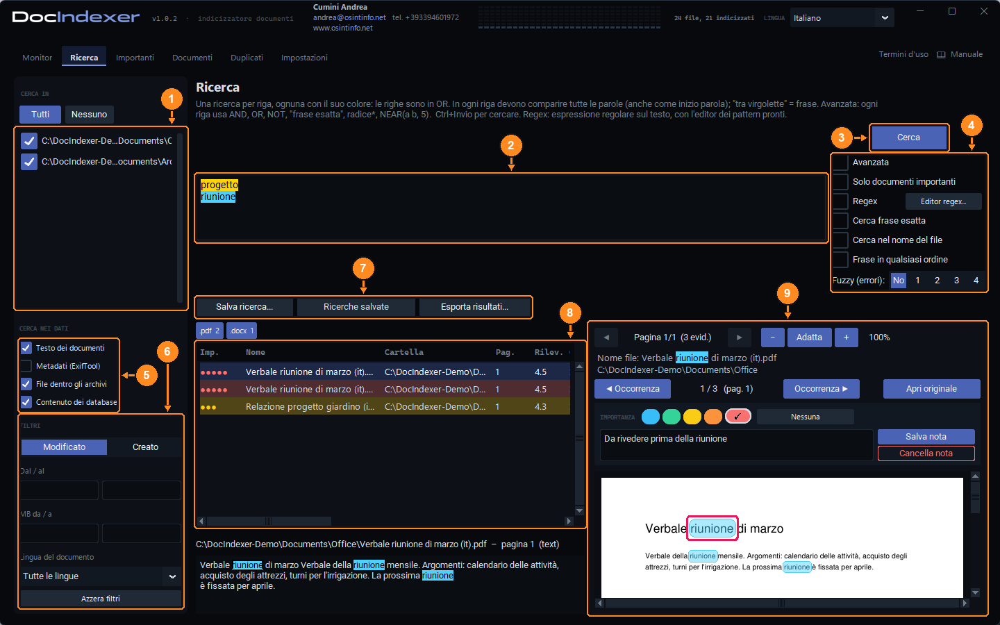

| # | Elemento | A cosa serve |
|:--:|---|---|
| **①** | **Cerca in** | Le cartelle in cui cercare (**Tutti** / **Nessuno**). |
| **②** | **Riquadro di ricerca** | Una ricerca per riga, ognuna col suo colore. |
| **③** | **Cerca** | Avvia la ricerca (anche Ctrl+Invio). |
| **④** | **Opzioni** | Avanzata, regex con il suo editor, frase esatta, nome del file, fuzzy. |
| **⑤** | **Cerca nei dati** | Testo, metadati, archivi e database da includere. |
| **⑥** | **Filtri** | Date, dimensione e lingua; **Azzera filtri** li toglie. |
| **⑦** | **Salva ed esporta** | Salva la ricerca, apre le ricerche salvate, esporta i risultati. |
| **⑧** | **Risultati** | Un clic mostra il documento nell'anteprima. |
| **⑨** | **Anteprima** | Pagine, occorrenze evidenziate, importanza e nota, **Apri originale**. |

**Cosa scrivere.** Nel riquadro grande scrivi una ricerca per riga; ogni riga ha il suo colore, che ritrovi nei risultati e nell'anteprima, e le righe valgono in alternativa (basta che ne compaia una). In una riga devono comparire tutte le parole, anche come inizio di parola; le maiuscole e gli accenti non contano; una frase "tra virgolette" va cercata così com'è. Premi **Cerca** o Ctrl+Invio.

**Opzioni** a destra del riquadro:

- **Avanzata**: ogni riga usa la sintassi completa: `AND`, `OR`, `NOT`, `"frase esatta"`, `radice*`, `NEAR(a b, 5)`.
- **Solo documenti importanti**: solo i file a cui hai dato un colore (vedi [capitolo 9](#9-importanza-e-note)).
- **Regex**: la riga è un'espressione regolare cercata nel testo; **Editor regex...** apre l'editor (vedi [capitolo 7](#7-editor-delle-espressioni-regolari)). Una ricerca regex lunga si può fermare con **Ferma ricerca**.
- **Cerca frase esatta**, **Cerca nel nome del file**, **Frase in qualsiasi ordine**.
- **Fuzzy (errori)**: accetta da 1 a 4 errori per parola, compresi gli scambi tipici dell'OCR (0/o, 1/l, rn/m). Se una ricerca normale non trova nulla, DocIndexer riprova da solo tollerando un errore e te lo segnala.

**A sinistra** scegli **dove** cercare:

- **Cerca in**: le cartelle monitorate in cui cercare (**Tutti** / **Nessuno**).
- **Cerca nei dati**: testo dei documenti, metadati (ExifTool), file dentro gli archivi, contenuto dei database.
- **Filtri**: periodo (**Modificato** o **Creato**, date nel formato aaaa-mm-gg, anche solo aaaa o aaaa-mm), dimensione in MB, **lingua del documento** (riconosciuta da sola per ogni file). **Azzera filtri** li toglie tutti.

**I risultati.** Sopra la tabella c'è un pulsante per ogni tipo di file trovato (.pdf, .docx...) con il numero di risultati: un clic nasconde o mostra quel tipo, **Tutte** e **Nessuna** li cambiano tutti. Le colonne sono importanza, nome, cartella, pagina, rilevanza, data di creazione ed estratto con le parole colorate; un clic sull'intestazione ordina la colonna. Sotto la tabella c'è il testo estratto della pagina trovata, con le parole evidenziate.

**L'anteprima** a destra mostra la pagina vera del documento con le occorrenze riquadrate: le frecce cambiano pagina, **−**, **Adatta** e **+** cambiano lo zoom (anche con la rotellina), **◀ Occorrenza** e **Occorrenza ▶** saltano da un risultato all'altro, **Apri originale** (o doppio clic sul risultato) apre il file con il suo programma. Per i documenti Office l'anteprima viene preparata con Office e può richiedere qualche secondo.

**Aprire la cartella di un risultato.** Un clic sulla cella **Cartella** di un risultato apre la cartella in Esplora file con il file già selezionato. Lo stesso vale nelle schede **Documenti** e **Importanti**.

### Nessun risultato esatto

Se una ricerca non trova nulla, DocIndexer riprova da solo tollerando un errore di battitura o di OCR per parola. In quel caso sopra i risultati compare un avviso rosso che lampeggia qualche volta: **Nessun risultato esatto: mostrati quelli con 1 errore di battitura o di OCR**. Controlla i risultati: possono contenere parole simili a quella cercata.

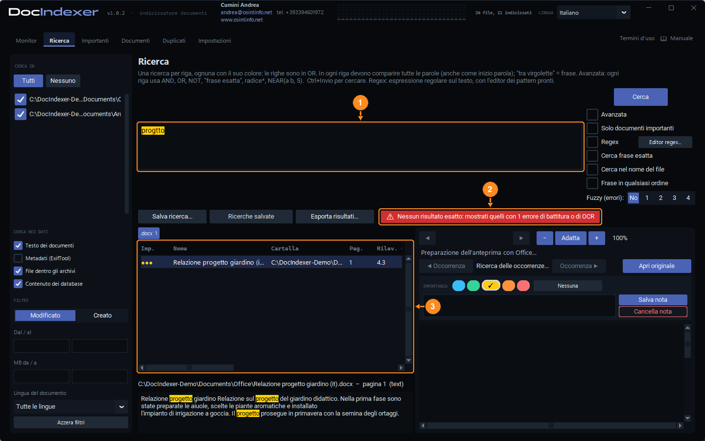

| # | Elemento | A cosa serve |
|:--:|---|---|
| **①** | **Ricerca con un errore** | Qui manca una lettera. |
| **②** | **Avviso rosso** | Lampeggia: nessun risultato esatto, mostrati quelli con 1 errore. |
| **③** | **Risultati** | I documenti con la parola giusta. |

## 7. Editor delle espressioni regolari

Un'espressione regolare (regex) cerca uno *schema* invece di una parola: per esempio qualsiasi data, qualsiasi indirizzo web o qualsiasi codice di un certo formato.

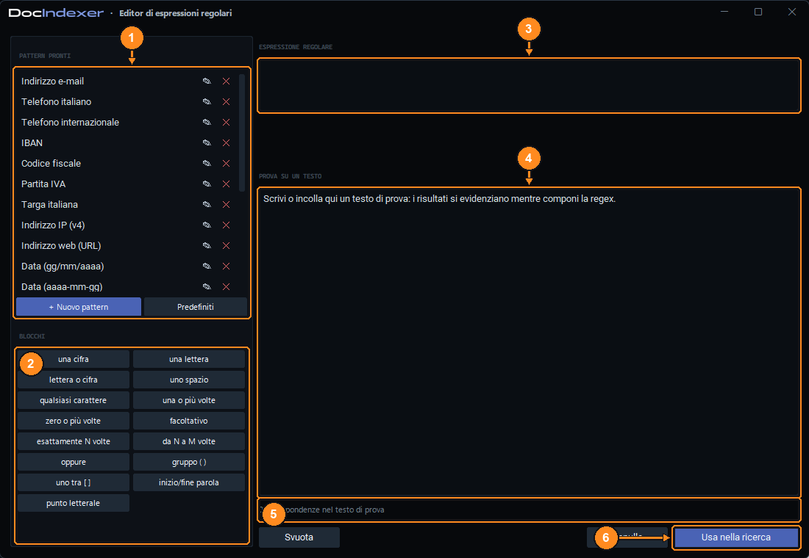

| # | Elemento | A cosa serve |
|:--:|---|---|
| **①** | **Pattern pronti** | Schemi già fatti: un clic li usa; **+ Nuovo pattern** ne aggiunge. |
| **②** | **Blocchi** | Pezzi da inserire senza conoscere la sintassi. |
| **③** | **Espressione regolare** | La regex che stai componendo. |
| **④** | **Prova su un testo** | Testo di prova: le corrispondenze si evidenziano subito. |
| **⑤** | **Conteggio** | Quante corrispondenze ci sono nel testo di prova. |
| **⑥** | **Usa nella ricerca** | Porta la regex nella pagina Ricerca. |

- **Pattern pronti**: schemi già fatti, tra cui indirizzo e-mail, numeri di telefono, IBAN, codice fiscale, partita IVA, targa, indirizzo IP, URL, date, ore, importi, coordinate GPS, hashtag e nomi utente. Un clic lo mette nel campo; puoi aggiungere i tuoi con **Nuovo pattern** e tornare all'elenco originale con **Predefiniti**.
- **Blocchi**: pezzi da comporre senza ricordare la sintassi (una cifra, una lettera, una o più volte, facoltativo, "oppure", gruppi, inizio/fine parola...).
- **Espressione regolare**: il campo con lo schema; sotto, la spiegazione in parole di cosa cerca.
- **Prova su un testo**: scrivi o incolla un testo di prova e i risultati si evidenziano mentre scrivi. **Svuota** cancella il testo.

**Usa nella ricerca** porta lo schema nella pagina Ricerca, con l'opzione Regex attiva, e fa partire la ricerca.

## 8. Ricerche salvate ed esportazione

**Salva ricerca...** (sotto il riquadro della Ricerca) salva la ricerca attuale con un nome, insieme a opzioni e filtri. Se spunti **Avvisami quando nuovi file corrispondono a questa ricerca**, DocIndexer la ripete da solo quando indicizza file nuovi e mostra un avviso di Windows vicino all'orologio.

| # | Elemento | A cosa serve |
|:--:|---|---|
| **①** | **Avviso** | Ripete la ricerca sui file nuovi e avvisa vicino all'orologio. |
| **②** | **Apri** | Rimette la ricerca nella pagina Ricerca e la esegue. |
| **③** | **✕** | Elimina la ricerca salvata. |
| **④** | **Controlla adesso** | Ripete subito le ricerche con avviso. |

**Ricerche salvate** apre l'elenco: per ognuna vedi l'avviso (attivo o no), quanti file nuovi ha trovato e quando è stata controllata. **Apri** la rimette nella pagina Ricerca e la esegue, **Solo i nuovi** mostra solo i file arrivati dopo l'ultima volta, **Controlla adesso** la ripete subito; si può anche eliminare. Quando ci sono file nuovi il pulsante Ricerche salvate mostra quanti sono.

**Esporta risultati...** salva i risultati in **Excel** (.xlsx, righe colorate secondo l'importanza), **CSV** (separatore `;`, si apre in Excel) o **PDF**, con importanza e note. Lo stesso pulsante **Esporta...** c'è in Documenti, Importanti e Duplicati.

## 9. Importanza e note

Nell'anteprima, sotto il nome del file, ogni documento può avere un **colore di importanza** (azzurro, verde, giallo, arancio, rosso, dal meno al più importante; **Nessuna** lo toglie) e una **nota** scritta da te (**Salva nota**, **Cancella nota**).

Colore e nota appartengono al **contenuto** del file (la sua impronta SHA-256), non al percorso. Se sposti o rinomini il file, anche con DocIndexer chiuso o su un altro disco, li ritrovi appena il file viene ricontrollato. Le copie identiche dello stesso file hanno lo stesso colore e la stessa nota: se li cambi su una copia, cambiano su tutte. Se modifichi il file, colore e nota restano.

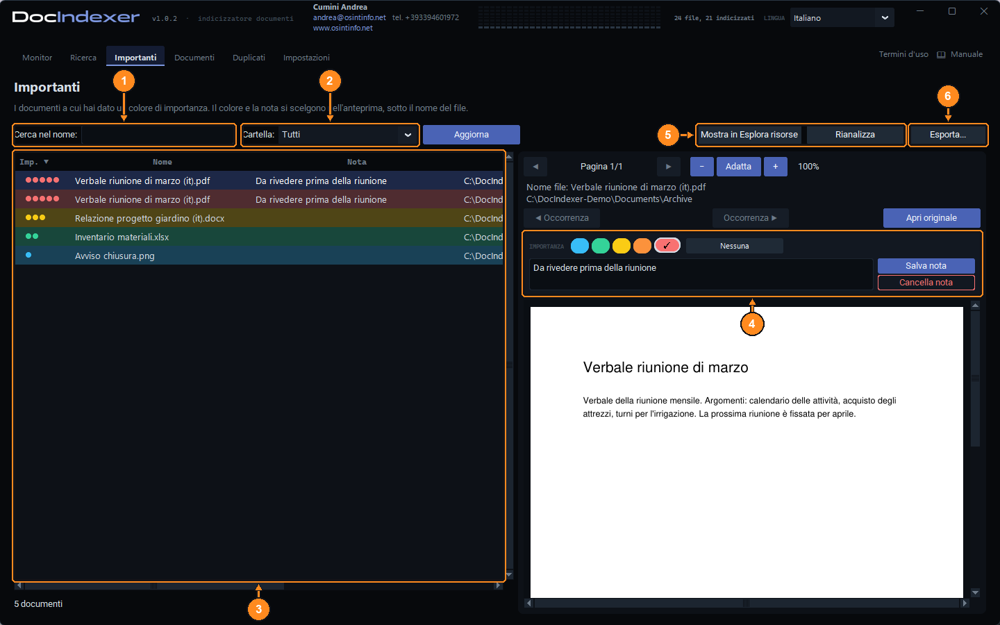

| # | Elemento | A cosa serve |
|:--:|---|---|
| **①** | **Cerca nel nome** | Filtra l'elenco mentre scrivi. |
| **②** | **Cartella** | Mostra solo una cartella monitorata. |
| **③** | **Elenco** | I documenti colorati, i più importanti in alto, con la nota. |
| **④** | **Importanza** | Cinque colori e una nota; **Salva nota** la registra. |
| **⑤** | **Mostra e rianalizza** | Apre la cartella del file o lo rimette in coda. |
| **⑥** | **Esporta** | Salva l'elenco in CSV, Excel o HTML. |

La scheda **Importanti** elenca solo i documenti colorati, i più importanti in alto, con la nota. In tutti gli elenchi il colore compare come pallini all'inizio della riga e la riga è leggermente colorata. In Ricerca l'opzione **Solo documenti importanti** limita la ricerca a questi file.

## 10. Documenti e File grandi

La scheda **Documenti** elenca tutti i file indicizzati.

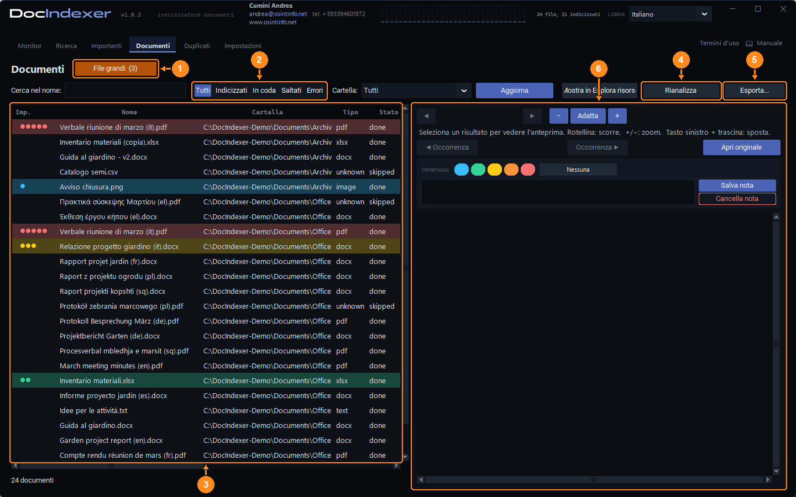

| # | Elemento | A cosa serve |
|:--:|---|---|
| **①** | **File grandi** | I file oltre il limite di dimensione, in attesa di una scelta. |
| **②** | **Stato** | Tutti, indicizzati, in coda, saltati o con errori. |
| **③** | **Elenco** | Tutti i file trovati, con cartella, tipo e stato. |
| **④** | **Rianalizza** | Rimette in coda il file selezionato. |
| **⑤** | **Esporta** | Salva l'elenco in CSV, Excel o HTML. |
| **⑥** | **Anteprima** | Il documento selezionato, con importanza e nota. |

- **Cerca nel nome**: filtra l'elenco mentre scrivi.
- **Tutti / Indicizzati / In coda / Saltati / Errori**: filtra per stato. **Cartella** filtra per cartella monitorata. **Aggiorna** ricarica l'elenco.
- Le colonne mostrano importanza, nome, cartella, tipo, stato, lingua, pagine, pagine lette con l'OCR, caratteri, data di creazione e di modifica e impronta SHA-256. Un clic sull'intestazione ordina; passando sopra una cella troncata compare il testo intero.
- Si possono selezionare più righe (Ctrl o Maiusc + clic, Ctrl+A). **Mostra in Esplora risorse** apre la cartella del file, **Rianalizza** rilegge i file selezionati, **Esporta...** salva l'elenco. Il doppio clic apre il file.
- Un clic sulla cella **Cartella** apre la cartella in Esplora file con il file selezionato (anche nella scheda **Importanti**).

**File grandi.** I file più grandi del limite impostato (200 MB di base) non vengono analizzati da soli: il pulsante **File grandi** diventa arancione e mostra quanti sono in attesa.

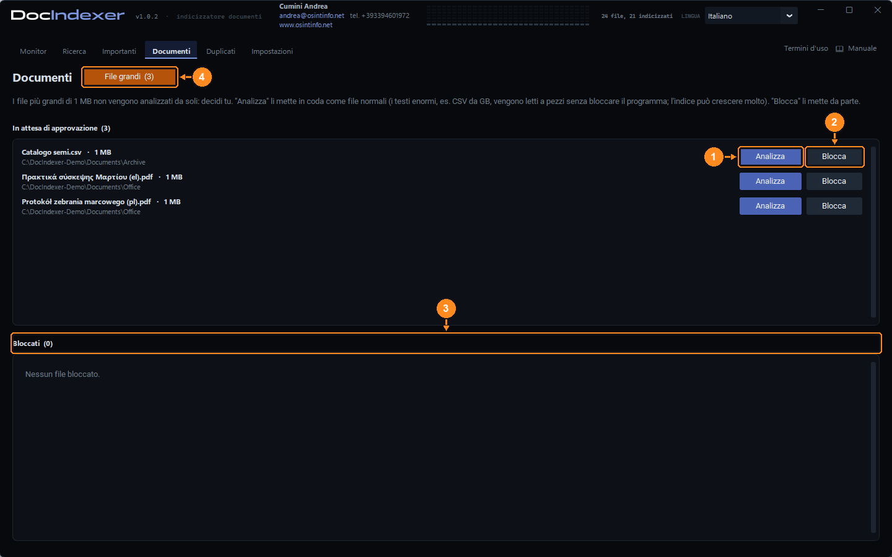

| # | Elemento | A cosa serve |
|:--:|---|---|
| **①** | **Analizza** | Mette il file in coda come gli altri. |
| **②** | **Blocca** | Lo mette da parte senza analizzarlo. |
| **③** | **Bloccati** | I file bloccati; **Sblocca** li rimette in attesa. |
| **④** | **File grandi** | Torna all'elenco dei documenti. |

Per ogni file in attesa scegli **Analizza** (va in coda come un file normale; i testi enormi vengono letti a pezzi senza bloccare il programma, ma l'indice può crescere molto) oppure **Blocca** (messo da parte). Nell'elenco **Bloccati**, **Sblocca** lo rimette in attesa. **← Documenti** torna all'elenco.

## 11. Duplicati

La scheda **Duplicati** trova due tipi di copie. Premi **Cerca duplicati**.

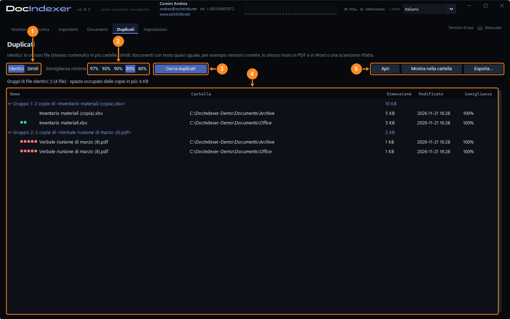

| # | Elemento | A cosa serve |
|:--:|---|---|
| **①** | **Identici / Simili** | Stesso file oppure testo quasi uguale. |
| **②** | **Somiglianza minima** | Quanto devono assomigliarsi i documenti simili. |
| **③** | **Cerca duplicati** | Avvia la ricerca. |
| **④** | **Gruppi** | Un gruppo per ogni insieme di copie, con lo spazio occupato. |
| **⑤** | **Apri, mostra, esporta** | Per il file selezionato o per tutto l'elenco. |

- **Identici**: lo stesso file (stesso contenuto) in più cartelle. Ogni gruppo mostra quante copie ci sono e lo spazio occupato; in cima c'è lo spazio totale occupato dalle copie in più.

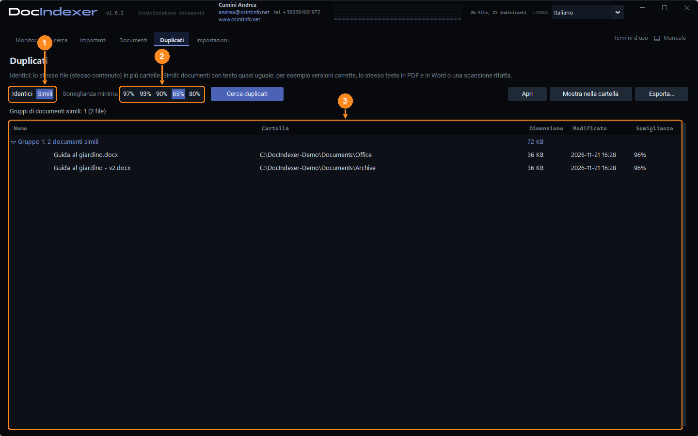

| # | Elemento | A cosa serve |
|:--:|---|---|
| **①** | **Simili** | Documenti con testo quasi uguale. |
| **②** | **Somiglianza minima** | Dal 97% all'80%: più basso trova più coppie. |
| **③** | **Gruppi** | La colonna Somiglianza mostra il valore di ogni file. |

- **Simili**: documenti con testo quasi uguale, per esempio versioni corrette dello stesso documento, lo stesso testo in PDF e in Word o una scansione rifatta. **Somiglianza minima** sceglie quanto devono assomigliarsi (dal 97% all'80%); la colonna Somiglianza mostra il valore di ogni file.

**Apri**, **Mostra nella cartella** ed **Esporta...** lavorano sul file selezionato o sull'elenco.

## 12. Ricerca rapida

La ricerca rapida è una barra di ricerca che si apre sopra qualsiasi programma, con la scorciatoia **Ctrl+Alt+D** (si cambia in Impostazioni) o dal menu dell'icona vicino all'orologio.

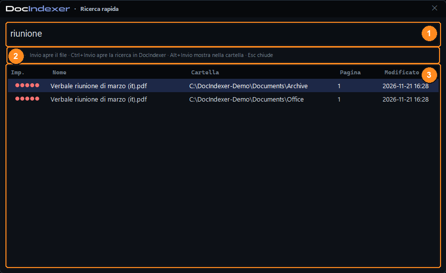

| # | Elemento | A cosa serve |
|:--:|---|---|
| **①** | **Campo di ricerca** | Cerca mentre scrivi. |
| **②** | **Tasti** | Invio, Ctrl+Invio, Alt+Invio, Esc. |
| **③** | **Risultati** | Con le frecce scegli il file. |

Cerca mentre scrivi. Con le frecce scegli un risultato; **Invio** apre il file, **Ctrl+Invio** apre la ricerca completa in DocIndexer, **Alt+Invio** mostra il file nella sua cartella, **Esc** chiude la barra.

## 13. Impostazioni

Le modifiche valgono solo dopo **Salva**. **Annulla modifiche** torna alle impostazioni salvate; **Ripristina impostazioni predefinite** riporta i valori di fabbrica. Se cambi scheda con modifiche non salvate, DocIndexer chiede se salvarle.

**Cartelle ed estensioni** contiene le stesse tabelle della configurazione guidata: cartelle monitorate, sottocartelle escluse, estensioni incluse ed escluse, cartelle saltate per nome.

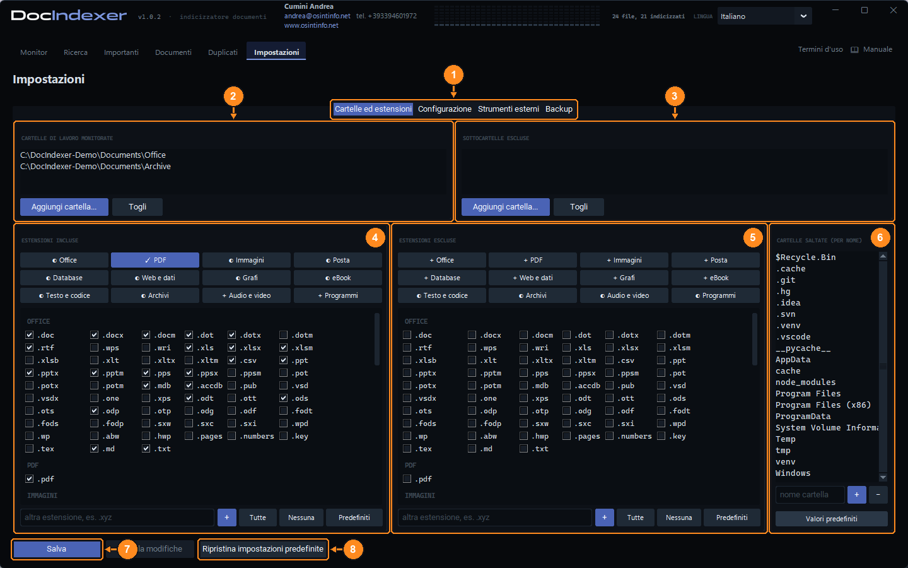

| # | Elemento | A cosa serve |
|:--:|---|---|
| **①** | **Schede delle impostazioni** | Cartelle, configurazione, strumenti esterni, backup. |
| **②** | **Cartelle di lavoro monitorate** | Le cartelle da indicizzare. |
| **③** | **Sottocartelle escluse** | Parti delle cartelle da saltare. |
| **④** | **Estensioni incluse** | I tipi di file da leggere. |
| **⑤** | **Estensioni escluse** | I tipi di file da ignorare. |
| **⑥** | **Cartelle saltate (per nome)** | Cartelle saltate ovunque si trovino. |
| **⑦** | **Salva** | Applica le modifiche. |
| **⑧** | **Ripristina impostazioni predefinite** | Torna ai valori iniziali. |

**Configurazione**:

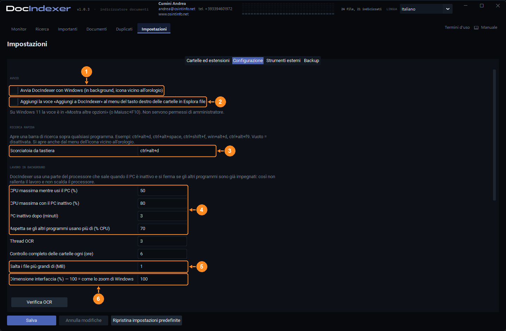

| # | Elemento | A cosa serve |
|:--:|---|---|
| **①** | **Avvia con Windows** | Vale subito, senza premere Salva. |
| **②** | **Aggiungi a DocIndexer** | Voce del tasto destro delle cartelle in Esplora file; vale subito. |
| **③** | **Scorciatoia da tastiera** | I tasti della ricerca rapida (vuoto = disattivata). |
| **④** | **Lavoro in background** | CPU con il PC in uso e inattivo, attesa, programmi impegnati. |
| **⑤** | **Salta i file più grandi di (MB)** | Oltre questo limite i file vanno in **File grandi**. |
| **⑥** | **Dimensione interfaccia (%) — 100 = come lo zoom di Windows** | 100 = come le altre app di Windows; di più ingrandisce, di meno rimpicciolisce. |

- **Avvio**: avvio con Windows (vale subito).
- **Aggiungi a DocIndexer**: aggiunge la voce al menu del tasto destro delle cartelle in Esplora file; vale subito, senza Salva (vedi il capitolo 14).
- **Ricerca rapida**: la scorciatoia da tastiera, per esempio `ctrl+alt+d`, `ctrl+shift+f` o `win+alt+d`; vuota = disattivata. Se la scorciatoia è già usata da un altro programma compare un avviso.
- **Lavoro in background**: CPU massima mentre usi il PC e con il PC inattivo, dopo quanti minuti il PC è considerato inattivo, oltre quale carico degli altri programmi DocIndexer aspetta, thread OCR, ogni quante ore ricontrollare tutte le cartelle, dimensione massima dei file (oltre va in **File grandi**), dimensione dell'interfaccia (in %, 100 = come lo zoom di Windows, cioè la stessa dimensione delle altre app; vale dal prossimo avvio). I primi valori cambiano anche con lo slider del Monitor.
- **Moduli aggiuntivi**: metadati con ExifTool, testo dei file dentro gli archivi (7-Zip), database SQLite, dBASE/FoxPro e Access. Ogni modulo salva i suoi dati a parte; in Ricerca scegli in quali cercare.
- **OCR (RapidOCR)**: il modello. **Automatico** legge la prima pagina scansionata con il modello latino e, se il risultato è incerto, prova gli altri modelli scaricati scegliendo quello che legge meglio. La **risoluzione OCR (DPI)** più alta legge meglio i caratteri piccoli ma è più lenta. **Verifica OCR** fa una prova.
- **Database SQLite**: il file del database.

**Strumenti esterni** mostra lo stato dei modelli OCR e degli strumenti facoltativi (ExifTool, 7-Zip, driver di Access). **Installa** o **Reinstalla** scarica uno strumento nella cartella `tools`, **Installa tutto ciò che manca** li scarica tutti, **Ricontrolla** aggiorna lo stato. Funzionano senza installazione nel sistema.

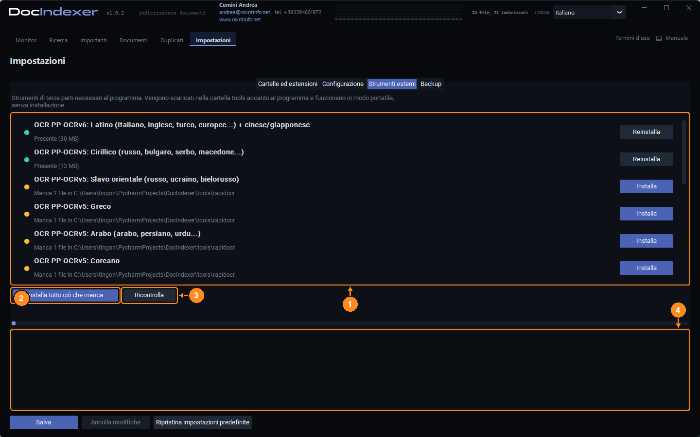

| # | Elemento | A cosa serve |
|:--:|---|---|
| **①** | **Strumenti** | Ogni strumento con il suo stato e il pulsante per installarlo. |
| **②** | **Installa tutto ciò che manca** | Scarica in una volta gli strumenti mancanti. |
| **③** | **Ricontrolla** | Rilegge lo stato degli strumenti. |
| **④** | **Registro** | Avanzamento e messaggi dei download. |

**Backup**: **Crea backup...** salva in un file .zip il database (indice, note, colori di importanza), le impostazioni, i pattern regex e le ricerche salvate, anche mentre l'indicizzazione lavora. **Ripristina da backup...** li sostituisce e riavvia DocIndexer; il database precedente resta accanto con l'estensione `.before-restore`.

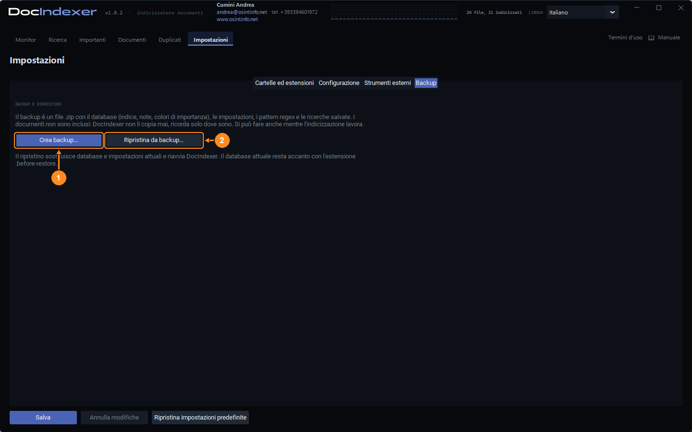

| # | Elemento | A cosa serve |
|:--:|---|---|
| **①** | **Crea backup** | Salva database, impostazioni, pattern e ricerche in un .zip. |
| **②** | **Ripristina da backup** | Sostituisce i dati attuali con quelli del backup e riavvia. |

## 14. Icona vicino all'orologio e avvio con Windows

Quando la finestra è chiusa DocIndexer continua a lavorare e resta come icona vicino all'orologio. Passandoci sopra si vede lo stato; il clic destro apre il menu:

- **Apri DocIndexer** (anche con un clic sull'icona);
- **Metti in pausa l'indicizzazione** / **Riprendi l'indicizzazione**;
- **Controlla subito le cartelle**;
- **Ricerca rapida**;
- **Manuale**;
- **Avvia con Windows** (con la spunta quando è attivo);
- **Esci**, che chiude davvero il programma.

Se avvii DocIndexer una seconda volta non parte una nuova copia: si mostra la finestra di quello già attivo. L'avvio con Windows vale solo per il tuo utente e non richiede permessi di amministratore.

### Aggiungere una cartella con il tasto destro

Con l'opzione **Aggiungi a DocIndexer** attiva (Impostazioni › Configurazione › Avvio), in Esplora file il clic destro su una cartella mostra **Aggiungi a DocIndexer**: la cartella entra tra le cartelle monitorate e l'indicizzazione parte subito, anche se DocIndexer era già aperto. Su Windows 11 la voce è in «Mostra altre opzioni» (o Maiusc+F10). Se la cartella è già monitorata, o è dentro una cartella monitorata, DocIndexer lo dice e non cambia nulla; se contiene cartelle già monitorate, prende il loro posto. Non servono permessi di amministratore.

**Su più PC.** La voce del tasto destro e l'avvio con Windows vengono registrati nel Windows del PC in uso, per il tuo utente. Se usi DocIndexer da un disco esterno, riattivali su ogni PC in **Impostazioni › Configurazione › Avvio**. Se sullo stesso PC il programma cambia cartella o lettera di disco, la voce del tasto destro si aggiorna da sola al successivo avvio.

## 15. Problemi frequenti

- **Un documento non si trova.** Controlla nel Monitor che l'indicizzazione sia finita; in Documenti cerca il file per nome e guarda lo stato (*In coda*, *Saltati*, *Errori*). Verifica che la cartella sia monitorata e che l'estensione sia tra le incluse.
- **Molti file tra gli errori.** Un file può essere protetto da password, danneggiato o aperto da un altro programma. **Rimetti in coda gli errori** nel Monitor li riprova.
- **Una scansione non viene letta.** Controlla in Impostazioni › Strumenti esterni che il modello OCR dell'alfabeto giusto sia installato; con il modello **Automatico** viene scelto da solo tra quelli scaricati.
- **Il PC è rumoroso o caldo.** Sposta lo slider delle risorse verso sinistra o premi **Riduci al minimo**; abbassa le soglie di temperatura.
- **L'indicizzazione è lenta.** Sposta lo slider verso destra; ricorda che a PC fermo DocIndexer accelera da solo.
- **Un file molto grande non compare.** È in **Documenti › File grandi**, in attesa della tua approvazione.
- **La scorciatoia della ricerca rapida non funziona.** È usata da un altro programma: scegline un'altra in Impostazioni › Configurazione.
- **Spostare DocIndexer su un altro PC.** Copia l'intera cartella del programma, oppure crea un backup e ripristinalo sul nuovo PC. Poi, se ti servono, riattiva **Avvia con Windows** e **Aggiungi a DocIndexer**.
- **Il disco esterno ha un'altra lettera.** Non devi fare nulla: all'avvio DocIndexer aggiorna da solo i percorsi (vedi il [capitolo 1](#1-prima-di-iniziare)).
- **Il testo è troppo piccolo o troppo grande.** Cambia **Dimensione interfaccia (%)** in Impostazioni › Configurazione: 100 è la dimensione delle altre app di Windows. Vale dal prossimo avvio.
