# DocIndexer — Podręcznik użytkownika

DocIndexer prowadzi indeks tekstu dokumentów znajdujących się w wybranych przez Ciebie folderach: dokumentów Office, plików PDF, zdjęć i skanów (odczytywanych za pomocą OCR), wiadomości e-mail, stron internetowych, baz danych, archiwów skompresowanych i nie tylko. Pracuje w tle, obok zegara Windows, i w mgnieniu oka odnajduje dokument, gdy szukasz słowa, frazy lub wyrażenia regularnego. Pliki **pozostają tam, gdzie są**: do bazy danych trafiają tylko ścieżka i tekst.

## Spis treści

1. [Zanim zaczniesz](#1-zanim-zaczniesz)
2. [Pierwsze uruchomienie: kreator konfiguracji](#2-pierwsze-uruchomienie-kreator-konfiguracji)
3. [Okno główne](#3-okno-główne)
4. [Monitor](#4-monitor)
5. [Zasoby do indeksowania i temperatury](#5-zasoby-do-indeksowania-i-temperatury)
6. [Wyszukiwanie](#6-wyszukiwanie)
7. [Edytor wyrażeń regularnych](#7-edytor-wyrażeń-regularnych)
8. [Zapisane wyszukiwania i eksport](#8-zapisane-wyszukiwania-i-eksport)
9. [Ważność i notatki](#9-ważność-i-notatki)
10. [Dokumenty i Duże pliki](#10-dokumenty-i-duże-pliki)
11. [Duplikaty](#11-duplikaty)
12. [Szybkie wyszukiwanie](#12-szybkie-wyszukiwanie)
13. [Ustawienia](#13-ustawienia)
14. [Ikona obok zegara i uruchamianie z systemem Windows](#14-ikona-obok-zegara-i-uruchamianie-z-systemem-windows)
15. [Typowe problemy](#15-typowe-problemy)

---

## 1. Zanim zaczniesz

- DocIndexer działa w systemie Windows i nie wymaga instalacji: to jeden program, `DocIndexer.exe`.
- Obok programu tworzy foldery `data` (baza danych), `cache` (tymczasowe podglądy, można je usunąć) i `tools` (narzędzia zewnętrzne i modele OCR) oraz plik ustawień `config.json`. Aby przenieść DocIndexer na inny komputer, wystarczy skopiować cały folder.
- Główny model OCR (alfabet łaciński oraz chiński i japoński) jest już dołączony. Inne alfabety i narzędzia opcjonalne (ExifTool do metadanych, 7-Zip do archiwów) pobiera się w **Ustawienia › Narzędzia zewnętrzne** (zob. [rozdział 13](#13-ustawienia)).
- Dokumenty nigdy nie są przenoszone, kopiowane ani zmieniane.

## 2. Pierwsze uruchomienie: kreator konfiguracji

### Język i warunki korzystania

Przy pierwszym uruchomieniu DocIndexer pyta o język, a potem pokazuje warunki korzystania w tym języku.

| # | Element | Do czego służy |
|:--:|---|---|
| **①** | **Język** | Kliknięcie wybiera język programu i podręcznika. |

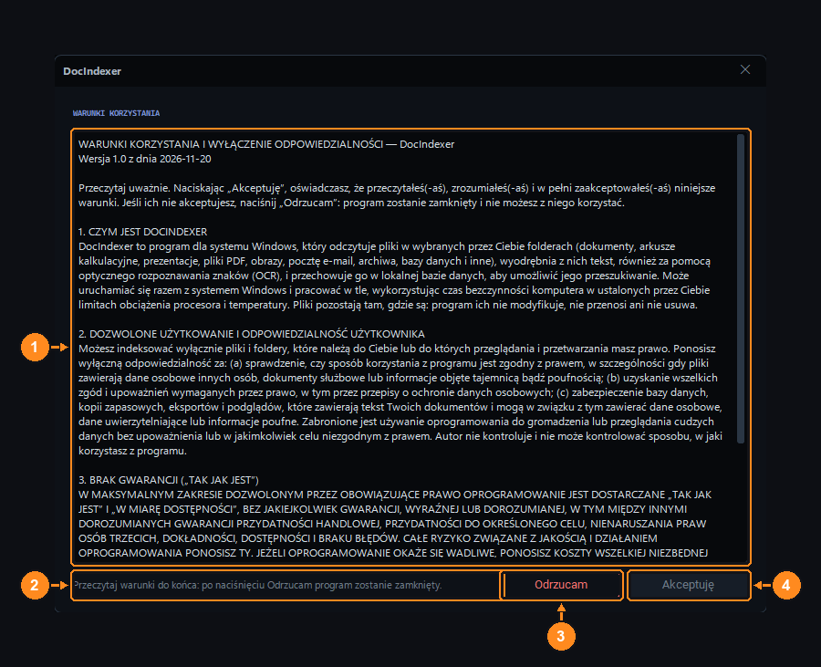

| # | Element | Do czego służy |
|:--:|---|---|
| **①** | **Treść warunków** | Trzeba go przewinąć do końca. |
| **②** | **Uwaga** | Zmienia kolor na zielony, gdy przeczytasz całość. |
| **③** | **Odrzucam** | Zamyka program. |
| **④** | **Akceptuję** | Uaktywnia się na końcu tekstu i przechodzi do konfiguracji. |

Przycisk **Akceptuję** uaktywnia się dopiero po przewinięciu tekstu do końca; **Odrzucam** (lub zamknięcie okna) zamyka program. Odpowiedź jest zapamiętywana: warunki są pokazywane ponownie tylko wtedy, gdy się zmienią. W każdej chwili można je przeczytać ponownie przyciskiem **Warunki korzystania** obok **📖 Podręcznik**.

### Kreator konfiguracji

Przy pierwszym uruchomieniu DocIndexer pyta, gdzie ma szukać.

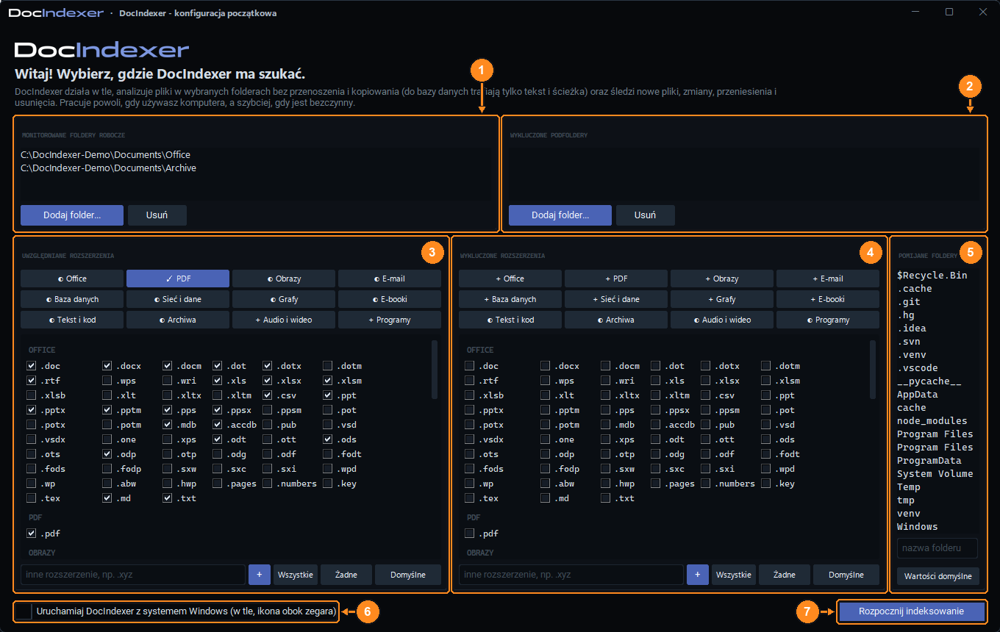

| # | Element | Do czego służy |
|:--:|---|---|
| **①** | **Monitorowane foldery robocze** | Foldery do indeksowania: **Dodaj folder...** i **Usuń**. |
| **②** | **Wykluczone podfoldery** | Części wybranych folderów, które mają być pominięte. |
| **③** | **Uwzględniane rozszerzenia** | Typy plików do odczytu; przyciski kategorii zaznaczają je grupami. |
| **④** | **Wykluczone rozszerzenia** | Typy plików, które są zawsze pomijane. |
| **⑤** | **Pomijane foldery (według nazwy)** | Foldery pomijane bez względu na położenie (np. .git, Temp). |
| **⑥** | **Uruchamiaj z systemem Windows** | DocIndexer uruchamia się sam po zalogowaniu, w tle. |
| **⑦** | **Rozpocznij indeksowanie** | Zapisuje wybory i rozpoczyna pracę. |

1. **Monitorowane foldery robocze**: naciśnij **Dodaj folder...** dla każdego folderu do indeksowania (na przykład Dokumenty lub folder sieciowy); **Usuń** usuwa go z listy.
2. **Wykluczone podfoldery**: konkretne foldery wewnątrz monitorowanych, których nie należy analizować.
3. **Uwzględniane rozszerzenia** i **wykluczone rozszerzenia**: typy plików do odczytu. Przyciski grup (Office, PDF, Obrazy, E-mail, Baza danych, Sieć i dane, Grafy, E-booki, Tekst i kod, Archiwa, Audio i wideo, Programy) jednym kliknięciem zaznaczają całą grupę, a kolejnym ją odznaczają; **Wszystkie**, **Żadne** i **Domyślne** działają zgodnie z nazwą. W polu na dole można ręcznie dodać rozszerzenie.
4. **Pomijane foldery (według nazwy)**: foldery ignorowane bez względu na położenie, takie jak `$Recycle.Bin`, `.git` lub `node_modules`.
5. **Uruchamiaj DocIndexer z systemem Windows**: po zaznaczeniu DocIndexer uruchamia się sam po zalogowaniu, widoczny tylko jako ikona obok zegara.

Naciśnij **Rozpocznij indeksowanie**. Wszystko, co tu wybierzesz, można później zmienić w **Ustawieniach**.

## 3. Okno główne

U góry znajduje się nagłówek, zawsze widoczny:

- logo, wersja i dane autora (adres e-mail i witrynę można kliknąć);
- **wskaźnik aktywności**, który porusza się jak korektor graficzny wieży stereo: wysokość słupków odpowiada obciążeniu CPU przez indeksowanie, a każdy właśnie odczytany plik pobudza swoją strefę (od lewej: PDF, Office, obrazy, tekst i inne); czerwone szczyty sygnalizują błąd. Gdy nie ma pracy, widać jedną przygaszoną linię; podczas wstrzymania jest bursztynowy;
- liczba plików w indeksie i liczba już zindeksowanych;
- menu **Język**, które od razu zmienia język całego programu;
- przyciski minimalizacji, maksymalizacji i zamykania. **Zamknięcie okna nie zatrzymuje DocIndexer**: okno zostaje ukryte, a praca trwa dalej (zob. [rozdział 14](#14-ikona-obok-zegara-i-uruchamianie-z-systemem-windows)).

Poniżej znajdują się karty **Monitor**, **Wyszukiwanie**, **Ważne**, **Dokumenty**, **Duplikaty** i **Ustawienia**. Na prawo od kart przycisk **📖 Podręcznik** otwiera ten podręcznik w języku programu. Obok przycisk **Warunki korzystania** ponownie pokazuje warunki zaakceptowane przy pierwszym uruchomieniu.

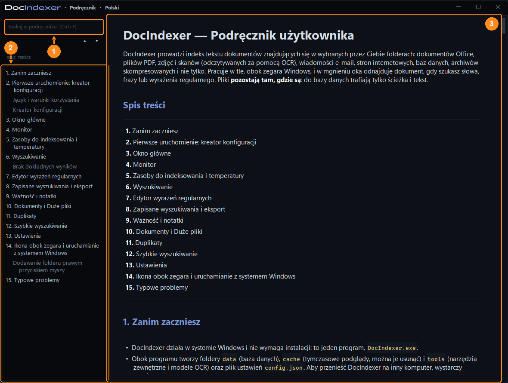

| # | Element | Do czego służy |
|:--:|---|---|
| **①** | **Szukaj w podręczniku (Ctrl+F)** | Wyróżnia wszystkie trafienia; Enter przechodzi do następnego. |
| **②** | **Spis treści** | Kliknięcie przenosi do rozdziału. |
| **③** | **Tekst** | Podręcznik; kliknięcie obrazu otwiera go w pełnym rozmiarze. |

W oknie podręcznika spis treści po lewej jednym kliknięciem przenosi do rozdziału, pole **Szukaj w podręczniku** (Ctrl+F) wyróżnia każde trafienie (Enter = następne, Shift+Enter = poprzednie), a kliknięcie obrazu otwiera go w pełnym rozmiarze. Esc zamyka okno.

## 4. Monitor

Monitor pokazuje postęp indeksowania.

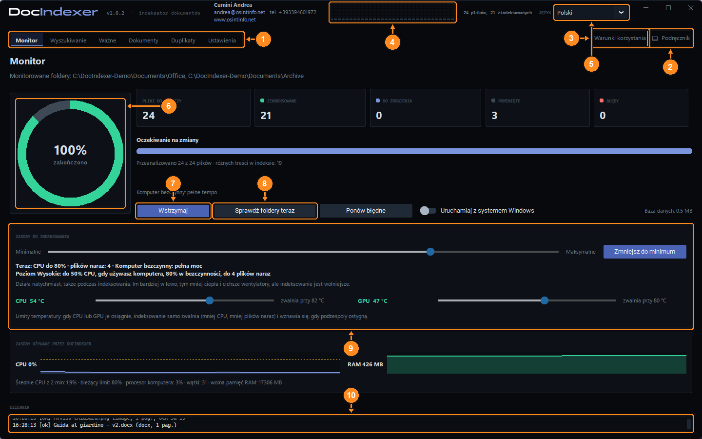

| # | Element | Do czego służy |
|:--:|---|---|
| **①** | **Karty** | Strony programu. |
| **②** | **📖 Podręcznik** | Otwiera ten podręcznik w języku programu. |
| **③** | **Warunki korzystania** | Ponownie pokazuje warunki zaakceptowane przy pierwszym uruchomieniu. |
| **④** | **Korektor** | Porusza się, gdy DocIndexer pracuje. |
| **⑤** | **Język** | Zmienia język interfejsu. |
| **⑥** | **Postęp** | Jaka część plików została już przeanalizowana. |
| **⑦** | **Wstrzymaj** | Wstrzymuje i wznawia indeksowanie. |
| **⑧** | **Sprawdź foldery teraz** | Od razu szuka nowych lub zmienionych plików. |
| **⑨** | **Zasoby do indeksowania** | Ile CPU używać i limity temperatury (rozdział 5). |
| **⑩** | **Dziennik** | Komunikaty o pracy, plik po pliku. |

- **Monitorowane foldery**: lista folderów pod tytułem.
- **Wykres kołowy** i pola: **Pliki do analizy** (wszystkie znalezione pliki), **Zindeksowane**, **Do zrobienia**, **Pominięte** (bez czytelnego tekstu lub wykluczone) i **Błędy**.
- Bieżący **etap**: liczenie plików, obliczanie skrótów, wyodrębnianie tekstu lub *Oczekiwanie na zmiany*, gdy praca jest zakończona. Poniżej znajdują się pasek postępu, przetwarzany plik i bieżące tempo: *Komputer w użyciu: tempo ograniczone*, *Komputer bezczynny: pełne tempo*, *Komputer zajęty: oczekiwanie* (inne programy już mocno obciążają CPU) lub *Zasilanie z baterii: tempo minimalne*.
- **Wstrzymaj / Wznów** zatrzymuje i ponownie uruchamia indeksowanie.
- **Sprawdź foldery teraz** od razu szuka nowych, zmienionych, przeniesionych lub usuniętych plików (DocIndexer robi to również sam przy uruchomieniu i co kilka godzin, a podczas pracy śledzi zmiany na bieżąco).
- **Ponów błędne** ponownie próbuje odczytać pliki, których nie udało się odczytać.
- **Uruchamiaj z systemem Windows** od razu włącza lub wyłącza automatyczne uruchamianie.
- **Baza danych**: bieżący rozmiar bazy danych.
- **Dziennik**: na dole strony, ostatnie operacje.

Jak to działa: najpierw program liczy pliki, potem oblicza odcisk zawartości każdego pliku (SHA-256) i wyodrębnia tekst. Plik identyczny z już odczytanym nie jest analizowany ponownie; w przypadku pliku przeniesionego lub o zmienionej nazwie w indeksie zmienia się tylko ścieżka; usunięty plik jest usuwany z indeksu.

## 5. Zasoby do indeksowania i temperatury

W Monitorze panel **Zasoby do indeksowania** określa, jaką część mocy komputera może wykorzystywać DocIndexer.

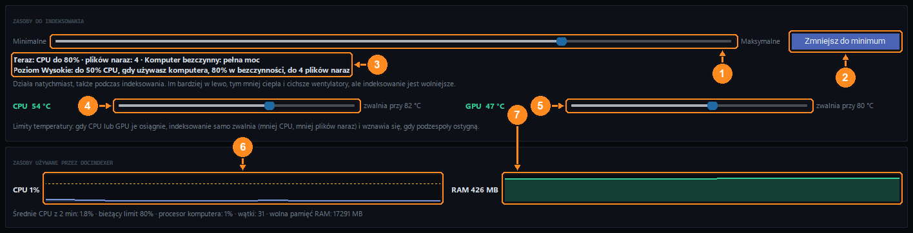

| # | Element | Do czego służy |
|:--:|---|---|
| **①** | **Poziom zasobów** | Od Minimalnego do Maksymalnego; działa natychmiast. |
| **②** | **Zmniejsz do minimum** | Przesuwa poziom do samego lewego końca. |
| **③** | **Teraz** | Co wybrany poziom robi w tej chwili. |
| **④** | **Limit CPU** | Powyżej tej temperatury indeksowanie zwalnia. |
| **⑤** | **Limit GPU** | To samo dla karty graficznej. |
| **⑥** | **Wykres CPU** | CPU używane przez DocIndexer; linia przerywana to limit. |
| **⑦** | **Wykres RAM** | Pamięć używana przez DocIndexer. |

**Suwak** obejmuje zakres od **Minimalnego** do **Maksymalnego** i działa natychmiast, także podczas indeksowania. Im bardziej w lewo, tym mniej ciepła i cichsze wentylatory, ale wolniejsze indeksowanie. **Zmniejsz do minimum** jednym kliknięciem przesuwa suwak do samego lewego końca.

| Poziom | CPU, gdy używasz komputera | CPU, gdy komputer jest bezczynny | Uwagi |
|---|---|---|---|
| Minimalne | 5% | 5% | jeden plik naraz, oszczędzanie energii Windows |
| Niskie | 10% | 25% | jeden plik naraz, oszczędzanie energii Windows |
| Średnie | 25% | 60% | dwa pliki naraz |
| Wysokie | 50% | 80% | kilka plików naraz (około połowy rdzeni) |
| Maksymalne | 90% | 100% | prawie wszystkie rdzenie |

Pod suwakiem dwa wiersze informują, co dzieje się teraz (na przykład *Teraz: CPU do 60% · plików naraz: 2 · Komputer bezczynny: pełna moc*) i co zapewnia wybrany poziom.

**Komputer bezczynny**: gdy przez kilka minut nie używasz klawiatury ani myszy (domyślnie 3, można to zmienić w Ustawieniach), limit stopniowo rośnie do wartości dla bezczynności; gdy tylko wrócisz, znowu spada. Podczas pisania lub klikania w oknie DocIndexer indeksowanie również ustępuje na kilka sekund, dzięki czemu wyszukiwanie i podglądy pozostają szybkie.

**Temperatury**: wiersze **CPU** i **GPU** pokazują bieżącą temperaturę (zielona, bursztynowa w pobliżu limitu, czerwona po jego osiągnięciu) oraz suwak z limitem, od 50 do 100 °C (domyślnie 82 °C dla CPU i 80 °C dla GPU). Po osiągnięciu limitu indeksowanie samo zwalnia (mniej CPU, mniej plików naraz) i wznawia się, gdy podzespół ostygnie. Jeśli czujnika nie da się odczytać, wyświetlany jest napis *niedostępne*.

Panel **Zasoby używane przez DocIndexer** pokazuje CPU i RAM używane przez program w ostatnich dwóch minutach; linia przerywana to obowiązujący limit CPU. Poniżej podano średnią, bieżący limit, całkowite obciążenie procesora i wolną pamięć RAM komputera.

## 6. Wyszukiwanie

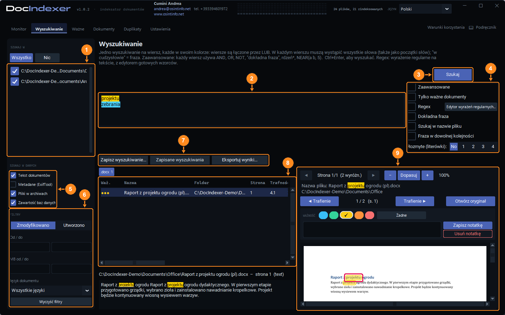

| # | Element | Do czego służy |
|:--:|---|---|
| **①** | **Szukaj w** | Foldery, w których szukać (**Wszystkie** / **Żadne**). |
| **②** | **Pole wyszukiwania** | Jedno wyszukiwanie na wiersz, każde w swoim kolorze. |
| **③** | **Szukaj** | Uruchamia wyszukiwanie (także Ctrl+Enter). |
| **④** | **Opcje** | Zaawansowane, regex z edytorem, dokładna fraza, nazwa pliku, wyszukiwanie rozmyte. |
| **⑤** | **Szukaj w danych** | Tekst, metadane, archiwa i bazy danych do uwzględnienia. |
| **⑥** | **Filtry** | Daty, rozmiar i język; **Wyczyść filtry** je usuwa. |
| **⑦** | **Zapis i eksport** | Zapisuje wyszukiwanie, otwiera zapisane wyszukiwania, eksportuje wyniki. |
| **⑧** | **Wyniki** | Kliknięcie pokazuje dokument w podglądzie. |
| **⑨** | **Podgląd** | Strony, wyróżnione trafienia, ważność i notatka, **Otwórz oryginał**. |

**Co wpisać.** W dużym polu wpisz jedno wyszukiwanie na wiersz; każdy wiersz ma swój kolor, który odnajdziesz w wynikach i w podglądzie, a wiersze są alternatywami (wystarczy jeden z nich). W wierszu muszą wystąpić wszystkie słowa, także jako początek słowa; wielkość liter i znaki diakrytyczne nie mają znaczenia; fraza „w cudzysłowie” jest wyszukiwana dokładnie tak, jak ją wpisano. Naciśnij **Szukaj** lub Ctrl+Enter.

**Opcje** na prawo od pola:

- **Zaawansowane**: każdy wiersz używa pełnej składni: `AND`, `OR`, `NOT`, `"dokładna fraza"`, `rdzeń*`, `NEAR(a b, 5)`.
- **Tylko ważne dokumenty**: tylko pliki, którym nadano kolor (zob. [rozdział 9](#9-ważność-i-notatki)).
- **Regex**: wiersz jest wyrażeniem regularnym wyszukiwanym w tekście; **Edytor wyrażeń regularnych...** otwiera edytor (zob. [rozdział 7](#7-edytor-wyrażeń-regularnych)). Długie wyszukiwanie regex można przerwać przyciskiem **Zatrzymaj wyszukiwanie**.
- **Dokładna fraza**, **Szukaj w nazwie pliku**, **Fraza w dowolnej kolejności**.
- **Rozmyte (literówki)**: dopuszcza od 1 do 4 błędów na słowo, w tym typowe pomyłki OCR (0/o, 1/l, rn/m). Jeśli zwykłe wyszukiwanie nic nie znajdzie, DocIndexer sam próbuje ponownie, dopuszczając jeden błąd, i informuje o tym.

**Po lewej** wybierasz, **gdzie** szukać:

- **Szukaj w**: monitorowane foldery do przeszukania (**Wszystkie** / **Żadne**).
- **Szukaj w danych**: tekst dokumentów, metadane (ExifTool), pliki w archiwach, zawartość baz danych.
- **Filtry**: okres (**Zmodyfikowano** lub **Utworzono**, daty w formacie rrrr-mm-dd, także samo rrrr lub rrrr-mm), rozmiar w MB, **język dokumentu** (rozpoznawany automatycznie dla każdego pliku). **Wyczyść filtry** usuwa wszystkie.

**Wyniki.** Nad tabelą znajduje się przycisk dla każdego znalezionego typu pliku (.pdf, .docx...) z liczbą wyników: kliknięcie ukrywa lub pokazuje dany typ, **Wszystkie** i **Żadne** zmieniają wszystkie naraz. Kolumny to ważność, nazwa, folder, strona, trafność, data utworzenia i fragment z kolorowymi słowami; kliknięcie nagłówka sortuje kolumnę. Pod tabelą widać wyodrębniony tekst znalezionej strony z wyróżnionymi słowami.

**Podgląd** po prawej pokazuje rzeczywistą stronę dokumentu z obramowanymi trafieniami: strzałki zmieniają stronę, **−**, **Dopasuj** i **+** zmieniają powiększenie (podobnie kółko myszy), **◀ Trafienie** i **Trafienie ▶** przeskakują od jednego trafienia do następnego, **Otwórz oryginał** (lub dwukrotne kliknięcie wyniku) otwiera plik w jego programie. W przypadku dokumentów Office podgląd jest przygotowywany przez Office i może to potrwać kilka sekund.

### Brak dokładnych wyników

Jeśli wyszukiwanie nic nie znajdzie, DocIndexer sam próbuje ponownie, dopuszczając jeden błąd pisowni lub OCR na słowo. Wtedy nad wynikami pojawia się czerwone powiadomienie, które kilka razy miga: **Brak dokładnych wyników: pokazano wyniki z 1 błędem pisowni lub OCR**. Sprawdź wyniki: mogą zawierać słowa podobne do szukanego.

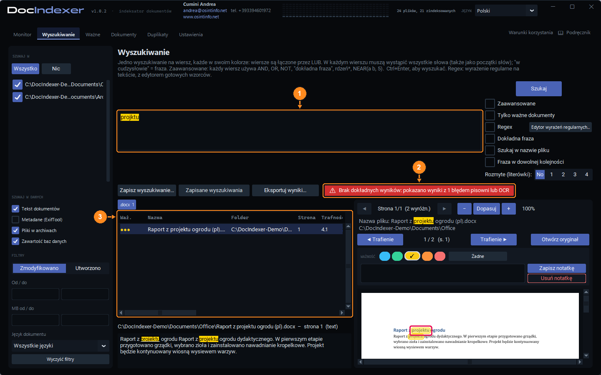

| # | Element | Do czego służy |
|:--:|---|---|
| **①** | **Wyszukiwanie z błędem** | Tutaj brakuje jednej litery. |
| **②** | **Czerwone powiadomienie** | Miga: brak dokładnych wyników, pokazano te z 1 błędem. |
| **③** | **Wyniki** | Dokumenty z poprawnym słowem. |

## 7. Edytor wyrażeń regularnych

Wyrażenie regularne (regex) wyszukuje *wzorzec* zamiast słowa: na przykład dowolną datę, dowolny adres internetowy lub dowolny kod o określonym formacie.

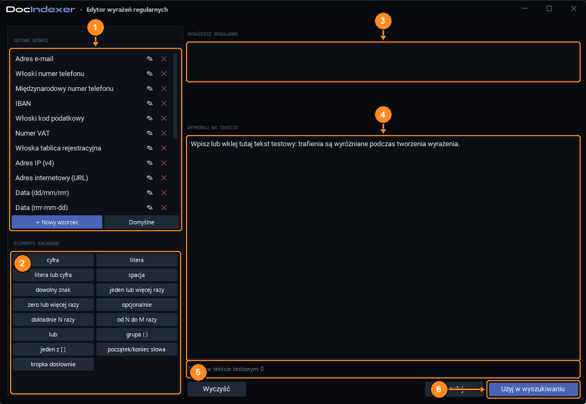

| # | Element | Do czego służy |
|:--:|---|---|
| **①** | **Gotowe wzorce** | Gotowe wzorce: kliknięcie używa wzorca; **+ Nowy wzorzec** dodaje nowy. |
| **②** | **Elementy składowe** | Fragmenty do wstawiania bez znajomości składni. |
| **③** | **Wyrażenie regularne** | Tworzone wyrażenie regularne. |
| **④** | **Wypróbuj na tekście** | Tekst testowy: trafienia są wyróżniane od razu. |
| **⑤** | **Licznik** | Ile trafień jest w tekście testowym. |
| **⑥** | **Użyj w wyszukiwaniu** | Przenosi wyrażenie na stronę Wyszukiwanie. |

- **Gotowe wzorce**: już napisane wzorce, m.in. adres e-mail, numery telefonów, IBAN, włoski kod podatkowy i numer VAT, tablica rejestracyjna, adres IP, URL, daty, godziny, kwoty, współrzędne GPS, hashtagi i nazwy użytkowników. Jedno kliknięcie wstawia wzorzec do pola; własne wzorce dodasz przyciskiem **Nowy wzorzec**, a do pierwotnej listy wrócisz przyciskiem **Domyślne**.
- **Elementy składowe**: fragmenty do łączenia bez pamiętania składni (cyfra, litera, jeden lub więcej razy, opcjonalnie, „lub”, grupy, początek/koniec słowa...).
- **Wyrażenie regularne**: pole ze wzorcem; pod nim objaśnienie prostym językiem, czego szuka.
- **Wypróbuj na tekście**: wpisz lub wklej przykładowy tekst, a trafienia będą wyróżniane w trakcie pisania. **Wyczyść** usuwa tekst.

**Użyj w wyszukiwaniu** przenosi wzorzec na stronę Wyszukiwanie z włączoną opcją Regex i uruchamia wyszukiwanie.

## 8. Zapisane wyszukiwania i eksport

**Zapisz wyszukiwanie...** (pod polem wyszukiwania) zapisuje bieżące wyszukiwanie pod nazwą, razem z opcjami i filtrami. Jeśli zaznaczysz **Powiadamiaj mnie, gdy nowe pliki pasują do tego wyszukiwania**, DocIndexer sam powtarza je po zindeksowaniu nowych plików i wyświetla powiadomienie Windows obok zegara.

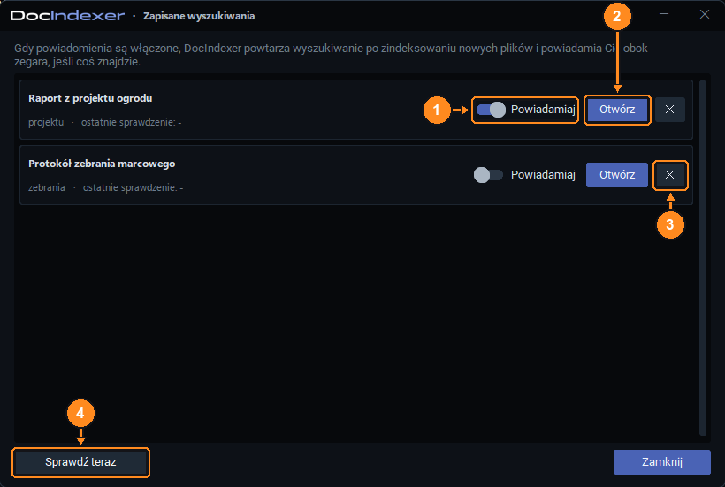

| # | Element | Do czego służy |
|:--:|---|---|
| **①** | **Powiadamiaj** | Powtarza wyszukiwanie na nowych plikach i powiadamia obok zegara. |
| **②** | **Otwórz** | Przenosi wyszukiwanie z powrotem na stronę Wyszukiwanie i je uruchamia. |
| **③** | **✕** | Usuwa zapisane wyszukiwanie. |
| **④** | **Sprawdź teraz** | Od razu powtarza wyszukiwania z powiadomieniem. |

**Zapisane wyszukiwania** otwiera listę: dla każdego wyszukiwania widać powiadomienie (włączone lub wyłączone), ile nowych plików znalazło i kiedy było sprawdzane. **Otwórz** przenosi je z powrotem na stronę Wyszukiwanie i uruchamia, **Tylko nowe** pokazuje tylko pliki, które pojawiły się od ostatniego razu, **Sprawdź teraz** od razu je powtarza; można je też usunąć. Gdy są nowe pliki, przycisk Zapisane wyszukiwania pokazuje ich liczbę.

**Eksportuj wyniki...** zapisuje wyniki do formatu **Excel** (.xlsx, wiersze pokolorowane według ważności), **CSV** (separator `;`, otwiera się w Excelu) lub **PDF**, z ważnością i notatkami. Ten sam przycisk **Eksportuj...** znajduje się w kartach Dokumenty, Ważne i Duplikaty.

## 9. Ważność i notatki

W podglądzie, pod nazwą pliku, każdy dokument może mieć **kolor ważności** (jasnoniebieski, zielony, żółty, pomarańczowy, czerwony, od najmniej do najbardziej ważnego; **Nic** go usuwa) oraz **notatkę** napisaną przez Ciebie (**Zapisz notatkę**, **Usuń notatkę**). Kolor i notatka pozostają przypisane do pliku nawet po jego przeniesieniu, zmianie nazwy lub modyfikacji.

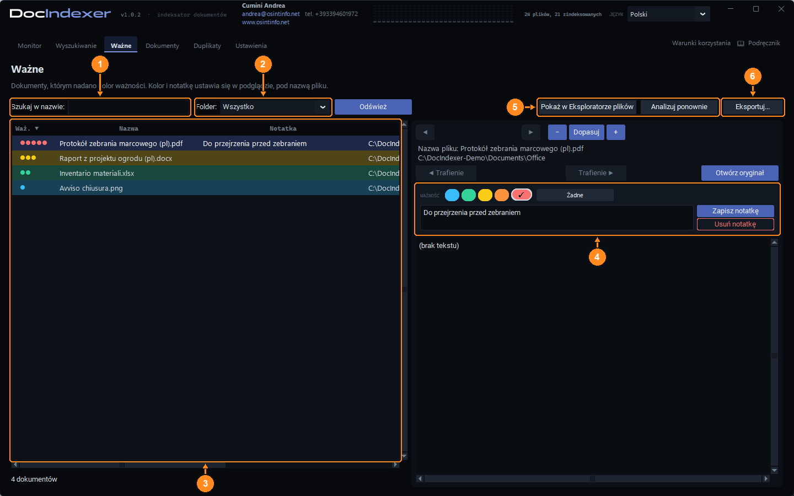

| # | Element | Do czego służy |
|:--:|---|---|
| **①** | **Szukaj w nazwie** | Filtruje listę w trakcie pisania. |
| **②** | **Folder** | Pokazuje tylko jeden monitorowany folder. |
| **③** | **Lista** | Pokolorowane dokumenty, od najważniejszych, z notatką. |
| **④** | **Ważność** | Pięć kolorów i notatka; **Zapisz notatkę** ją zapisuje. |
| **⑤** | **Pokaż i analizuj ponownie** | Otwiera folder pliku lub ponownie dodaje go do kolejki. |
| **⑥** | **Eksportuj** | Zapisuje listę jako CSV, Excel lub HTML. |

Karta **Ważne** zawiera tylko pokolorowane dokumenty, najważniejsze na górze, z notatką. Na każdej liście kolor jest widoczny jako kropki na początku wiersza, a sam wiersz jest lekko zabarwiony. W Wyszukiwaniu opcja **Tylko ważne dokumenty** ogranicza wyszukiwanie do tych plików.

## 10. Dokumenty i Duże pliki

Karta **Dokumenty** zawiera wszystkie zindeksowane pliki.

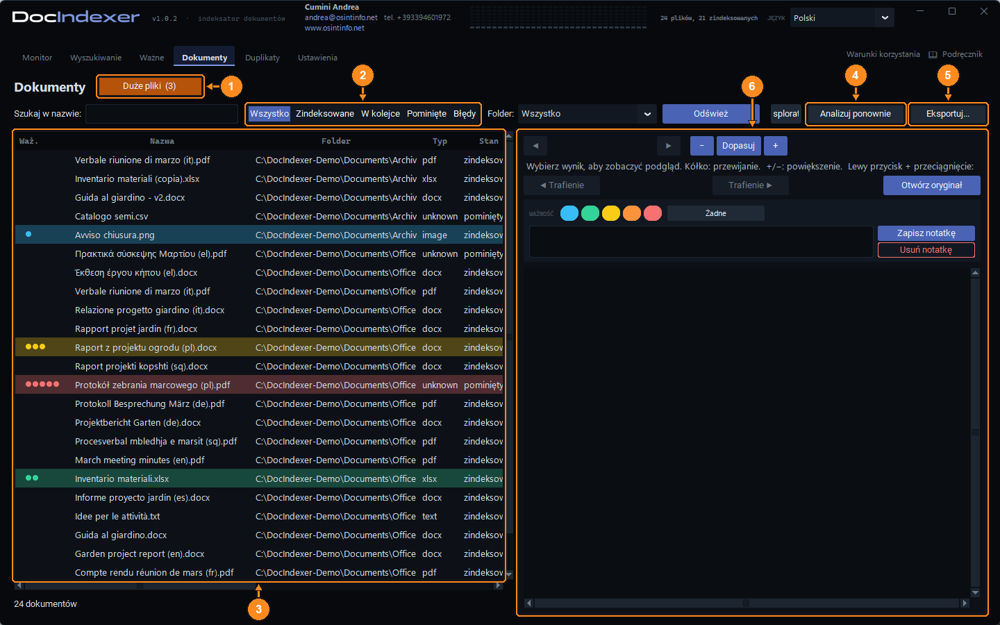

| # | Element | Do czego służy |
|:--:|---|---|
| **①** | **Duże pliki** | Pliki powyżej limitu rozmiaru, czekające na decyzję. |
| **②** | **Stan** | Wszystkie, zindeksowane, w kolejce, pominięte lub z błędami. |
| **③** | **Lista** | Wszystkie znalezione pliki, z folderem, typem i stanem. |
| **④** | **Analizuj ponownie** | Ponownie dodaje zaznaczony plik do kolejki. |
| **⑤** | **Eksportuj** | Zapisuje listę jako CSV, Excel lub HTML. |
| **⑥** | **Podgląd** | Zaznaczony dokument, z ważnością i notatką. |

- **Szukaj w nazwie**: filtruje listę w trakcie pisania.
- **Wszystko / Zindeksowane / W kolejce / Pominięte / Błędy**: filtrują według stanu. **Folder** filtruje według monitorowanego folderu. **Odśwież** ponownie wczytuje listę.
- Kolumny pokazują ważność, nazwę, folder, typ, stan, język, strony, strony odczytane przez OCR, znaki, datę utworzenia i modyfikacji oraz odcisk SHA-256. Kliknięcie nagłówka sortuje; najechanie na obciętą komórkę pokazuje pełny tekst.
- Można zaznaczyć kilka wierszy (Ctrl lub Shift + kliknięcie, Ctrl+A). **Pokaż w Eksploratorze plików** otwiera folder pliku, **Analizuj ponownie** ponownie odczytuje zaznaczone pliki, **Eksportuj...** zapisuje listę. Dwukrotne kliknięcie otwiera plik.

**Duże pliki.** Pliki większe niż ustawiony limit (domyślnie 200 MB) nie są analizowane automatycznie: przycisk **Duże pliki** zmienia kolor na pomarańczowy i pokazuje, ile plików czeka.

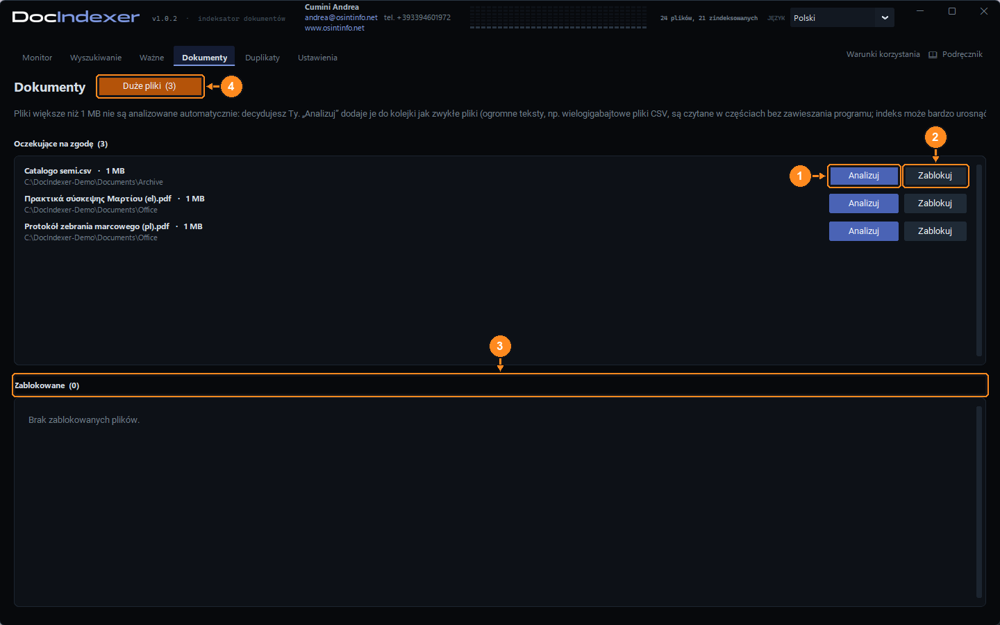

| # | Element | Do czego służy |
|:--:|---|---|
| **①** | **Analizuj** | Dodaje plik do kolejki jak pozostałe. |
| **②** | **Zablokuj** | Odkłada plik na bok bez analizowania. |
| **③** | **Zablokowane** | Zablokowane pliki; **Odblokuj** przywraca je do oczekujących. |
| **④** | **Duże pliki** | Powrót do listy dokumentów. |

Dla każdego oczekującego pliku wybierz **Analizuj** (trafia do kolejki jak zwykły plik; ogromne teksty są czytane w częściach bez zawieszania programu, ale indeks może bardzo urosnąć) lub **Zablokuj** (odłożenie na bok). Na liście **Zablokowane** przycisk **Odblokuj** przywraca plik do oczekujących. **← Dokumenty** wraca do listy.

## 11. Duplikaty

Karta **Duplikaty** znajduje dwa rodzaje kopii. Naciśnij **Znajdź duplikaty**.

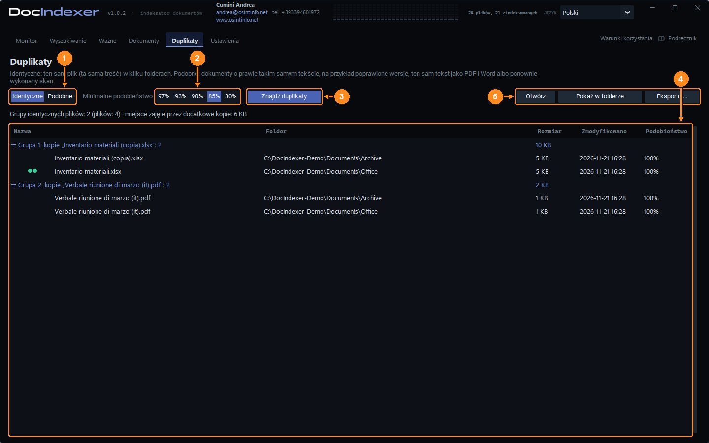

| # | Element | Do czego służy |
|:--:|---|---|
| **①** | **Identyczne / Podobne** | Ten sam plik lub prawie taki sam tekst. |
| **②** | **Minimalne podobieństwo** | Jak bardzo podobne muszą być dokumenty. |
| **③** | **Znajdź duplikaty** | Uruchamia wyszukiwanie. |
| **④** | **Grupy** | Jedna grupa na każdy zestaw kopii, z zajmowanym miejscem. |
| **⑤** | **Otwórz, pokaż, eksportuj** | Dla zaznaczonego pliku lub całej listy. |

- **Identyczne**: ten sam plik (ta sama treść) w kilku folderach. Każda grupa pokazuje, ile jest kopii i ile miejsca zajmują; na górze widać łączne miejsce zajmowane przez dodatkowe kopie.

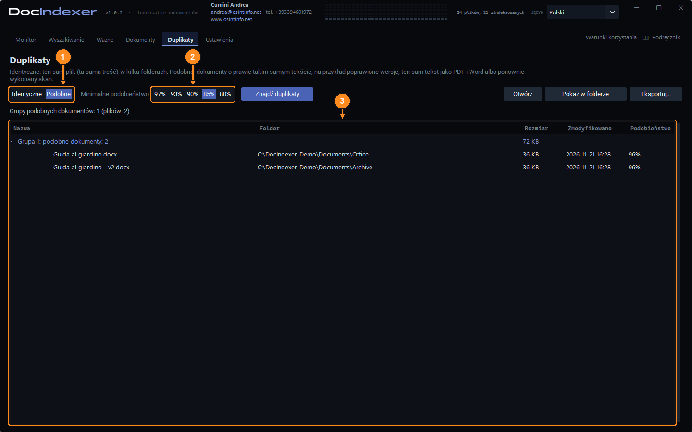

| # | Element | Do czego służy |
|:--:|---|---|
| **①** | **Podobne** | Dokumenty o prawie takim samym tekście. |
| **②** | **Minimalne podobieństwo** | Od 97% do 80%: niższa wartość znajduje więcej par. |
| **③** | **Grupy** | Kolumna Podobieństwo pokazuje wartość każdego pliku. |

- **Podobne**: dokumenty o prawie takim samym tekście, na przykład poprawione wersje tego samego dokumentu, ten sam tekst w PDF i w Wordzie albo ponownie wykonany skan. **Minimalne podobieństwo** określa, jak bardzo muszą być podobne (od 97% do 80%); kolumna Podobieństwo pokazuje wartość każdego pliku.

**Otwórz**, **Pokaż w folderze** i **Eksportuj...** działają na zaznaczonym pliku lub na liście.

## 12. Szybkie wyszukiwanie

Szybkie wyszukiwanie to pasek wyszukiwania otwierany nad dowolnym programem skrótem **Ctrl+Alt+D** (można go zmienić w Ustawieniach) lub z menu ikony obok zegara.

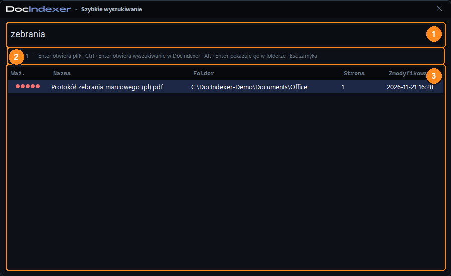

| # | Element | Do czego służy |
|:--:|---|---|
| **①** | **Pole wyszukiwania** | Szuka w trakcie pisania. |
| **②** | **Klawisze** | Enter, Ctrl+Enter, Alt+Enter, Esc. |
| **③** | **Wyniki** | Wybierz plik klawiszami strzałek. |

Wyszukuje w trakcie pisania. Wybierz wynik klawiszami strzałek; **Enter** otwiera plik, **Ctrl+Enter** otwiera pełne wyszukiwanie w DocIndexer, **Alt+Enter** pokazuje plik w jego folderze, **Esc** zamyka pasek.

## 13. Ustawienia

Zmiany obowiązują dopiero po naciśnięciu **Zapisz**. **Odrzuć zmiany** przywraca zapisane ustawienia; **Przywróć ustawienia domyślne** przywraca wartości fabryczne. Jeśli przełączysz kartę z niezapisanymi zmianami, DocIndexer zapyta, czy je zapisać.

**Foldery i rozszerzenia** zawiera te same tabele co kreator konfiguracji: monitorowane foldery, wykluczone podfoldery, uwzględniane i wykluczone rozszerzenia, foldery pomijane według nazwy.

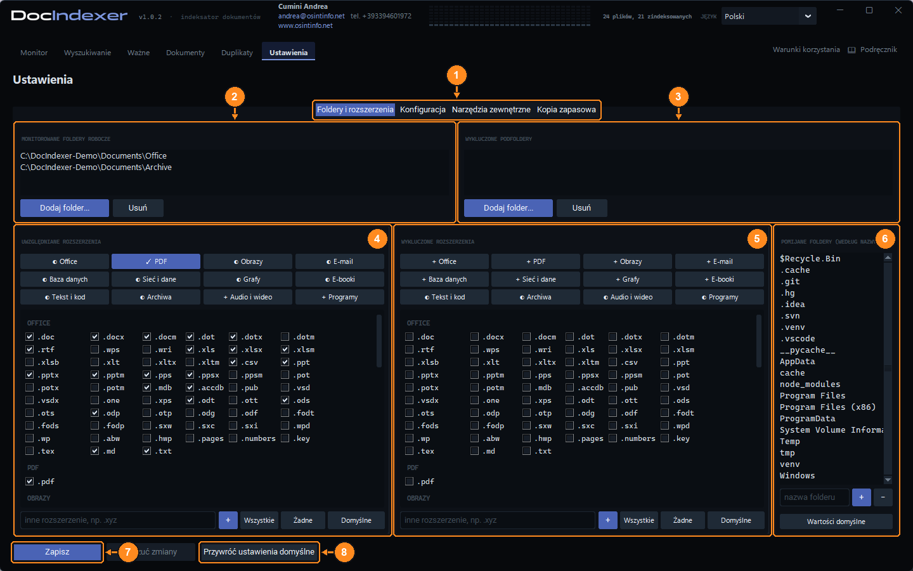

| # | Element | Do czego służy |
|:--:|---|---|
| **①** | **Karty ustawień** | Foldery, konfiguracja, narzędzia zewnętrzne, kopia zapasowa. |
| **②** | **Monitorowane foldery robocze** | Foldery do indeksowania. |
| **③** | **Wykluczone podfoldery** | Części folderów, które mają być pominięte. |
| **④** | **Uwzględniane rozszerzenia** | Typy plików do odczytu. |
| **⑤** | **Wykluczone rozszerzenia** | Typy plików do pominięcia. |
| **⑥** | **Pomijane foldery (według nazwy)** | Foldery pomijane bez względu na położenie. |
| **⑦** | **Zapisz** | Stosuje zmiany. |
| **⑧** | **Przywróć ustawienia domyślne** | Przywraca wartości początkowe. |

**Konfiguracja**:

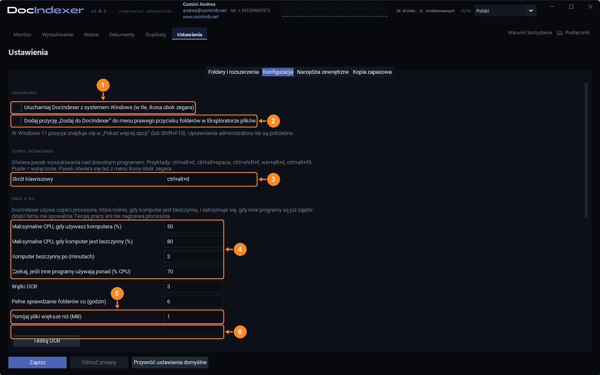

| # | Element | Do czego służy |
|:--:|---|---|
| **①** | **Uruchamiaj z systemem Windows** | Działa od razu, bez naciskania Zapisz. |
| **②** | **Dodaj do DocIndexer** | Pozycja menu prawego przycisku folderów w Eksploratorze; działa od razu. |
| **③** | **Skrót klawiszowy** | Klawisze szybkiego wyszukiwania (puste = wyłączone). |
| **④** | **Praca w tle** | CPU przy komputerze w użyciu i bezczynnym, czas oczekiwania, zajęte programy. |
| **⑤** | **Pomijaj pliki większe niż (MB)** | Powyżej tego limitu pliki trafiają do **Dużych plików**. |
| **⑥** | **Rozmiar interfejsu (%) — niezależny od powiększenia Windows** | Powiększa lub zmniejsza całe okno. |

- **Uruchamianie**: uruchamianie z systemem Windows (działa od razu).
- **Dodaj do DocIndexer**: dodaje pozycję do menu prawego przycisku folderów w Eksploratorze plików; działa od razu, bez Zapisz (zob. rozdział 14).
- **Szybkie wyszukiwanie**: skrót klawiszowy, na przykład `ctrl+alt+d`, `ctrl+shift+f` lub `win+alt+d`; puste = wyłączone. Jeśli skrót jest już używany przez inny program, pojawia się ostrzeżenie.
- **Praca w tle**: maksymalne CPU, gdy używasz komputera i gdy jest bezczynny, po ilu minutach komputer uznaje się za bezczynny, powyżej jakiego obciążenia przez inne programy DocIndexer czeka, wątki OCR, jak często (w godzinach) ponownie sprawdzać wszystkie foldery, maksymalny rozmiar pliku (większe pliki trafiają do **Dużych plików**), rozmiar interfejsu (w %, niezależny od powiększenia Windows; obowiązuje od następnego uruchomienia). Pierwsze wartości zmieniają się też za pomocą suwaka w Monitorze.
- **Moduły dodatkowe**: metadane za pomocą ExifTool, tekst plików w archiwach (7-Zip), bazy danych SQLite, dBASE/FoxPro i Access. Każdy moduł przechowuje swoje dane osobno; w Wyszukiwaniu wybierasz, w których szukać.
- **OCR (RapidOCR)**: model. **Automatyczny** odczytuje pierwszą zeskanowaną stronę modelem łacińskim, a jeśli wynik jest niepewny, próbuje innych pobranych modeli i zachowuje ten, który czyta najlepiej. Wyższa **Rozdzielczość OCR (DPI)** lepiej odczytuje małe znaki, ale działa wolniej. **Testuj OCR** wykonuje sprawdzenie.
- **Bazy danych SQLite**: plik bazy danych.

**Narzędzia zewnętrzne** pokazuje stan modeli OCR i narzędzi opcjonalnych (ExifTool, 7-Zip, sterownik Access). **Zainstaluj** lub **Zainstaluj ponownie** pobiera narzędzie do folderu `tools`, **Zainstaluj wszystko, czego brakuje** pobiera wszystkie, **Sprawdź ponownie** odświeża stan. Działają bez instalowania w systemie.

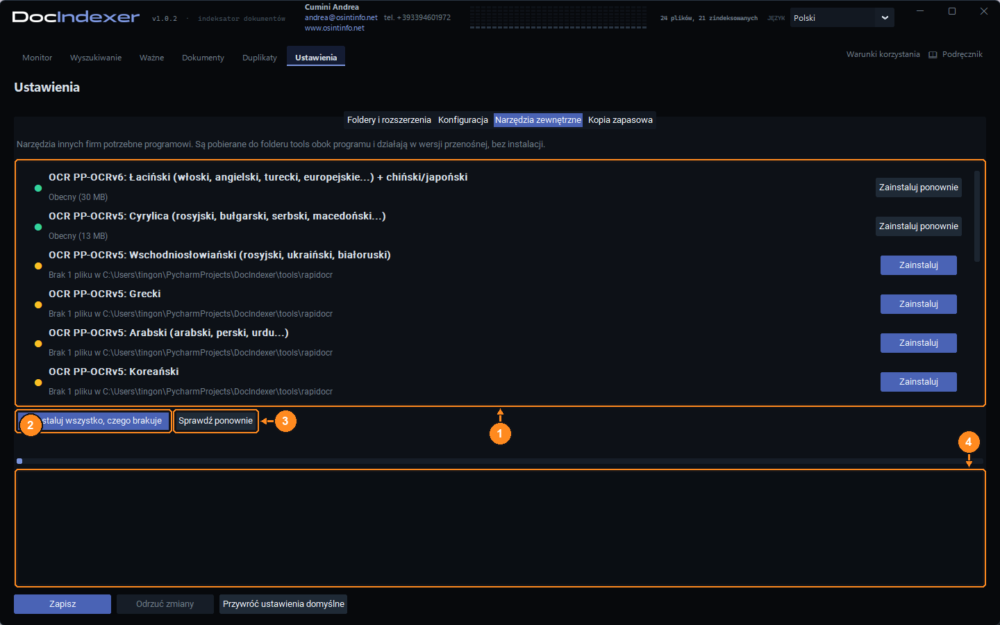

| # | Element | Do czego służy |
|:--:|---|---|
| **①** | **Narzędzia** | Każde narzędzie z jego stanem i przyciskiem instalacji. |
| **②** | **Zainstaluj wszystko, czego brakuje** | Pobiera naraz wszystkie brakujące narzędzia. |
| **③** | **Sprawdź ponownie** | Ponownie odczytuje stan narzędzi. |
| **④** | **Dziennik** | Postęp pobierania i komunikaty. |

**Kopia zapasowa**: **Utwórz kopię zapasową...** zapisuje do pliku .zip bazę danych (indeks, notatki, kolory ważności), ustawienia, wzorce regex i zapisane wyszukiwania, także w trakcie indeksowania. **Przywróć z kopii zapasowej...** zastępuje je i uruchamia ponownie DocIndexer; poprzednia baza danych pozostaje obok z rozszerzeniem `.before-restore`.

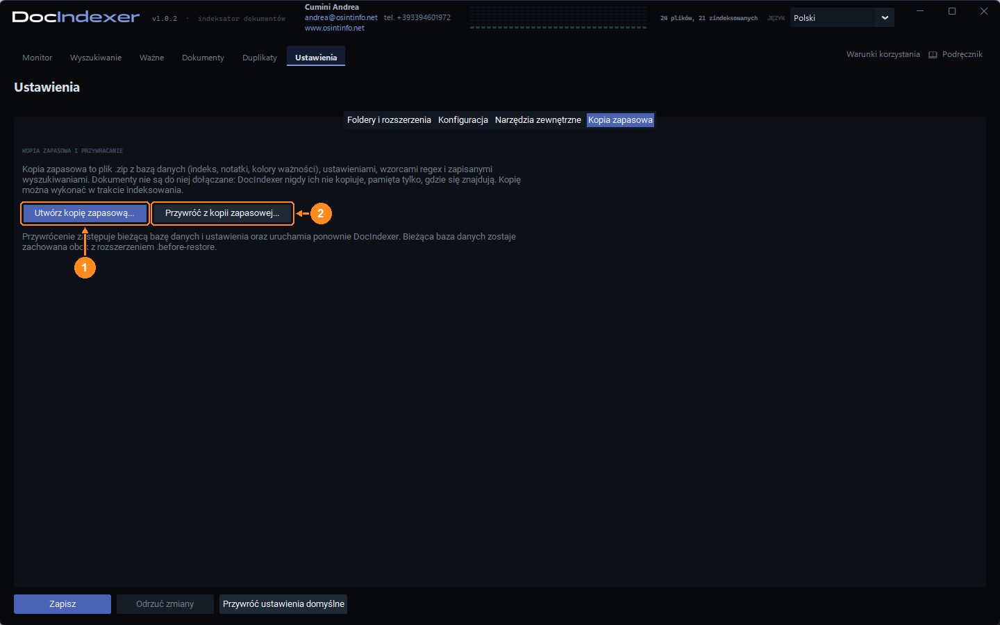

| # | Element | Do czego służy |
|:--:|---|---|
| **①** | **Utwórz kopię zapasową** | Zapisuje bazę danych, ustawienia, wzorce i wyszukiwania w pliku .zip. |
| **②** | **Przywróć z kopii zapasowej** | Zastępuje bieżące dane kopią zapasową i uruchamia program ponownie. |

## 14. Ikona obok zegara i uruchamianie z systemem Windows

Po zamknięciu okna DocIndexer nadal pracuje i pozostaje jako ikona obok zegara. Najechanie na nią pokazuje stan; kliknięcie prawym przyciskiem otwiera menu:

- **Otwórz DocIndexer** (także kliknięciem ikony);
- **Wstrzymaj indeksowanie** / **Wznów indeksowanie**;
- **Sprawdź foldery teraz**;
- **Szybkie wyszukiwanie**;
- **Podręcznik**;
- **Uruchamiaj z systemem Windows** (zaznaczone, gdy jest włączone);
- **Zakończ**, które naprawdę zamyka program.

Jeśli uruchomisz DocIndexer po raz drugi, nowa kopia się nie uruchomi: zostanie pokazane okno już działającej. Uruchamianie z systemem Windows dotyczy tylko Twojego użytkownika i nie wymaga uprawnień administratora.

### Dodawanie folderu prawym przyciskiem myszy

Gdy opcja **Dodaj do DocIndexer** jest włączona (Ustawienia › Konfiguracja › Uruchamianie), kliknięcie prawym przyciskiem folderu w Eksploratorze plików pokazuje **Dodaj do DocIndexer**: folder trafia do monitorowanych folderów, a indeksowanie zaczyna się od razu, nawet jeśli DocIndexer był już otwarty. W Windows 11 pozycja znajduje się w „Pokaż więcej opcji” (lub Shift+F10). Jeśli folder jest już monitorowany albo leży w monitorowanym folderze, DocIndexer o tym informuje i niczego nie zmienia; jeśli zawiera foldery już monitorowane, zajmuje ich miejsce. Uprawnienia administratora nie są potrzebne.

## 15. Typowe problemy

- **Nie można znaleźć dokumentu.** Sprawdź w Monitorze, czy indeksowanie się zakończyło; w Dokumentach wyszukaj plik po nazwie i sprawdź jego stan (*W kolejce*, *Pominięte*, *Błędy*). Upewnij się, że folder jest monitorowany, a rozszerzenie znajduje się wśród uwzględnianych.
- **Wiele plików wśród błędów.** Plik może być chroniony hasłem, uszkodzony lub otwarty w innym programie. **Ponów błędne** w Monitorze ponawia próbę.
- **Skan nie jest odczytywany.** Sprawdź w Ustawienia › Narzędzia zewnętrzne, czy zainstalowano model OCR dla właściwego alfabetu; przy modelu **Automatyczny** jest on wybierany samodzielnie spośród pobranych.
- **Komputer jest głośny lub gorący.** Przesuń suwak zasobów w lewo lub naciśnij **Zmniejsz do minimum**; obniż limity temperatury.
- **Indeksowanie jest wolne.** Przesuń suwak w prawo; pamiętaj, że gdy komputer jest bezczynny, DocIndexer sam przyspiesza.
- **Bardzo duży plik się nie pojawia.** Znajduje się w **Dokumenty › Duże pliki** i czeka na Twoją zgodę.
- **Skrót szybkiego wyszukiwania nie działa.** Używa go inny program: wybierz inny w Ustawienia › Konfiguracja.
- **Przenoszenie DocIndexer na inny komputer.** Skopiuj cały folder programu albo utwórz kopię zapasową i przywróć ją na nowym komputerze.
