# DocIndexer — Manuali i përdoruesit

DocIndexer mban një indeks të tekstit të dokumenteve që ndodhen në dosjet që zgjidhni ju: dokumente Office, PDF, fotografi dhe skanime (të lexuara me OCR), e-mail, faqe interneti, baza të dhënash, arkiva të ngjeshura e të tjera. Punon në sfond, pranë orës së Windows, dhe e gjen një dokument në çast kur kërkoni një fjalë, një frazë ose një shprehje të rregullt. Skedarët **mbeten aty ku janë**: në bazën e të dhënave ruhen vetëm shtegu dhe teksti.

## Përmbajtja

1. [Para se të filloni](#1-para-se-të-filloni)
2. [Nisja e parë: konfigurimi i udhëhequr](#2-nisja-e-parë-konfigurimi-i-udhëhequr)
3. [Dritarja kryesore](#3-dritarja-kryesore)
4. [Monitorimi](#4-monitorimi)
5. [Burimet për indeksimin dhe temperaturat](#5-burimet-për-indeksimin-dhe-temperaturat)
6. [Kërkimi](#6-kërkimi)
7. [Redaktori i shprehjeve të rregullta](#7-redaktori-i-shprehjeve-të-rregullta)
8. [Kërkime të ruajtura dhe eksportimi](#8-kërkime-të-ruajtura-dhe-eksportimi)
9. [Rëndësia dhe shënimet](#9-rëndësia-dhe-shënimet)
10. [Dokumentet dhe Skedarët e mëdhenj](#10-dokumentet-dhe-skedarët-e-mëdhenj)
11. [Dublikatat](#11-dublikatat)
12. [Kërkimi i shpejtë](#12-kërkimi-i-shpejtë)
13. [Cilësimet](#13-cilësimet)
14. [Ikona pranë orës dhe nisja me Windows](#14-ikona-pranë-orës-dhe-nisja-me-windows)
15. [Probleme të shpeshta](#15-probleme-të-shpeshta)

---

## 1. Para se të filloni

- DocIndexer punon në Windows dhe nuk ka nevojë për instalim: është një program i vetëm, `DocIndexer.exe`.
- Pranë programit krijohen dosjet `data` (baza e të dhënave), `cache` (paraparje të përkohshme, mund të fshihet) dhe `tools` (mjete të jashtme dhe modele OCR), si edhe skedari i cilësimeve `config.json`. Për ta zhvendosur DocIndexer në një PC tjetër, mjafton të kopjoni të gjithë dosjen.
- Modeli kryesor OCR (alfabeti latin si dhe kinezisht e japonisht) është i përfshirë tashmë. Alfabetet e tjera dhe mjetet fakultative (ExifTool për metadatat, 7-Zip për arkivat) shkarkohen nga **Cilësimet › Mjete të jashtme** (shih [kapitullin 13](#13-cilësimet)).
- Dokumentet nuk zhvendosen, nuk kopjohen dhe nuk ndryshohen kurrë.

### Përdorimi portativ në një disk të jashtëm

DocIndexer mund të qëndrojë në një disk të jashtëm ose në një USB bashkë me dosjet që indekson: programi, cilësimet (`config.json`) dhe baza e të dhënave janë në të njëjtën dosje dhe udhëtojnë bashkë. Nuk ka asgjë për të aktivizuar: mënyra portative është automatike.

- Nëse në një PC tjetër disku merr një shkronjë tjetër (për shembull ishte **E:** dhe tani është **F:**), DocIndexer e kupton në nisje dhe përditëson vetë të gjitha shtigjet e atij disku: dosjet e monitoruara, nëndosjet e përjashtuara, kërkimet e ruajtura dhe indeksin. Nuk fillon nga e para: teksti i lexuar tashmë, ngjyrat e rëndësisë dhe shënimet mbeten. Te **Regjistri** i Monitorimit një rresht tregon shkronjën e vjetër dhe të renë dhe sa shtigje u përditësuan.
- Dosjet në disqe të tjerë (për shembull **C:**) nuk preken. Nëse një disk i monitoruar nuk është i lidhur, skedarët e tij mbeten në indeks dhe kontrollohen përsëri kur rikthehet.
- **Nis me Windows** dhe zëri **Shto në DocIndexer** i klikimit të djathtë ruhen në Windows, jo në dosjen e programit: në çdo PC duhen aktivizuar përsëri te **Cilësimet › Konfigurimi › Nisja** (shihni [kapitullin 14](#14-ikona-pranë-orës-dhe-nisja-me-windows)).

## 2. Nisja e parë: konfigurimi i udhëhequr

### Gjuha dhe kushtet e përdorimit

Herën e parë që hapet, DocIndexer pyet për gjuhën dhe pastaj shfaq kushtet e përdorimit në atë gjuhë.

| # | Elementi | Çfarë bën |
|:--:|---|---|
| **①** | **Gjuha** | Një klik zgjedh gjuhën e programit dhe të manualit. |

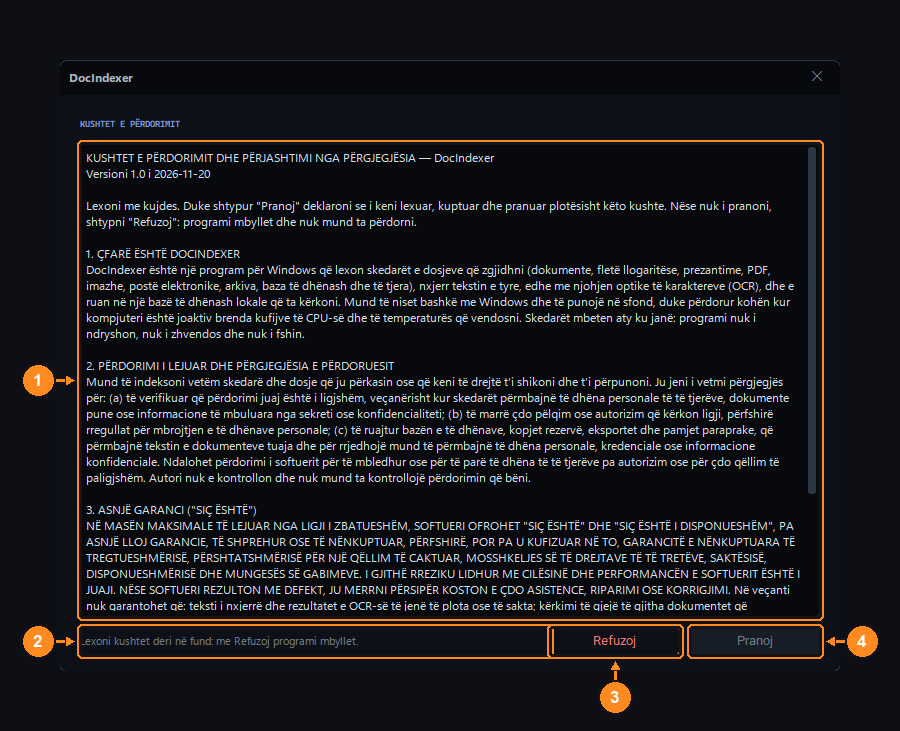

| # | Elementi | Çfarë bën |
|:--:|---|---|
| **①** | **Teksti i kushteve** | Duhet lëvizur deri në fund. |
| **②** | **Shënim** | Bëhet e gjelbër kur ke lexuar gjithçka. |
| **③** | **Refuzoj** | Mbyll programin. |
| **④** | **Pranoj** | Aktivizohet në fund të tekstit dhe vazhdon me konfigurimin. |

**Pranoj** aktivizohet vetëm pasi ta keni lëvizur tekstin deri në fund; **Refuzoj** (ose mbyllja e dritares) e mbyll programin. Përgjigjja ruhet: kushtet kërkohen sërish vetëm nëse ndryshojnë. Mund t'i rilexoni kur të doni me butonin **Kushtet e përdorimit** pranë **📖 Manuali**.

### Konfigurimi i udhëhequr

Herën e parë që hapet, DocIndexer pyet se ku duhet të kërkojë.

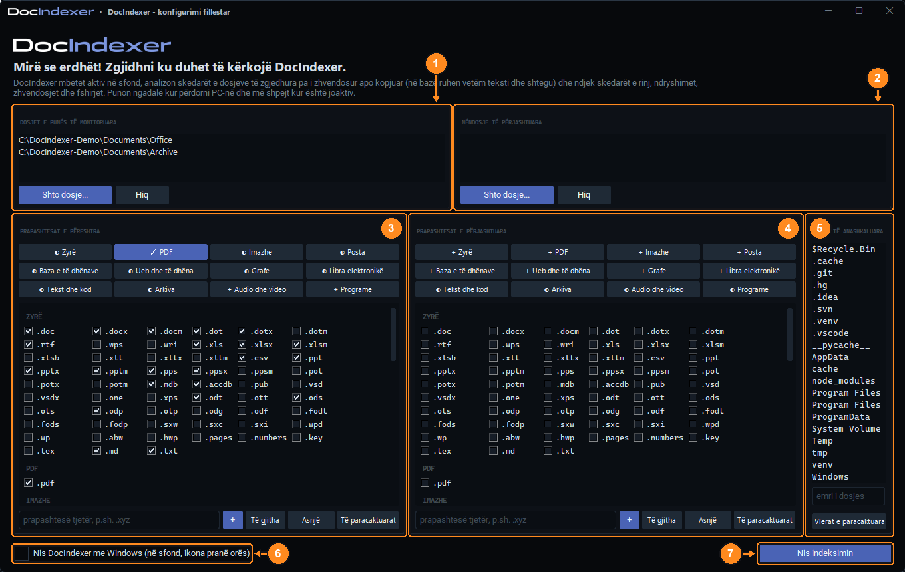

| # | Elementi | Çfarë bën |
|:--:|---|---|
| **①** | **Dosjet e punës të monitoruara** | Dosjet që indeksohen: **Shto dosje...** dhe **Hiq**. |
| **②** | **Nëndosje të përjashtuara** | Pjesë të dosjeve të zgjedhura që anashkalohen. |
| **③** | **Prapashtesat e përfshira** | Llojet e skedarëve që lexohen; butonat e kategorive i zgjedhin me grupe. |
| **④** | **Prapashtesat e përjashtuara** | Llojet e skedarëve që shpërfillen gjithmonë. |
| **⑤** | **Dosje të anashkaluara (sipas emrit)** | Dosje që anashkalohen kudo që të jenë (p.sh. .git, Temp). |
| **⑥** | **Nis me Windows** | DocIndexer niset vetë kur ndizet kompjuteri, në sfond. |
| **⑦** | **Nis indeksimin** | Ruan zgjedhjet dhe nis punën. |

1. **Dosjet e punës të monitoruara**: shtypni **Shto dosje...** për çdo dosje që doni të indeksohet (për shembull Dokumentet ose një dosje rrjeti); **Hiq** e heq nga lista.
2. **Nëndosje të përjashtuara**: dosje të caktuara, brenda atyre të monitoruara, që nuk duhen analizuar.
3. **Prapashtesat e përfshira** dhe **prapashtesat e përjashtuara**: llojet e skedarëve që lexohen. Butonat e grupeve (Zyrë, PDF, Imazhe, Posta, Baza e të dhënave, Ueb dhe të dhëna, Grafe, Libra elektronikë, Tekst dhe kod, Arkiva, Audio dhe video, Programe) shënojnë gjithë grupin me një klikim dhe e heqin me një tjetër; **Të gjitha**, **Asnjë** dhe **Të paracaktuarat** bëjnë atë që thonë. Në fushën poshtë mund të shtoni një prapashtesë me dorë.
4. **Dosje të anashkaluara (sipas emrit)**: dosje që shpërfillen kudo që të jenë, si `$Recycle.Bin`, `.git` ose `node_modules`.
5. **Nis DocIndexer me Windows**: nëse është shënuar, DocIndexer niset vetë kur hyni në llogari, vetëm me ikonën pranë orës.

Shtypni **Nis indeksimin**. Çdo gjë që zgjidhni këtu mund të ndryshohet më vonë te **Cilësimet**.

## 3. Dritarja kryesore

Lart ndodhet koka e dritares, gjithmonë e dukshme:

- logoja, versioni dhe të dhënat e autorit (e-maili dhe faqja mund të klikohen);
- **treguesi i aktivitetit**, që lëviz si barazuesi i një stereoje: lartësia e shtyllave ndjek CPU-në që përdor indeksimi dhe çdo skedar i sapolexuar i jep një goditje zonës së tij (nga e majta: PDF, Office, imazhe, tekst dhe të tjera); majat e kuqe tregojnë një gabim. Kur nuk ka punë mbetet një vijë e shuar; në pauzë është portokalli e verdhë;
- numri i skedarëve në indeks dhe sa janë indeksuar tashmë;
- menuja **Gjuha**, që ndryshon menjëherë gjuhën e gjithë programit;
- butonat minimizo, maksimizo dhe mbyll. **Mbyllja e dritares nuk e ndalon DocIndexer**: e fsheh dhe puna vazhdon (shih [kapitullin 14](#14-ikona-pranë-orës-dhe-nisja-me-windows)).

Poshtë janë skedat **Monitorimi**, **Kërkimi**, **Të rëndësishme**, **Dokumentet**, **Dublikatat** dhe **Cilësimet**. Në të djathtë të skedave, **📖 Manuali** hap këtë manual në gjuhën e programit. Pranë tij, **Kushtet e përdorimit** shfaq sërish kushtet e pranuara në nisjen e parë.

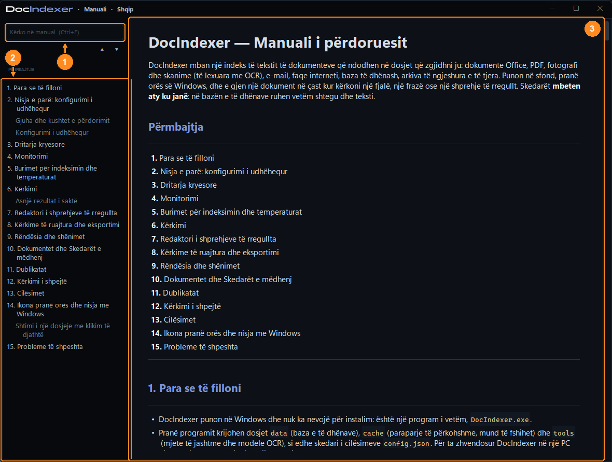

| # | Elementi | Çfarë bën |
|:--:|---|---|
| **①** | **Kërko në manual (Ctrl+F)** | Thekson të gjitha përputhjet; Enter kalon te tjetra. |
| **②** | **Përmbajtja** | Një klik të çon te kapitulli. |
| **③** | **Teksti** | Manuali; një klik mbi një figurë e hap në madhësi të plotë. |

Në dritaren e manualit, përmbajtja në të majtë të çon te kapitulli me një klikim, fusha **Kërko në manual** (Ctrl+F) thekson të gjitha përputhjet (Enter = tjetra, Shift+Enter = e mëparshmja) dhe një klikim mbi një imazh e hap në madhësi të plotë. Esc e mbyll dritaren.

## 4. Monitorimi

Monitorimi tregon se ku ka arritur indeksimi.

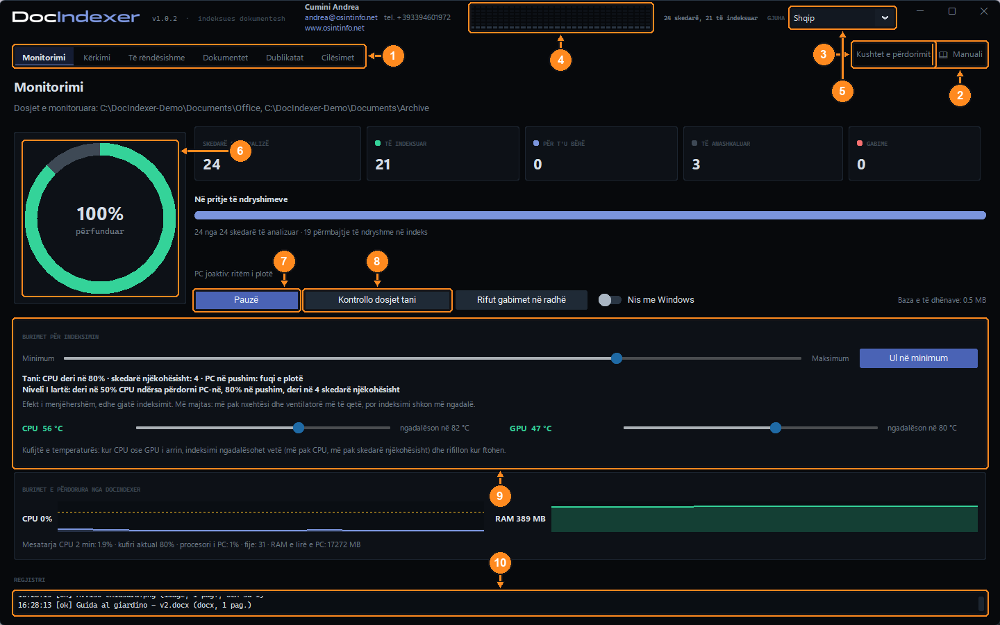

| # | Elementi | Çfarë bën |
|:--:|---|---|
| **①** | **Skedat** | Faqet e programit. |
| **②** | **📖 Manuali** | Hap këtë manual në gjuhën e programit. |
| **③** | **Kushtet e përdorimit** | Shfaq sërish kushtet e pranuara në nisjen e parë. |
| **④** | **Ekualizuesi** | Lëviz kur DocIndexer po punon. |
| **⑤** | **Gjuha** | Ndryshon gjuhën e ndërfaqes. |
| **⑥** | **Përparimi** | Sa pjesë e skedarëve është analizuar tashmë. |
| **⑦** | **Pauzë** | Ndalon dhe rinis indeksimin. |
| **⑧** | **Kontrollo dosjet tani** | Kërkon menjëherë skedarë të rinj ose të ndryshuar. |
| **⑨** | **Burimet për indeksimin** | Sa CPU të përdoret dhe pragjet e temperaturës (kapitulli 5). |
| **⑩** | **Regjistri** | Mesazhet e punës, skedar pas skedari. |

- **Dosjet e monitoruara**: lista nën titull.
- **Grafiku rrethor** dhe kutitë: **Skedarë për analizë** (të gjithë skedarët e gjetur), **Të indeksuar**, **Për t'u bërë**, **Të anashkaluar** (pa tekst të lexueshëm ose të përjashtuar) dhe **Gabime**.
- **Faza** aktuale: numërimi i skedarëve, llogaritja e gjurmëve, nxjerrja e tekstit, ose *Në pritje të ndryshimeve* kur ka mbaruar. Poshtë janë shiriti i përparimit, skedari ku po punon dhe ritmi aktual: *PC në përdorim: ritëm i ulët*, *PC joaktiv: ritëm i plotë*, *PC i zënë: në pritje* (programet e tjera përdorin tashmë shumë CPU) ose *Me bateri: ritëm minimal*.
- **Pauzë / Vazhdo** e ndalon dhe e rinis indeksimin.
- **Kontrollo dosjet tani** kërkon menjëherë skedarë të rinj, të ndryshuar, të zhvendosur ose të fshirë (DocIndexer e bën edhe vetë gjatë nisjes dhe çdo disa orë, dhe i ndjek ndryshimet në kohë reale sa kohë që punon).
- **Rifut gabimet në radhë** riprovon skedarët që nuk arriti t'i lexonte.
- **Nis me Windows** aktivizon ose çaktivizon menjëherë nisjen automatike.
- **Baza e të dhënave**: madhësia aktuale e bazës së të dhënave.
- **Regjistri**: në fund të faqes, veprimet e fundit.

Si punon: fillimisht numëron skedarët, pastaj llogarit për secilin një gjurmë të përmbajtjes (SHA-256) dhe nxjerr tekstin. Një skedar identik me një të lexuar më parë nuk analizohet përsëri; një skedar i zhvendosur ose i riemërtuar ndryshon vetëm shtegun në indeks; një skedar i fshirë hiqet.

Nëse hiqni të gjitha dosjet e monitoruara, DocIndexer heq skedarët e tyre nga indeksi dhe Monitorimi kthehet në zero: grafiku, numëruesit dhe ecuria nisin nga zero derisa të shtoni një dosje të re.

## 5. Burimet për indeksimin dhe temperaturat

Në Monitorim, kutia **Burimet për indeksimin** vendos se sa nga PC-ja mund të përdorë DocIndexer.

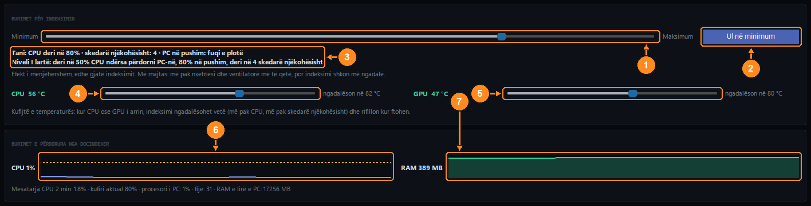

| # | Elementi | Çfarë bën |
|:--:|---|---|
| **①** | **Niveli i burimeve** | Nga Minimumi te Maksimumi; vlen menjëherë. |
| **②** | **Ul në minimum** | E çon nivelin plotësisht majtas. |
| **③** | **Tani** | Çfarë bën niveli i zgjedhur tani. |
| **④** | **Pragu i CPU** | Mbi këtë temperaturë indeksimi ngadalësohet. |
| **⑤** | **Pragu i GPU** | E njëjta gjë për kartën grafike. |
| **⑥** | **Grafiku i CPU** | CPU e përdorur nga DocIndexer; vija me ndërprerje është kufiri. |
| **⑦** | **Grafiku i RAM** | Memoria e përdorur nga DocIndexer. |

**Rrëshqitësi** shkon nga **Minimum** në **Maksimum** dhe vlen menjëherë, edhe gjatë indeksimit. Më majtas do të thotë më pak nxehtësi dhe ventilatorë më të qetë, por indeksim më i ngadaltë. **Ul në minimum** e çon rrëshqitësin krejt majtas me një klikim.

| Niveli | CPU ndërsa përdorni PC-në | CPU kur PC-ja është në pushim | Shënime |
|---|---|---|---|
| Minimum | 5% | 5% | një skedar në një kohë, kursimi i energjisë i Windows |
| I ulët | 10% | 25% | një skedar në një kohë, kursimi i energjisë i Windows |
| Mesatar | 25% | 60% | dy skedarë njëkohësisht |
| I lartë | 50% | 80% | disa skedarë njëkohësisht (rreth gjysma e bërthamave) |
| Maksimum | 90% | 100% | pothuajse të gjitha bërthamat |

Nën rrëshqitës, dy rreshta tregojnë çfarë po ndodh tani (për shembull *Tani: CPU deri në 60% · skedarë njëkohësisht: 2 · PC në pushim: fuqi e plotë*) dhe çfarë parashikon niveli i zgjedhur.

**PC në pushim**: kur nuk përdorni tastierën dhe miun për disa minuta (3 si parazgjedhje, ndryshohet te Cilësimet), kufiri rritet gradualisht deri te vlera "në pushim"; sapo ktheheni, ulet përsëri. Ndërsa shkruani ose klikoni në dritaren e DocIndexer, indeksimi gjithashtu i lë vendin për disa sekonda, që kërkimi dhe paraparjet të mbeten të shpejta.

**Temperaturat**: rreshtat **CPU** dhe **GPU** tregojnë temperaturën aktuale (jeshile, portokalli e verdhë kur i afrohet kufirit, e kuqe kur e arrin) dhe një rrëshqitës me kufirin, nga 50 deri në 100 °C (82 °C për CPU-në dhe 80 °C për GPU-në si parazgjedhje). Kur arrihet kufiri, indeksimi ngadalësohet vetë (më pak CPU, më pak skedarë njëkohësisht) dhe rifillon kur pjesa është ftohur. Nëse një sensor nuk lexohet, shfaqet *e padisponueshme*.

Kutia **Burimet e përdorura nga DocIndexer** tregon CPU-në dhe RAM-in që ka përdorur programi në dy minutat e fundit; vija me ndërprerje është kufiri i CPU-së në fuqi. Poshtë janë mesatarja, kufiri aktual, ngarkesa totale e procesorit dhe RAM-i i lirë i PC-së.

## 6. Kërkimi

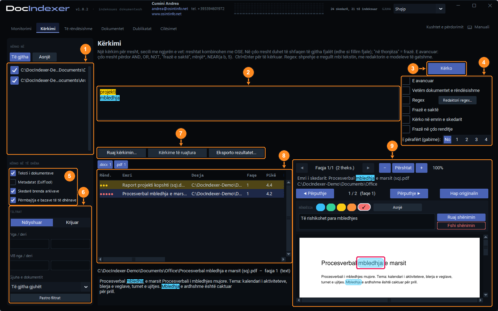

| # | Elementi | Çfarë bën |
|:--:|---|---|
| **①** | **Kërko në** | Dosjet ku kërkohet (**Të gjitha** / **Asnjë**). |
| **②** | **Kutia e kërkimit** | Një kërkim për rresht, secili me ngjyrën e vet. |
| **③** | **Kërko** | Nis kërkimin (edhe Ctrl+Enter). |
| **④** | **Opsionet** | E avancuar, regex me redaktuesin e vet, frazë e saktë, emri i skedarit, e përafërt. |
| **⑤** | **Kërko në të dhëna** | Teksti, metadatat, arkivat dhe bazat e të dhënave që përfshihen. |
| **⑥** | **Filtrat** | Datat, madhësia dhe gjuha; **Pastro filtrat** i heq. |
| **⑦** | **Ruaj dhe eksporto** | Ruan kërkimin, hap kërkimet e ruajtura, eksporton rezultatet. |
| **⑧** | **Rezultatet** | Një klik e shfaq dokumentin në pamjen paraprake. |
| **⑨** | **Pamja paraprake** | Faqet, përputhjet e theksuara, rëndësia dhe shënimi, **Hap origjinalin**. |

**Çfarë të shkruani.** Në kutinë e madhe shkruani një kërkim për rresht; çdo rresht ka ngjyrën e vet, që e gjeni përsëri në rezultate dhe në paraparje, dhe rreshtat vlejnë si alternativa (mjafton që të shfaqet njëri). Në një rresht duhet të shfaqen të gjitha fjalët, edhe si fillim fjale; shkronjat e mëdha dhe theksat nuk kanë rëndësi; një frazë "në thonjëza" kërkohet ashtu siç është. Shtypni **Kërko** ose Ctrl+Enter.

**Opsionet** në të djathtë të kutisë:

- **E avancuar**: çdo rresht përdor sintaksën e plotë: `AND`, `OR`, `NOT`, `"frazë e saktë"`, `rrënjë*`, `NEAR(a b, 5)`.
- **Vetëm dokumentet e rëndësishme**: vetëm skedarët të cilëve u keni dhënë një ngjyrë (shih [kapitullin 9](#9-rëndësia-dhe-shënimet)).
- **Regex**: rreshti është një shprehje e rregullt që kërkohet në tekst; **Redaktori regex...** hap redaktorin (shih [kapitullin 7](#7-redaktori-i-shprehjeve-të-rregullta)). Një kërkim regex i gjatë ndalet me **Ndalo kërkimin**.
- **Frazë e saktë**, **Kërko në emrin e skedarit**, **Frazë në çdo renditje**.
- **E përafërt (gabime)**: pranon nga 1 deri në 4 gabime për fjalë, përfshirë ngatërrimet tipike të OCR-së (0/o, 1/l, rn/m). Nëse një kërkim i zakonshëm nuk gjen asgjë, DocIndexer riprovon vetë duke lejuar një gabim dhe jua tregon.

**Në të majtë** zgjidhni **ku** të kërkohet:

- **Kërko në**: dosjet e monitoruara ku do të kërkohet (**Të gjitha** / **Asnjë**).
- **Kërko në të dhëna**: teksti i dokumenteve, metadatat (ExifTool), skedarët brenda arkivave, përmbajtja e bazave të të dhënave.
- **Filtrat**: periudha (**Ndryshuar** ose **Krijuar**, datat në formatin vvvv-mm-dd, ose vetëm vvvv ose vvvv-mm), madhësia në MB, **gjuha e dokumentit** (njihet vetë për çdo skedar). **Pastro filtrat** i heq të gjitha.

**Rezultatet.** Mbi tabelë ka një buton për çdo lloj skedari të gjetur (.pdf, .docx...) me numrin e rezultateve: një klikim e fsheh ose e shfaq atë lloj, **Të gjitha** dhe **Asnjë** i ndryshojnë të gjitha. Kolonat janë rëndësia, emri, dosja, faqja, përshtatshmëria, data e krijimit dhe një fragment me fjalët e ngjyrosura; një klikim mbi kokën e kolonës e rendit. Nën tabelë është teksti i nxjerrë i faqes së gjetur, me fjalët e theksuara.

**Paraparja** në të djathtë tregon faqen e vërtetë të dokumentit me përputhjet në kornizë: shigjetat ndryshojnë faqen, **−**, **Përshtat** dhe **+** ndryshojnë zmadhimin (edhe rrota e miut), **◀ Përputhje** dhe **Përputhje ▶** kalojnë nga një gjetje te tjetra, **Hap origjinalin** (ose një klikim i dyfishtë mbi rezultatin) e hap skedarin me programin e tij. Për dokumentet Office paraparja përgatitet me Office dhe mund të zgjasë disa sekonda.

**Hapja e dosjes së një rezultati.** Një klikim në qelizën **Dosja** të një rezultati hap dosjen në File Explorer me skedarin tashmë të zgjedhur. E njëjta gjë vlen në skedat **Dokumentet** dhe **Të rëndësishme**.

### Asnjë rezultat i saktë

Nëse një kërkim nuk gjen asgjë, DocIndexer provon sërish vetë, duke lejuar një gabim shtypi ose OCR për fjalë. Atëherë mbi rezultatet shfaqet një njoftim i kuq që pulson disa herë: **Asnjë rezultat i saktë: shfaqen ata me 1 gabim shtypi ose OCR**. Kontrolloni rezultatet: mund të përmbajnë fjalë të ngjashme me atë që kërkuat.

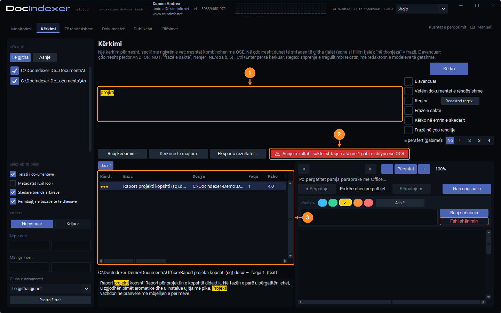

| # | Elementi | Çfarë bën |
|:--:|---|---|
| **①** | **Kërkim me një gabim** | Këtu mungon një shkronjë. |
| **②** | **Njoftim i kuq** | Pulson: asnjë rezultat i saktë, shfaqen ata me 1 gabim. |
| **③** | **Rezultatet** | Dokumentet me fjalën e saktë. |

## 7. Redaktori i shprehjeve të rregullta

Një shprehje e rregullt (regex) kërkon një *model* në vend të një fjale: për shembull çdo datë, çdo adresë interneti ose çdo kod me një format të caktuar.

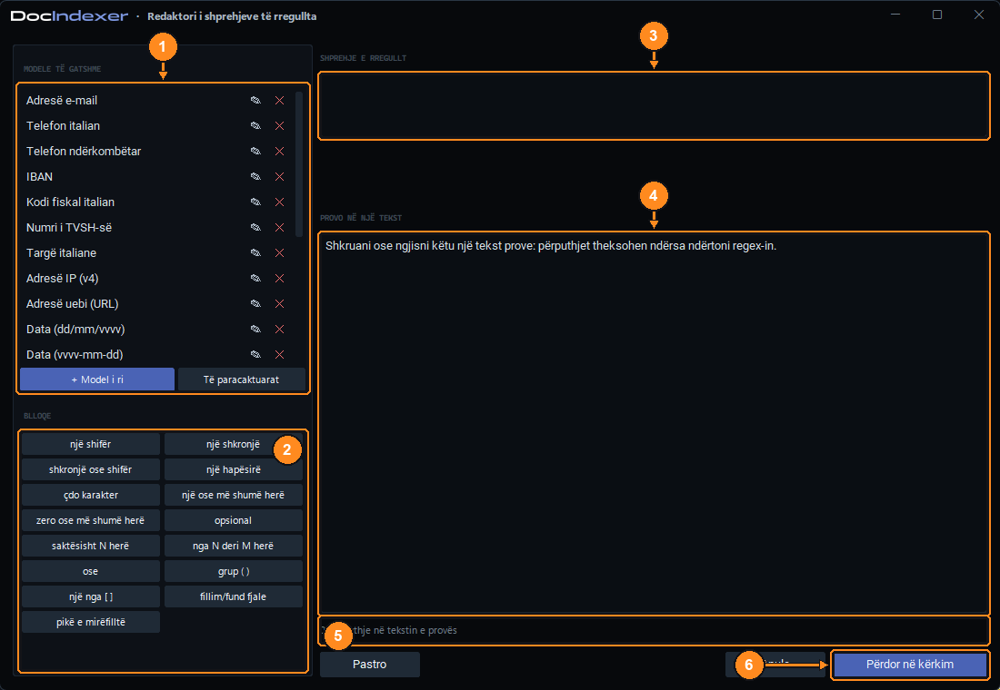

| # | Elementi | Çfarë bën |
|:--:|---|---|
| **①** | **Modele të gatshme** | Modele të gatshme: një klik e përdor; **+ Model i ri** shton një. |
| **②** | **Blloqe** | Copa për t'u futur pa e ditur sintaksën. |
| **③** | **Shprehje e rregullt** | Regex-i që po ndërton. |
| **④** | **Provo në një tekst** | Tekst prove: përputhjet theksohen menjëherë. |
| **⑤** | **Numri** | Sa përputhje ka në tekstin e provës. |
| **⑥** | **Përdor në kërkim** | E çon regex-in në faqen Kërkimi. |

- **Modele të gatshme**: modele të shkruara tashmë, ndër to adresë e-maili, numra telefoni, IBAN, kod fiskal dhe numër TVSH-je italian, targë, adresë IP, URL, data, orë, shuma, koordinata GPS, hashtag dhe emra përdoruesish. Një klikim e vendos në fushë; mund të shtoni tuajat me **Model i ri** dhe të ktheheni te lista origjinale me **Të paracaktuarat**.
- **Blloqe**: copa për t'u kombinuar pa e mbajtur mend sintaksën (një shifër, një shkronjë, një ose më shumë herë, fakultative, "ose", grupe, fillim/fund fjale...).
- **Shprehje e rregullt**: fusha me modelin; poshtë saj, shpjegimi me fjalë i asaj që kërkon.
- **Provo në një tekst**: shkruani ose ngjitni një tekst prove dhe përputhjet theksohen ndërsa shkruani. **Pastro** e fshin tekstin.

**Përdor në kërkim** e çon modelin te faqja Kërkimi, me opsionin Regex aktiv, dhe nis kërkimin.

## 8. Kërkime të ruajtura dhe eksportimi

**Ruaj kërkimin...** (nën kutinë e Kërkimit) e ruan kërkimin aktual me një emër, së bashku me opsionet dhe filtrat. Nëse shënoni **Më njofto kur skedarë të rinj përputhen me këtë kërkim**, DocIndexer e përsërit vetë kur indekson skedarë të rinj dhe shfaq një njoftim të Windows pranë orës.

| # | Elementi | Çfarë bën |
|:--:|---|---|
| **①** | **Njoftim** | Përsërit kërkimin te skedarët e rinj dhe njofton pranë orës. |
| **②** | **Hap** | E vendos kërkimin te faqja Kërkimi dhe e ekzekuton. |
| **③** | **✕** | Fshin kërkimin e ruajtur. |
| **④** | **Kontrollo tani** | Përsërit menjëherë kërkimet me njoftim. |

**Kërkime të ruajtura** hap listën: për secilin shihni njoftimin (aktiv ose jo), sa skedarë të rinj ka gjetur dhe kur është kontrolluar. **Hap** e rikthen te faqja Kërkimi dhe e ekzekuton, **Vetëm të rinjtë** tregon vetëm skedarët që kanë ardhur që nga hera e fundit, **Kontrollo tani** e përsërit menjëherë; mund edhe të fshihet. Kur ka skedarë të rinj, butoni Kërkime të ruajtura tregon sa janë.

**Eksporto rezultatet...** i ruan rezultatet në **Excel** (.xlsx, rreshta të ngjyrosur sipas rëndësisë), **CSV** (ndarës `;`, hapet në Excel) ose **PDF**, me rëndësinë dhe shënimet. I njëjti buton **Eksporto...** ndodhet te Dokumentet, Të rëndësishme dhe Dublikatat.

## 9. Rëndësia dhe shënimet

Në paraparje, nën emrin e skedarit, çdo dokument mund të ketë një **ngjyrë rëndësie** (e kaltër, e gjelbër, e verdhë, portokalli, e kuqe, nga më pak te më e rëndësishmja; **Asnjë** e heq) dhe një **shënim** të shkruar nga ju (**Ruaj shënimin**, **Fshi shënimin**).

Ngjyra dhe shënimi i përkasin **përmbajtjes** së skedarit (gjurmës së tij SHA-256), jo shtegut. Nëse e zhvendosni ose e riemërtoni skedarin, edhe me DocIndexer të mbyllur ose në një disk tjetër, i gjeni përsëri sapo skedari kontrollohet përsëri. Kopjet identike të të njëjtit skedar kanë të njëjtën ngjyrë dhe të njëjtin shënim: nëse i ndryshoni në një kopje, ndryshojnë në të gjitha. Nëse e modifikoni skedarin, ngjyra dhe shënimi mbeten.

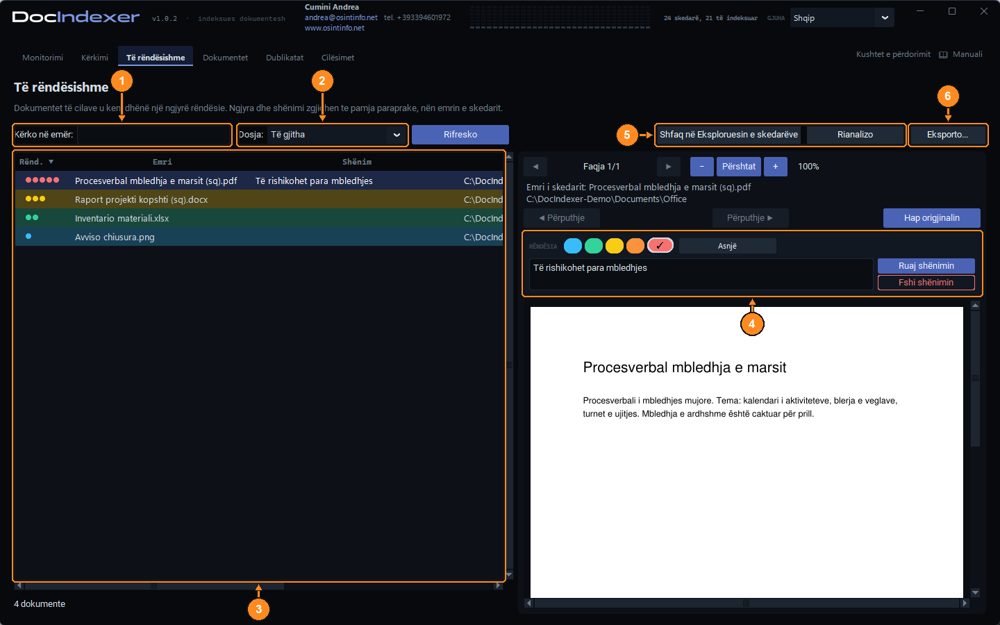

| # | Elementi | Çfarë bën |
|:--:|---|---|
| **①** | **Kërko në emër** | Filtron listën ndërsa shkruan. |
| **②** | **Dosja** | Shfaq vetëm një dosje të monitoruar. |
| **③** | **Lista** | Dokumentet me ngjyrë, më të rëndësishmit lart, me shënimin. |
| **④** | **Rëndësia** | Pesë ngjyra dhe një shënim; **Ruaj shënimin** e regjistron. |
| **⑤** | **Shfaq dhe rianalizo** | Hap dosjen e skedarit ose e rivendos në radhë. |
| **⑥** | **Eksporto** | Ruan listën në CSV, Excel ose HTML. |

Skeda **Të rëndësishme** tregon vetëm dokumentet me ngjyrë, më të rëndësishmet lart, me shënimin. Në të gjitha listat ngjyra shfaqet si pika në fillim të rreshtit dhe rreshti është lehtë i ngjyrosur. Te Kërkimi, opsioni **Vetëm dokumentet e rëndësishme** e kufizon kërkimin te këta skedarë.

## 10. Dokumentet dhe Skedarët e mëdhenj

Skeda **Dokumentet** tregon të gjithë skedarët e indeksuar.

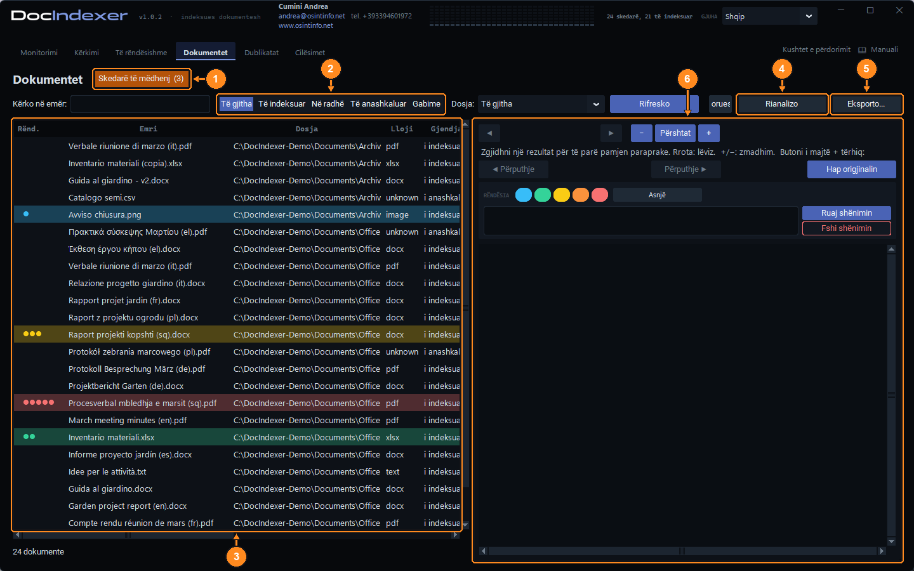

| # | Elementi | Çfarë bën |
|:--:|---|---|
| **①** | **Skedarë të mëdhenj** | Skedarët mbi kufirin e madhësisë, në pritje të një zgjedhjeje. |
| **②** | **Gjendja** | Të gjithë, të indeksuar, në radhë, të anashkaluar ose me gabime. |
| **③** | **Lista** | Të gjithë skedarët e gjetur, me dosjen, llojin dhe gjendjen. |
| **④** | **Rianalizo** | E rivendos në radhë skedarin e zgjedhur. |
| **⑤** | **Eksporto** | Ruan listën në CSV, Excel ose HTML. |
| **⑥** | **Pamja paraprake** | Dokumenti i zgjedhur, me rëndësinë dhe shënimin. |

- **Kërko në emër**: filtron listën ndërsa shkruani.
- **Të gjitha / Të indeksuar / Në radhë / Të anashkaluar / Gabime**: filtron sipas gjendjes. **Dosja** filtron sipas dosjes së monitoruar. **Rifresko** e ringarkon listën.
- Kolonat tregojnë rëndësinë, emrin, dosjen, llojin, gjendjen, gjuhën, faqet, faqet e lexuara me OCR, karakteret, datat e krijimit dhe të ndryshimit dhe gjurmën SHA-256. Një klikim mbi kokën e kolonës rendit; duke kaluar mbi një qelizë të shkurtuar shfaqet teksti i plotë.
- Mund të zgjidhni disa rreshta (Ctrl ose Shift + klikim, Ctrl+A). **Shfaq në Eksploruesin e skedarëve** hap dosjen e skedarit, **Rianalizo** rilexon skedarët e zgjedhur, **Eksporto...** ruan listën. Një klikim i dyfishtë e hap skedarin.
- Një klikim në qelizën **Dosja** hap dosjen në File Explorer me skedarin të zgjedhur (edhe në skedën **Të rëndësishme**).

**Skedarë të mëdhenj.** Skedarët më të mëdhenj se kufiri i caktuar (200 MB si parazgjedhje) nuk analizohen vetë: butoni **Skedarë të mëdhenj** bëhet portokalli dhe tregon sa janë në pritje.

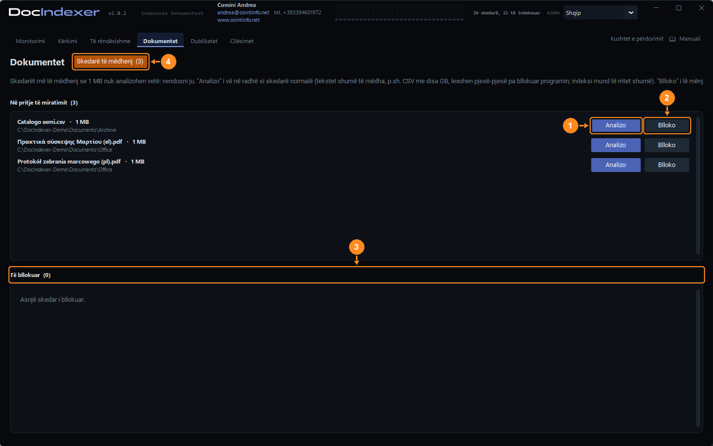

| # | Elementi | Çfarë bën |
|:--:|---|---|
| **①** | **Analizo** | E vendos skedarin në radhë si të tjerët. |
| **②** | **Blloko** | E lë mënjanë pa e analizuar. |
| **③** | **Të bllokuar** | Skedarët e bllokuar; **Zhblloko** i rikthen në pritje. |
| **④** | **Skedarë të mëdhenj** | Kthehet te lista e dokumenteve. |

Për çdo skedar në pritje zgjidhni **Analizo** (futet në radhë si një skedar i zakonshëm; tekstet shumë të mëdha lexohen pjesë-pjesë pa bllokuar programin, por indeksi mund të rritet shumë) ose **Blloko** (lihet mënjanë). Në listën **Të bllokuar**, **Zhblloko** e kthen në pritje. **← Dokumentet** kthehet te lista.

## 11. Dublikatat

Skeda **Dublikatat** gjen dy lloje kopjesh. Shtypni **Gjej dublikatat**.

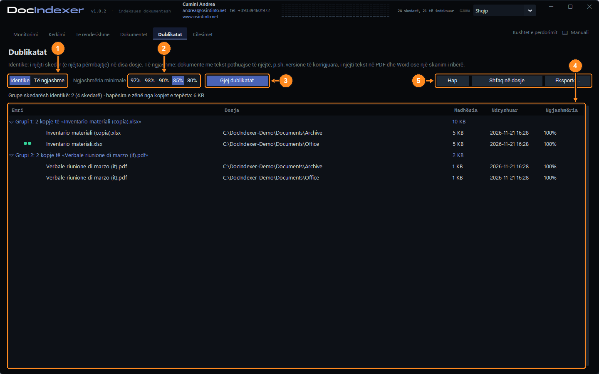

| # | Elementi | Çfarë bën |
|:--:|---|---|
| **①** | **Identikë / Të ngjashëm** | I njëjti skedar ose tekst pothuajse i njëjtë. |
| **②** | **Ngjashmëria minimale** | Sa duhet të ngjajnë dokumentet e ngjashëm. |
| **③** | **Gjej dublikatat** | Nis kërkimin. |
| **④** | **Grupet** | Një grup për çdo bashkësi kopjesh, me hapësirën që zënë. |
| **⑤** | **Hap, shfaq, eksporto** | Për skedarin e zgjedhur ose për gjithë listën. |

- **Identike**: i njëjti skedar (e njëjta përmbajtje) në disa dosje. Çdo grup tregon sa kopje ka dhe hapësirën që zënë; lart është hapësira totale që zënë kopjet e tepërta.

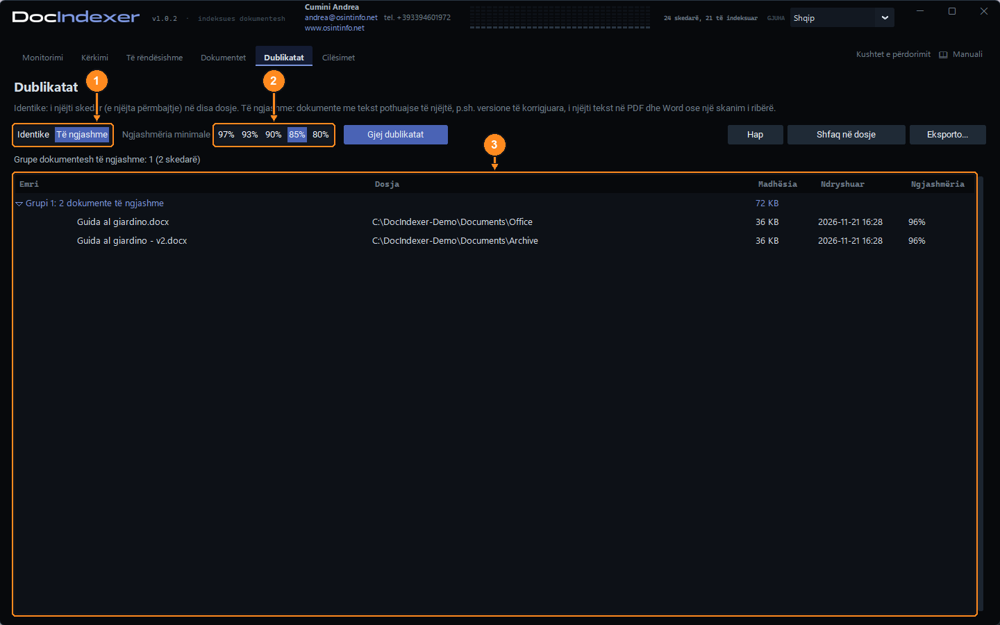

| # | Elementi | Çfarë bën |
|:--:|---|---|
| **①** | **Të ngjashëm** | Dokumente me tekst pothuajse të njëjtë. |
| **②** | **Ngjashmëria minimale** | Nga 97% në 80%: më i ulët gjen më shumë çifte. |
| **③** | **Grupet** | Kolona Ngjashmëria tregon vlerën e çdo skedari. |

- **Të ngjashme**: dokumente me tekst pothuajse të njëjtë, për shembull versione të korrigjuara të të njëjtit dokument, i njëjti tekst në PDF dhe në Word ose një skanim i ribërë. **Ngjashmëria minimale** zgjedh sa duhet t'i ngjajnë njëri-tjetrit (nga 97% në 80%); kolona Ngjashmëria tregon vlerën e çdo skedari.

**Hap**, **Shfaq në dosje** dhe **Eksporto...** veprojnë mbi skedarin e zgjedhur ose mbi listën.

## 12. Kërkimi i shpejtë

Kërkimi i shpejtë është një shirit kërkimi që hapet mbi çdo program, me shkurtoren **Ctrl+Alt+D** (ndryshohet te Cilësimet) ose nga menuja e ikonës pranë orës.

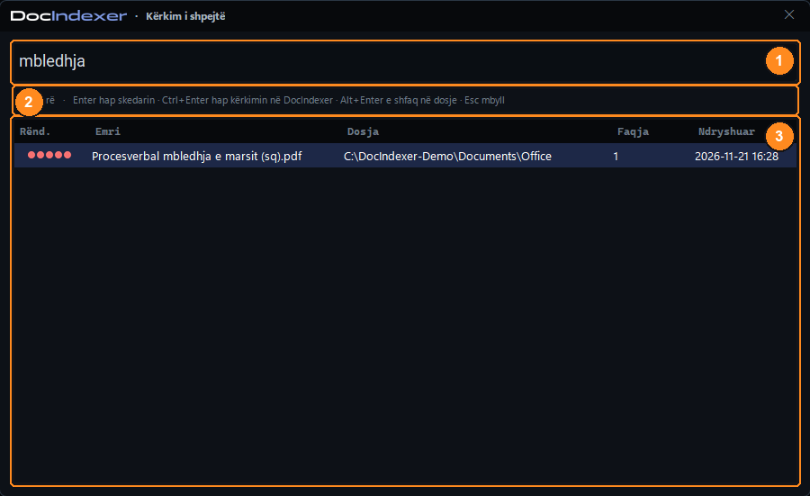

| # | Elementi | Çfarë bën |
|:--:|---|---|
| **①** | **Fusha e kërkimit** | Kërkon ndërsa shkruan. |
| **②** | **Tastet** | Enter, Ctrl+Enter, Alt+Enter, Esc. |
| **③** | **Rezultatet** | Me shigjetat zgjedh skedarin. |

Kërkon ndërsa shkruani. Zgjidhni një rezultat me shigjetat; **Enter** hap skedarin, **Ctrl+Enter** hap kërkimin e plotë në DocIndexer, **Alt+Enter** e shfaq skedarin në dosjen e tij, **Esc** mbyll shiritin.

## 13. Cilësimet

Ndryshimet vlejnë vetëm pas **Ruaj**. **Anulo ndryshimet** kthehet te cilësimet e ruajtura; **Rikthe cilësimet e paracaktuara** rikthen vlerat fillestare. Nëse ndërroni skedë me ndryshime të paruajtura, DocIndexer pyet nëse do t'i ruani.

**Dosjet dhe prapashtesat** ka të njëjtat tabela si konfigurimi i udhëhequr: dosjet e monitoruara, nëndosjet e përjashtuara, prapashtesat e përfshira dhe të përjashtuara, dosjet e anashkaluara sipas emrit.

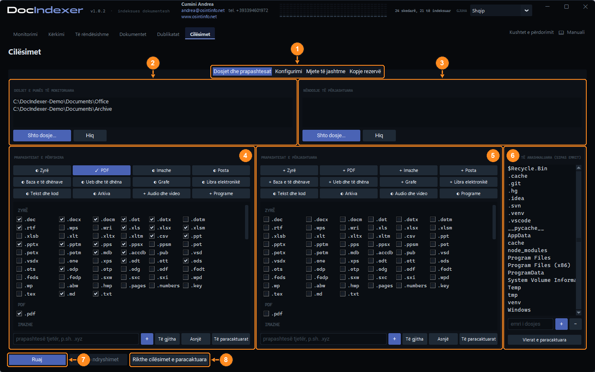

| # | Elementi | Çfarë bën |
|:--:|---|---|
| **①** | **Skedat e cilësimeve** | Dosjet, konfigurimi, mjetet e jashtme, kopja rezervë. |
| **②** | **Dosjet e punës të monitoruara** | Dosjet që indeksohen. |
| **③** | **Nëndosje të përjashtuara** | Pjesë të dosjeve që anashkalohen. |
| **④** | **Prapashtesat e përfshira** | Llojet e skedarëve që lexohen. |
| **⑤** | **Prapashtesat e përjashtuara** | Llojet e skedarëve që shpërfillen. |
| **⑥** | **Dosje të anashkaluara (sipas emrit)** | Dosje që anashkalohen kudo që të jenë. |
| **⑦** | **Ruaj** | Zbaton ndryshimet. |
| **⑧** | **Rikthe cilësimet e paracaktuara** | Kthehet te vlerat fillestare. |

**Konfigurimi**:

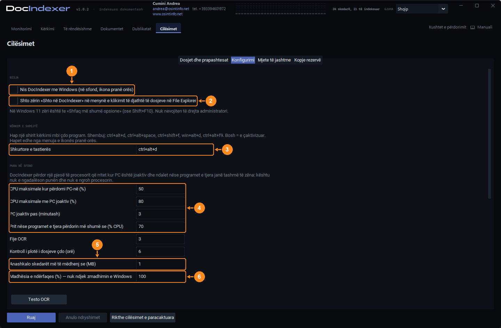

| # | Elementi | Çfarë bën |
|:--:|---|---|
| **①** | **Nis me Windows** | Vlen menjëherë, pa shtypur Ruaj. |
| **②** | **Shto në DocIndexer** | Zë i klikimit të djathtë të dosjeve në File Explorer; vlen menjëherë. |
| **③** | **Shkurtore e tastierës** | Tastet e kërkimit të shpejtë (bosh = çaktivizuar). |
| **④** | **Puna në sfond** | CPU me kompjuterin në përdorim dhe joaktiv, pritja, programet e zëna. |
| **⑤** | **Anashkalo skedarët më të mëdhenj se (MB)** | Mbi këtë kufi skedarët shkojnë te **Skedarë të mëdhenj**. |
| **⑥** | **Madhësia e ndërfaqes (%) — 100 = si zmadhimi i Windows** | 100 = si aplikacionet e tjera të Windows; më shumë zmadhon, më pak zvogëlon. |

- **Nisja**: nisja me Windows (vlen menjëherë).
- **Shto në DocIndexer**: shton zërin në menynë e klikimit të djathtë të dosjeve në File Explorer; vlen menjëherë, pa Ruaj (shih kapitullin 14).
- **Kërkim i shpejtë**: shkurtorja e tastierës, për shembull `ctrl+alt+d`, `ctrl+shift+f` ose `win+alt+d`; bosh = e çaktivizuar. Nëse shkurtoren e përdor tashmë një program tjetër, shfaqet një paralajmërim.
- **Puna në sfond**: CPU maksimale ndërsa përdorni PC-në dhe kur është në pushim, pas sa minutash PC-ja konsiderohet në pushim, mbi cilën ngarkesë të programeve të tjera DocIndexer pret, fijet OCR, çdo sa orë rikontrollohen të gjitha dosjet, madhësia maksimale e skedarëve (më të mëdhenjtë shkojnë te **Skedarë të mëdhenj**), madhësia e ndërfaqes (në %, 100 = si zmadhimi i Windows, pra e njëjta madhësi si aplikacionet e tjera; vlen nga nisja e ardhshme). Vlerat e para ndryshojnë edhe me rrëshqitësin e Monitorimit.
- **Module shtesë**: metadata me ExifTool, teksti i skedarëve brenda arkivave (7-Zip), baza të dhënash SQLite, dBASE/FoxPro dhe Access. Çdo modul i ruan të dhënat veçmas; te Kërkimi zgjidhni ku të kërkohet.
- **OCR (RapidOCR)**: modeli. **Automatik** lexon faqen e parë të skanuar me modelin latin dhe, nëse rezultati është i pasigurt, provon modelet e tjera të shkarkuara dhe mban atë që lexon më mirë. Një **rezolucion OCR (DPI)** më i lartë lexon më mirë karakteret e vogla, por është më i ngadaltë. **Testo OCR** bën një provë.
- **Baza të dhënash SQLite**: skedari i bazës së të dhënave.

**Mjete të jashtme** tregon gjendjen e modeleve OCR dhe të mjeteve fakultative (ExifTool, 7-Zip, drejtuesi i Access). **Instalo** ose **Riinstalo** shkarkon një mjet në dosjen `tools`, **Instalo gjithçka që mungon** i shkarkon të gjitha, **Kontrollo sërish** përditëson gjendjen. Punojnë pa u instaluar në sistem.

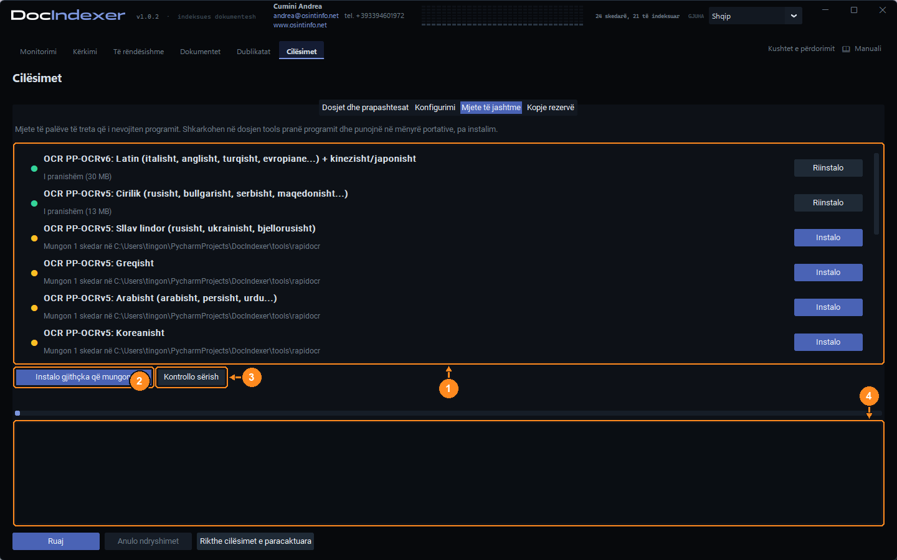

| # | Elementi | Çfarë bën |
|:--:|---|---|
| **①** | **Mjetet** | Çdo mjet me gjendjen e vet dhe butonin për ta instaluar. |
| **②** | **Instalo gjithçka që mungon** | Shkarkon njëherësh mjetet që mungojnë. |
| **③** | **Kontrollo sërish** | Rilexon gjendjen e mjeteve. |
| **④** | **Regjistri** | Përparimi dhe mesazhet e shkarkimeve. |

**Kopje rezervë**: **Krijo kopje rezervë...** ruan në një skedar .zip bazën e të dhënave (indeksi, shënimet, ngjyrat e rëndësisë), cilësimet, modelet regex dhe kërkimet e ruajtura, edhe ndërsa indeksimi punon. **Rikthe nga kopja rezervë...** i zëvendëson dhe rinis DocIndexer; baza e mëparshme mbetet pranë me prapashtesën `.before-restore`.

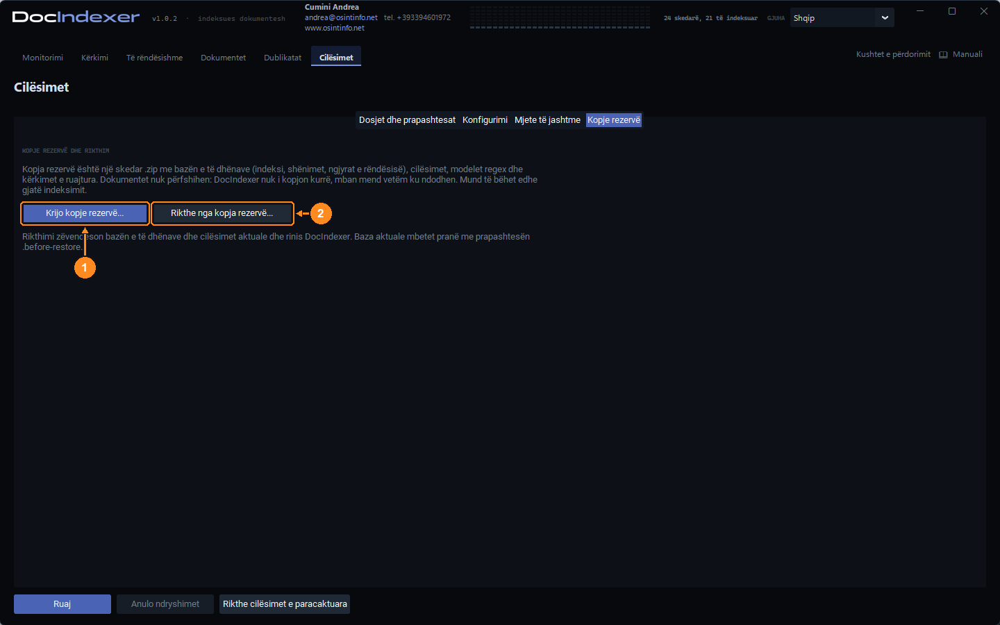

| # | Elementi | Çfarë bën |
|:--:|---|---|
| **①** | **Krijo kopje rezervë** | Ruan bazën, cilësimet, modelet dhe kërkimet në një .zip. |
| **②** | **Rikthe nga kopja rezervë** | Zëvendëson të dhënat aktuale me ato të kopjes dhe rinis. |

## 14. Ikona pranë orës dhe nisja me Windows

Kur dritarja është e mbyllur, DocIndexer vazhdon të punojë dhe mbetet si ikonë pranë orës. Duke kaluar mbi të shihet gjendja; klikimi i djathtë hap menunë:

- **Hap DocIndexer** (edhe me një klikim mbi ikonë);
- **Ndalo përkohësisht indeksimin** / **Vazhdo indeksimin**;
- **Kontrollo dosjet tani**;
- **Kërkim i shpejtë**;
- **Manuali**;
- **Nis me Windows** (i shënuar kur është aktiv);
- **Dil**, që e mbyll vërtet programin.

Nëse e hapni DocIndexer për herë të dytë nuk niset një kopje e re: shfaqet dritarja e atij që po punon tashmë. Nisja me Windows vlen vetëm për përdoruesin tuaj dhe nuk kërkon të drejta administratori.

### Shtimi i një dosjeje me klikim të djathtë

Me opsionin **Shto në DocIndexer** aktiv (Cilësimet › Konfigurimi › Nisja), klikimi i djathtë mbi një dosje në File Explorer shfaq **Shto në DocIndexer**: dosja shtohet te dosjet e monitoruara dhe indeksimi nis menjëherë, edhe nëse DocIndexer ishte i hapur. Në Windows 11 zëri është te «Shfaq më shumë opsione» (ose Shift+F10). Nëse dosja monitorohet tashmë, ose ndodhet brenda një dosjeje të monitoruar, DocIndexer e njofton dhe nuk ndryshon asgjë; nëse përmban dosje që monitorohen tashmë, zë vendin e tyre. Nuk nevojiten të drejta administratori.

**Në disa PC.** Zëri i klikimit të djathtë dhe nisja me Windows ruhen në Windows-in e PC-së që përdorni, për përdoruesin tuaj. Nëse e përdorni DocIndexer nga një disk i jashtëm, aktivizojini përsëri në çdo PC te **Cilësimet › Konfigurimi › Nisja**. Nëse në të njëjtin PC programi ndryshon dosje ose shkronjë disku, zëri i klikimit të djathtë përditësohet vetë në nisjen e ardhshme.

## 15. Probleme të shpeshta

- **Një dokument nuk gjendet.** Kontrolloni në Monitorim që indeksimi të ketë mbaruar; te Dokumentet kërkoni skedarin sipas emrit dhe shihni gjendjen e tij (*Në radhë*, *Të anashkaluar*, *Gabime*). Sigurohuni që dosja të jetë e monitoruar dhe që prapashtesa të jetë ndër të përfshirat.
- **Shumë skedarë me gabime.** Një skedar mund të jetë i mbrojtur me fjalëkalim, i dëmtuar ose i hapur në një program tjetër. **Rifut gabimet në radhë** në Monitorim i riprovon.
- **Një skanim nuk lexohet.** Kontrolloni te Cilësimet › Mjete të jashtme që të jetë instaluar modeli OCR i alfabetit të duhur; me modelin **Automatik** zgjidhet vetë ndër ata të shkarkuar.
- **PC-ja bën zhurmë ose nxehet.** Lëvizni rrëshqitësin e burimeve majtas ose shtypni **Ul në minimum**; ulni kufijtë e temperaturës.
- **Indeksimi është i ngadaltë.** Lëvizni rrëshqitësin djathtas; kur PC-ja është në pushim, DocIndexer përshpejtohet vetë.
- **Një skedar shumë i madh nuk shfaqet.** Ndodhet te **Dokumentet › Skedarë të mëdhenj**, në pritje të miratimit tuaj.
- **Shkurtorja e kërkimit të shpejtë nuk punon.** E përdor një program tjetër: zgjidhni një tjetër te Cilësimet › Konfigurimi.
- **Zhvendosja e DocIndexer në një PC tjetër.** Kopjoni gjithë dosjen e programit, ose krijoni një kopje rezervë dhe riktheni atë në PC-në e re. Pastaj, nëse ju duhen, aktivizoni përsëri **Nis me Windows** dhe **Shto në DocIndexer**.
- **Disku i jashtëm ka një shkronjë tjetër.** Nuk keni pse të bëni asgjë: në nisje DocIndexer i përditëson vetë shtigjet (shihni [kapitullin 1](#1-para-se-të-filloni)).
- **Teksti është shumë i vogël ose shumë i madh.** Ndryshoni **Madhësia e ndërfaqes (%)** te Cilësimet › Konfigurimi: 100 është madhësia e aplikacioneve të tjera të Windows. Vlen nga nisja e ardhshme.
